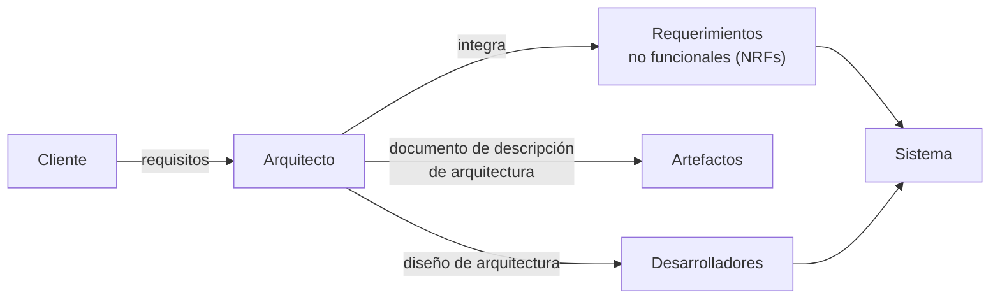

# Arquitecto de software

En corto: **el arquitecto es el puente entre el cliente y los desarrolladores.** Obtiene los
requisitos del cliente, produce un diseño de arquitectura y les da soluciones a los
desarrolladores.

La presentación contrasta dos definiciones de rol.

## Según Rational Unified Process (RUP)

El arquitecto es un **rol** en un proyecto de desarrollo de software, responsable de:

- Liderar el proceso de arquitectura.
- Producir los artefactos necesarios: el **documento de descripción de arquitectura**.
- Producir modelos y prototipos de arquitectura.

Ojo con esto: en RUP arquitecto es un **rol**, no un puesto. La misma persona puede jugar
varios roles. Es la misma idea que en [[Actor del negocio]] — rol ≠ persona.

## Según SUN SL-425

El arquitecto:

- **Visualiza** el comportamiento del sistema.
- **Crea los planos** del sistema.
- **Define la forma** en la cual los elementos del sistema trabajan en conjunto.
- Es **responsable de integrar los requerimientos no-funcionales (NRFs)** en el sistema.

El cuarto punto es el que más se olvida y el que más se pregunta: los **requisitos no
funcionales** (rendimiento, seguridad, disponibilidad, modificabilidad) son responsabilidad
del arquitecto, no del programador.

![[adjuntos/arquitectura-de-software/arq-p07.png]]
![[adjuntos/arquitectura-de-software/arq-p06.png]]

## Qué se espera de un buen arquitecto

> Un buen arquitecto debe estar en capacidad de entender todas las **condiciones** a las que
> se verá sometido un sistema y proponer una **solución** acorde a cada **escenario** en
> particular.

Es decir: no existe "la" arquitectura correcta en abstracto. La solución depende del
escenario, y por eso el arquitecto vive equilibrando fuerzas que se contradicen
(→ [[Equilibrio de restricciones del proyecto]]).

![[adjuntos/arquitectura-de-software/arq-p09.png]]

## Quién lo hace

Ingenieros de software / especialistas. La presentación separa dos figuras:

- El **diseñador de una base de datos** crea la *arquitectura de los datos* para un sistema.
- El **arquitecto del sistema** selecciona un *estilo arquitectónico* apropiado a partir de
  los requerimientos obtenidos durante el análisis de los datos.

Esto encaja con el primer paso del [[Proceso de diseño arquitectónico]]: el diseño de la
arquitectura comienza con el diseño de los datos.

## ¿Quién diseña y gestiona la arquitectura? — el perfil

La unidad 2 vuelve sobre el rol con una lista de **nueve rasgos**. Textual:

> El arquitecto software...
> - Es un líder técnico.
> - Puede ser un equipo. Posibles roles: arquitecto jefe (necesario), arquitecto de aplicaciones,
>   arquitecto de infraestructuras, arquitecto de datos, etc.
> - Tiene conocimientos tecnológicos y habilidades de programación.
> - Tiene habilidades para el diseño.
> - Conoce el dominio del negocio.
> - Es consciente de las políticas organizacionales.
> - Es un buen comunicador.
> - Toma decisiones.
> - Es un negociador.

![[adjuntos/capturas-clase-U2/diseno-arquitectonico/quien-disena-y-gestiona-la-arquitectura.png]]

Para estudiarlo, los nueve se agrupan en tres canastas *(agrupación propia)*:

| Canasta | Rasgos de la diapositiva | Por qué los necesita |
|---|---|---|
| **Técnica** | conocimientos tecnológicos y de programación · habilidades para el diseño | sin esto propone cosas que no se pueden construir |
| **De contexto** | conoce el dominio del negocio · consciente de las políticas organizacionales | es la entrada **Contexto** del embudo (→ [[Qué se tiene en cuenta para el diseño]]) |
| **Humana** | líder técnico · buen comunicador · toma decisiones · negociador | los stakeholders piden cosas que chocan: alguien tiene que decidir y convencer (→ [[Equilibrio de restricciones del proyecto]]) |

> [!important] "Puede ser un equipo", pero con **un jefe necesario**
> El único rol que la diapositiva marca como **(necesario)** es el **arquitecto jefe**. Los demás
> —aplicaciones, infraestructuras, datos— son *posibles*. Encaja con lo que ya decía RUP: arquitecto es un
> **rol**, no necesariamente una persona; puede repartirse, pero alguien tiene la última palabra.
>
> El **arquitecto de datos** de esta lista equivale, en la práctica, al *diseñador de la base de datos* de la
> sección "Quién lo hace" *(correspondencia propia)*.

Fijate que **cuatro de los nueve rasgos no son técnicos** (comunicador, decisiones, negociador, políticas).
Es lo mismo que decía SUN SL-425 al pedirle que *integre los requerimientos no funcionales*: el trabajo es
de equilibrio, no de programación.

## La experiencia del arquitecto es una entrada del diseño

La clase pone la experiencia como una de las **tres cosas que se tienen en cuenta** para el diseño,
junto con los requisitos y el contexto:

> Los arquitectos desarrollan su modo de pensar a partir de experiencias anteriores.
> - Experiencias anteriores buenas darán lugar a replicar esos diseños.
> - Las experiencias anteriores malas se evitarán en el nuevo diseño.

![[adjuntos/capturas-clase-U2/diseno-arquitectonico/que-se-tiene-en-cuenta-experiencia-arquitecto.png]]

El detalle está en [[Qué se tiene en cuenta para el diseño]] y en el
[[Ciclo de influencias en la arquitectura]], donde la experiencia es una de las cuatro influencias.

## Notas relacionadas

- [[Arquitectura de software]]
- [[Ciclo de influencias en la arquitectura]]
- [[Proceso de diseño arquitectónico]]
- [[Equilibrio de restricciones del proyecto]]
- [[Qué se tiene en cuenta para el diseño]]

## Preguntas de repaso

1. ¿Qué artefacto principal produce el arquitecto según RUP?
2. Según SUN SL-425, ¿de qué tipo de requerimientos es responsable el arquitecto?
3. ¿Por qué se dice que "arquitecto" es un rol y no un puesto?
4. ¿Qué diferencia hay entre el diseñador de base de datos y el arquitecto del sistema?
5. ¿Qué rol del equipo de arquitectura marca la clase como "necesario"? Nombrá otros tres posibles.
6. De los nueve rasgos del arquitecto, ¿cuáles no son técnicos y por qué los necesita?
