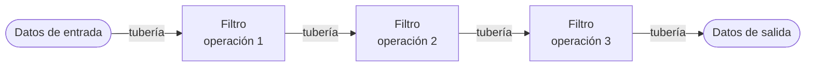
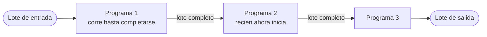

# Arquitectura centrada en el flujo de datos

Una de las **familias** del catálogo de estilos de clase (ver [[Catálogo de estilos arquitectónicos]]).
Hasta esta tanda estaba **solo nombrada**; con las capturas 13-28 pasa a tener **diapositivas de
desarrollo** propias. Esta nota cubre la **familia** y su miembro **secuencial por lotes**; el otro
miembro, el que la clase desarrolló a fondo, tiene su nota: [[Tuberías y filtros]].

> [!important] Esta nota es NÚCLEO
> Sale de diapositivas con el subtítulo en rojo **"–arquitectura centrada en el flujo de datos–"**
> (14, 15) y **"–estilo Secuencial por Lotes–"** (28), más el árbol C & C con *Data flow* resaltado
> (13) y dos láminas de analogía sin texto (16, 17).

---

## 1. Dónde está en el catálogo: *Data flow* resaltado (captura 13)

La clase **volvió a dar** el árbol de componentes y conectores (C & C) que ya estaba en
[[Catálogo de estilos arquitectónicos]] §2, pero **con tres agregados**, y por eso se guarda aparte:

| Agregado | Qué es |
|---|---|
| Recuadro **punteado naranja** | rodea la caja **Data flow** |
| **Flecha negra** gruesa, a mano | sale de *Data flow* y baja a la derecha, hacia la frase |
| **Frase en azul** | *"La computación/ procesamiento es dirigido por el flujo de datos en el sistema"* |

Textual:

> La computación/procesamiento es dirigido por el flujo de datos en el sistema

![[adjuntos/capturas-clase-U2/flujo-datos/catalogo-cc-data-flow-resaltado-computacion-dirigida-por-flujo.png]]

En el árbol, **Data flow** tiene dos hijos —**Batch sequential** y **Pipes and filters**— y *Pipes
and filters* tiene a su vez **Pipeline** y **UNIX pipe-and-filter**. El catálogo textual de la clase
dice lo mismo en español: *"Arquitectura de flujo de datos (Tuberías y filtros, proceso secuencial en
lotes)"*. **Las dos taxonomías de clase coinciden en esta familia** (no como en P2P o eventos).

> [!note] Título de la 13
> Esta vez la diapositiva dice solo **"Estilos Arquitectónicos"**, sin el subtítulo
> *"–Catálogo de Estilos–"* que tenía en capturas_U2_F2. Abre la serie del flujo de datos.

---

## 2. Qué es (captura 14)

La definición, textual:

> Se enfoca en la transformación de datos a través de una serie de componentes o filtros conectados
> por tuberías, donde cada filtro realiza una operación específica y los datos fluyen de forma
> independiente entre ellos

Y a la derecha, dos viñetas:

> - Los componentes se denominan FILTROS que son conectados por medio de TUBERÍAS las cuales
>   transmiten los datos.
> - Se aplica cuando los datos de entrada se habrán transformado en datos de salida mediante una
>   serie de componentes para el cálculo o la manipulación.

![[adjuntos/capturas-clase-U2/flujo-datos/flujo-datos-definicion-filtros-tuberias.png]]

*(La etiqueta "View Fullscreen" que tapa parte de "una serie de" es del visor de la clase, no de la
diapositiva.)*

| Pieza | Nombre en clase | Qué hace |
|---|---|---|
| **Componente** | **filtro** | realiza **una operación específica** sobre los datos |
| **Conector** | **tubería** | **transmite** los datos de un filtro al siguiente |
| **Lo que manda** | el **flujo de datos** | *"la computación/procesamiento es dirigido por el flujo de datos"* (13) |

El patrón conceptual (esquema propio, no es un diagrama de la clase):

### El diagrama de la 14, leído con zoom

Tres franjas horizontales rotuladas **Application Layer**, **Support Layer** y **Core Layer**, y una
nota al pie: *"Note: Data storage components have been added in the support layer."* Entre las dos
primeras franjas, el rótulo **Data Flows**; bajo la segunda fila, **Data Stores**.

| Franja | Elementos |
|---|---|
| **Application Layer** | Tracking · Data Fusion · Threat Evaluation · Engagement Planning |
| **Support Layer** (almacenes de datos) | Plot Data · Local Tracks Data · External Tracks Data · Systems Tracks Data · Threat Data · Engagement Data |
| **Core Layer** | Time · TSync · Comm · BIT |

Las flechas (todas gruesas, de un solo sentido):

| # | Desde | Hacia |
|---|---|---|
| 1 | Plot Data | Tracking |
| 2 | Tracking | Local Tracks Data |
| 3 | Local Tracks Data | Data Fusion |
| 4 | External Tracks Data | Data Fusion |
| 5 | Data Fusion | Systems Tracks Data |
| 6 | Systems Tracks Data | Threat Evaluation |
| 7 | Threat Evaluation | Threat Data |
| 8 | Threat Data | Engagement Planning |
| 9 | Engagement Planning | Engagement Data |

La **Core Layer no tiene flechas**: no participa del flujo.

**Cómo se lee:** los **procesos** de la capa de aplicación son los filtros; cada uno lee un almacén,
transforma y escribe en el siguiente. El dato avanza en **zigzag** de izquierda a derecha, siempre en
un solo sentido: parcelas → pistas locales (+ externas) → pistas del sistema → amenazas →
enfrentamiento.

> [!note] Lectura propia (COMPLEMENTO, no de la clase)
> - Por los nombres (*tracking*, *threat evaluation*, *engagement planning*, BIT = *built-in test*)
>   es la arquitectura de un **sistema de combate / defensa**: seguir blancos, evaluar amenazas y
>   planificar la respuesta. La diapositiva no lo dice.
> - La figura muestra que **los estilos se componen**: el **flujo de datos** corre **dentro de una
>   estructura en capas** ([[Arquitectura en capas]]). Las capas ordenan *qué depende de qué*; el
>   flujo ordena *por dónde pasa el dato*. No se contradicen.

---

## 3. Para qué sirve y cuándo (captura 15)

Textual:

> Enfatiza la reutilización y la modificabilidad
> - Adecuada para sistemas con trasformaciones de datos en pasos sucesivos (cuando los datos de
>   entrada se transforman en datos de salida mediante una serie de componentes para el cálculo o la
>   manipulación. )
> - Ejemplos: arquitecturas de tuberías y filtros y las de proceso secuencial en lotes

![[adjuntos/capturas-clase-U2/flujo-datos/flujo-datos-reutilizacion-modificabilidad-ejemplos.png]]

| Pregunta | Respuesta de la clase |
|---|---|
| ¿Qué atributos de calidad **enfatiza**? | **reutilización** y **modificabilidad** |
| ¿Cuándo es **adecuada**? | sistemas con **transformaciones de datos en pasos sucesivos** |
| ¿Qué **ejemplos** da? | **tuberías y filtros** · **proceso secuencial en lotes** |

La figura de la 15 no tiene texto (salvo "Java"). Leída con zoom:

| Recuadro | Cadena de íconos |
|---|---|
| **Arriba** | base de datos → documento con cajas naranjas → documento con cajas azules/verdes → archivos *Java* |
| **Abajo izquierda** | documento azul/verde → *Java* · y en paralelo: documento azul/verde → documento naranja → base de datos |
| **Abajo derecha** | documento naranja → base de datos · y en paralelo: documento naranja → documento azul/verde → *Java* |

> [!note] Lectura propia de la figura (COMPLEMENTO)
> Parecen **transformaciones de modelos**: base de datos → modelo entidad-relación (naranja) →
> modelo de clases (azul/verde) → código Java. Lo que la figura enseña es la **reutilización**: los
> **mismos pasos** de transformación se **recombinan** en cadenas distintas, en otro orden y con
> bifurcaciones. Es la misma idea que la captura 23 de [[Tuberías y filtros]]
> (*"Components reused in different pipelines"*).

---

## 4. La analogía: la industria textil (capturas 16 y 17)

Dos láminas **sin texto propio** de la catedrática, puestas como analogía del flujo de datos.

**16 — infografía *"TEXTILE INDUSTRY"*.** Máquinas unidas por líneas punteadas. Rótulos, leídos con
zoom: *Knitting Machine* · *Thread Winding Machine* · *Singeing Machine* · *Weaving Machine* · *Air-jet
Loom* · *Winch Dyeing Machine* · *Cutting Room Machine* · *Sewing* · *Quality Checks* · *Delivery*.
(Lleva marca de agua de *dreamstime*: es una ilustración de banco de imágenes.)

![[adjuntos/capturas-clase-U2/flujo-datos/analogia-industria-textil-infografia.png]]

**17 — fotos de planta en secuencia.** Cinco fotos unidas por **flechas azules** en un solo sentido:
rollos de tela cruda en bodega → máquina que baja la tela → máquina de teñido (tela naranja) → sala
con equipos de procesamiento → máquina revisadora/enrolladora de tela.

![[adjuntos/capturas-clase-U2/flujo-datos/analogia-industria-textil-maquinas-en-secuencia.png]]

> [!tip] Cómo se usa la analogía (lectura propia)
> | Fábrica textil | Flujo de datos |
> |---|---|
> | la tela | los **datos** |
> | cada máquina (tejer, teñir, cortar, coser) | un **filtro**: una **operación específica** |
> | la cinta o el carro que lleva la tela | la **tubería** |
> | la máquina no sabe qué hizo la anterior, solo recibe tela | el filtro no conoce a sus vecinos |
> | cambiar la tintorería sin tocar el telar | **modificabilidad** |
> | el mismo telar sirve para varias líneas de producto | **reutilización** |
>
> Y la **17** separa los dos miembros de la familia: si cada máquina **procesa el rollo entero** antes
> de pasarlo, es **secuencial por lotes**; si la tela **sale continuamente** de una y entra a la otra,
> es **tuberías y filtros**.

---

## 5. Estilo secuencial por lotes (captura 28)

La definición, textual:

> En el estilo secuencial por lotes (batch sequential) los componentes son programas independientes;
> el supuesto es que cada paso se ejecuta hasta completarse antes que se inicie el paso siguiente.

![[adjuntos/capturas-clase-U2/flujo-datos/secuencial-por-lotes-definicion-batch-application-style.png]]

Las **dos ideas** que hay que poder repetir:

1. **Componentes = programas independientes.**
2. **Cada paso se ejecuta hasta completarse antes de que se inicie el siguiente.**

Patrón conceptual (esquema propio):

### La figura: *"Batch Application Style – Interactions and Services"*

Cuatro columnas separadas por líneas punteadas: **Run Tier**, **Job Tier**, **Application Tier** y
**Data Tier**. Leída con zoom:

| Tier | Elementos |
|---|---|
| **Run Tier** | Scheduler (con *Config.* adentro) · Job Script · Request (http, ws) · JobRunner · JobLocator · Job Configuration (App Context) |
| **Job Tier** | JobLauncher · Job · JobRepository (la barra ancha abajo, que se extiende hasta la columna siguiente) |
| **Application Tier** | Step · ItemReader · ItemWriter · Business Logic · Data Access (con *Config.* adentro) |
| **Data Tier** (recuadro punteado) | Message Queue · Database · Data Files · Print Queue |

Las flechas:

| Desde | Hacia | Rótulo |
|---|---|---|
| Scheduler | Job Script | — |
| Job Script | JobRunner | — |
| Request (http, ws) | JobRunner | — |
| JobRunner | JobLocator | — |
| JobLocator | Job Configuration (App Context) | — |
| JobRunner | JobLauncher | — |
| JobLauncher | Job | — |
| Job | Step | — |
| JobLauncher · Job · Step | JobRepository | — (tres flechas hacia abajo) |
| Step | ItemReader | **Read** |
| Step | ItemWriter | **Write** |
| ItemReader | Business Logic | — |
| ItemWriter | Business Logic | — (hacia arriba) |
| ItemReader | Data Access | — |
| ItemWriter | Data Access | — (hacia arriba) |
| ItemReader | Data Tier (a la altura de Message Queue) | — |
| ItemWriter | Data Tier (a la altura de Print Queue) | — |
| Data Access | Data Tier (a la altura de Database) | — (**doble punta**) |

**Leyenda (*Key*)**, por color:

| Color | Significa | Elementos |
|---|---|---|
| amarillo verdoso | *Custom Application Artifacts* | Job Script, Config., Job Configuration, Business Logic |
| azul | *Application Architecture Services* | JobRunner, JobLocator, JobLauncher, Job, JobRepository, Step, ItemReader, ItemWriter, Data Access |
| gris | *Applications, App Servers, VMs* | Scheduler, Request, los cuatro del Data Tier |

**Cómo se lee:** algo **dispara** el lote (un *Scheduler* a hora fija o un *Request*); el *JobRunner*
lanza el **Job**, que se compone de **Steps**; cada *Step* **lee** ítems, les aplica la **lógica de
negocio** y los **escribe**. Todo lo que pasa queda registrado en el *JobRepository*. Lo único que
escribe el equipo del proyecto es lo amarillo: el resto es infraestructura del marco de lotes.

> [!note] Procedencia probable (COMPLEMENTO, no verificado en disco)
> Los nombres *JobLauncher, Job, Step, ItemReader, ItemWriter, JobRepository* son los de **Spring
> Batch**, y la figura parece venir de su documentación de arquitectura. No está en `00-Fuentes/`.
> Otra vez hay **composición de estilos**: un estilo de lotes organizado **por niveles (tiers)**.

---

## 6. Los dos miembros, lado a lado

| | **Tuberías y filtros** | **Secuencial por lotes** |
|---|---|---|
| Nombre en el árbol C & C | *Pipes and filters* | *Batch sequential* |
| Componentes | **filtros** | **programas independientes** |
| Conectores | **tuberías** (*pipes*) | *(la diapositiva no los nombra)* |
| Cuándo avanza el dato | *"las comunicaciones se ejecutan como un flujo"* (18) | *"cada paso se ejecuta hasta completarse antes que se inicie el paso siguiente"* (28) |
| ¿Hay pasos trabajando a la vez? | sí: la clase da **ejecución concurrente** como ventaja (27) | no: el supuesto es que el anterior **termina** primero |
| Ejemplo de clase | pipeline, cola de mensajes, *web service* (18-24) | *Batch Application Style* (28) |
| Nota | [[Tuberías y filtros]] | esta, §5 |

> [!warning] La trampa
> 1. **Creer que "flujo de datos" es un solo estilo.** Es una **familia** con dos miembros. Si
>    preguntan *"ejemplos de arquitectura de flujo de datos"*, la respuesta de la clase es **tuberías y
>    filtros** y **proceso secuencial en lotes** (15).
> 2. **Confundir este flujo de datos con el del diagrama de contexto o un DFD.** Acá *flujo de datos*
>    es un **estilo arquitectónico** (cómo se organiza el software); en el
>    [[Diagrama de contexto]] los flujos son **streamlines** de negocio con nombre.
> 3. **Decir que lotes y tuberías son lo mismo.** Los separa **cuándo** pasa el dato: en lotes, cuando
>    el paso anterior **terminó**.

**Regla memorizable:** *en el flujo de datos manda el dato: filtros que transforman, tuberías que
transportan. Si el dato fluye mientras se procesa, tuberías y filtros; si cada paso termina antes del
siguiente, lotes.*

---

## Notas relacionadas

- [[Tuberías y filtros]] — el miembro que la clase desarrolló a fondo (capturas 18-27)
- [[Catálogo de estilos arquitectónicos]] — la familia *Data flow* en el árbol C & C y en el catálogo textual
- [[Estilos arquitectónicos]] — qué es un estilo; la Parte II tiene la ficha de complemento de tubería y filtro
- [[Arquitectura de llamada y retorno]] — la familia vecina: ahí manda el **control** (invoca y espera), acá manda el **dato**
- [[Arquitectura en capas]] — las figuras 14 y 28 muestran flujo de datos compuesto con capas/tiers
- [[Atributos de calidad]] — reutilización y modificabilidad, lo que enfatiza la familia

## Preguntas de repaso

1. Según la clase, ¿qué **dirige** la computación en la arquitectura de flujo de datos? Citá la frase
   que agregó al árbol C & C.
2. Definí la arquitectura centrada en el flujo de datos: ¿cómo se llaman sus componentes y sus
   conectores, y qué hace cada uno?
3. ¿Qué dos atributos de calidad **enfatiza** esta familia, y cuáles son sus dos ejemplos?
4. ¿Cuál es el **supuesto** del estilo secuencial por lotes y qué son sus componentes?
5. En la analogía de la industria textil, ¿qué sería el filtro, la tubería y el dato? ¿Qué cambiaría
   para que fuera secuencial por lotes?
