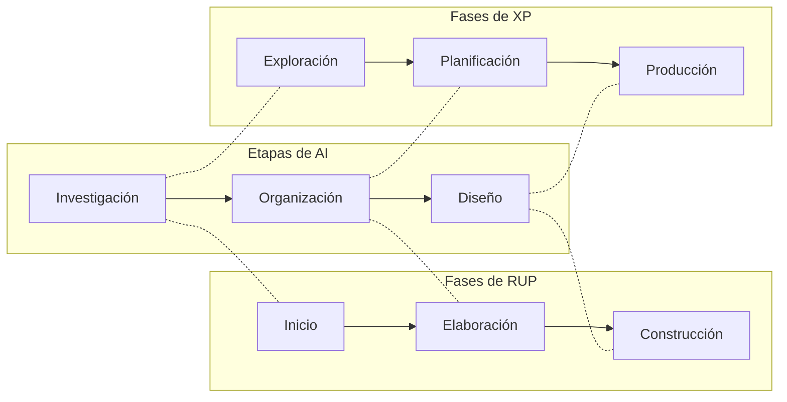

# Arquitectura de la información (AI)

La **arquitectura de la información** (AI) es la disciplina que **organiza los contenidos** de un
producto de software según lo que **necesita saber quien lo usa**. Se ocupa de qué información hay,
cómo se agrupa, cómo se etiqueta y cómo se navega. **No es la arquitectura del software.**

> [!note] De dónde sale esta nota
> De la **NT2**, la segunda nota técnica de la unidad 3. Las notas técnicas son **material de
> clase**, igual que la NT1 de trazabilidad. Es un artículo de seis páginas, no una diapositiva. Cubre
> el punto del programa *"Integrando con la arquitectura de la información"*, que hasta hoy no tenía
> ninguna fuente.

## 1. Las definiciones

El artículo da tres. La primera es la del autor del término:

> Richard Saul Wurman acuñó el término "Arquitectura de Información", que se define como *"una
> combinación de la organización de la información del contenido del sitio en categorías y la
> creación de una interfaz para sostener esas categorías"*.

La segunda es la de las autoras, y es la más fácil de citar:

> *"La AI es la disciplina encargada de la organización de los contenidos en un producto, tomando
> como punto de partida las necesidades y consideraciones de la audiencia y teniendo como principal
> objetivo desarrollar productos de calidad que cumplan con las expectativas de los usuarios."*

La tercera es la del **AIfIA** (*Asilomar Institute for Information Architecture*), que saca a la AI
de los sitios web:

> *"el diseño estructural de ambientes de información compartidos. Es el arte y la ciencia de
> organizar y etiquetar sitios Web, Intranets, Comunidades en línea y programas computacionales,
> para apoyar las capacidades de uso y búsqueda"*.

**Lo que tienen en común**, según el artículo: *"la satisfacción de los usuarios"*. La meta es
satisfacer sus **necesidades informativas** y facilitarles el acceso a los contenidos.

Y no es solo para sitios web: el proceso de AI *"se lleva a cabo en sistemas informáticos más
complejos, tales como sistemas de gestión, software educativo, librería de componentes,
simuladores, vídeo juegos"*.

> [!warning] La trampa: AI no es AS
> | | Arquitectura de **software** | Arquitectura de la **información** |
> |---|---|---|
> | Organiza | componentes, conectores, estructuras | **contenidos**: categorías, etiquetas, navegación |
> | Mira el sistema desde | el punto de vista técnico | **las necesidades informativas del usuario** |
> | La hace | el arquitecto de software | el **arquitecto de información** |
>
> El artículo lo dice así: los roles de las metodologías *"analizan la información del sistema desde
> el punto de vista informático, pero no se particulariza en las tareas que se llevan a cabo en el
> proceso de AI"*.

## 2. Para qué existe: la calidad

El artículo engancha la AI con la **calidad del software**, y usa la definición de la IEEE
(Std 610.12-1990):

> *"Concordancia del software producido con los requerimientos explícitamente establecidos, con los
> estándares de desarrollo prefijados y con los requerimientos implícitos no establecidos
> formalmente, que desea el usuario"*.

De ahí saca que *"calidad implica eficiencia, flexibilidad, corrección, confiabilidad, usabilidad,
seguridad e integridad"*.

> [!warning] Es otra lista de calidad más
> Esas siete no son ni las siete de los drivers, ni las seis de ISO 9126, ni las del ejemplo READM.
> Sirve para entender por qué la AI existe. **No la uses para clasificar drivers.** El cuadro de
> qué lista va con qué uso está en [[Atributos de calidad]].

El problema que la AI ataca, en el diagnóstico del artículo: los productos *"se desarrollan sobre
un montaje de prototipo de interfaz de usuario sin tener en cuenta todos los elementos de dicha
disciplina"*. Y el que paga es el usuario.

## 3. Metodología, y las dos que se comparan

El artículo define primero qué es el proceso de desarrollo:

> *"es aquel en que las necesidades del usuario son traducidas en requerimientos de software, estos
> requerimientos transformados en diseño y el diseño implementado en código, el código es probado,
> documentado y certificado para su uso operativo"*. Concretamente *"define quién está haciendo
> qué, cuándo hacerlo y cómo alcanzar un cierto objetivo"*.

Y una **metodología** es *"un proceso de software minucioso y acabado"*: tiene que definir
**artefactos, roles y actividades**, más prácticas, técnicas y guías para adaptarla al proyecto. Se
clasifican en **ágiles** y **pesadas**. Las dos que compara:

| | **RUP** (pesada) | **XP** (ágil) |
|---|---|---|
| **Fases** | cuatro: Inicio, Elaboración, Construcción, Transición | seis: Exploración, Planificación de la entrega, Iteraciones, Producción, Mantenimiento, **Muerte del proyecto** |
| **Cuándo documenta** | en cada fase | *"es en la última fase donde se documenta todo el proceso"* |

### Los artefactos por fase

| Metodología | Fase | Artefactos |
|---|---|---|
| RUP | **Inicio** | Especificación de requisitos, Glosario de términos, **Informe del levantamiento de la AI** |
| RUP | **Elaboración** | **AI**, Arquitectura de software, refinamiento de los documentos de inicio |
| RUP | **Construcción** | Manual de usuario, aplicación de los casos de prueba |
| XP | **Exploración** | programadores y clientes definen a grandes rasgos las **historias de usuario** |
| XP | **Planificación** | el cliente prioriza las historias de usuario |
| XP | **Producción** | pruebas antes de pasar al entorno del cliente |

Fijate en Elaboración: la **AI y la arquitectura de software salen en la misma fase**, como dos
artefactos distintos.

## 4. Los roles que tocan la AI

![[adjuntos/nt2-arquitectura-de-la-informacion/fig1-roles-rup-xp-relacionados-con-el-arquitecto-de-informacion.png]]

La figura 1 pone al **arquitecto de información** a la izquierda, unido a las dos metodologías, y
alrededor los roles con los que se relaciona. La figura no dibuja a cuál pertenece cada rol; lo dice
el texto:

| Metodología | Rol | Qué hace, según el artículo |
|---|---|---|
| RUP | **Analista de procesos del negocio** | identifica metas (misión) y objetivos del negocio, el vocabulario común, *"define una arquitectura para el negocio, encuentra actores y casos de uso de este y estructura el modelo de casos de uso del negocio"*, determina los niveles de organización y mantiene las reglas |
| RUP | **Analista del sistema** | plan de administración de requerimientos, **documento visión**, demandas de los stakeholders, vocabulario común con el cliente, actores y casos de uso **del sistema** |
| RUP | **Diseñador de interfaz de usuario** | el prototipo de la interfaz |
| RUP | **Administrador de pruebas** | evalúa la calidad: que los requisitos funcionales, no funcionales y los atributos de calidad estén en el producto final |
| XP | **Cliente** | escribe las **historias de usuario**, decide *"qué construir y cuándo"* y fija las pruebas funcionales |
| XP | **Programador** | decisiones técnicas y construcción; en XP diseña, programa y prueba |
| XP | **Encargado de pruebas** | ayuda al cliente con las pruebas funcionales |

> [!important] El analista de procesos del negocio es lo que hiciste en el Caso 1
> Actores del negocio, casos de uso del negocio, modelo de CUN: es el rol de RUP que hace el
> [[Modelo de casos de uso del negocio|modelo del negocio]]. Y la separación **negocio /
> sistema** entre los dos analistas es la misma de los dos planos del curso.

> [!note] La figura dice «Asministrador»
> Es una errata de la figura 1; el texto dice *Administrador de pruebas*.

## 5. Las tres etapas de la AI

El artículo toma la estructura del proceso de AI de Rodrigo Ronda León, que lo divide en **tres
etapas: investigación, organización y diseño**.

| Etapa | Qué se hace |
|---|---|
| **Investigación** | se definen los **objetivos** del producto y su **tipología**. Se investiga el tema, el **contexto de los emisores y de los usuarios potenciales**, se define el **modelo del negocio**, se estudian el mercado y los productos similares y las características culturales, políticas, económicas, sociales y tecnológicas. Se hace el **estudio de usuarios** (tipología, roles, necesidades de información y de formación) y se definen los **contenidos**: tipo, formato y cantidades |
| **Organización** | se definen **roles, escenarios y tareas de los usuarios**. Se hace el **inventario de contenidos** y se los organiza según los usuarios, el **mapeo de términos** y la conformación y organización de temáticas. Al final se representan todas las estructuras posibles de los contenidos |
| **Diseño** | se definen las **pantallas** del producto y su funcionamiento, las **etiquetas** del producto y de sus servicios, y se crean **prototipos de bajo y alto nivel** |

### La correspondencia con RUP y XP (tabla 1)

![[adjuntos/nt2-arquitectura-de-la-informacion/tabla1-etapas-de-ai-y-fases-de-rup-y-xp.png]]

| Etapas de AI | Fases de RUP | Fases de XP |
|---|---|---|
| Investigación | Inicio | Exploración |
| Organización | Elaboración | Planificación |
| Diseño | Construcción | Producción |

**Regla memorizable:** *investigar al inicio, organizar al elaborar, diseñar al construir.* En XP:
*explorar, planificar, producir.*

> [!warning] La tabla deja fases afuera
> **Transición** de RUP, e **Iteraciones**, **Mantenimiento** y **Muerte del proyecto** de XP no
> tienen etapa de AI. Si preguntan por qué: la tabla solo relaciona *"algunas de las fases"*, en
> palabras del artículo.

## 6. Qué aportó el arquitecto de información

El caso real del artículo: en la UCI el rol *"todavía no ha madurado lo suficiente"*, pero en el
**Polo Geoinformática** (Facultad 9) los proyectos con RUP y XP lo incluyeron y eso *"influyó
positivamente en los resultados finales"*. Les permitió:

1. Identificar la **visión, misión y objetivos** del producto, equilibrando las necesidades de la
   organización patrocinadora y las de su público.
2. Hacer el **estudio de homólogos**: el estado del arte del producto.
3. Hacer la **auditoría de información**: servicios, fuentes, sistema y contenidos.
4. Organizar y representar los contenidos: **taxonomía**, **sistema de navegación** y **sistema de
   etiquetado**.
5. Hacer la diagramación de diagramas tipo.
6. Describir en detalle los elementos de cada pantalla.

La frase que resume el rol: *"Él es quien organiza los patrones inherentes a los datos, haciendo lo
complejo claro"*. Crea *"la estructura o mapa de información que permite a los usuarios encontrar su
camino personal al conocimiento"*.

## 7. Las conclusiones

| # | Conclusión |
|---|---|
| 1 | **No sobrecargar** los roles que la metodología ya define: más funciones les quitan tiempo y bajan la calidad |
| 2 | Tiene que haber **retroalimentación** entre el arquitecto de información y los roles relacionados |
| 3 | La AI hay que hacerla **en paralelo** al proceso de desarrollo, y el arquitecto de información debe ser **un rol** de las metodologías |
| 4 | Hoy **ni RUP ni XP definen roles ni actividades de AI** |

La tesis, en una línea: **la AI es un proceso paralelo al desarrollo, con su propio rol, que se
engancha a las fases de inicio, elaboración y construcción.**

## 8. Cómo se conecta con lo de clase

| Idea de la NT2 | Dónde aparece en el curso |
|---|---|
| Estudiar el contexto de emisores y usuarios, el negocio y el mercado | [[Diagrama de contexto]] y [[Stakeholders]]: también arrancan por quién rodea al sistema |
| El analista de procesos del negocio encuentra actores y CUN | [[Modelo de casos de uso del negocio]] |
| La AI y la AS salen en Elaboración | [[Arquitectura en el ciclo de vida del software]] |
| Escenarios y tareas de los usuarios (etapa de organización) | [[Drivers arquitectónicos]] y [[Ejemplo resuelto - Sistema de Transporte READM]]: en la AS, los escenarios son de **calidad**; acá, de **uso** |
| RUP y XP | [[Arquitectura y proceso de desarrollo]] (complemento) y [[Arquitectura ágil]] (NT3) |

## Notas relacionadas

- [[Arquitectura ágil]] — la NT3: arquitectura de software dentro de las metodologías ágiles
- [[Arquitectura de software en el modelo en espiral]] — la NT1: dónde participa la arquitectura en el ciclo de vida
- [[Arquitectura y proceso de desarrollo]] — RUP y ágil según Garland & Anthony (complemento)
- [[Programa oficial del curso]] — el punto de la unidad 3 que esta nota cubre

## Preguntas de repaso

1. ¿Qué es la arquitectura de la información y en qué se diferencia de la arquitectura de software?
2. ¿Qué tienen en común las definiciones de Wurman, del AIfIA y de las autoras?
3. Nombrá las tres etapas de la AI y una tarea de cada una.
4. ¿Con qué fase de RUP y con qué fase de XP se corresponde cada etapa de la AI?
5. ¿En qué fase de RUP salen juntas la AI y la arquitectura de software, y qué otros artefactos produce RUP en el inicio?
