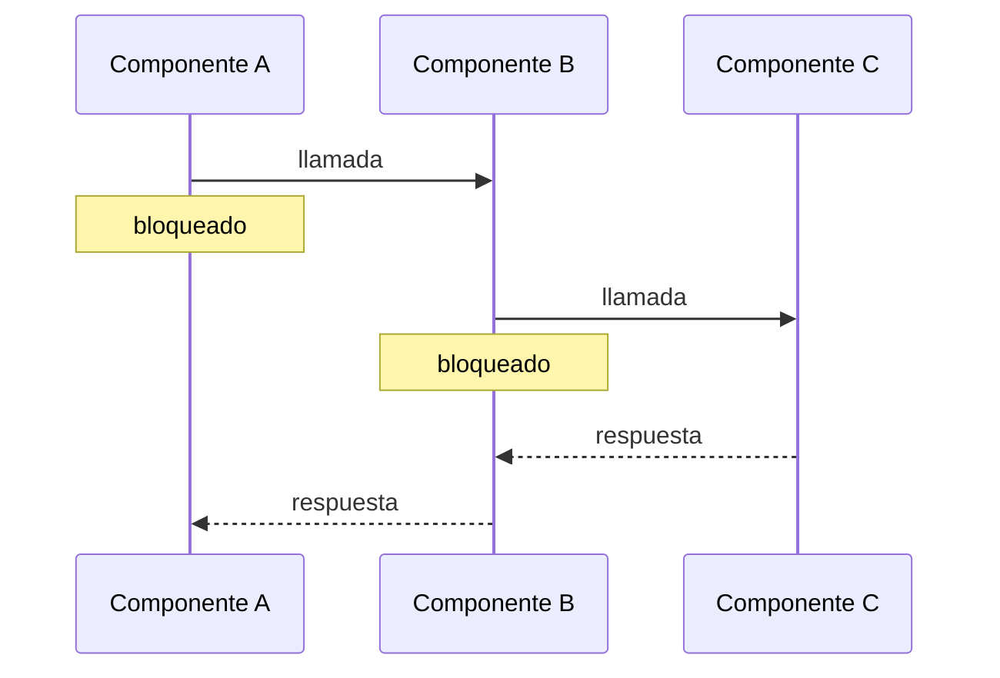
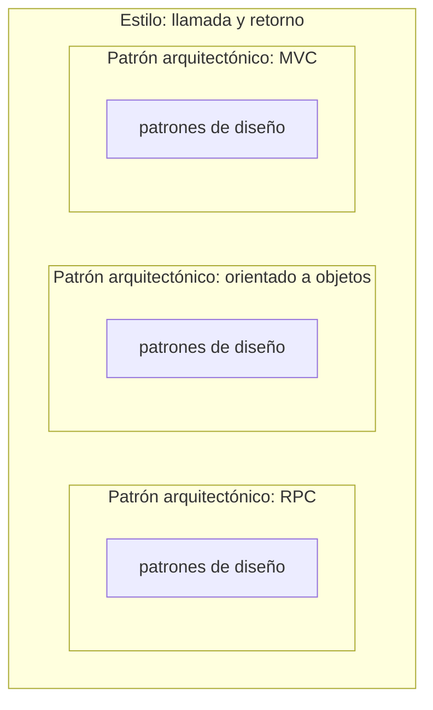

# Arquitectura de llamada y retorno

Uno de los seis estilos del catálogo del punto **1.9** del programa. Hasta ahora estaba solo
**nombrado** —como *"llamar y regresar"* en la definición de estilo y como familia en
[[Catálogo de estilos arquitectónicos]]—. Con esta tanda pasa a tener **diapositivas de desarrollo**.

> [!important] Esta nota es NÚCLEO
> Sale de cinco diapositivas de la serie *"Estilos Arquitectónicos"*:
>
> | Captura | Subtítulo en rojo | Qué aporta |
> |---|---|---|
> | 30 (y 29) | — *(es el árbol C & C con Call-return resaltado)* | la definición en una línea y qué significa **síncrono** |
> | 31 | *"–arquitectura de llamada y retorno–"* | la definición en tres viñetas y el dibujo |
> | 32 | *"–call return: cliente-servidor"* | cliente-servidor **como miembro** de esta familia |
> | 40 | *"–Patrones Arquitéctónicos* [sic] *para arquitectura de llamada y retorno–"* | la ventaja y los tres patrones: RPC, orientado a objetos, MVC |
>
> El primer patrón de la lista, RPC, tiene su propia nota: [[Llamada a procedimiento remoto]].

---

## 1. Dónde está en el catálogo: el árbol C & C, con Call-return resaltado (captura 30)

La clase volvió a mostrar el árbol de componentes y conectores de [[Catálogo de estilos arquitectónicos]]
§2, pero **con agregados**: un recuadro punteado naranja sobre **Call-return**, una flecha negra
dibujada a mano que baja desde ese recuadro, y dos textos nuevos.

Textual, en azul:

> Interacción por invocación síncrona de capacidades proporcionadas por los componentes

Textual, en rojo, con una flecha curva que sale de la palabra *síncrona*:

> Proceso o su efecto que se desarrolla en perfecta correspondencia temporal con otro proceso o causa

![[adjuntos/capturas-clase-U2/llamada-retorno/llamada-retorno-arbol-cc-invocacion-sincrona.png]]

> [!note] La captura 29 es la misma diapositiva un paso antes
> Tiene el recuadro, la flecha y el texto azul, pero **todavía no** la definición en rojo de
> *síncrono*. No se guarda aparte: la 30 la contiene entera.

Lo que se lee del árbol para esta familia (ya transcrito con zoom en el catálogo, se repite acá lo
que importa):

| Padre | Hijos |
|---|---|
| **C & C** | Data flow · **Call-return** · Event-based · Repository |
| **Call-return** | **Client-server** · **Peer to peer** · **SOA** |
| **Client-server** | **Multi-tier** |

Desarmada en sus partes, la definición en una línea:

| Pieza de la frase | Qué quiere decir |
|---|---|
| **Interacción** | habla de cómo se **relacionan** los componentes (es un estilo de C & C, de tiempo de ejecución) |
| **por invocación** | uno **llama** al otro: la iniciativa es explícita |
| **síncrona** | *"en perfecta correspondencia temporal"*: la respuesta llega **en el mismo hilo de tiempo** que la llamada, y el que llama la espera |
| **de capacidades proporcionadas por los componentes** | lo que se invoca es un **servicio** que el otro componente **ofrece** (su interfaz provista, ver [[Interfaces de componentes]]) |

---

## 2. Qué es (captura 31)

Textual de *"Estilos Arquitectónicos –arquitectura de llamada y retorno–"*:

> - Representa un modelo computacional en el cual los componentes proporcionan servicios que pueden
>   ser invocados por otros de forma síncrona.
> - **Los componentes se comunican mediante llamadas y respuestas, como funciones o métodos.**
> - Un componente que invoca un servicio permanece en estado de bloqueo mientras el servicio termina.

*(La segunda viñeta está en negrita en la diapositiva.)*

![[adjuntos/capturas-clase-U2/llamada-retorno/llamada-retorno-definicion-bloqueo.png]]

Las tres viñetas son tres rasgos distintos, y los tres hacen falta:

| # | Rasgo | Palabra clave | Pregunta para reconocerlo |
|---|---|---|---|
| 1 | Los componentes **ofrecen servicios** que otros **invocan de forma síncrona** | *síncrona* | ¿alguien **llama** a una capacidad de otro componente? |
| 2 | Se comunican con **llamadas y respuestas**, **como funciones o métodos** | *llamada y respuesta* | ¿toda llamada tiene su **respuesta** de vuelta al que llamó? |
| 3 | El que invoca **queda bloqueado** hasta que el servicio **termina** | *bloqueo* | ¿el que llamó **espera** sin hacer otra cosa? |

### El dibujo de la diapositiva

| Elemento | Qué es |
|---|---|
| Flecha negra grande a la izquierda | la **entrada**: la llamada inicial que dispara todo, apuntando al primer componente |
| Tres cuadrados azules redondeados | tres **componentes** en fila |
| Entre el 1.º y el 2.º, y entre el 2.º y el 3.º | **dos flechas**: la de arriba apunta a la **derecha** (la llamada), la de abajo a la **izquierda** (el retorno) |

Se lee como una **cadena**: el primero llama al segundo, que llama al tercero; el tercero responde
al segundo, que recién entonces responde al primero. Cada flecha de ida tiene **su** flecha de vuelta.

El patrón conceptual, en Mermaid (no es su dibujo: es la secuencia que el dibujo implica):

> [!tip] Enlace con lo que ya dio la clase en el diagrama de secuencia
> [[Diagrama de secuencia]] define la **comunicación síncrona** como *"el objeto que envía el mensaje
> **queda bloqueado** hasta que recibe la respuesta"*: flecha de cabeza llena y respuesta discontinua.
> Es **el mismo mecanismo** que la viñeta 3, visto en un diagrama. Un sistema de llamada y retorno,
> dibujado en secuencia, es casi todo mensajes síncronos.

---

## 3. Un miembro: cliente-servidor visto como llamada y retorno (captura 32)

Textual de *"Estilos Arquitectónicos –call return: cliente-servidor"* (el subtítulo abre con guion y
no cierra):

> - Clientes invocan servicios proporcionados por un servidor.
> - La interacción se hace a través de un protocolo basado en un esquema de request/reply (por ejemplo
>   HTTP)
> - El cliente requiere conocer el servidor y el servicio a invocar; los servidores no conocen los
>   clientes.

![[adjuntos/capturas-clase-U2/llamada-retorno/call-return-cliente-servidor.png]]

El dibujo es el mismo de la captura 31 **recortado a dos componentes**: flecha de entrada grande,
un cuadrado, flecha a la derecha arriba y a la izquierda abajo, y el segundo cuadrado. Cliente a la
izquierda, servidor a la derecha.

Cómo cada viñeta de cliente-servidor **instancia** un rasgo de la familia:

| Rasgo de llamada y retorno (31) | Cómo aparece en cliente-servidor (32) |
|---|---|
| componentes que **proporcionan servicios** invocados por otros | *"Clientes invocan servicios **proporcionados por un servidor**"* |
| **llamadas y respuestas** | *"protocolo basado en un esquema de **request/reply** (por ejemplo HTTP)"* |
| el que invoca **queda bloqueado** | *(no lo repite: se hereda de la familia)* |
| *(nuevo, propio de este miembro)* | **conocimiento asimétrico**: el cliente conoce al servidor y al servicio; el servidor **no** conoce a los clientes |

> [!important] Lo que agrega el subtítulo *"call return: cliente-servidor"*
> Con este subtítulo la clase dice **en palabras** lo que el árbol C & C decía con una línea:
> **cliente-servidor es un estilo de la familia llamada y retorno**. Ya no depende de leer el árbol.

### Cómo encaja con la arquitectura de 2 capas

La clase ya había dado cliente-servidor como *"Arquitectura de 2 capas — Modelo Cliente Servidor"*
en [[Arquitectura en capas]] §3. **No se contradicen**; se miran desde dos lugares:

| | [[Arquitectura en capas]] §3 (capturas_U2) | Esta diapositiva (capturas_U2_F3, 32) |
|---|---|---|
| **Desde dónde lo mira** | como **capas**: N-capas con N = 2 | como **forma de interacción**: llamada y retorno |
| **Qué dibuja** | *1 Petición* → servidor, *2 Respuesta* ← servidor | llamada → y retorno ← entre dos cuadrados |
| **Quién inicia** | el cliente (la numeración empieza en él) | el cliente (*"Clientes invocan"*) |
| **Qué agrega** | el **rol** cambia: el smartphone es cliente y después servidor | el **conocimiento** es asimétrico: el servidor no conoce a los clientes |
| **Protocolo** | *"mediante 3G, 4G, 5G"* (la red) | *request/reply*, *"por ejemplo HTTP"* |

Las dos se suman: *cliente es quien **conoce** al servidor e **inicia** la llamada, en esa
interacción*. Por eso el smartphone puede ser servidor del smartwatch: en esa interacción es el
smartwatch el que lo conoce y le pide.

---

## 4. Los patrones arquitectónicos de este estilo (captura 40)

Textual de *"–Patrones Arquitéctónicos* [sic] *para arquitectura de llamada y retorno–"*:

> Con esta arquitectura se obtiene una estructura de programa que resulta relativamente fácil de
> modificar y cambiar de tamaño.
>
> Ejemplos:
>
> - **Llamada de procedimiento remoto (RPC):** Un componente llama a un procedimiento en otro
>   componente, que lo ejecuta y devuelve un resultado.
> - **Orientado a objetos:** Los objetos se comunican mediante llamadas a métodos, esperando
>   respuestas.
> - **Modelo-Vista-Controlador**

*(El título escribe "Arquitéctónicos" con dos tildes. MVC aparece **sin** descripción.)*

![[adjuntos/capturas-clase-U2/llamada-retorno/patrones-arquitectonicos-llamada-retorno-rpc-oo-mvc.png]]

### La ventaja que declara

| Lo que dice | Traducido a atributo de calidad *(lectura propia)* |
|---|---|
| *"relativamente fácil de **modificar**"* | **mantenibilidad** / modificabilidad |
| *"y **cambiar de tamaño**"* | **escalabilidad** |

Es **la única ventaja** que da la clase para este estilo, y viene con *"relativamente"*. Las
desventajas no están en la diapositiva (ver §7, complemento).

### Los tres ejemplos

| Patrón | Qué dice la diapositiva | Quién llama a quién | Dónde se desarrolla |
|---|---|---|---|
| **RPC** | *"Un componente llama a un procedimiento en otro componente, que lo ejecuta y devuelve un resultado"* | componente → **procedimiento** de otro componente (posiblemente en otra máquina) | [[Llamada a procedimiento remoto]] (capturas 41-43) |
| **Orientado a objetos** | *"Los objetos se comunican mediante llamadas a métodos, esperando respuestas"* | objeto → **método** de otro objeto | sin diapositiva propia |
| **Modelo-Vista-Controlador** | *(solo el nombre)* | — | [[Modelo-Vista-Controlador]] |

Las tres descripciones repiten el ADN de la familia: **llama**, **espera**, **recibe respuesta**. Son
la viñeta 2 de la captura 31 (*"como funciones o métodos"*) aplicada a tres escalas: el procedimiento
remoto, el método de un objeto, y las tres piezas de MVC.

### La relación estilo ⊃ patrón arquitectónico, dicha con su título

El título dice *"Patrones Arquitectónicos **para** arquitectura de llamada y retorno"*. Es la
jerarquía de [[Patrones arquitectónicos]] §4 con nombres concretos:

| Nivel | En este estilo | Fuente |
|---|---|---|
| **Estilo** | llamada y retorno | capturas 30-31 |
| **Patrón arquitectónico** | RPC · orientado a objetos · MVC | captura 40 (y 41-43 para RPC) |
| **Patrón de diseño** | *(la clase no los nombra para este estilo)* | — |

> [!warning] Los mismos nombres aparecen como estilo en otra diapositiva
> El **catálogo textual** (capturas_U2_F2, 30) pone a RPC, MVC y orientadas a objetos como
> **"Arquitecturas de llamada y retorno (llamadas a procedimientos remotos, Modelo Vista Controlador
> –MVC-, en Capas, Orientadas a Objetos, basadas en Componentes)"**: o sea, como **miembros de la
> familia**, con la palabra *arquitecturas*. La captura 40 los llama **patrones arquitectónicos** del
> estilo. Y la lista de **13 patrones arquitectónicos** de [[Patrones arquitectónicos]] §5 **no
> incluye ninguno de los tres**.
>
> **Cómo se concilia:** el catálogo textual lista *todo lo que cae dentro* de la familia sin
> distinguir nivel; la captura 40 **sí** declara el nivel, y es la que coincide con la doctrina
> *estilo ⊃ patrón arquitectónico ⊃ patrón de diseño*. Y no es un rótulo aislado: las diapositivas
> de RPC dicen *"Patrón Arquitectónico de llamada a procedimiento remoto"* (41, 42) y la de MVC se
> titula *"Patrón Arquitectónico Modelo-Vista-Controlador"* (44). La lista de 13 no es exhaustiva: son
> patrones **transversales** (DTO, API Gateway, Circuit Breaker) que no pertenecen a un estilo
> concreto. Si te preguntan *qué es MVC para llamada y retorno*, la respuesta de clase con nombre es
> **"un patrón arquitectónico del estilo llamada y retorno"** (captura 40).

---

## 5. Qué cae dentro de la familia, según cada diapositiva de clase

| Miembro | Catálogo textual (U2_F2 30) | Árbol C & C (U2_F2 30-cc y U2_F3 30) | Subtítulo *"call return: …"* (U2_F3) | *Patrones … para llamada y retorno* (U2_F3 40) | Nota |
|---|---|---|---|---|---|
| **Cliente-servidor** (+ multi-tier) | — | ✅ Client-server, con Multi-tier debajo | ✅ captura 32 | — | §3 · [[Arquitectura en capas]] |
| **En capas** | ✅ *en Capas* | ✅ vía Multi-tier | — | — | [[Arquitectura en capas]] |
| **SOA** | ✗ la pone bajo **peer-to-peer** | ✅ (y también bajo Event-based) | ✅ *"call return: SOA"* (capturas 33-39) | — | [[Arquitectura orientada a servicios]] |
| **Peer to peer** | ✗ es **familia** propia | ✅ | — | — | [[Catálogo de estilos arquitectónicos]] §4 |
| **RPC** | ✅ *llamadas a procedimientos remotos* | — | — | ✅ **patrón arquitectónico** | [[Llamada a procedimiento remoto]] |
| **Orientado a objetos** | ✅ *Orientadas a Objetos* | — | — | ✅ **patrón arquitectónico** | — |
| **MVC** | ✅ *Modelo Vista Controlador –MVC-* | — | — | ✅ **patrón arquitectónico** (y la captura 44 se titula *"Patrón Arquitectónico Modelo-Vista-Controlador"*) | [[Modelo-Vista-Controlador]] |
| **Basadas en componentes** | ✅ | — | — | — | — |

**Lo que se puede afirmar sin dudar**, porque lo dicen dos o más diapositivas: cliente-servidor,
capas, RPC, orientado a objetos y MVC son de llamada y retorno. **SOA y peer-to-peer dependen de la
taxonomía** que se use (ver [[Catálogo de estilos arquitectónicos]] §4): en el árbol y en su
subtítulo *"call return: SOA"* están dentro; en el catálogo textual, no.

---

## 6. Síncrono y bloqueo: lo que separa a esta familia de las otras

La clase dio la definición de *síncrono* en rojo (captura 30). El contraste con las otras familias
del árbol es **lectura propia**, porque sus definiciones no están en estas diapositivas:

| Familia del árbol C & C | ¿Cómo interactúan los componentes? | ¿El que inicia espera? |
|---|---|---|
| **Call-return** | **invocación síncrona**: llamada y respuesta (clase, 30-31) | **sí, bloqueado** (clase, 31) |
| **Event-based** | publican o reciben eventos o mensajes *(complemento)* | no: el emisor sigue *(complemento)* |
| **Data flow** | los datos **pasan** de un filtro al siguiente *(complemento)* | no hay "respuesta" que esperar |
| **Repository** | leen y escriben un almacén compartido *(complemento)* | no se llaman entre sí |

---

## 7. COMPLEMENTO — lo que la diapositiva no dice

> [!note] COMPLEMENTO (conocimiento general; no es de la clase)
> - **Origen del nombre.** *Call-and-return* es una de las familias clásicas de Shaw y Garlan, que
>   Pressman traduce como *llamada y retorno* e ilustra con **programa principal y subrutinas**: el
>   control pasa al llamado y **vuelve** al que llamó. Por eso la clase lo nombró también como
>   *"llamar y regresar"* (capturas_U2, 21).
> - **La otra cara del bloqueo.** Que el que invoca quede bloqueado da **simplicidad** (el flujo se lee
>   de arriba abajo, como un programa) pero **acopla en el tiempo**: si el llamado tarda o se cae, el
>   que llama también tarda o falla, y en una cadena A → B → C la demora **se suma**. Es la razón de
>   ser de patrones como **Circuit Breaker** (de su lista de 13).
> - **Acoplamiento de conocimiento.** Como el que llama debe conocer al llamado (captura 32), mover o
>   reemplazar al servidor obliga a avisar a los clientes. Los patrones **Service Registry** y
>   **Service Discovery** (lista de 13) atacan justo eso.

---

## 8. La trampa

> [!warning] Tres errores con esta familia
> 1. **Creer que "llamada y retorno" es lo mismo que "cliente-servidor".** Cliente-servidor es **un**
>    miembro (captura 32); la familia incluye también capas, RPC, orientado a objetos y MVC.
> 2. **Olvidar el bloqueo.** La definición no es solo "se llaman": es que el que llama **queda en
>    estado de bloqueo mientras el servicio termina** (31). Sin eso, no se distingue de basada en
>    eventos.
> 3. **Decir que MVC o RPC "son estilos" sin declarar la diapositiva.** La captura 40 los llama
>    **patrones arquitectónicos** del estilo; el catálogo textual los lista como *arquitecturas*.
>    Usá la 40, que declara el nivel.

**Regla memorizable:** *llamada y retorno = invoco un servicio, **me quedo bloqueado**, y **la
respuesta vuelve a mí**. Miembros: cliente-servidor y capas. Patrones: RPC, orientado a objetos,
MVC. Ventaja: fácil de modificar y cambiar de tamaño.*

---

## Notas relacionadas

- [[Catálogo de estilos arquitectónicos]] — la familia dentro de las dos taxonomías de clase y el árbol C & C completo
- [[Llamada a procedimiento remoto]] — el primer patrón arquitectónico de este estilo, con el diagrama de 15 pasos
- [[Modelo-Vista-Controlador]] — el tercer patrón de la captura 40
- [[Arquitectura orientada a servicios]] — sus diapositivas llevan el subtítulo *"call return: SOA"*
- [[Arquitectura en capas]] — capas y cliente-servidor como 2 capas
- [[Patrones arquitectónicos]] — la jerarquía estilo ⊃ patrón arquitectónico ⊃ patrón de diseño y la lista de 13
- [[Estilos arquitectónicos]] — definiciones de estilo y patrón
- [[Diagrama de secuencia]] — la comunicación síncrona, con el mismo "queda bloqueado"
- [[Interfaces de componentes]] — la capacidad que un componente *proporciona* es su interfaz provista

## Preguntas de repaso

1. Citá la definición de llamada y retorno que la clase escribió en azul junto al árbol C & C, y
   explicá qué significa *síncrona* con la definición en rojo.
2. ¿Cuáles son las tres viñetas de la diapositiva *"arquitectura de llamada y retorno"*? ¿Qué pasa con
   el componente que invoca un servicio?
3. Según la diapositiva *"call return: cliente-servidor"*, ¿quién conoce a quién? ¿Cómo se concilia con
   el ejemplo del smartphone que cambia de rol?
4. ¿Qué ventaja declara la clase para este estilo, y cuáles son sus tres patrones arquitectónicos?
5. El catálogo textual pone a MVC como *arquitectura* de llamada y retorno y la captura 40 lo pone
   como *patrón arquitectónico*. ¿Cuál usarías en un examen y por qué?
