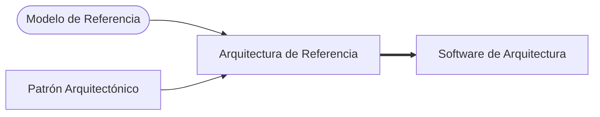

# Arquitectura de referencia

Dos subpuntos del **1.9** del programa —*arquitectura candidata* y *la arquitectura de referencia*—
que hasta hoy solo tenían complemento. Con las capturas 23-26 pasan a tener **diapositivas propias
de clase**, dentro de la serie *"Estilos Arquitectónicos"*.

> [!important] Esta nota es NÚCLEO
> Sale de cuatro diapositivas con el subtítulo en rojo **"–La Arquitectura de Referencia–"** (23, 24,
> 26) y **"–Definición de una arquitectura candidata–"** (25). Lo que antes estaba en
> [[Estilos arquitectónicos]] §10 era complemento del SAIP y de RUP; acá queda debajo y rotulado.

---

## 1. La cadena: de dónde sale una arquitectura de referencia

La diapositiva 23 es un diagrama de cuatro piezas y una frase al pie. Leída a resolución completa:

| Pieza | Forma y color | Flecha |
|---|---|---|
| **Modelo de Referencia** | elipse celeste | → *Arquitectura de Referencia* (azul) |
| **Patrón Arquitectónico** | rectángulo verde claro | → *Arquitectura de Referencia* (azul) |
| **Arquitectura de Referencia** | rectángulo azul | → *Software de Arquitectura* (**roja**, más gruesa) |
| **Software de Arquitectura** | rectángulo rojo | — |

Y el pie, textual:

> Estos son conceptos útiles que capturan elementos de una arquitectura, pero en sí ellos no son
> arquitecturas.

![[adjuntos/capturas-clase-U2/arquitectura-referencia/cadena-modelo-patron-arquitectura-referencia.png]]

El patrón conceptual, en Mermaid (es una cadena de dos entradas y una salida, sin más relaciones):

> [!note] Sobre "Software de Arquitectura"
> La caja dice **"Software de Arquitectura"**, así, en ese orden. La lectura natural es *"la
> arquitectura de software"* concreta de un sistema —lo que se construye a partir de la de
> referencia—; en el esquema original (Bass, Clements y Kazman) esa caja es *Software Architecture*,
> y el orden invertido parece una traducción literal. Citala **como está** en la diapositiva; si la
> parafraseás, decí *"la arquitectura de software del sistema"*. **Lectura propia**, no de la clase.

**Lo que dice el pie, y por qué importa:** *modelo de referencia*, *patrón arquitectónico* y
*arquitectura de referencia* **no son arquitecturas**. Son **insumos** que capturan partes de una.
La arquitectura propiamente dicha es la última caja, la del sistema concreto.

---

## 2. Las dos definiciones

### Modelo de referencia (captura 26)

Dos frases en verde, textuales:

> Un modelo de Referencia es una división de funcionalidad junto con el flujo de datos entre las
> piezas.
>
> Es un estándar de descomposición de un problema conocido, en partes que cooperativamente resuelven
> el problema.

![[adjuntos/capturas-clase-U2/arquitectura-referencia/definicion-modelo-de-referencia.png]]

### Arquitectura de referencia (captura 24)

Una frase en azul, textual:

> Es un modelo de referencia mapeado en elementos de software que cooperativamente implementan la
> funcionalidad definida en el modelo de referencia y flujos de datos entre ellos

![[adjuntos/capturas-clase-U2/arquitectura-referencia/definicion-arquitectura-de-referencia.png]]

---

## 3. La tabla que hay que saber

| | **Modelo de referencia** | **Patrón arquitectónico** | **Arquitectura de referencia** |
|---|---|---|---|
| **Qué es** | división de **funcionalidad** + flujo de datos entre las piezas | solución general a un problema común del diseño (ver [[Patrones arquitectónicos]]) | modelo de referencia **mapeado en elementos de software** |
| **¿Habla de software?** | **no**: parte el **problema** | sí, pero genérico | **sí**: elementos de software concretos |
| **De qué depende** | de un **problema conocido** (un dominio) | de un problema de diseño recurrente | de **los dos anteriores** (las dos flechas de la cadena) |
| **¿Es una arquitectura?** | no | no | **no** — *"en sí ellos no son arquitecturas"* |
| **Palabra clave** | *división* / *descomposición* | *solución general* | *mapeado* |

**Regla memorizable:** *el modelo de referencia parte el problema; la arquitectura de referencia lo
reparte en software; la arquitectura del sistema lo construye.*

> [!warning] La trampa
> Decir que una arquitectura de referencia **es** la arquitectura del sistema. La diapositiva lo
> niega explícitamente: es un **concepto útil que captura elementos** de una arquitectura. Se toma
> como punto de partida y **se adapta** al sistema concreto (la flecha roja).
>
> La trampa opuesta: confundir **modelo** de referencia con **arquitectura** de referencia. El
> modelo no nombra software —divide funcionalidad—; la arquitectura sí —la mapea en elementos de
> software—. La diferencia está en una sola palabra: **mapeado**.

### Un ejemplo, para fijarlo *(ejemplo propio, no de la clase)*

| Pieza | En una tienda en línea |
|---|---|
| **Modelo de referencia** | catálogo → carrito → pago → despacho, con los datos que pasan de uno a otro (pedido, factura, guía) |
| **Patrón arquitectónico** | capas (presentación / negocio / datos) — ver [[Arquitectura en capas]] |
| **Arquitectura de referencia** | ese flujo mapeado en software: *servicio de catálogo*, *servicio de pagos*, *base de pedidos*… organizados en capas |
| **Arquitectura del sistema** | la de *esa* tienda: con su pasarela de pago concreta, su nube, sus decisiones |

Los diagramas de AWS y Azure que mostró la clase en [[Arquitectura en la nube]] son arquitecturas de
referencia de proveedor: un modelo de referencia (web, negocio, datos) ya mapeado en servicios de la
nube, que cada cliente adapta.

> [!note] Cómo se usa una arquitectura de referencia (COMPLEMENTO — SAIP 4ª ed.)
> Venía de [[Estilos arquitectónicos]] §10. El SAIP la trata como una de las *categorías de concepto
> de diseño* que se eligen, junto con tácticas y patrones, y dice cómo se aplica:
>
> > En el caso de las arquitecturas de referencia, **instanciar** típicamente significa que se realiza
> > algún tipo de **customización**: agregar o quitar elementos que son parte de la estructura definida
> > por la arquitectura de referencia.
>
> Su ejemplo: una aplicación web que tiene que hablar con una aplicación externa de pagos obliga a
> **agregar un componente de integración** junto a los *tiers* de presentación, negocio y datos. Es la
> flecha *"Arquitectura de Referencia → Software de Arquitectura"* de la captura 23, contada por el libro.

---

## 4. Arquitectura candidata (captura 25)

> [!warning] Lo que muestra la diapositiva, dicho con honestidad
> El título es **"Estilos Arquitectónicos –Definición de una arquitectura candidata–"**, pero la
> diapositiva **no trae una definición textual** de *arquitectura candidata*. Lo único que muestra es
> **una tabla** de tipos de arquitectura con sus elementos y relaciones. La definición hay que
> tomarla de otro lado (ver abajo, rotulado).

La tabla, transcrita con zoom:

| Tipo de Arquitectura | Ejemplos de Elementos | Ejemplos de Relaciones |
|---|---|---|
| Conceptual | Componentes | Conectores |
| Modular | Subsistemas, módulos | Exportaciones, importaciones |
| Código | Archivos, directorios, bibliotecas | Incluye, contiene |
| Ejecución | Tareas, líneas, interacciones de objetos | Usos, llamadas |

![[adjuntos/capturas-clase-U2/arquitectura-referencia/arquitectura-candidata-tipos-elementos-relaciones.png]]

**Cómo se lee:** para **definir** una arquitectura candidata hay que decir, **por cada tipo**, qué
elementos la componen y qué relaciones los unen. Una arquitectura no es un solo dibujo: son cuatro
miradas, cada una con su par *elemento–relación*.

> [!note] Lectura propia de la tabla (COMPLEMENTO, no de la clase)
> - Los cuatro tipos coinciden con las **cuatro vistas de Hofmeister, Nord y Soni** (*Applied
>   Software Architecture*, 2000): *conceptual, module, code, execution*. La tabla parece venir de ahí.
> - **"líneas"** en la fila de ejecución casi seguro traduce *threads* (**hilos**): *tareas, hilos,
>   interacciones de objetos*. Citalo como dice la diapositiva —*líneas*— y aclaralo si lo explicás.
> - El cruce con las **tres** [[Categorías de estructuras]] de la unidad 1: *conceptual* ≈
>   componentes y conectores · *modular* y *código* ≈ módulos · *ejecución* ≈ componentes y conectores
>   en tiempo de ejecución (con algo de asignación). **No es una equivalencia que ella haya dado.**

### De dónde sacar la definición de "candidata"

Dos fuentes, en este orden:

1. **Clase, unidad 1** — el *Flujo de Definición* de Ambler, en [[Proceso de diseño arquitectónico]]:
   *Define Candidate Architecture* ocurre **solo en el esfuerzo inicial** (`[initial effort]`); en las
   vueltas siguientes se refina. O sea: la candidata es la **primera propuesta, todavía sin validar**.
   Ahí mismo, la de referencia aparece como la **reutilizable entre proyectos**.
2. **COMPLEMENTO** (lo que estaba en [[Estilos arquitectónicos]] §10): en RUP, la arquitectura
   candidata es la primera versión producida en elaboración; puede haber **varias en competencia**, y
   se someten a evaluación (ver [[Evaluación de la arquitectura]]).

Juntando las dos con la tabla: **una arquitectura candidata es una propuesta inicial, sin validar,
que se define diciendo sus elementos y relaciones en cada tipo (conceptual, modular, código,
ejecución)**. La primera mitad tiene fuente de clase (Ambler); la unión con la tabla es lectura propia.

---

## 5. Candidata vs. de referencia

| | **Arquitectura candidata** | **Arquitectura de referencia** |
|---|---|---|
| Alcance | **un** sistema, primera vuelta | **un dominio**, reutilizable entre proyectos |
| Estado | propuesta **sin validar** | **estable**, ya probada |
| Sale de | requisitos + estilos/patrones que se analizan | modelo de referencia + patrón arquitectónico |
| Cómo se define en clase | tabla de 4 tipos con elementos y relaciones (25) | *"modelo de referencia mapeado en elementos de software"* (24) |
| Destino | se evalúa y se refina | se **adapta** para producir la arquitectura de un sistema |

Una candidata **puede partir** de una de referencia: se toma la del dominio, se adapta al sistema y
eso es la primera propuesta. *(Relación propia, consistente con la cadena de la captura 23.)*

---

## Notas relacionadas

- [[Estilos arquitectónicos]] — la serie de diapositivas de la que salen estas cuatro
- [[Catálogo de estilos arquitectónicos]] — las dos diapositivas siguientes de la misma serie
- [[Patrones arquitectónicos]] — una de las dos entradas de la cadena
- [[Proceso de diseño arquitectónico]] — el flujo de Ambler: candidata en el esfuerzo inicial
- [[Categorías de estructuras]] — las tres categorías, para cruzar con los cuatro tipos de la tabla
- [[Arquitectura en la nube]] — AWS y Azure como arquitecturas de referencia de proveedor
- [[Arquitectura en capas]] — el patrón más usado para mapear un modelo de referencia
- [[Evaluación de la arquitectura]] — a donde va una candidata

## Preguntas de repaso

1. Según la diapositiva, ¿qué dos cosas entran para formar una arquitectura de referencia, y qué sale
   de ella?
2. ¿Qué diferencia hay entre un **modelo** de referencia y una **arquitectura** de referencia? Decila
   con la palabra clave de cada definición.
3. *"Estos son conceptos útiles que capturan elementos de una arquitectura, pero…"* — completá la
   frase y explicá qué consecuencia tiene.
4. Nombrá los cuatro tipos de arquitectura de la tabla de la arquitectura candidata, con un ejemplo
   de elemento y uno de relación de cada uno.
5. ¿En qué momento del flujo de Ambler se define la arquitectura candidata, y en qué se diferencia de
   la de referencia?
