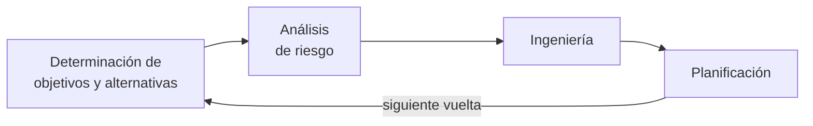
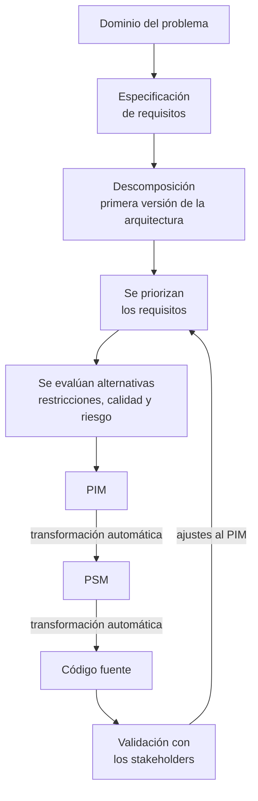

# Arquitectura de software en el modelo en espiral

El artículo responde dos preguntas: **en qué momentos del ciclo de vida participa la arquitectura, y
cuánto**; y **cómo se integra MDA** a ese ciclo para bajar el riesgo. Para ubicar las tareas usa el
**modelo en espiral** de Boehm.

> [!note] De dónde sale esta nota
> Del mismo artículo que [[Arquitectura dirigida por modelos MDA]] (Meaurio y Schmieder, 2013). Es
> la **NT1 de la unidad 3**, *Arquitectura del SW y CCV*: una nota técnica, o sea **material de
> clase**, aunque no sea una diapositiva. La diapositiva sobre el tema está en
> [[Arquitectura en el ciclo de vida del software]]. Las otras dos notas técnicas de la unidad son
> [[Arquitectura de la información]] (NT2) y [[Arquitectura ágil]] (NT3).

## 1. El modelo en espiral

> Este modelo (Barry Boehm 1986), incorpora métodos de proceso que están influenciados por el
> control y gestión del riesgo para el análisis y estructuración del proceso de desarrollo.

Es un modelo **evolutivo e iterativo**. Lo que lo distingue de otros es *"un nuevo elemento: el
análisis de riesgo"*. La espiral se lee con dos ejes:

| Movimiento | Qué representa |
|---|---|
| **Avance angular** (dar la vuelta) | *"el progreso del desarrollo"* |
| **Desplazamiento radial** (alejarse del centro) | *"el incremento de los costos de desarrollo en forma acumulativa"* |

![[adjuntos/lectura-mda-y-espiral/fig3-modelo-en-espiral-cuatro-cuadrantes.png]]

### Las cuatro actividades, una por cuadrante

| Actividad | Qué incluye |
|---|---|
| **Determinación de objetivos y alternativas** | objetivos del proyecto, alternativas y restricciones; en vueltas posteriores, la valoración de los resultados de ingeniería anteriores |
| **Análisis de riesgo** | analizar alternativas, identificar y resolver los riesgos *"que puedan hacer fracasar el proyecto o sobrepasar el presupuesto o plazo fijado"*. Después del análisis *"se toma la decisión de continuar o no con el desarrollo"* |
| **Ingeniería** | el desarrollo del producto: *"la construcción de los prototipos de nivel cada vez más refinados"* hasta el producto final |
| **Planificación** | planificación y estimaciones del proyecto en cada etapa |

> [!warning] El artículo da dos listas distintas de las cuatro actividades
> - **Introducción:** *"1) planificación, 2) análisis de riesgo, 3) ingeniería y 4) evaluación del
>   cliente"*.
> - **Apartado III y figura 3:** determinación de objetivos y alternativas, análisis de riesgo,
>   ingeniería, planificación.
>
> Coinciden en tres. La cuarta es *evaluación del cliente* en una y *determinación de objetivos y
> alternativas* en la otra. Si preguntan «las cuatro actividades del modelo en espiral», conviene la
> del **apartado III**, que es la que el artículo desarrolla y dibuja, y nombrar la otra.

## 2. Cuánto participa la arquitectura en cada tramo

> La Arquitectura de Software (AS) representa un alto nivel de abstracción que permite que la
> mayoría de los participantes puedan utilizarla como base para crear entendimiento mutuo, formar
> consenso y comunicarse entre sí. […] La AS representa la encarnación de las decisiones de diseño
> más tempranas sobre un sistema.

![[adjuntos/lectura-mda-y-espiral/fig4-grado-de-participacion-de-la-arquitectura.png]]

La figura 4 sombrea una vuelta de la espiral con tres intensidades (**bajo, medio, alto**): es el
*"grado en que participa la arquitectura de software"*. *"Una vuelta de espiral que cubre a estas
cuatro fases es un ciclo"*.

> [!note] LECTURA PROPIA de la figura 4
> El tramo más oscuro (**alto**) está en la mitad de arriba, del cuadrante de objetivos hacia el de
> **análisis de riesgo**. El tono **medio** acompaña al **plan de desarrollo**. El gris (**bajo**)
> queda en el tramo de **requerimientos de software** y **diseño del producto**. La figura no lo
> dice con palabras: se lee del sombreado.

### El recorrido, ciclo por ciclo

| Ciclo | Qué hace la arquitectura |
|---|---|
| **Especificación de requerimientos** | Empieza a formarse. El arquitecto *"debe interpretar, conciliar y proponer alternativas de solución"* con los expertos del dominio y los planificadores. Meta: la **integridad conceptual** |
| **Desarrollo del plan** | Se identifican los **requerimientos significativos arquitectónicamente**: *"aquellos que tienen un impacto esencial sobre la arquitectura"*. Se refina la primera arquitectura, hecha sobre todo de elementos genéricos que representan los requisitos funcionales |
| **Objetivos, alternativas y restricciones** | Se toman las **decisiones arquitectónicas**: cómo implementar los requisitos, riesgos, costes y viabilidad. Ejemplo del artículo: *"si se usa un sistema legado, si se construye uno nuevo, o se usan elementos (componentes) de software prefabricados disponibles en el mercado"*. Los atributos de calidad refinan las estructuras y sale la **especificación de la arquitectura** |
| **Análisis de riesgos y prototipos** | La arquitectura tiene **doble función**: se la analiza para comprobar que soporta los requerimientos de calidad, y se la usa como **prototipo** para estudiar el comportamiento del sistema antes de diseñarlo |
| **Diseño, validación y verificación** | Se ejecutan los prototipos, se ajusta, y la arquitectura *"es usada para construir el diseño del sistema"* |

### Tres ideas que conviene poder citar

**Integridad conceptual.** *"La integridad conceptual es la clave para el diseño de sistemas con
éxito y tal integridad conceptual puede ser tenida por un pequeño número de mentes llegando juntos a
diseñar la arquitectura del sistema"*.

![[adjuntos/lectura-mda-y-espiral/fig5-interaccion-del-arquitecto-con-los-actores.png]]

La figura 5 pone tres actores unidos por flechas punteadas:

| Actor | Rol |
|---|---|
| **Arquitectura de software** | experto de la **solución** |
| **Administración del negocio** | experto del **dominio** |
| **Administración del proyecto** | experto de la **planeación** |

**Requisitos y arquitectura, al mismo nivel.** El artículo destaca *"la igualdad en importancia
entre la arquitectura y los requisitos"*: *"un entendimiento oportuno de los requerimientos y una
elección adecuada de la arquitectura son claves para la gestión de proyectos"*.

**Grano grueso y grano fino.** Los elementos **arquitectónicos** son de *grano grueso*; los de
**diseño**, de *grano fino*. Hay que *"conservar la traza"* entre unos y otros *"para asegurar que
la arquitectura sea quien gobierne de manera efectiva las siguientes tareas del proceso"*. El puente
puede hacerse con transformación de modelos.

### Funcionales, no funcionales y atributos de calidad

| Tipo | Qué son, según el artículo | Para qué sirven en la arquitectura |
|---|---|---|
| **Requisitos funcionales** | los que derivan de las necesidades de los usuarios; *"características operacionales del sistema"* | *"formar los elementos básicos de cada estructura"* |
| **Requisitos no funcionales** | capturan *"cómo estos requisitos funcionales deben llevarse a cabo"*; se expresan como **requisitos de calidad** | — |
| **Atributos de calidad** | los que conforman los requisitos de calidad. Los más comunes: **escalabilidad, seguridad, desempeño y fiabilidad** | *"dirigir el diseño"* y **refinar** las estructuras |

El método que nombra es **ADD** (*Attribute Driven Design*, «diseño dirigido por atributos»).

> [!warning] Otra lista de atributos, y van cinco
> Esta lectura da **cuatro** «más comunes». No reemplaza a ninguna de las listas de clase
> ([[Drivers arquitectónicos]], [[Atributos de calidad]],
> [[Ejemplo resuelto - Sistema de Transporte READM]]): si se usa, se declara de dónde sale.

## 3. La propuesta: MDA dentro de la espiral

**El problema que ataca.** En la espiral *"los artefactos producidos y consumidos entre las
diferentes etapas están desconectados entre sí y del código fuente que representan"*. A medida que
el sistema cambia, *"la distancia existente entre el código y los artefactos de modelado previamente
construidos se incrementa"*.

**El recorrido propuesto:**

| Paso | Quién | Qué sale |
|---|---|---|
| 1. Descomposición | arquitectos junto con los expertos del dominio | la **primera versión de la arquitectura** |
| 2. Priorización | los responsables de la administración del proyecto | los requisitos prioritarios para avanzar |
| 3. Evaluación de alternativas | — | se tienen presentes *"las restricciones, los requisitos de calidad y el análisis de riesgo"* |
| 4. PIM | — | *"un modelo formal que especifique qué debe realizar la aplicación"*, *"libre de detalles de implementación, pero extremadamente detallado"*. Equivale *"casi en su totalidad"* a la fase de **análisis** tradicional |
| 5. Transformaciones | automáticas | PIM a PSM, y PSM a código fuente |
| 6. Validación | con los stakeholders | ajustes sobre el PIM, que entran en la planificación de la etapa siguiente |

El proceso sigue *"hasta que todos los requisitos fueron contemplados por una solución de software y
la misma se encuentra validada, probada e implementada"*.

**La separación.** La primera arquitectura se obtiene con la estrategia de **separación o
descomposición**, que reduce la complejidad al separar los asuntos de interés. Dos formas:

| Forma | Cómo divide |
|---|---|
| **Separación modular** | en funciones representadas por **módulos**, relacionados de manera **jerárquica** |
| **Descomposición en clases** | cada **clase** representa una abstracción, relacionadas *"de diversas formas"* |

## 4. Las conclusiones del artículo

1. **La deficiencia de los ciclos tradicionales** es *"la pérdida en la trazabilidad entre los
   artefactos generados por las distintas etapas"*: los cambios de requisitos o de diseño
   *"generalmente no se actualizan en los artefactos generados en etapas anteriores"*.
2. **MDA la resuelve** con la doble transformación automática (PIM a PSM y PSM a código): el
   esfuerzo se concentra en los modelos de alto nivel y, al regenerar, *"la trazabilidad está
   garantizada"*. Las iteraciones son más eficaces y **se minimizan los riesgos**.
3. **La separación de los aspectos tecnológicos**: si cambian los requisitos tecnológicos, se
   ajustan las **transformaciones**, *"sin mayor impacto en los PIM"*.

**Regla memorizable:** *la espiral pone el riesgo en cada vuelta; MDA baja ese riesgo porque el
cambio se hace una sola vez, en el PIM.*

## 5. Dónde encaja en el programa

Corresponde a la **unidad 3, Arquitectura en el ciclo de vida**. Toca dos de sus puntos: la
arquitectura en las metodologías (acá, un modelo evolutivo guiado por riesgo) e implementación (la
generación de código desde modelos). **No cubre** el enfoque ágil ni SCRUM, la arquitectura de la
información, la documentación ni la evaluación.

| Idea de la lectura | Con qué se cruza |
|---|---|
| La arquitectura son las decisiones de diseño más tempranas | [[Arquitectura de software]], [[Beneficios de la arquitectura de software]] |
| Requerimientos significativos arquitectónicamente | [[Drivers arquitectónicos]]: es la misma idea con otro nombre. La NT3 los desarrolla como **RSA**: [[Requisitos significativos para la arquitectura]] |
| ADD, diseño dirigido por atributos | [[Método de diseño centrado en la arquitectura]], [[Guía - Drivers de calidad y restricción]] |
| Usar legado, construir o comprar componentes | la decisión del [[Plan - Caso Harley-Davidson]] |
| Analizar si la arquitectura soporta la calidad | [[Evaluación de la arquitectura]] |
| El arquitecto entre el dominio y la planeación | [[Arquitecto de software]] |

## Notas relacionadas

- [[Arquitectura dirigida por modelos MDA]] — la primera mitad del artículo
- [[Arquitectura en el ciclo de vida del software]] · [[Arquitectura y proceso de desarrollo]]
- [[Proceso de diseño arquitectónico]] · [[El ciclo del architecting]]

## Preguntas de repaso

1. ¿Qué elemento nuevo incorpora el modelo en espiral y qué representan el avance angular y el
   desplazamiento radial?
2. ¿Cuáles son las cuatro actividades del apartado III, y en qué difiere la lista de la introducción?
3. ¿Qué doble función tiene la arquitectura en el ciclo de análisis de riesgos?
4. ¿Qué problema de los ciclos tradicionales resuelve MDA, y cómo?
5. ¿Qué son los elementos de grano grueso y de grano fino, y por qué hay que conservar la traza?
