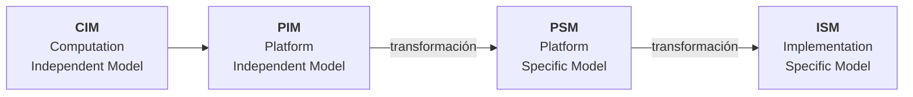

# Arquitectura dirigida por modelos (MDA)

**MDA** (*Model Driven Architecture*) es la propuesta de la **OMG** de construir software como una
**transformación sucesiva de modelos**, *"desde un alto nivel de abstracción hasta el nivel de
implementación en una plataforma concreta"*. La idea de fondo: lo que se mantiene es el **modelo**,
y el código se **genera**.

> [!note] De dónde sale esta nota
> De un artículo de cinco páginas (Meaurio y Schmieder, 2013). No es una diapositiva de clase. El
> artículo tiene dos mitades: esta nota cubre **qué es MDA**; la otra,
> [[Arquitectura de software en el modelo en espiral]], cubre dónde participa la arquitectura en el
> ciclo de vida y cómo se integra MDA.

## 1. La definición

> MDA es el acrónimo de Model Driven Architecture promovido por la OMG que propone basar el
> desarrollo del software en modelos especificados utilizando UML para que a partir de esos modelos
> se realicen transformaciones que generen código u otro modelo con menor nivel de abstracción.

Dos palabras cargan el peso: **modelos** (en UML) y **transformaciones** (de un modelo a otro más
concreto, o a código).

## 2. Los cuatro modelos

![[adjuntos/lectura-mda-y-espiral/fig1-modelos-mda-cim-pim-psm-ism.png]]

| Modelo | Nombre | Qué es, textual |
|---|---|---|
| **CIM** | Computation Independent Model | *"se centra en los requerimientos y representa el nivel más alto del modelo de negocio. Es un modelo de dominio."* La figura agrega: *"Cualquiera que pueda entender el negocio y sus procesos, puede comprenderlo"* |
| **PIM** | Platform Independent Model | *"es un modelo de alto nivel del sistema independiente de cualquier tecnología o plataforma. Permite una abstracción de las características técnicas."* |
| **PSM** | Platform Specific Model | *"Describe el sistema de acuerdo con una tecnología de implementación determinada. Proporciona independencia entre la capa de negocio y la tecnología empleada."* |
| **ISM** | Implementation Specific Model | *"La generación de código se realiza automáticamente a partir de cada PSM."* |

Y un quinto elemento, que no es un modelo: los **cartuchos MDA** (*MDA Cartridges*). *"Un cartucho
MDA contiene las reglas necesarias para realizar una transformación de modelos."*

> [!important] Regla para no confundirlos
> **CIM = el negocio · PIM = el sistema sin tecnología · PSM = el sistema con tecnología · ISM = el
> código.** La frontera que importa es la de **PIM a PSM**: ahí entra la plataforma.

La introducción del artículo agrupa los modelos así: *"desde los modelos independientes de la
plataforma (CIM y PIM) hasta los modelos dependientes de la plataforma (PSM)"*.

## 3. Las cuatro ventajas

| Ventaja | Texto del artículo |
|---|---|
| **Separación de responsabilidades** | *"Separar la especificación de la funcionalidad del sistema de su implementación sobre una plataforma en particular"* |
| **Productividad** | *"Controlar la evolución desde modelos abstractos a implementaciones, tendiendo a aumentar el grado de automatización"* |
| **Portabilidad** | *"Se logra enfocando el desarrollo en el PIM. Al ser un modelo independiente de cualquier tecnología, todo lo definido en él es totalmente portable"* |
| **Mantenimiento y documentación** | *"a partir del PIM se generan los PSM y a partir de estos el código. Básicamente el PIM desempeña el papel de la documentación de alto nivel. La trazabilidad está asegurada debido a que los cambios en el PIM se reflejan regenerando PSM y código"* |

La consecuencia práctica, según el artículo: los cambios de negocio se hacen **en el PIM** y *"se
reflejan en toda la aplicación"*, con menos trabajo, menos coste y más productividad.

> [!warning] El resumen promete «ventajas y desventajas», pero no hay desventajas
> El apartado II anuncia *"sus características, ventajas y desventajas"* y solo desarrolla ventajas.
> Si en un examen piden desventajas de MDA, **no salen de esta lectura**: hay que decirlo.

## 4. El proceso iterativo con MDA

![[adjuntos/lectura-mda-y-espiral/fig2-proceso-iterativo-con-mda.png]]

La figura 2 pone a la izquierda las etapas del ciclo y a la derecha el artefacto que sale de cada
una:

| Etapa | Artefacto de salida |
|---|---|
| Requisitos | Especificación de requisitos |
| Análisis | **PIM** |
| Diseño | **PSM** |
| Codificación | Código fuente |
| Prueba | *(la figura no le asigna artefacto)* |
| Despliegue | *(la figura no le asigna artefacto)* |

Un recuadro abarca de **Diseño** a **Prueba** con el rótulo *"Transparente al desarrollador"*: es la
parte que las transformaciones hacen solas.

## 5. Los estándares en que se apoya

| Estándar | Qué es |
|---|---|
| **UML** | *"lenguaje de modelado adoptado por MDA, empleado para la definición de los PIM y PSM"*. El artículo subraya que *"los modelos de clases son los más importantes dentro de MDA"* |
| **MOF** (Meta Object Facility) | *"establece un marco común de trabajo para las especificaciones de OMG, a la vez que provee un repositorio de modelos y meta modelos"*. Con MOF *"puede definirse cualquier lenguaje de modelado incluyendo UML"* |
| **XMI** (XML Metadata Interchange) | *"define una traza que permite transformar modelo UML en XML para poder ser tratados automáticamente por otras aplicaciones"* |
| **CWM** (Common Warehouse Metamodel) | *"Define un formato común de intercambio para metadatos en data-warehouse"*, y agrega metaclases, por ejemplo, para modelar bases de datos relacionales |

**Regla memorizable:** *UML dibuja, MOF define los lenguajes, XMI los intercambia, CWM los lleva a
los datos.*

## 6. Cómo se conecta con lo de clase

| Idea de MDA | Dónde aparece en el curso |
|---|---|
| El modelo de clases es el más importante | [[Diagrama de clases]]: en clase es del **diseño detallado**, no de la arquitectura. No se contradicen: MDA habla de qué modelo se transforma en código |
| Del CIM al código hay una traza | [[Matriz de trazabilidad de requisitos]]: MDA la obtiene regenerando; la matriz, anotándola |
| Portabilidad como ventaja | [[Atributos de calidad]]: es una de las características de ISO |
| PIM antes que PSM | [[Cómo se modela la arquitectura]]: primero alto nivel, después detalle |

## Notas relacionadas

- [[Arquitectura de software en el modelo en espiral]] — la otra mitad del artículo
- [[Arquitectura en el ciclo de vida del software]] — lo que sí es de clase sobre el tema
- [[Arquitectura y proceso de desarrollo]] — complemento sobre metodologías

## Preguntas de repaso

1. ¿Qué propone MDA y quién lo promueve?
2. Nombrá los cuatro modelos en orden y decí en cuál entra la plataforma.
3. ¿Qué contiene un cartucho MDA?
4. ¿Por qué el artículo dice que con MDA la trazabilidad «está asegurada»?
5. ¿Qué hace cada uno de los cuatro estándares: UML, MOF, XMI y CWM?
