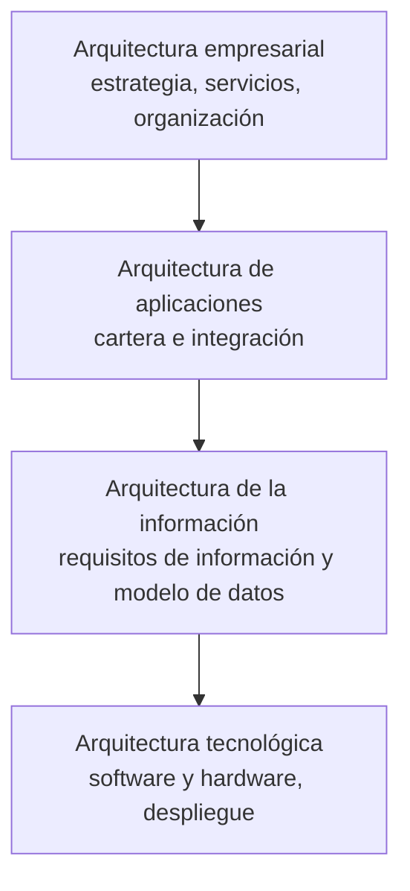

# Arquitectura empresarial

## 1. Los cuatro dominios — la lámina

| Dominio | Definición (lámina, textual) |
|---|---|
| **Arquitectura empresarial** | *"Describe la estrategia de la empresa, los servicios ofrecidos, la organización y las capacidades empresariales necesarias para prestar los servicios."* |
| **Arquitectura de aplicaciones** | *"Define la cartera de aplicaciones de la empresa, la integración y el modo en que estos activos de TI respaldan los procesos y servicios prestados."* |
| **Arquitectura de la información** | *"Define los requisitos de información y el modelo de datos de la empresa y ayuda a garantizar que los datos se gestionan para dar soporte a las necesidades del negocio."* |
| **Arquitectura tecnológica** | *"Identifica las tecnologías (software y hardware) que soportan las aplicaciones y los datos y comprende cómo se despliegan."* |

Van **escalonadas de arriba hacia abajo**: cada una se apoya en la de abajo. Negocio → aplicaciones →
información → tecnología.

![[adjuntos/capturas-clase-U3/arquitectura-informacion/u3f3-13-cuatro-dominios-arquitectura-empresarial.png]]

> [!warning] Dos trampas
> 1. **La arquitectura de la información de esta lámina habla de datos** (*"modelo de datos"*). La de
>    la NT2 habla de **contenidos para el usuario** (categorías, etiquetas, navegación), →
>    [[Arquitectura de la información]]. Son dos usos del mismo nombre: decí de cuál hablás.
> 2. **"Arquitectura empresarial" aparece dos veces**: como el **todo** (el diagrama de comunicación)
>    y como la **capa de arriba** (estrategia). En la lámina de cuatro, es el dominio de **negocio**
>    *(en TOGAF se llama *business architecture* — complemento)*.

**Dónde cae la arquitectura de software del curso**: entre **aplicaciones** (componentes,
integración, estilos) y **tecnológica** (el [[Diagrama de despliegue]]). *(Correspondencia propia.)*

## 2. El diagrama de comunicación de la arquitectura empresarial

Un ejemplo (empresa **PIENSA**) que muestra **cómo se comunican** las zonas de la empresa:

| Zona | Qué tiene |
|---|---|
| **PIENSA Producción** | operador, operador taller, impresión, etiquetas, lector de código de barras, **switch fábrica** |
| **PIENSA Gestión** | gestión de entradas y de salidas, calidad, veterinario, informes, etiquetas, **switch gestión** |
| **PIENSA Stock** | PDA/Stock por **wi-fi** |
| **PIENSA Servidor** | **redundancia**, MSMQ/SMS/sucesos/logs, servidor de informes |
| Al centro | **router**, básculas con conversor serie/TCP, lectores de código de barras ethernet, **router cortafuegos** |
| Afuera | proxy aplicación/autómata y **capa de automatización / PROFINET**; por **Internet**: soporte técnico/acceso remoto, gerente, jefe de producción; por **GSM/Mobile**: smartphone (acceso a informes) y SMS (recibe alertas) |

Es un diagrama **de red y comunicación**, no UML: muestra áreas, dispositivos y enlaces. Se parece al
[[Diagrama de despliegue]] en que reparte cosas en nodos, pero sin estereotipos ni componentes.

![[adjuntos/capturas-clase-U3/arquitectura-informacion/u3f3-09-diagrama-comunicacion-arquitectura-empresarial.png]]

## Preguntas de repaso

1. Nombrá los cuatro dominios y definí cada uno con la lámina.
2. ¿Qué diferencia hay entre la *arquitectura de la información* de esta lámina y la de la NT2?
3. ¿Qué muestra un diagrama de comunicación de la arquitectura empresarial?
4. ¿En qué dominios cae la arquitectura de software que hacemos en el curso?
