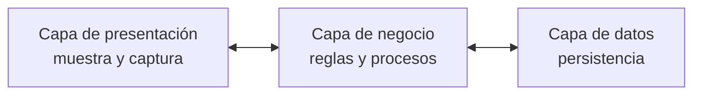
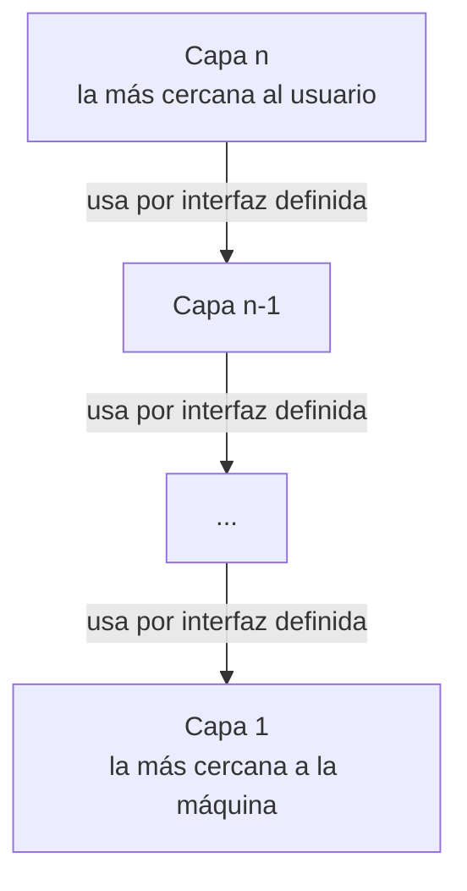

# Arquitectura en capas

El estilo que la clase más desarrolló: **N-Capas** en general, **2 capas** (el modelo
cliente-servidor) como caso particular, y un **diagrama de componentes por capas** como ejemplo.
Cubre dos estilos del catálogo del punto 1.9: *en capas* y *cliente-servidor*. Ver
[[Estilos arquitectónicos]].

> [!important] La clase le dedicó una serie entera: "–arquitectura en o por capas–"
> Las §1-§4 salen de la primera tanda (capturas_U2). La tercera tanda (capturas_U2_F3, 0-12) trae
> **doce diapositivas más** con el subtítulo en rojo *"–arquitectura en o por capas–"*: la
> definición, cinco dibujos de capas, dos ejemplos web, una infografía, ventajas y desventajas y dos
> ejercicios. Van de la §5 en adelante; las §1-§4 no se renumeraron porque otras notas enlazan a
> *§3* (cliente-servidor).

| § | Qué hay | Capturas |
|---|---|---|
| 1-2 | N-Capas y la clínica veterinaria | capturas_U2 |
| 3 | 2 capas = cliente-servidor, smartphone/smartwatch, **ejemplo web Apache + MySQL** | capturas_U2 · U2_F3 3, 4, 5 |
| 4 | capa y nivel como sinónimos | capturas_U2 · U2_F3 2, 7, 10 |
| 5 | **la definición de "en o por capas"** y los anillos | U2_F3 0, 1 |
| 6 | la infografía: especialización de cliente-servidor, características, 4 capas, ejemplos | U2_F3 10 |
| 7 | los modelos de niveles que mostró (3 niveles web, thin/rich client, tiers) | U2_F3 2, 6, 7 |
| 8 | capas fuera de la web (aplicación-servicios-red-objetos y la pirámide) | U2_F3 8, 9 |
| 9 | ventajas y desventajas | U2_F3 11 |
| 10-11 | la trampa y dónde encaja en el catálogo | — |
| 12 | los ejercicios que dejó la clase | U2_F3 12 |

> [!note] Por qué 2 capas va dentro de esta nota y no aparte
> La catedrática presenta *"Arquitectura de 2 capas"* inmediatamente después de *"Arquitectura
> N-Capas"*, con el mismo formato de diapositiva: para ella es **N-Capas con N = 2**. Separarlas
> rompería esa lectura. Cliente-servidor queda en §3.

---

## 1. N-Capas: la definición

Textual de la diapositiva *"Arquitectura N-Capas"*:

> N-Capas: En el diseño de sistemas informáticos actual se suele usar las **arquitecturas multinivel
> o Programación por capas**. En dichas arquitecturas **a cada nivel se le confía una misión
> simple**, lo que permite el diseño de **arquitecturas escalables** (que pueden ampliarse con
> facilidad en caso de que las necesidades aumenten).

Dos ideas para quedarse:

| Idea | Lo que dice | Para qué sirve |
|---|---|---|
| **Una misión simple por nivel** | cada capa hace una sola cosa | separa responsabilidades: presentación, negocio, datos |
| **Escalable** | *"pueden ampliarse con facilidad"* | es el atributo de calidad que la diapositiva le asigna al estilo |

![[adjuntos/capturas-clase-U2/estilos/n-capas-definicion.png]]

### El diagrama de la diapositiva

Leído con zoom (no se redibuja):

| Fila del dibujo | Contenido |
|---|---|
| **Capas** (cajas azules) | **Presentación** ⇄ **Negocio** ⇄ **Datos**, unidas por **flechas dobles** (comunicación en los dos sentidos, solo entre capas vecinas) |
| **Dónde corre** (barras verdes) | **Cliente** bajo la parte izquierda de Presentación · **Servidor Aplicativo** desde una **línea punteada dentro de Presentación** hasta el final de Negocio · **SGBD** bajo Datos |
| **Hardware** (íconos) | una **laptop** (cliente) · un ícono chico entre la laptop y los servidores (por la forma, parece un *firewall*; no está rotulado) · **tres servidores** (el servidor aplicativo) · **un servidor con base de datos** (SGBD) |

> [!tip] El detalle que se escapa: la presentación está partida
> La línea punteada cae **dentro** de la caja *Presentación*: una parte de la presentación corre en
> el **cliente** y otra en el **servidor aplicativo**. Es el caso típico de una aplicación web: el
> navegador muestra, pero las páginas se generan en el servidor. Y el servidor aplicativo son
> **tres** máquinas: la escalabilidad de la definición, dibujada.

Esquema propio del patrón conceptual (no es el diagrama de la clase):

**Regla para el examen:** *N-Capas = cada nivel, una misión simple → arquitectura escalable.
Presentación, negocio, datos.*

---

## 2. Un diseño concreto en capas: la clínica veterinaria

La diapositiva *"Arquitectura: Capas"* muestra un **diagrama de componentes** rotulado *"Diagrama de
componentes clínica veterinaria"*. Cada capa es un **paquete** (rectángulo con pestaña), y la
catedrática las numeró en rojo del **1 al 4**.

![[adjuntos/capturas-clase-U2/estilos/capas-componentes-clinica-veterinaria.png]]

Tabla leída con zoom:

| Nº | Paquete (capa) | Componentes adentro |
|---|---|---|
| **1** | **Presentación** | *Interfaz usuarios* · *Interfaz administrador* |
| **2** | **Lógica de negocio** | *Creación de facturas* · *Gestión de animales* · *Gestión de empleados* · *Gestor de avisos* · *Workflow* · *Gestor documental* |
| **3** | **BBDD** | (vacío en el dibujo) |
| **4** | **Servicios** | (vacío en el dibujo) |

| Relación | Línea | Punta |
|---|---|---|
| Presentación — Lógica de negocio | **punteada** | la flecha apunta **hacia Lógica de negocio** |
| BBDD — Lógica de negocio | **punteada** | la flecha apunta **hacia Lógica de negocio** (hacia arriba) |
| Servicios — Lógica de negocio | **punteada** | la flecha apunta **hacia Lógica de negocio** (hacia arriba) |

> [!warning] Ojo con la dirección de las flechas 3 y 4
> En UML una flecha punteada es una **dependencia** y va **del que usa hacia el que es usado** (ver
> [[Diagrama de componentes]]). Presentación → Lógica cumple eso. Pero BBDD y Servicios apuntan
> **hacia arriba**, a Lógica de negocio: leído al pie de la letra, dirían que la base de datos
> *usa* a la lógica, que es lo contrario de lo que suele querer decir un diagrama en capas (la
> lógica usa la base). Transcribilo **como está**; si lo vas a reproducir, **preguntale** si la
> dirección es intencional.

Por qué este diagrama importa: con las definiciones de [[Estilos arquitectónicos]] §1, esto es un
**diseño arquitectónico** (un sistema concreto, la clínica) que **respeta el estilo en capas**.
Además muestra que las capas **se modelan con un diagrama de componentes** agrupado en paquetes.

---

## 3. Arquitectura de 2 capas: el modelo cliente-servidor

### La diapositiva

La diapositiva *"Arquitectura de 2 capas"* no trae definición en texto: trae dos dibujos, y el de
abajo se titula ***"Modelo Cliente Servidor"***.

![[adjuntos/capturas-clase-U2/estilos/dos-capas-modelo-cliente-servidor.png]]

| Dibujo | Qué muestra |
|---|---|
| **Arriba** | **Cliente** → **1 Petición** → **Servidor**; el servidor devuelve **2 Respuesta** al cliente. La numeración marca el orden: **siempre pide primero el cliente** |
| **Abajo** | **Clientes** (tres PC dentro de un recuadro punteado) mandan *Petición* a **Internet** y reciben *Respuesta*; Internet pasa la *Petición* al **Servidor** y le devuelve la *Respuesta*. Muchos clientes, un servidor, y la red en el medio |

Las dos capas son **cliente** y **servidor**. El que **inicia** es el cliente; el servidor
**responde**.

### El ejemplo: el rol cambia

La segunda diapositiva de 2 capas, textual:

> **El Smartphone** tiene instalada una aplicación de mensajería (como WhatsApp, Hangout, Telegram,
> etc.) que **como Cliente realiza peticiones [1] a un Servidor físico** (mediante 3G, 4G, 5G, etc.)
> preguntando si hay mensajes nuevos, **el Servidor físico responde [2]** con los mensajes nuevos que
> le llegan al Smartphone; **entonces el Smartwatch pregunta [3] como cliente al Smartphone -que
> ahora cambia de rol- como Servidor**, y como el Smartphone tiene mensajes en su memoria **se los
> devuelve [4]** al Smartwatch.

![[adjuntos/capturas-clase-U2/estilos/dos-capas-smartphone-smartwatch.png]]

| Paso | Quién pide (cliente) | Quién responde (servidor) |
|---|---|---|
| **[1]** Petición | Smartphone | Servidor físico |
| **[2]** Respuesta | — | Servidor físico → Smartphone |
| **[3]** Petición | **Smartwatch** | **Smartphone** (cambió de rol) |
| **[4]** Respuesta | — | Smartphone → Smartwatch |

> [!important] La lección del ejemplo
> **Cliente y servidor son ROLES, no máquinas.** El mismo smartphone es **cliente** en [1]-[2] y
> **servidor** en [3]-[4]. Lo que define el rol es **quién inicia la petición** en esa interacción.

> [!note] La clase la volvió a dar (capturas_U2_F3, 3)
> El mismo dibujo reapareció en la serie de capas, **sin el texto** y con otro título:
> *"EJEMPLO –arquitectura en o por capas–"*. Para ella el ejemplo del rol que cambia es un ejemplo
> **de capas**, no solo de cliente-servidor: otra confirmación de que 2 capas = N-Capas con N = 2.

**Regla para el examen:** *2 capas = cliente-servidor: el cliente pide [1], el servidor responde
[2]; ser cliente o servidor es un rol, no un aparato.*

> [!tip] Cliente-servidor también visto como llamada y retorno
> El catálogo de clase pone a cliente-servidor y a capas dentro de la familia de **llamada y
> retorno**, y hay una diapositiva propia *"call return: cliente-servidor"*: está desarrollada en
> [[Arquitectura de llamada y retorno]]. Acá queda solo la lectura **por capas**.

### El ejemplo web: Apache y MySQL (capturas_U2_F3, 4 y 5)

Dos diapositivas seguidas con el título *"EJEMPLO –arquitectura en o por capas–"*. La primera
muestra **qué hay** en cada lado; la segunda, **en qué orden** se atiende un pedido. No traen texto
explicativo: todo está en el dibujo.

![[adjuntos/capturas-clase-U2/capas/capas-ejemplo-cliente-servidor-apache-mysql.png]]

Leído con zoom (captura 4):

| Lado | Qué contiene |
|---|---|
| **Cliente** (laptop verde) | un navegador con la dirección *www.abc.com* y los íconos de Chrome, Safari, Firefox e Internet Explorer/Edge |
| **Servidor** (rack azul) | dos programas, **MySQL** y **Apache**, cada uno con un "ojo" que mira una carpeta · el árbol de carpetas **usuario** → **privado** y **www (público)** |
| carpeta **privado** (la mira MySQL) | *Bases de datos* · *Python (Programación)* · *Java (Programación)* · *Imágenes* |
| carpeta **www (público)** (la mira Apache) | *PHP (Programación Servidor)* · *JavaScript (Programación Cliente)* · *CSS (Estilo)* · *HTML (Estructura)* · *Imágenes* |

![[adjuntos/capturas-clase-U2/capas/capas-ejemplo-peticion-del-index-pasos-1-5.png]]

Los pasos numerados de la captura 5, con la dirección de cada flecha leída con zoom:

| Paso | Flecha | De → a |
|---|---|---|
| **1** | *"Petición del index"* (rótulo violeta) | navegador del Cliente → **Apache** |
| **2** | amarilla | archivo **PHP** de la carpeta *www* → un PHP que se ejecuta junto a Apache |
| **3** | amarilla, hacia arriba | el PHP en ejecución → **MySQL** · y una flecha oscura MySQL → *Bases de datos* (carpeta privado) |
| **4** | una oscura y una amarilla, casi paralelas | oscura: *Bases de datos* → el PHP en ejecución · amarilla: el PHP en ejecución → hacia *Python* (carpeta privado) |
| **5** | amarilla | el procesamiento (engranajes) → un archivo **HTML** dentro del rótulo *"Respuesta"*, que vuelve (flecha verde) al navegador del Cliente |

> [!note] Lectura del paso 4
> Las dos flechas del 4 salen del mismo punto y el rótulo queda entre ellas. La oscura es claramente
> *"la base devuelve los datos"*; la punta de la amarilla cae junto al ícono de *Python*, y el dibujo
> no dice qué se le pide. Transcribilo **como está**.

Lo que enseña el ejemplo: **el cliente solo pide y muestra** (paso 1 y 5); **todo el trabajo ocurre
del lado del servidor** y en orden: servidor web → programa → base de datos → vuelta con HTML. Es el
mismo recorrido de los **tres niveles web** de la §7.

### Lo que suma el complemento

> [!note] COMPLEMENTO — lo que suma el catálogo
> Restricciones del estilo cliente-servidor según el SAIP: la comunicación la **inicia siempre el
> cliente** (lo mismo que muestra la numeración de la clase) y **los clientes no se comunican entre
> sí**. Si un aparato empieza a atender pedidos de otro, como el smartphone, deja de ser "solo
> cliente": asumió el rol de servidor en esa interacción. Ficha completa en
> [[Estilos arquitectónicos]] §8.

---

## 4. Capa y nivel: la clase los usa como sinónimos

> [!warning] Desfase entre la clase y el complemento
> **Lo que hace la clase:** trata *capa* y *nivel* como la misma cosa.
> - Define N-Capas como *"arquitecturas **multinivel** o Programación por **capas**"* y dice que *"a
>   cada **nivel** se le confía una misión simple"*.
> - Llama *"2 **capas**"* al modelo cliente-servidor, donde lo que hay son **dos máquinas**.
> - En la nube titula *"N-**niveles** en la nube"* un diagrama cuyas partes se llaman *Web **tier***,
>   *Business **tier***, *Data **tier*** (ver [[Arquitectura en la nube]]).
>
> **Lo que dice el complemento** (SAIP vía guía de estudio): son dos cosas distintas.

| | **Capa** (*layer*) — complemento | **Nivel** (*tier*) — complemento |
|---|---|---|
| Qué parte | el **código** | el **despliegue** (máquinas o procesos) |
| Estructura donde vive | de **módulos** | de **asignación** ([[Categorías de estructuras]]) |
| Se ve en | un diagrama de paquetes o de componentes (la clínica veterinaria) | un [[Diagrama de despliegue]] (los servidores de N-Capas) |
| Ejemplo | presentación / negocio / datos dentro de una sola aplicación | cliente / servidor aplicativo / SGBD en máquinas separadas |

Consecuencia: **tres capas pueden correr en un solo nivel** (un [[Arquitectura monolítica|monolito]]
bien estratificado), y el propio diagrama de N-Capas de la clase muestra **una capa repartida en dos
niveles** (la presentación, partida por la línea punteada entre cliente y servidor aplicativo).

**Para el examen:** usá **su** vocabulario (N-Capas, 2 capas, N-niveles), pero si preguntan la
diferencia, sabé explicarla.

### La serie de capas lo confirma (capturas_U2_F3)

Tres diapositivas más mezclan los dos términos, y una de ellas los usa **en la misma frase**:

| Captura | Texto o rótulo | Cómo usa los términos |
|---|---|---|
| **2** | *"El primer **nivel** consiste en la **capa** de presentación…"* | nivel que contiene una capa |
| **7** | *Tier 1 Presentation · Tier 2 Business Logic · Tier 3 Data/Resource*, bajo el título *"–arquitectura en o por **capas**–"* | tier = capa |
| **10** | *"Las capas de una aplicación pueden residir en la misma maquina física (**misma capa**) o puede estar distribuido sobre diferentes computadores (**n-capas**)"* [sic] | **capa** para la división lógica **y** para la máquina física, en la misma oración |

La captura 10 es la prueba más fuerte: dice que las capas (lógicas) pueden quedar en *"misma capa"*
(una máquina) o en *"n-capas"* (varias máquinas). Es exactamente la distinción capa/tier del
complemento, **dicha con una sola palabra**. En clase: *capa* sirve para las dos cosas; si hace falta
distinguir, el contexto lo da (*"misma máquina física"* vs. *"diferentes computadores"*).

---

## 5. "En o por capas": la definición de la serie

### La definición (captura 0)

Textual de la diapositiva *"Estilos Arquitectónicos –arquitectura en o por capas–"*:

> - Hay varias capas definidas, cada una de ellas realiza operaciones que se acercan progresivamente
>   al conjunto de instrucciones de la máquina.
> - En la capa externa los componentes sirven a las operaciones de interfaz del usuario.
> - Las capas intermedias proporcionan servicios de utilería y de SW de aplicaciones
> - En la capa interna los componentes sirven como interfaz con el sistema operativo.

![[adjuntos/capturas-clase-U2/capas/capas-definicion-externa-intermedias-interna.png]]

| Capa | Qué hacen sus componentes | Cerca de… |
|---|---|---|
| **Externa** | *"sirven a las operaciones de interfaz del usuario"* | el usuario |
| **Intermedias** | *"proporcionan servicios de utilería y de SW de aplicaciones"* | — |
| **Interna** | *"sirven como interfaz con el sistema operativo"* | la máquina |

La idea que ordena todo: **de afuera hacia adentro, cada capa se acerca más "al conjunto de
instrucciones de la máquina"**. La de afuera habla con la persona; la de adentro, con el sistema
operativo.

### Los anillos (captura 1)

La diapositiva siguiente dibuja esa definición como **anillos concéntricos**. Leído con zoom (no se
redibuja):

![[adjuntos/capturas-clase-U2/capas/capas-anillos-concentricos-modulos.png]]

| Anillo (de afuera hacia adentro) | Color | Qué tiene |
|---|---|---|
| **Capa de la interfaz de usuario** | azul | cinco rectángulos blancos en escalera |
| **Capa de la Aplicación** | blanco | tres rectángulos celestes |
| **Capa de Utilerías** | azul | cuatro rectángulos blancos |
| **Capa Centra[l]** | blanco (centro) | un rectángulo celeste |

- El rótulo **"Módulos"**, arriba a la izquierda, tiene **tres líneas** que apuntan a los rectángulos
  del anillo externo: los rectángulos son **módulos**.
- El rótulo del centro se lee *"Capa Centra"*: el rectángulo celeste tapa la **l** final (se ve el
  trazo vertical asomando). Es *"Capa Central"*.
- Los rectángulos de cada anillo quedan **pegados al borde del anillo siguiente**: cada capa se
  apoya en la de adentro.

Cómo se corresponden la definición y el dibujo:

| Definición (captura 0) | Anillo (captura 1) |
|---|---|
| capa **externa** — interfaz del usuario | Capa de la interfaz de usuario |
| capas **intermedias** — *SW de aplicaciones* y *utilería* | Capa de la Aplicación · Capa de Utilerías |
| capa **interna** — interfaz con el sistema operativo | Capa Central |

**Regla para el examen:** *en o por capas = capas que se acercan progresivamente a la máquina:
externa = interfaz de usuario, intermedias = aplicación y utilerías, interna = interfaz con el
sistema operativo. Las capas contienen módulos.*

---

## 6. La infografía "Arquitectura por capas" (captura 10)

Una sola diapositiva con cuatro bloques: definición, las 4 capas más comunes, características y
ejemplos. Todo textual.

![[adjuntos/capturas-clase-U2/capas/capas-infografia-arquitectura-por-capas.png]]

### La definición

> Especialización de la arquitectura cliente-servidor, que se puede utilizar para estructurar
> programas que se pueden descomponer en grupos de subtareas con un reparto claro de funciones. Una
> capa solamente tiene relación con la siguiente.

Tres ideas:

| Idea | Lo que dice | Consecuencia |
|---|---|---|
| **Especialización de cliente-servidor** | capas **hereda** de cliente-servidor | coincide con el árbol C&C, donde *Multi-tier* es hijo de *Client-server* ([[Catálogo de estilos arquitectónicos]]) |
| **Grupos de subtareas con reparto claro** | el problema se parte en funciones separadas | es la *"misión simple por nivel"* de N-Capas (§1) |
| **Una capa solamente tiene relación con la siguiente** | nada de saltos | la regla de vecindad |

### Las 4 capas más comunes

> Las 4 capas más comúnmente encontradas de un sistema de información general son las siguientes.

| Capa | *"también conocida como"* |
|---|---|
| **Capa de presentación** | capa UI |
| **Capa de aplicación** | capa de servicio |
| **Capa de lógica de negocios** | capa de dominio |
| **Capa de acceso a datos** | capa de persistencia |

Debajo hay un dibujo con **otras** cuatro etiquetas (leído con zoom):

| Columna | Elemento | Flecha |
|---|---|---|
| **Capa Cliente** | Cliente | ⇄ con Servidor Web (doble punta) |
| **Capa Web/ Servicios** | Servidor Web | ⇄ con Servidor de Aplicaciones (doble punta) |
| **Capa de lógica de negocios** | Servidor de Aplicaciones | ⇄ con Base de Datos (doble punta) |
| **Capa de base de datos** | Base de Datos (cilindro) | — |

> [!warning] El texto y el dibujo de la misma diapositiva no nombran igual las capas
> El texto dice *presentación / aplicación / lógica de negocios / acceso a datos* (capas **lógicas**
> de un programa). El dibujo dice *cliente / web-servicios / lógica de negocios / base de datos*, y
> adentro pone **servidores** (capas **físicas**). Son dos lecturas del mismo estilo; si lo citás,
> decí de cuál de las dos hablás.

### Las características

> El estilo de arquitectura basado en capas se identifica por las siguientes características:
>
> - Describe la descomposición de servicios de forma que la mayoría de la interacción ocurre
>   solamente entre capas vecinas.
> - Las capas de una aplicación pueden residir en la misma maquina física (misma capa) o puede estar
>   distribuido sobre diferentes computadores (n-capas).
> - Los componentes de cada capa se comunican con otros componentes en otras capas a través de
>   interfaces muy bien definidas.
> - Este modelo ha sido descrito como una "pirámide invertida de re-uso" donde cada capa agrega
>   responsabilidad y abstracción a la capa directamente sobre ella.

| Característica | Palabra clave |
|---|---|
| interacción entre **capas vecinas** | *"la mayoría"* — no *"toda"* |
| misma máquina o varias | *"misma capa"* / *"n-capas"* (ver §4) |
| comunicación entre capas | **interfaces muy bien definidas** |
| cómo crece | **pirámide invertida de re-uso**: cada capa agrega responsabilidad y abstracción a la de arriba |

Arriba a la derecha hay un esquema mínimo: **Layer n** → **Layer n-1** (flecha llena hacia abajo)
→ … → **Layer 1** (flecha **punteada** hacia abajo: por la forma, las capas intermedias que no se
dibujan). Las flechas van **de la capa de arriba a la de abajo**; la lectura habitual —propia, la
diapositiva no la explica— es que la superior usa a la inferior.

### Los ejemplos

> Algunos tipos comunes de aplicaciones por capas incluyen:
>
> - Aplicaciones de línea de negocios (LOB), como contabilidad, y sistemas de gestión de clientes.
> - Aplicaciones web Corporativas y sitios Web
> - Aplicaciones corporativas de escritorio o clientes inteligentes con servidores centralizados de
>   aplicación con lógica de negocios.

Esquema propio del patrón conceptual que describen las características (no es un dibujo de la clase):

**Regla para el examen:** *capas = especialización de cliente-servidor · cada capa habla con su
vecina por interfaces bien definidas · pirámide invertida de re-uso · 4 capas comunes: presentación
(UI), aplicación (servicio), lógica de negocios (dominio), acceso a datos (persistencia).*

---

## 7. Los modelos de niveles que mostró

Tres diapositivas del mismo estilo, cada una con otro corte. **No son contradictorias**: parten el
mismo sistema web en 3 o 4 pedazos según qué se quiera mostrar.

### Tres niveles web (captura 2)

> El primer nivel consiste en la capa de presentación que incluye el navegador y el servidor web. El
> segundo nivel esta referido a algún programa o scripts. El tercer nivel proporciona al segundo
> datos necesarios para su ejecucion. [sic]

![[adjuntos/capturas-clase-U2/capas/capas-tres-niveles-web-browser-script-datos.png]]

| Elemento del dibujo | Dónde está | Flechas |
|---|---|---|
| **Browser** (rotulado *Cliente*) | afuera del recuadro *Servidor* | **Petición** Browser → Servidor Web · **Respuesta** Servidor Web → Browser |
| **Servidor Web** | dentro de *Servidor* | ⇄ con el *Entorno de Ejecución* (doble punta) |
| **Entorno de Ejecución** (recuadro punteado) con **Programa o Script** adentro | dentro de *Servidor* | ⇄ con *Datos* (doble punta, vertical) |
| **Datos** | dentro de *Servidor* | — |

| Nivel (llave del dibujo) | Qué abarca |
|---|---|
| **1er nivel** (llave horizontal abajo) | desde **Browser** hasta **Servidor Web** |
| **2º nivel** (llave a la derecha) | el **Entorno de Ejecución** con el *Programa o Script* |
| **3er nivel** (llave a la derecha) | **Datos** |

> [!tip] El detalle que se escapa
> El **servidor web está en el primer nivel**, junto al navegador, aunque vive **dentro de la caja
> Servidor**. Los niveles no son máquinas: el nivel 1 cruza la frontera cliente/servidor. Es el
> mismo fenómeno que la **presentación partida** del diagrama de N-Capas (§1).

### Thin client, rich client y cuatro capas (captura 6)

Una diapositiva con **tres** dibujos.

![[adjuntos/capturas-clase-U2/capas/capas-thin-rich-client-cuatro-capas-reglas-de-negocio.png]]

**Arriba a la izquierda — la plataforma en perspectiva** (rótulos en inglés, leídos con zoom):

| Franja | Qué hay |
|---|---|
| **Presentation** | **Thin Client** (arriba, terminales chicas) y **Rich Client** (abajo, PC completa), con una cuña que se ensancha de thin a rich |
| (entre Presentation y Business Logic) | **Firewall** (muro de ladrillos) |
| **Business Logic** | un servidor/contenedor con bloques de colores |
| **Data** | **Databases** · **Legacy Systems** · **External Applications** |
| franjas transversales | **Tools** (arriba, a lo largo) · **System Services** (abajo, a lo largo) |

**Abajo a la izquierda — cuatro capas separadas por líneas rojas:**

| Capa | Elemento | Hardware |
|---|---|---|
| **Capa 1** | **Navegador** (dos, en PCs) | PCs conectadas a una nube **Internet/ Intranet** |
| **Capa 2** | **Servidor Web** | un servidor |
| **Capa 3** | **Lógica de negocios** | un servidor |
| **Capa 4** | **Base de datos** | un servidor |

Flechas rojas: una recorre **Capa 1 → Servidor Web → Lógica de negocios → Base de datos**; otra sale
de una **tercera PC** (abajo), pasa por el servidor de la capa 2 y sube en diagonal hasta **Lógica de
negocios**. Una línea negra une la nube con los tres servidores (la red física).

**A la derecha — capas lógicas con servicios** (leído con zoom):

| De arriba hacia abajo | Flecha con la siguiente |
|---|---|
| **Usuario** | ⇄ (dos flechas de doble punta) |
| **Capa de Presentación** | ⇄ |
| **Capa de Reglas de Negocio (Empresarial)** | ⇄ · y recibe una flecha de **una sola punta** desde **Servicios de Llamadas** (caja celeste a la derecha) |
| **Capa de Datos** | ⇄ con cada una de las dos cajas de abajo |
| **Orígenes de Datos** (cilindros) · **Servicios** (cubos) | — |

> [!note] Thin client y rich client
> Es la única diapositiva que los nombra, y **sin definirlos**: solo los ubica como los dos extremos
> de la franja *Presentation*. **COMPLEMENTO** (conocimiento general, para entender): un *thin
> client* (cliente liviano) deja casi todo el procesamiento en el servidor —un navegador—; un *rich
> client* (cliente pesado o inteligente) ejecuta parte de la lógica en la máquina del usuario —una
> aplicación de escritorio—. La infografía (§6) nombra a estos últimos como *"clientes
> inteligentes"*.

### Three-tier (captura 7)

![[adjuntos/capturas-clase-U2/capas/capas-three-tier-presentation-business-data.png]]

| Tier | Rótulo interno | Elementos |
|---|---|---|
| **Tier 1 — Presentation** | *Clients* | cinco PCs |
| **Tier 2 — Business Logic** | *Application Servers* | tres servidores de aplicación (caja violeta con globo) |
| **Tier 3 — Data/Resource** | *Existing Enterprise Information Systems* | un sistema de información · un **Resource Manager** · **Resources (for example; databases)** [sic] |

Flechas, todas **punteadas** (leídas con zoom):

| Entre | Punta |
|---|---|
| Clients ↔ Application Servers, por una línea rotulada **LAN** | doble: puntas en cada PC y en cada servidor |
| Application Servers ↔ sistema de información | doble (desde el 1º y el 2º servidor) |
| Application Servers ↔ Resource Manager | doble (desde los tres servidores) |
| Resource Manager → Resources | una sola punta, hacia cada base de datos |

Lo que muestra: **los clientes nunca tocan el tier 3**. Todo pasa por el tier 2, y el acceso a los
datos se hace **a través de un Resource Manager**, no directo.

**Regla para el examen:** *los niveles se cortan distinto (3 niveles web, 4 capas, 3 tiers), pero
siempre en el mismo orden: presentación → lógica → datos, y sin saltarse el del medio.*

---

## 8. Capas fuera de la web (capturas 8 y 9)

Dos diapositivas del mismo título que muestran que el estilo **no es solo para aplicaciones web**.
Ninguna trae texto explicativo.

### Cuatro capas: aplicación, servicios, red, objetos (captura 8)

![[adjuntos/capturas-clase-U2/capas/capas-aplicacion-servicios-red-objetos.png]]

| Capa (de arriba hacia abajo) | Íconos a la izquierda |
|---|---|
| **CAPA DE APLICACIÓN** | teléfono, monitor, tableta, laptop con wifi |
| **CAPA DE SERVICIOS** | un cilindro *Registry* y un grafo de tres nodos |
| **CAPA DE RED** | una nube |
| **CAPA DE OBJETOS** | **RFID**, **WSN** (*Wireless Sensor Networks*), una etiqueta RFID |

A la derecha, dos flechas verdes gruesas: una **hacia arriba** a la altura de *Servicios* y
*Aplicación*, y otra **hacia abajo** a la altura de *Red* y *Objetos*.

### La pirámide de cinco capas (captura 9)

![[adjuntos/capturas-clase-U2/capas/capas-piramide-negocios-a-objetos.png]]

| Capa (de la punta a la base) | Íconos |
|---|---|
| **CAPA DE NEGOCIOS** | un ejecutivo sobre un gráfico de barras que sube |
| **CAPA APLICACIÓN** | dos personas frente a monitores |
| **CAPA GESTIÓN DE SERVICIOS** | servidores con un globo terráqueo y un teléfono |
| **CAPA ABSTRACCIÓN DE OBJETOS** | un router, una antena **3G**, **WiFi** |
| **CAPA OBJETOS** | PDA, teléfono, tableta, laptop |

> [!note] COMPLEMENTO — de dónde salen estos dos dibujos
> Las diapositivas no lo dicen, pero por los íconos (RFID, redes de sensores, 3G, WiFi) son los dos
> modelos más citados de **arquitectura en capas para Internet de las Cosas (IoT)**: el de cuatro
> capas y el de cinco capas "basado en servicios". Identificación **propia**, no de la clase. Lo que
> sí es de la clase: que los puso como ejemplo de *"arquitectura en o por capas"*.

Lo que enseñan los dos: la **base** es lo más cercano al **mundo físico** (objetos, sensores) y la
**punta** es lo más cercano al **negocio**. Es la misma idea de la definición (§5) —cada capa se
acerca progresivamente a la máquina— con otra "máquina" en el fondo: los dispositivos.

---

## 9. Ventajas y desventajas (captura 11)

![[adjuntos/capturas-clase-U2/capas/capas-ventajas-desventajas.png]]

> **Ventajas**
> - Facilita la descomposición del problema en varios niveles de abstracción.
> - Soporta fácilmente la evolución del sistema, los cambios sólo afectan a las capas vecinas
> - Se pueden cambiar las implementaciones respetando las interfaces con las capas adyacentes
>
> **Desventajas**
> - No todos los sistemas pueden estructurarse en capas
> - A menudo es difícil encontrar la separación en capas adecuadas

| Ventaja | Atributo de calidad que toca ([[Atributos de calidad]]) — *lectura propia, no de la diapositiva* |
|---|---|
| descomposición en niveles de abstracción | ninguno directo: facilita entender y diseñar |
| los cambios solo afectan a las capas vecinas | **mantenibilidad** (evolución) |
| cambiar implementaciones respetando interfaces | **mantenibilidad** / portabilidad |

Y las tres ventajas descansan en la misma condición: la **regla de vecindad** y las **interfaces bien
definidas** de la §6. Si una capa se salta a otra, el cambio ya no queda contenido en las vecinas.

**Regla para el examen:** *ventajas: abstracción, evolución (cambios solo en vecinas), implementaciones
intercambiables respetando interfaces. Desventajas: no todo se puede estructurar en capas, y es
difícil encontrar la separación adecuada.*

---

## 10. La trampa

> [!warning] Tres errores con este estilo
> 1. **Creer que "capa" es una máquina.** La §7 lo desmiente dos veces: el servidor web cae en el
>    *primer nivel* junto al navegador (captura 2), y la infografía dice que las capas pueden estar
>    en *"la misma maquina física"* (captura 10).
> 2. **Decir que una capa "solo" habla con su vecina, sin matiz.** La definición de la infografía dice
>    *"solamente tiene relación con la siguiente"*, pero sus características dicen *"la **mayoría** de
>    la interacción"*. Si lo citás, citá la frase exacta que corresponde.
> 3. **Confundir la lista de capas.** No hay "las" capas del estilo: la clase mostró cuatro juegos
>    (externa/intermedias/interna · presentación/aplicación/negocio/datos · cliente/web/negocio/BD ·
>    objetos/.../negocios). El estilo es la **regla** (capas ordenadas, cada una usa la de abajo por
>    interfaces), no una lista fija de nombres.

---

## 11. Dónde encaja en el catálogo

| Fuente de clase | Dónde pone a capas |
|---|---|
| Lista de 9 estilos | estilo propio: *"Arquitectura en Capas"* ([[Estilos arquitectónicos]]) |
| Catálogo textual | dentro de **llamada y retorno** ([[Arquitectura de llamada y retorno]]) |
| Árbol C&C | *Multi-tier*, hijo de *Client-server* ([[Catálogo de estilos arquitectónicos]]) |
| Infografía (captura 10) | *"Especialización de la arquitectura cliente-servidor"* |

Las cuatro son compatibles: capas **es** una especialización de cliente-servidor, y las dos son de
la familia **llamada y retorno** (una capa *llama* a la de abajo y *espera* el retorno).

> [!warning] MVC no es "3 capas"
> MVC está en la misma familia, pero no es presentación / negocio / datos con otros nombres. La
> trampa, con las citas de clase, está en [[Modelo-Vista-Controlador]] §6.

---

## 12. Ejercicios que dejó la clase (captura 12)

Diapositiva *"Estilos Arquitectónicos –Ejercicios"*, al cierre de la serie de capas. Textual:

> 1. Piensa que tú quieres organizar una partida con tu videoconsola (también vale un
>    ordenador/Smartphone con el juego en cuestión instalado) y que varios de tus amigos se unan a
>    ella a través de Internet (a un juego en el que creas tú la partida. Dibuja el diagrama de
>    bloques para que los jugadores puedan jugar a la vez al mismo juego e interactuando entre
>    ellos. [sic: el paréntesis no se cierra]
>
> 2. Imagina que una empresa vende artículos por internet y por lo tanto tiene su catálogo en línea
>    y su sistema de control de inventario, además le interesa enviar confirmaciones de pedidos por
>    correo electrónico. Si tuvieras que aplicar un estilo arquitectónico en o por capas, ¿cómo te
>    quedaría el diagrama de bloques?

![[adjuntos/capturas-clase-U2/capas/capas-ejercicios-videoconsola-tienda-online.png]]

| Ejercicio | Qué entregable pide | Estilo que nombra |
|---|---|---|
| **1** | un **diagrama de bloques** | ninguno explícito |
| **2** | un **diagrama de bloques** | **en o por capas**, explícito |

Los dos piden el mismo artefacto: el método para dibujarlo está en
[[Diagrama de bloques de alto nivel]]. Quedan **sin resolver** en esta nota.

---

## Notas relacionadas

- [[Estilos arquitectónicos]] — diseño vs estilo vs patrón, y la ficha de complemento de capas y cliente-servidor
- [[Catálogo de estilos arquitectónicos]] — capas en llamada y retorno, y *Multi-tier* bajo *Client-server*
- [[Arquitectura de llamada y retorno]] — la familia de capas, y la diapositiva *"call return: cliente-servidor"*
- [[Diagrama de bloques de alto nivel]] — el artefacto que piden los ejercicios de la §12
- [[Modelo-Vista-Controlador]] — el otro miembro de llamada y retorno que se confunde con 3 capas (su §6)
- [[Arquitectura monolítica]] — las mismas tres capas en una base de código única
- [[Arquitectura en la nube]] — N-niveles desplegados en Azure
- [[Diagrama de componentes]] — cómo se dibuja el ejemplo de la clínica veterinaria
- [[Diagrama de despliegue]] — donde se ven los niveles físicos
- [[Categorías de estructuras]] — módulos vs asignación
- [[Atributos de calidad]] — escalabilidad y mantenibilidad

## Preguntas de repaso

1. Citá la definición de *"arquitectura en o por capas"* de la clase: ¿qué hacen la capa externa, las intermedias y la interna, y hacia dónde se acercan progresivamente?
2. La infografía define el estilo como *"especialización de la arquitectura cliente-servidor"*. ¿Qué cuatro características le asigna y qué es la *"pirámide invertida de re-uso"*?
3. En el diagrama de tres niveles web, ¿en qué nivel queda el servidor web y qué enseña eso sobre capa y máquina? Relacionalo con la frase *"misma capa"* / *"n-capas"*.
4. Nombrá las tres ventajas y las dos desventajas de la clase. ¿Qué condición tienen que cumplir las capas para que las ventajas se sostengan?
5. En el ejemplo smartphone/smartwatch, ¿qué rol cumple el smartphone en cada paso y qué enseña eso sobre cliente y servidor?
