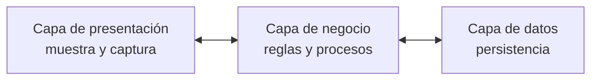

# Arquitectura en capas

El estilo que la clase más desarrolló: **N-Capas** en general, **2 capas** (el modelo
cliente-servidor) como caso particular, y un **diagrama de componentes por capas** como ejemplo.
Cubre dos estilos del catálogo del punto 1.9: *en capas* y *cliente-servidor*. Ver
[[Estilos arquitectónicos]].

> [!note] Por qué 2 capas va dentro de esta nota y no aparte
> La catedrática presenta *"Arquitectura de 2 capas"* inmediatamente después de *"Arquitectura
> N-Capas"*, con el mismo formato de diapositiva: para ella es **N-Capas con N = 2**. Separarlas
> rompería esa lectura. Cliente-servidor queda en §3.

---

## 1. N-Capas: la definición

Textual de la diapositiva *"Arquitectura N-Capas"*:

> N-Capas: En el diseño de sistemas informáticos actual se suele usar las **arquitecturas multinivel
> o Programación por capas**. En dichas arquitecturas **a cada nivel se le confía una misión
> simple**, lo que permite el diseño de **arquitecturas escalables** (que pueden ampliarse con
> facilidad en caso de que las necesidades aumenten).

Dos ideas para quedarse:

| Idea | Lo que dice | Para qué sirve |
|---|---|---|
| **Una misión simple por nivel** | cada capa hace una sola cosa | separa responsabilidades: presentación, negocio, datos |
| **Escalable** | *"pueden ampliarse con facilidad"* | es el atributo de calidad que la diapositiva le asigna al estilo |

![[adjuntos/capturas-clase-U2/estilos/n-capas-definicion.png]]

### El diagrama de la diapositiva

Leído con zoom (no se redibuja):

| Fila del dibujo | Contenido |
|---|---|
| **Capas** (cajas azules) | **Presentación** ⇄ **Negocio** ⇄ **Datos**, unidas por **flechas dobles** (comunicación en los dos sentidos, solo entre capas vecinas) |
| **Dónde corre** (barras verdes) | **Cliente** bajo la parte izquierda de Presentación · **Servidor Aplicativo** desde una **línea punteada dentro de Presentación** hasta el final de Negocio · **SGBD** bajo Datos |
| **Hardware** (íconos) | una **laptop** (cliente) · un ícono chico entre la laptop y los servidores (por la forma, parece un *firewall*; no está rotulado) · **tres servidores** (el servidor aplicativo) · **un servidor con base de datos** (SGBD) |

> [!tip] El detalle que se escapa: la presentación está partida
> La línea punteada cae **dentro** de la caja *Presentación*: una parte de la presentación corre en
> el **cliente** y otra en el **servidor aplicativo**. Es el caso típico de una aplicación web: el
> navegador muestra, pero las páginas se generan en el servidor. Y el servidor aplicativo son
> **tres** máquinas: la escalabilidad de la definición, dibujada.

Esquema propio del patrón conceptual (no es el diagrama de la clase):

**Regla para el examen:** *N-Capas = cada nivel, una misión simple → arquitectura escalable.
Presentación, negocio, datos.*

---

## 2. Un diseño concreto en capas: la clínica veterinaria

La diapositiva *"Arquitectura: Capas"* muestra un **diagrama de componentes** rotulado *"Diagrama de
componentes clínica veterinaria"*. Cada capa es un **paquete** (rectángulo con pestaña), y la
catedrática las numeró en rojo del **1 al 4**.

![[adjuntos/capturas-clase-U2/estilos/capas-componentes-clinica-veterinaria.png]]

Tabla leída con zoom:

| Nº | Paquete (capa) | Componentes adentro |
|---|---|---|
| **1** | **Presentación** | *Interfaz usuarios* · *Interfaz administrador* |
| **2** | **Lógica de negocio** | *Creación de facturas* · *Gestión de animales* · *Gestión de empleados* · *Gestor de avisos* · *Workflow* · *Gestor documental* |
| **3** | **BBDD** | (vacío en el dibujo) |
| **4** | **Servicios** | (vacío en el dibujo) |

| Relación | Línea | Punta |
|---|---|---|
| Presentación — Lógica de negocio | **punteada** | la flecha apunta **hacia Lógica de negocio** |
| BBDD — Lógica de negocio | **punteada** | la flecha apunta **hacia Lógica de negocio** (hacia arriba) |
| Servicios — Lógica de negocio | **punteada** | la flecha apunta **hacia Lógica de negocio** (hacia arriba) |

> [!warning] Ojo con la dirección de las flechas 3 y 4
> En UML una flecha punteada es una **dependencia** y va **del que usa hacia el que es usado** (ver
> [[Diagrama de componentes]]). Presentación → Lógica cumple eso. Pero BBDD y Servicios apuntan
> **hacia arriba**, a Lógica de negocio: leído al pie de la letra, dirían que la base de datos
> *usa* a la lógica, que es lo contrario de lo que suele querer decir un diagrama en capas (la
> lógica usa la base). Transcribilo **como está**; si lo vas a reproducir, **preguntale** si la
> dirección es intencional.

Por qué este diagrama importa: con las definiciones de [[Estilos arquitectónicos]] §1, esto es un
**diseño arquitectónico** (un sistema concreto, la clínica) que **respeta el estilo en capas**.
Además muestra que las capas **se modelan con un diagrama de componentes** agrupado en paquetes.

---

## 3. Arquitectura de 2 capas: el modelo cliente-servidor

### La diapositiva

La diapositiva *"Arquitectura de 2 capas"* no trae definición en texto: trae dos dibujos, y el de
abajo se titula ***"Modelo Cliente Servidor"***.

![[adjuntos/capturas-clase-U2/estilos/dos-capas-modelo-cliente-servidor.png]]

| Dibujo | Qué muestra |
|---|---|
| **Arriba** | **Cliente** → **1 Petición** → **Servidor**; el servidor devuelve **2 Respuesta** al cliente. La numeración marca el orden: **siempre pide primero el cliente** |
| **Abajo** | **Clientes** (tres PC dentro de un recuadro punteado) mandan *Petición* a **Internet** y reciben *Respuesta*; Internet pasa la *Petición* al **Servidor** y le devuelve la *Respuesta*. Muchos clientes, un servidor, y la red en el medio |

Las dos capas son **cliente** y **servidor**. El que **inicia** es el cliente; el servidor
**responde**.

### El ejemplo: el rol cambia

La segunda diapositiva de 2 capas, textual:

> **El Smartphone** tiene instalada una aplicación de mensajería (como WhatsApp, Hangout, Telegram,
> etc.) que **como Cliente realiza peticiones [1] a un Servidor físico** (mediante 3G, 4G, 5G, etc.)
> preguntando si hay mensajes nuevos, **el Servidor físico responde [2]** con los mensajes nuevos que
> le llegan al Smartphone; **entonces el Smartwatch pregunta [3] como cliente al Smartphone -que
> ahora cambia de rol- como Servidor**, y como el Smartphone tiene mensajes en su memoria **se los
> devuelve [4]** al Smartwatch.

![[adjuntos/capturas-clase-U2/estilos/dos-capas-smartphone-smartwatch.png]]

| Paso | Quién pide (cliente) | Quién responde (servidor) |
|---|---|---|
| **[1]** Petición | Smartphone | Servidor físico |
| **[2]** Respuesta | — | Servidor físico → Smartphone |
| **[3]** Petición | **Smartwatch** | **Smartphone** (cambió de rol) |
| **[4]** Respuesta | — | Smartphone → Smartwatch |

> [!important] La lección del ejemplo
> **Cliente y servidor son ROLES, no máquinas.** El mismo smartphone es **cliente** en [1]-[2] y
> **servidor** en [3]-[4]. Lo que define el rol es **quién inicia la petición** en esa interacción.

**Regla para el examen:** *2 capas = cliente-servidor: el cliente pide [1], el servidor responde
[2]; ser cliente o servidor es un rol, no un aparato.*

> [!note] COMPLEMENTO — lo que suma el catálogo
> Restricciones del estilo cliente-servidor según el SAIP: la comunicación la **inicia siempre el
> cliente** (lo mismo que muestra la numeración de la clase) y **los clientes no se comunican entre
> sí**. Si un aparato empieza a atender pedidos de otro, como el smartphone, deja de ser "solo
> cliente": asumió el rol de servidor en esa interacción. Ficha completa en
> [[Estilos arquitectónicos]] §8.

---

## 4. Capa y nivel: la clase los usa como sinónimos

> [!warning] Desfase entre la clase y el complemento
> **Lo que hace la clase:** trata *capa* y *nivel* como la misma cosa.
> - Define N-Capas como *"arquitecturas **multinivel** o Programación por **capas**"* y dice que *"a
>   cada **nivel** se le confía una misión simple"*.
> - Llama *"2 **capas**"* al modelo cliente-servidor, donde lo que hay son **dos máquinas**.
> - En la nube titula *"N-**niveles** en la nube"* un diagrama cuyas partes se llaman *Web **tier***,
>   *Business **tier***, *Data **tier*** (ver [[Arquitectura en la nube]]).
>
> **Lo que dice el complemento** (SAIP vía guía de estudio): son dos cosas distintas.

| | **Capa** (*layer*) — complemento | **Nivel** (*tier*) — complemento |
|---|---|---|
| Qué parte | el **código** | el **despliegue** (máquinas o procesos) |
| Estructura donde vive | de **módulos** | de **asignación** ([[Categorías de estructuras]]) |
| Se ve en | un diagrama de paquetes o de componentes (la clínica veterinaria) | un [[Diagrama de despliegue]] (los servidores de N-Capas) |
| Ejemplo | presentación / negocio / datos dentro de una sola aplicación | cliente / servidor aplicativo / SGBD en máquinas separadas |

Consecuencia: **tres capas pueden correr en un solo nivel** (un [[Arquitectura monolítica|monolito]]
bien estratificado), y el propio diagrama de N-Capas de la clase muestra **una capa repartida en dos
niveles** (la presentación, partida por la línea punteada entre cliente y servidor aplicativo).

**Para el examen:** usá **su** vocabulario (N-Capas, 2 capas, N-niveles), pero si preguntan la
diferencia, sabé explicarla.

---

## Notas relacionadas

- [[Estilos arquitectónicos]] — diseño vs estilo vs patrón, y la ficha de complemento de capas y cliente-servidor
- [[Arquitectura monolítica]] — las mismas tres capas en una base de código única
- [[Arquitectura en la nube]] — N-niveles desplegados en Azure
- [[Diagrama de componentes]] — cómo se dibuja el ejemplo de la clínica veterinaria
- [[Diagrama de despliegue]] — donde se ven los niveles físicos
- [[Categorías de estructuras]] — módulos vs asignación
- [[Atributos de calidad]] — escalabilidad

## Preguntas de repaso

1. Citá la definición de N-Capas de la clase. ¿Qué atributo de calidad le asigna?
2. En el diagrama de N-Capas, ¿qué capas cubre el *Servidor Aplicativo* y por qué la línea punteada cae dentro de *Presentación*?
3. En el diagrama de la clínica veterinaria, ¿qué hay en cada una de las capas 1 a 4 y qué tipo de diagrama es?
4. En el ejemplo smartphone/smartwatch, ¿qué rol cumple el smartphone en cada paso y qué enseña eso sobre cliente y servidor?
5. ¿Qué diferencia hay entre capa y nivel (tier) según el complemento, y cómo usa esos términos la clase?
