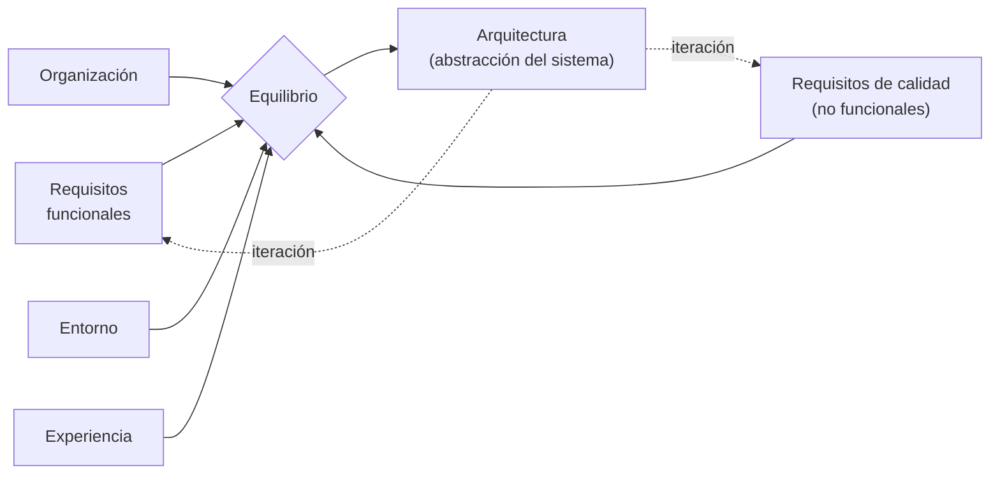

# Arquitectura en el ciclo de vida del software

La pregunta de la diapositiva es: **¿dónde debe colocarse la arquitectura en el ciclo de vida
del software?** La respuesta implícita es que **no se coloca en un solo lugar**: atraviesa el
ciclo, porque es iterativa y depende de cosas que van cambiando.

## Las ocho afirmaciones

1. Involucra requisitos **funcionales y no funcionales**.
2. Es un **proceso iterativo** a través de requisitos y calidad.
3. Involucra una **gran variedad de stakeholders**.
4. Nos permite conocer el primer conjunto de **decisiones de diseño**, la **estructura
   organizativa**, **restricciones en la implementación** y **atributos de calidad**.
5. Es la **abstracción** de un sistema.
6. La arquitectura del software es el resultado de **equilibrar requisitos funcionales y
   calidad**.
7. Se ve afectada por la **organización**, el **entorno** y la **experiencia**.

(La presentación las lista así; el punto 4 junta cuatro cosas en una sola línea, vale
desglosarlo al estudiar.)

![[adjuntos/arquitectura-de-software/arq-p20.png]]

## Lo que hay que sacar de acá

Tres ideas que se repiten en todo el deck y que acá aparecen juntas:

**Es iterativa, no una fase.** El punto 2 lo dice directo: es un proceso iterativo *a través de
requisitos y calidad*. No es "primero requisitos, después arquitectura, después construcción".
Se va y se vuelve.

**Es un equilibrio, no una derivación.** El punto 6 es clave: la arquitectura **no se deduce**
de los requisitos funcionales. Es el **resultado de equilibrar** requisitos funcionales contra
calidad. Si fuera una deducción mecánica no haría falta un arquitecto
(→ [[Equilibrio de restricciones del proyecto]]).

**Depende del contexto, no solo del problema.** El punto 7 —organización, entorno y
experiencia— es exactamente el [[Ciclo de influencias en la arquitectura]] resumido en una
línea.

## Qué nos da la arquitectura en esta etapa

Del punto 4, el "primer conjunto" de cosas que quedan definidas:

| Qué se conoce | Por qué importa temprano |
|---|---|
| Decisiones de diseño | Son las caras de cambiar después (criterio de Booch) |
| Estructura organizativa | Define cómo se reparte el trabajo entre equipos |
| Restricciones en la implementación | Acota lo que los desarrolladores pueden y no pueden hacer |
| Atributos de calidad | Se habilitan o se pierden acá, no en la codificación |

Es el mismo contenido del segundo beneficio: *manifiesta las decisiones de diseño
tempranamente* (→ [[Beneficios de la arquitectura de software]]).

## ¿Cuándo se diseña la arquitectura?

La unidad 2 responde la pregunta del título con **dos diapositivas seguidas** que parecen tirar para lados
opuestos. No se contradicen: una dice **cuándo empieza**, la otra **cuándo termina**.

### 1. Empieza primero: antes del diseño detallado

> Es el **primer paso en el diseño** de un sistema, previo al diseño detallado.

*("primer paso en el diseño" va resaltado en azul en la diapositiva.)*

Debajo, tres cajas unidas por flechas rojas:

| Caja | Ilustración de arriba | Ilustración de abajo |
|---|---|---|
| **Analizar el problema** | dos personas mirando un plano | tres personas conversando en una mesa |
| → **Diseño arquitectura** | **un** plano de planta de una casa | un grafo de nodos y conexiones |
| → **Diseño detallado** | **muchos** planos (plantas, fachadas, elevaciones) | un diagrama de clases (los nombres de las clases no se leen ni con zoom) |

![[adjuntos/capturas-clase-U2/diseno-arquitectonico/cuando-se-disena-antes-del-detallado.png]]

Las ilustraciones cuentan la diferencia mejor que el texto:

- **Diseño arquitectura** = **un** plano general y un grafo de **piezas y conexiones**: la estructura
  gruesa.
- **Diseño detallado** = **todos** los planos y un **diagrama de clases**: el detalle de cada pieza.

Es la frase de Booch en forma de dibujo: *toda la arquitectura es diseño, pero no todo el diseño es
arquitectura* (→ [[Arquitectura de software]]). Y deja una trampa marcada: **el diagrama de clases es del
diseño detallado, no de la arquitectura** (→ [[Cómo se modela la arquitectura]]).

> [!note] "Analizar el problema" viene antes
> La arquitectura no es el primer paso **del proyecto**: es el primer paso **del diseño**. Antes está
> analizar el problema — que en el curso es el caso de negocio y los drivers (→
> [[Método de diseño centrado en la arquitectura]], paso 0 y etapa 1).

### 2. No termina nunca: es una actividad continua

> El diseño de la arquitectura podrá evolucionar a lo largo del desarrollo y el tiempo de vida de la
> aplicación. **El diseño arquitectónico es una actividad continúa** [sic].

*(La diapositiva escribe "continúa", con tilde, que es el verbo; se refiere al adjetivo **continua**. La
frase va en negrita y azul.)* La ilustración es un ciclo: dos flechas curvas dando vuelta alrededor de
tres bloques.

![[adjuntos/capturas-clase-U2/diseno-arquitectonico/cuando-se-disena-actividad-continua.png]]

### Cómo se juntan las dos

| Pregunta | Respuesta de la clase |
|---|---|
| ¿Cuándo **empieza**? | primero en el diseño, **antes** del diseño detallado |
| ¿Cuándo **termina**? | **no termina**: evoluciona durante el desarrollo **y** durante toda la vida de la aplicación |

Regla memorizable: **la arquitectura se diseña primero y se sigue diseñando siempre.**

Esto es lo mismo que la afirmación 2 de arriba (*"es un proceso iterativo"*) y que la flecha de retorno del
ciclo `«precede»` (→ [[Proceso de diseño arquitectónico]]), pero con un agregado: el diseño sigue
**después de la entrega**, en el *tiempo de vida de la aplicación* — no solo durante el proyecto.

## Notas relacionadas

- [[Arquitectura de software]]
- [[Ciclo de influencias en la arquitectura]]
- [[Beneficios de la arquitectura de software]]
- [[Proceso de diseño arquitectónico]]
- [[Equilibrio de restricciones del proyecto]]
- [[Qué se tiene en cuenta para el diseño]]
- [[Cómo se modela la arquitectura]]

## Preguntas de repaso

1. ¿Por qué se dice que la arquitectura es un proceso iterativo y no una fase del ciclo de vida?
2. Completá: la arquitectura del software es el resultado de equilibrar ______ y ______.
3. ¿Qué cuatro cosas nos permite conocer la arquitectura como "primer conjunto"?
4. ¿Qué tres factores de contexto afectan a la arquitectura según esta diapositiva?
5. ¿Cuándo se diseña la arquitectura? Respondé las dos partes: cuándo empieza y cuándo termina.
6. ¿Qué diferencia muestran las ilustraciones entre "diseño arquitectura" y "diseño detallado"?
