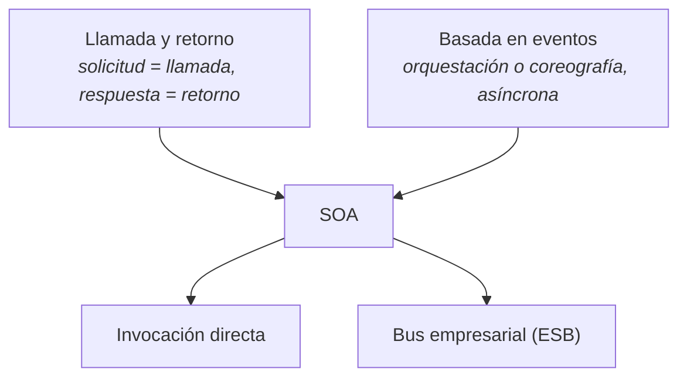

# Arquitectura orientada a servicios (SOA)

**SOA** es el **estilo 5** de su lista de nueve estilos ([[Estilos arquitectónicos]] §2), y hasta
esta tanda figuraba como *solo nombrado*. Con las capturas 33-39 pasa a tener **siete diapositivas
propias**, todas con el subtítulo en rojo **"–call return: SOA–"**: la clase la presenta como un
estilo de la familia de [[Arquitectura de llamada y retorno]].

> [!important] Esta nota es NÚCLEO
> Todo lo que está fuera de la sección §9 sale textual de sus diapositivas. Lo que es lectura propia
> de una figura va marcado *(lectura propia)*.

---

## 1. Qué es — las dos definiciones que dio

### La conceptual (captura 33)

> … conceptualmente hablando:
> *se refiere a la comunicación entre servicios, donde un servicio (cliente) realiza una solicitud
> (llamada) a otro servicio (proveedor) y espera una respuesta (retorno)*

Fijate en los paréntesis: son **el mapeo con la familia**. *Solicitud = llamada*, *respuesta =
retorno*. Por eso SOA está bajo **llamada y retorno**.

### La de la infografía (captura 38)

> La arquitectura orientada a servicios (SOA, siglas del inglés Service Oriented Architecture)
> permite que la funcionalidad de la aplicación se exponga y consuma como un conjunto de servicios.
> Los servicios usan una forma estándar de interacción que les permiten ser invocados, publicados y
> descubiertos. Los servicios SOA están enfocados en proveer un esquema y una interacción basada en
> mensajes con una aplicación. Los servicios SOA proveen interfaces con alcance de aplicación en vez
> de interfaces del nivel de componente u objeto. En otras palabras un servicio SOA no debe ser
> tratado como un servicio proveído por un componente.

| Idea de la definición | Palabra clave para citar |
|---|---|
| La funcionalidad se **expone y consume** como servicios | *"conjunto de servicios"* |
| Hay una forma **estándar** de interactuar | *"invocados, publicados y descubiertos"* |
| La interacción es por **mensajes** | *"interacción basada en mensajes"* |
| La interfaz es **de aplicación**, no de componente | *"alcance de aplicación en vez de … componente u objeto"* |

> [!warning] La trampa: servicio SOA ≠ servicio de un componente
> En [[Interfaces de componentes]] un componente **provee** una interfaz (el *lollipop*). Es tentador
> decir que eso ya es un servicio SOA. La diapositiva lo niega explícitamente: *"un servicio SOA no
> debe ser tratado como un servicio proveído por un componente"*. El servicio SOA tiene **alcance de
> aplicación** y representa una actividad **del negocio** (§7), no una operación de un objeto.

---

## 2. Antes y después de SOA (captura 33)

![[adjuntos/capturas-clase-U2/soa/soa-antes-y-despues-definicion-llamada-retorno.png]]

La figura tiene dos mitades. Leída con zoom:

| | **Antes de SOA** | **Después de SOA** |
|---|---|---|
| **Rótulo** | *Silos aislados - Cerrados - Monolíticos -* | *Compartidos - Colaborativos - Interoperables - Integrado* |
| **Subtítulo** | *Aplicaciones desarrolladas para funciones específicas del negocio* | *Aplicaciones que consumen servicios* |
| **Aplicaciones** | tres columnas cerradas: *Administración App 1 ERP* · *Procesamiento de Ordenes App 2 Desarrollo propio* · *Gestión Comercial App 3 CRM* | las mismas tres, arriba, en la fila *Aplicaciones Integradas*, y debajo la fila *Procesos de Negocio Integrados* |
| **Funciones** | **repetidas dentro de cada silo** (tabla abajo) | una sola vez cada una, como *Servicios de Negocio Reusables* |
| **Datos** | *Repositorio Datos*: Marketing · Sales · CRM · Finance · Data Warehouse · External Partner, con **líneas punteadas enredadas** desde cada silo | *Repositorio Datos*: los mismos, **más *BPM*** (encerrado en un óvalo) y **sin** las líneas enredadas |

**Las funciones de cada silo, antes** (textual, con la ortografía de la lámina):

| Silo | Funciones adentro |
|---|---|
| App 1 · ERP (verde) | Check Inventario · Status Cliente |
| App 2 · Desarrollo propio (azul) | Check Inventario · Check Status · Status Cliente · Check Credito |
| App 3 · CRM (naranja) | Check Status · Crear Factura |

**Los servicios, después** — cada servicio lleva **puntos de color**, que son el color de las
aplicaciones que lo consumen *(lectura propia, pero cuadra exacto con la tabla de antes)*:

| Servicio reusable | Puntos | Lo usan |
|---|---|---|
| crear Factura | naranja | App 3 |
| Status Cliente | verde + azul | App 1 y App 2 |
| check Status | azul + naranja | App 2 y App 3 |
| Check Credito | azul | App 2 |
| Check Inventario | verde + azul | App 1 y App 2 |
| *Servicio Reusable* / *Serv. Reusab.* (×7) | sin puntos | casillas genéricas |

**Las flechas del lado "después"**, leídas con zoom:

| Trazo | Entre | Dirección |
|---|---|---|
| punteado grueso | *App 2*, *App 3*, *App 1* y su fila de procesos | doble punta (vertical, una por app) |
| punteado grueso | proceso de App 3 ↔ *crear Factura* | doble punta |
| punteado grueso | proceso de App 3 ↔ *check Status* | doble punta |
| discontinuo | proceso de App 2 → proceso de App 3 → proceso de App 1 | hacia la derecha |
| fino continuo | dos curvas entre la fila de procesos (App 2 y App 1) y la fila de servicios | **poco nítido**: se ven las curvas, pero no se distingue con certeza a qué servicio llega cada una |

**Lo que se lee en la figura sin agregar nada:** antes, *Check Inventario*, *Check Status* y *Status
Cliente* estaban **programados dos veces** en silos distintos. Después existen **una vez** y los
consumen varias aplicaciones. Ese es el argumento de SOA: **reutilización** e **integración**.

---

## 3. Cómo interactúan cliente y proveedor (captura 34)

Textual:

> - Clientes invocan servicios proporcionados por los servidores, en un ambiente heterogéneo.
> - La interacción se hace mediante invocación directa o mediante el uso de un bus empresarial (ESB).
> - Es event-based porque puede usar motores de orquestación/ coreografía e invocar servicios de
>   forma asíncrona

![[adjuntos/capturas-clase-U2/soa/soa-invocacion-directa-o-bus-event-based.png]]

Sus dos diagramas, flecha por flecha (**no se redibujan**):

| Diagrama | Flecha | Trazo |
|---|---|---|
| **Arriba — invocación directa** | entrada → Cliente | lleno |
| | Cliente → Proveedor (superior) | lleno |
| | Proveedor (superior) → Cliente | **punteado** |
| | Cliente → Proveedor (inferior) | lleno |
| | Proveedor (inferior) → Cliente | lleno |
| **Abajo — con Bus** | entrada → Cliente | lleno |
| | Cliente → Bus / Bus → Cliente (par superior) | lleno / lleno |
| | Cliente → Bus / Bus → Cliente (par inferior) | lleno / **punteado** |
| | Bus → Proveedor (superior) / Proveedor → Bus | lleno / lleno |
| | Bus → Proveedor (inferior) / Proveedor → Bus | lleno / **punteado** |

En los dos diagramas **una de las dos respuestas es punteada** y la otra llena. La diapositiva no lo
explica. *(Lectura propia: la llena sería la respuesta **síncrona** —el cliente espera— y la punteada
la **asíncrona** —llega después—, que es justo la diferencia entre la primera y la tercera viñeta.
Pregunta para clase.)*

| Modo de interacción | Cómo es | Qué lo ubica en su catálogo |
|---|---|---|
| **Invocación directa** | el cliente llama al proveedor y espera la respuesta | **call-return** (captura 33) |
| **Bus empresarial (ESB)** | el cliente habla con el bus y el bus con los proveedores | intermediario |
| **Orquestación / coreografía, asíncrona** | un motor coordina varias llamadas, o los servicios reaccionan entre sí sin esperar | **event-based** (captura 34) |

> [!warning] SOA está en DOS familias — y ahora lo dice ella
> El subtítulo de las siete láminas es *"call return: SOA"*, y la 34 agrega *"Es event-based
> porque…"*. Coincide con el **árbol C & C** de [[Catálogo de estilos arquitectónicos]] §2, donde
> SOA cuelga **a la vez** de *Call-return* y de *Event-based*. Lo que allí era *lectura propia* ("se
> puede consumir por llamada o por eventos") queda **confirmado por diapositiva**.
>
> **No** coincide con el **catálogo textual** (captura 30 de F2), que pone *"orientadas a Servicios"*
> bajo **peer-to-peer**. En un examen: *"SOA es de llamada y retorno, y también basada en eventos
> cuando invoca asíncronamente con orquestación o coreografía"* — y citá la 33-34.

El patrón conceptual de la doble pertenencia (no es su diagrama):

---

## 4. Funcionamiento: la escalera (captura 35)

Título de la lámina: **"Funcionamiento de la Arquitectura (SOA)"**. Cuatro escalones, de abajo hacia
arriba, con una flecha curva roja que sube:

| Escalón | Texto del escalón |
|---|---|
| 1. **Definición** | *"Define las necesidades del negocio"* |
| 2. **Desarrollo** | *"Desarrolla procesos de negocio como Servicios"* |
| 3. **Evolución** | *"Permite que cada Servicio evolucione independientemente"* |
| 4. **Distribución** | *"Plantea aplicaciones distribuidas, multi-nivel"* |

![[adjuntos/capturas-clase-U2/soa/soa-funcionamiento-definicion-desarrollo-evolucion-distribucion.png]]

**Regla memorizable:** *Define, Desarrolla, Evoluciona, Distribuye* — **necesidades → procesos como
servicios → cada uno por su lado → repartidos en niveles**.

> [!note] "multi-nivel"
> El escalón 4 conecta con [[Arquitectura en capas]]: en clase *capa* y *nivel* se usan como
> sinónimos, y el árbol C & C pone *Multi-tier* bajo *Client-server* → *Call-return*, la misma
> familia que SOA.

---

## 5. Por qué importa y cómo se diseña (captura 36)

Textual, completa:

> - Interoperabilidad entre los diferentes sistemas de información
> - Se ha convertido en una corriente importante para la ingeniería de software y para las redes de
>   nueva generación, gracias a que mediante interfaces bien definidas entre los módulos de las
>   aplicaciones permite el intercambio de datos, la reutilización de funcionalidades y el proceso de
>   hacer más escalables y extensibles cada uno de los sistemas que hacen parte de las organizaciones
> - Para identificar apropiadamente el tipo de conexiones y desarrollar un esquema que exprese la
>   orquestación empresarial adecuada se deben definir claramente los objetivos empresariales, tratar
>   de maximizar la reusabilidad y la interoperabilidad y pensar en adaptarse a soluciones
>   comerciales y no a soluciones propias para esto, es necesario no perder de vista: recopilar la
>   información, datos, objetivos, recursos y determinar el traslape funcional y el potencial reúso.

![[adjuntos/capturas-clase-U2/soa/soa-interoperabilidad-orquestacion-empresarial.png]]

La tercera viñeta es un **método**. Desarmado en checklist:

| Para diseñar la orquestación empresarial… | Qué hacer |
|---|---|
| 1 | **definir claramente los objetivos empresariales** |
| 2 | **maximizar la reusabilidad y la interoperabilidad** |
| 3 | **adaptarse a soluciones comerciales y no a soluciones propias** |
| 4 | **recopilar** la información, datos, objetivos y recursos |
| 5 | **determinar el traslape funcional y el potencial reúso** |

> [!tip] El paso 5 es la figura de la captura 33
> *"Traslape funcional"* es exactamente lo que muestra el "antes": *Check Inventario* en dos silos,
> *Check Status* en dos, *Status Cliente* en dos. Donde hay traslape, hay un servicio reutilizable.

**Lo que promete, en su vocabulario** (sirve para escribir drivers de calidad): intercambio de datos
· reutilización de funcionalidades · **escalables** · **extensibles** · **interoperabilidad**.

---

## 6. Las capas de una solución SOA (captura 37)

Sin texto explicativo: es una figura de un banco o cooperativa. Leída con zoom, de arriba hacia abajo:

| Capa | Elementos |
|---|---|
| **Acceso Multiplataforma** | un usuario y cinco dispositivos (PDA, PC de escritorio, laptop, celular) con dos pantallas web |
| **Componentes de Negocio Reutilizables** | Adeudos · Historial · Crédito · Inversiones · Cheques · Fondo Retiro |
| **Servicios Reutilizables** (óvalos amarillos) | Servicio Clientes · Checa Crédito · Detección De Fraude · Servicio de Acceso · Cálculo de Intereses · Checa Inversiones · Servicio Historial · Servicio Datos |
| **Fuentes de Información** | CRM · Bancos · Finanzas · DWH |
| Aparte, a la izquierda | **Internet** |

| Flecha | Entre | Punta |
|---|---|---|
| vertical | Componentes de Negocio ↔ Servicios Reutilizables | doble |
| vertical | Servicios Reutilizables ↔ Fuentes de Información | doble |
| vertical | Servicios Reutilizables ↔ Internet | doble |
| horizontal | Internet ↔ Fuentes de Información | doble |

![[adjuntos/capturas-clase-U2/soa/soa-capas-componentes-y-servicios-reutilizables.png]]

> [!note] Dos cosas que se ven sin agregar nada
> 1. **Los estilos se combinan**: la solución SOA está organizada **en capas**. Es lo que dice
>    [[Estilos arquitectónicos]] §6 (Reynoso, complemento) y §1.2 (clase: estilos y patrones *se
>    complementan*): un sistema real mezcla estilos.
> 2. **Componente de negocio ≠ servicio**: están en **capas distintas**. Los componentes (Crédito,
>    Historial) **consumen** servicios (Checa Crédito, Servicio Historial). Es la trampa del §1 dibujada.

---

## 7. La infografía: características, beneficios y ejemplos (captura 38)

![[adjuntos/capturas-clase-U2/soa/soa-infografia-definicion-beneficios-ejemplos.png]]

La definición está en el §1. El resto, textual:

### Beneficios

> **BENEFICIOS** — Los mayores beneficios del estilo de arquitectura SOA son:
> - **Alineación con el Dominio.** El re-uso de servicios comunes con interfaces estándar incrementa
>   las oportunidades de negocios y reduce costos.
> - **Abstracción.** Los servicios son autónomos y se accede a ellos a través de un contrato formal
>   lo que provee desacople y abstracción.
> - **Capacidad de Descubrimiento.** Los servicios pueden exponer descripciones que permiten a otras
>   aplicaciones y servicios localizarlos y determinar de forma automática la interfaz.

### Características

> El estilo de arquitectura SOA se caracteriza por:
> - Estar basado en el diseño de servicios que reflejan las actividades del negocio en el mundo real,
>   estas actividades forman parte de los procesos de negocio de la compañía.
> - Representar los servicios utilizando descripciones de negocio para asignarles un contexto de
>   negocio.
> - Requerir un conjunto de pruebas que determinen que es un buen servicio.
> - Tener requerimientos de infraestructura específicos y únicos para este tipo de arquitectura, en
>   general se recomienda el uso de estándares abiertos para la interoperabilidad y transparencia en
>   la ubicación de servicios.

### Ejemplos

> Ejemplos comunes de aplicaciones orientadas a servicios incluyen:
> - Sistemas que comparten información médica. (Harvard Medical School)
> - Sistemas de reservas (Starwood Hotels and Resorts)
> - Sistemas de WorkFlow. (State Children's Health Insurance Program)

### El árbol de elementos de SOA

Abajo a la derecha de la infografía hay un árbol en inglés. Leído con zoom:

| Nivel | Padre | Hijos |
|---|---|---|
| 1 | **SOA** | Application frontend · Service · Service repository · Service bus |
| 2 | **Service** | Contract · Implementation · Interface |
| 3 | **Implementation** | Business logic · Data |

| Elemento | En español *(traducción propia)* | Dónde aparece en sus otras láminas |
|---|---|---|
| Application frontend | la aplicación que consume | *Aplicaciones que consumen servicios* (33), *Acceso Multiplataforma* (37) |
| Service | el servicio | *Servicios de Negocio Reusables* (33), *Servicios Reutilizables* (37) |
| — Contract | el contrato formal | beneficio *Abstracción* (38) |
| — Interface | la interfaz expuesta | *"interfaces con alcance de aplicación"* (38) |
| — Implementation → Business logic, Data | lo que hay adentro | oculto al cliente |
| Service repository | dónde se publican y encuentran | beneficio *Capacidad de Descubrimiento* (38) |
| Service bus | el bus | *ESB* (34, 39) |

**Regla memorizable:** *un servicio es **contrato + interfaz + implementación**; el cliente solo ve
los dos primeros.*

---

## 8. El Enterprise Service Bus (captura 39)

Una figura sin texto: una **flecha ancha** rotulada *Enterprise Service Bus*, y alrededor, en
baldosas, lo que se conecta a ella. Cada baldosa tiene **un par de flechas** (una hacia el bus, otra
desde el bus). Leída con zoom:

| Lado | Baldosa (rótulo textual) | Ícono |
|---|---|---|
| superior | **Portal** | persona con laptop |
| superior | **SOAP (J2EE, .NET)** | sobre con rayo |
| superior | **Transacciones B2B** | fábrica |
| inferior | **Flujo de Servicios** | flechas de flujo |
| inferior | **Datos** | tres cilindros |
| inferior | **Aplicaciones Existentes** | servidor con cilindro |
| inferior | **Nueva Lógica de Servicios** | bombilla |

Sobre el bus, cerca de la punta, hay además un **ícono de nodo con rayos** sin rótulo.

![[adjuntos/capturas-clase-U2/soa/soa-enterprise-service-bus.png]]

**Lo que dice la figura** *(lectura propia, sin agregar elementos)*: todo se conecta **al bus** y no
entre sí. Conviven lo **viejo** (*Aplicaciones Existentes*, *Datos*), lo **nuevo** (*Nueva Lógica de
Servicios*), lo **externo** (*Transacciones B2B*) y **tecnologías distintas** (*SOAP (J2EE, .NET)*).
Es el *"ambiente heterogéneo"* de la captura 34 hecho dibujo.

| | Invocación directa | Con ESB |
|---|---|---|
| Quién conoce a quién | el cliente conoce a cada proveedor | cada uno conoce **solo al bus** |
| Tecnologías distintas | cada par se tiene que entender | el bus media (*SOAP (J2EE, .NET)*) |
| Orquestación / flujo | la hace el cliente | *Flujo de Servicios* conectado al bus |
| Diapositiva | 34 arriba | 34 abajo, 39 |

---

## 9. COMPLEMENTO — para entender, no para citar

> [!note] COMPLEMENTO
> - **SOA vs. microservicios** (SAIP, ya citado en [[Estilos arquitectónicos]] §8): SOA supone
>   servicios **heterogéneos y de organizaciones distintas**, reutilizables; microservicios componen
>   **un solo sistema de una sola organización**. Cuadra con el *"ambiente heterogéneo"* de la 34 y
>   las *Transacciones B2B* de la 39. En su lista de 9, **son estilos distintos** (5 y 6).
> - **Orquestación vs. coreografía** (conocimiento general; la 34 solo las nombra): en la
>   **orquestación** un coordinador central dice a cada servicio qué hacer y en qué orden; en la
>   **coreografía** no hay director: cada servicio reacciona a los eventos de los otros. Por eso la
>   coreografía es la parte más claramente *event-based*.
> - **Procedencia probable de la 38** (no verificada, no está en `00-Fuentes/`): la definición, los
>   beneficios y las características coinciden en forma con la sección de SOA de la *Microsoft
>   Application Architecture Guide* (2ª ed., 2009). Citá la diapositiva, no la guía.

### Relación con sus patrones arquitectónicos

[[Patrones arquitectónicos]] pone una caja **SOA** en su árbol de categorías, y en la lista de 13 hay
patrones que la bóveda asigna (como complemento) a esa categoría. Cruzados con lo que dijo de SOA
*(relación propia)*:

| Patrón de su lista de 13 | Qué pieza de SOA resuelve | Diapositiva de SOA que lo pide |
|---|---|---|
| **Service Registry** | el *Service repository* donde se publican | 38: árbol, *"publicados"* |
| **Service Discovery** | que el cliente encuentre el servicio | 38: *Capacidad de Descubrimiento*, *"transparencia en la ubicación de servicios"* |
| **API Gateway** | una sola puerta delante de muchos servicios | 37: *Acceso Multiplataforma* |
| **Circuit Breaker** | que la caída de un servicio no arrastre a sus consumidores | 33: un servicio con varios consumidores es un punto compartido de falla |

Es la jerarquía **estilo ⊃ patrón arquitectónico** de la clase: SOA es el estilo; estos patrones
resuelven un aspecto dentro de él.

---

## 10. La trampa, en una tabla

| Error | Lo correcto, con fuente |
|---|---|
| "SOA es solo de llamada y retorno" | también es **event-based** cuando orquesta/coreografía asíncronamente (34) |
| "SOA es peer-to-peer" | eso dice el catálogo textual (F2 30); las 7 láminas de SOA dicen **call return**. Declarar cuál se usa |
| "Un servicio SOA es la interfaz de un componente" | *"no debe ser tratado como un servicio proveído por un componente"* (38) |
| "SOA = tener un ESB" | la interacción es **directa o** mediante ESB (34) |
| "SOA y microservicios son lo mismo" | en su lista de 9 son **estilos distintos** (5 y 6) |
| Confundir *cliente/proveedor* con máquinas | son **roles**: en la 33 **un servicio** hace de cliente de otro servicio |

---

## Notas relacionadas

- [[Arquitectura de llamada y retorno]] — la familia: el subtítulo *"call return: SOA"*
- [[Llamada a procedimiento remoto]] — el otro miembro de la familia que cruza la red
- [[Catálogo de estilos arquitectónicos]] — el árbol C & C (SOA con dos padres) y el catálogo textual (bajo peer-to-peer)
- [[Estilos arquitectónicos]] — su lista de 9 (SOA es el 5) y el complemento SOA vs. microservicios
- [[Patrones arquitectónicos]] — la categoría SOA y Service Registry, Service Discovery, API Gateway, Circuit Breaker
- [[Arquitectura en capas]] — *"multi-nivel"* (35) y la figura por capas (37)
- [[Arquitectura monolítica]] — el "antes de SOA": *"Silos aislados - Cerrados - Monolíticos"*
- [[Arquitectura en la nube]] — su diagrama del portal bancario usa *Service Bus* → *Servicios SOAP*
- [[Interfaces de componentes]] — para no confundir la interfaz de un componente con un servicio SOA

## Preguntas de repaso

1. Citá la definición conceptual de SOA de la captura 33 y explicá qué palabras la ubican en la
   familia de llamada y retorno.
2. ¿Por qué la clase dice que SOA **también** es *event-based*? ¿Con cuál de sus dos taxonomías de
   estilos coincide eso, y con cuál choca?
3. Nombrá los cuatro escalones del *"Funcionamiento de la Arquitectura (SOA)"* con la frase de cada uno.
4. ¿Cuáles son los tres beneficios de SOA de la infografía, y qué tiene que ver cada uno con el árbol
   *Contract / Interface / Service repository*?
5. Mirando el "antes y después" de la captura 33, ¿qué es el *traslape funcional* que pide determinar
   la captura 36? Dá un ejemplo con los nombres de la figura.
