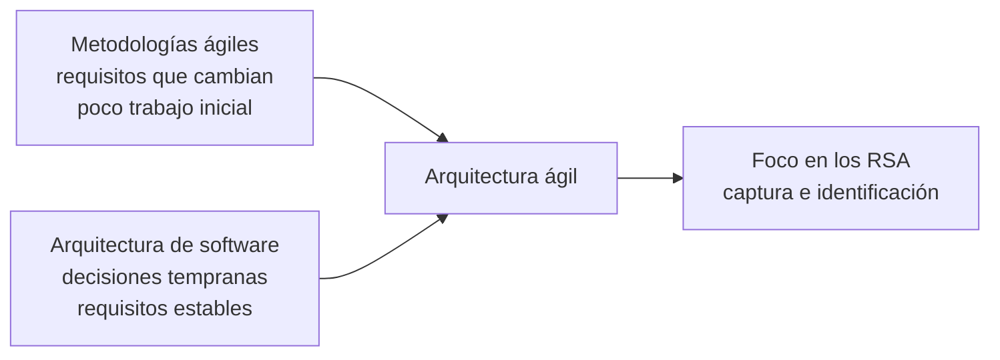

# Arquitectura ágil (AA)

La **arquitectura ágil** es el intento de **juntar la arquitectura de software con las metodologías
ágiles**, que durante años se vieron como incompatibles. El puente, según la NT3, son los
**requisitos significativos para la arquitectura** (RSA).

> [!note] De dónde sale esta nota
> De la **NT3**, la tercera nota técnica de la unidad 3: material de clase. Es un artículo corto
> (cuatro páginas) que presenta una **línea de investigación**: plantea el problema y los objetivos,
> no trae un método terminado. El concepto central, los RSA, tiene su propia nota:
> [[Requisitos significativos para la arquitectura]].

## 1. Las dos posturas que chocan

| | **Metodologías ágiles (MA)** | **Arquitectura de software (AS)** |
|---|---|---|
| Se centran en | *"el trabajo en equipo, la adaptabilidad y colaboración"*, dentro del equipo y con los usuarios finales | *"una manifestación de decisiones de etapas muy tempranas del diseño sobre un sistema"* |
| Sobre los requisitos suponen | que *"siempre cambian y continúan cambiando a lo largo del ciclo de vida"* | una captura de requisitos *"que no tengan cambios sustanciales en las etapas intermedias y finales"* |
| Por eso | *"típicamente eviten un trabajo inicial sustancial"* | las decisiones tempranas *"condicionan otras decisiones que siguen"* y, si cambian, *"implican ramificaciones posteriores"* |

De ese choque viene *"la sensación de que las MA y la AS van en direcciones diferentes y no pueden
coexistir juntas"*.

Por qué se adoptan las MA, según el resumen: por *"las necesidades cambiantes y la espera de
beneficios en el menor tiempo posible"*.

## 2. El giro: aparece la arquitectura ágil

> *"en los últimos cinco años esta tendencia está cambiando, hasta el punto que ha surgido el
> concepto 'Arquitectura Ágil' (AA). En la AA, se enfatiza fuertemente en el concepto de los
> 'Requisitos Significantes para la Arquitectura' (RSA)"*.

**La idea:** no hace falta congelar *todos* los requisitos para tener arquitectura. Hace falta
encontrar a tiempo **los que la cambian**.

## 3. Dónde se rompe en ágil

La AS *"debe garantizar que la arquitectura sea realizable mediante una implementación adecuada que
satisfaga los requisitos del sistema"*. Y en las MA, justamente *"en la consideración de los
requisitos, [es] donde los aspectos arquitectónicos se suelen pasar por alto"*.

Cómo se hace normalmente, y por qué falla:

1. Se identifican y captan los requisitos, funcionales y no funcionales.
2. Después *"se intenta definir una arquitectura de software que los cumpla"*.
3. Eso es difícil con los **no funcionales** y con los **requisitos mal elicitados** *"(que no
   consideran aspectos AS)"*, y *"puede derivar en una realización arquitectónica inadecuada"*.

Y el agravante: *"algunos requisitos tienen un efecto mucho más profundo en la arquitectura que
otros"*. En ágil se expresan *"muchas veces en forma contradictoria"* y *"de manera informal durante
el análisis de requisitos"*.

> [!warning] La trampa: creer que el artículo dice «ágil no tiene arquitectura»
> No lo dice. Dice que ágil **suele pasar por alto** los aspectos arquitectónicos **al tratar los
> requisitos**, y que la arquitectura ágil lo corrige con los RSA. La postura es de **integración**,
> no de rechazo.

## 4. Dónde se ubica la AS en el ciclo de vida

> *"El lugar que ocupa la AS en el ciclo de vida de desarrollo de software es difícil de definir.
> Pero, puesto que las arquitecturas describen el espacio de solución de un sistema,
> tradicionalmente se la ha considerado como una parte temprana de la fase de diseño."*

Es la misma respuesta de clase: la arquitectura **empieza antes del diseño detallado** y atraviesa
el ciclo (→ [[Arquitectura en el ciclo de vida del software]]).

## 5. Qué se propone la investigación

El artículo es parte del proyecto *"Integración de Metodologías Ágiles y Arquitecturas de software en
el Desarrollo de Sistemas de Información"* (U.N.S.J., 2016-2017). Sus objetivos:

1. Analizar la relación entre los **requisitos tradicionales** y los **RSA**.
2. Evaluar las propuestas de Babar y otros, Bass, Clements y Kazman, y Chen sobre documentos de
   requisitos tradicionales de las MA, y aplicarlas en tesis.
3. Seguir con la incorporación de arquitecturas al proceso dirigido por MA, para que favorezca el
   diseño de sistemas de información.

La metodología que mencionan para los trabajos de los alumnos: **ICONIX-SCRUM**, *"adoptando el
enfoque de integración con arquitecturas desde la perspectiva de los RSA"*.

> [!note] Lo que la NT3 no trae
> No describe Scrum ni XP por dentro, ni cómo se hace la arquitectura en un sprint. Si en el examen
> piden el **enfoque ágil (SCRUM)** del programa en detalle, la NT3 da **el problema y los RSA**; lo
> de Scrum como proceso está en [[Arquitectura y proceso de desarrollo]] (complemento, Garland &
> Anthony) y las fases de XP en [[Arquitectura de la información]] (NT2).

## 6. Las tres notas técnicas de la unidad 3, juntas

| NT | Tema | Qué responde |
|---|---|---|
| **NT1** | [[Arquitectura de software en el modelo en espiral]] y [[Arquitectura dirigida por modelos MDA]] | cuánto participa la AS en cada vuelta de un ciclo **guiado por riesgo**, y cómo MDA mantiene la traza |
| **NT2** | [[Arquitectura de la información]] | cómo se organiza el **contenido** para el usuario, en paralelo a RUP y XP |
| **NT3** | esta nota y [[Requisitos significativos para la arquitectura]] | cómo convive la AS con las **metodologías ágiles** |

**El hilo común:** la arquitectura es una **decisión temprana** que hay que sostener durante todo el
ciclo, y las tres notas buscan cómo hacerlo en un ciclo distinto: espiral, RUP/XP y ágil.

## Notas relacionadas

- [[Requisitos significativos para la arquitectura]] — el concepto central de la arquitectura ágil
- [[Arquitectura y proceso de desarrollo]] — ágil y Scrum según Garland & Anthony (complemento)
- [[Arquitectura de software en el modelo en espiral]] — NT1
- [[Arquitectura de la información]] — NT2
- [[Drivers arquitectónicos]] — la versión de clase de «lo que guía el diseño»

## Preguntas de repaso

1. ¿Por qué se pensó que las metodologías ágiles y la arquitectura de software no podían coexistir?
2. ¿Qué es la arquitectura ágil y en qué concepto se apoya?
3. ¿En qué momento de un proceso ágil se suelen pasar por alto los aspectos arquitectónicos?
4. ¿Dónde se ha ubicado tradicionalmente la arquitectura en el ciclo de vida, y por qué?
5. ¿Qué responde cada una de las tres notas técnicas de la unidad 3?
