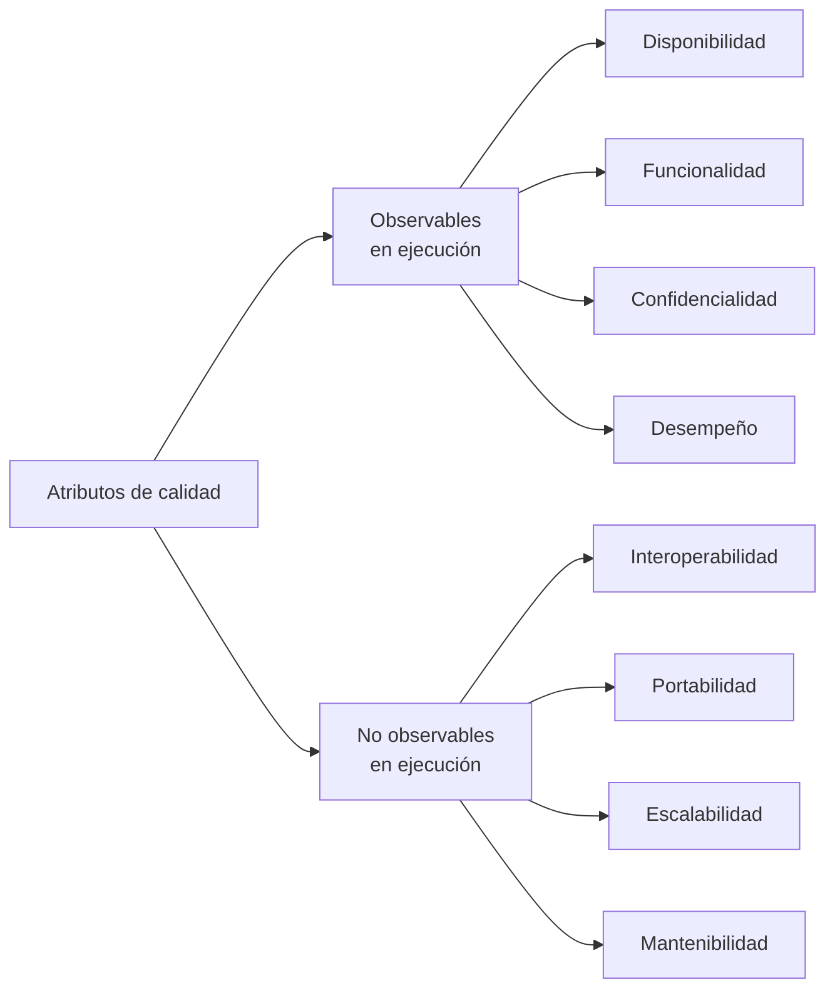

# Atributos observables y no observables vía ejecución

Es el último punto del contenido temático de la unidad 2: *"otros atributos de calidad no observables
vía ejecución"*. La clase lo da como **la clasificación de Bass**, distinta de la de ISO 9126.

## 1. Qué es — las dos categorías

> **Categorías de Atributos de Calidad, Bass et al. (1998):**
>
> - **Observables vía ejecución**: *"aquellos atributos que se determinan del comportamiento del
>   sistema en tiempo de ejecución."*
> - **No observables vía ejecución**: *"aquellos atributos que se establecen durante el desarrollo del
>   sistema."*

La lámina corta la primera definición a mitad de frase (*"La descripción de algunos de"*): lo que
sigue es la tabla de la §3.

**La regla para decidir**: ¿se puede comprobar **corriendo** el sistema? → observable. ¿Solo se
comprueba **cambiándolo, portándolo o integrándolo**? → no observable.

![[adjuntos/capturas-clase-U3/atributos-observables/u3f1-16-categorias-bass-1998.png]]

## 2. El árbol: qué va en cada rama

La lámina *Escenarios de Calidad — Atributos de calidad que pueden ser afectados*:

| Observables en ejecución | No observables en ejecución |
|---|---|
| Disponibilidad | Interoperabilidad |
| Funcionalidad | Portabilidad |
| Confidencialidad | Escalabilidad |
| Desempeño | Mantenibilidad |

![[adjuntos/capturas-clase-U3/atributos-observables/u3f1-22-arbol-observables-no-observables.png]]

> [!warning] Tres trampas del árbol
> 1. **La escalabilidad cae en NO observables.** En la lámina de drivers de calidad, en cambio, es
>    un driver con número (*10.000 peticiones*), o sea, algo que se mide corriendo. Si preguntan por
>    **esta** clasificación, va donde la pone el árbol, y conviene declararlo (duda 53).
> 2. **La usabilidad no aparece** en ninguna rama, aunque sus ejemplos de escenario son de usabilidad.
> 3. **La interoperabilidad** es *no observable* acá, pero en ISO 9126 es una subcaracterística de
>    **funcionalidad**, que es observable. Son dos clasificaciones distintas: no hay que forzarlas a
>    coincidir.

## 3. La tabla con su descripción — y el título que no corresponde

La lámina 17 se titula **"Atributos de Calidad NO observables vía ejecución"**, pero lista:

| Atributo | Descripción (con su cita) |
|---|---|
| **Disponibilidad** (*availability*) | la medida de disponibilidad del sistema para el uso (Barbacci et al., 1995) |
| **Confidencialidad** (*confidentiality*) | la ausencia de acceso no autorizado a la información (Barbacci et al., 1995) |
| **Funcionalidad** (*functionality*) | habilidad del sistema para realizar el trabajo para el cual fue concebido (Kazman et al., 2001) |
| **Desempeño** (*performance*) | el grado en el cual un sistema o componente cumple con sus funciones designadas, dentro de ciertas restricciones dadas, como velocidad, exactitud o uso de memoria (IEEE 610.12). Según Smith (1993), se refiere a aspectos temporales: capacidad de respuesta, tiempo para responder o número de eventos procesados en un intervalo. Según Bass et al. (1998), además la cantidad de comunicación e interacción entre los componentes |
| **Confiabilidad** (*reliability*) | la medida de la habilidad de un sistema a mantenerse operativo a lo largo del tiempo (Barbacci et al., 1995) |
| **Seguridad externa** (*safety*) | ausencia de consecuencias catastróficas en el ambiente; la medida de ausencia de errores que generan pérdidas de información (Barbacci et al., 1995) |
| **Seguridad interna** (*security*) | la medida de la habilidad del sistema para resistir intentos de uso no autorizados y negación del servicio, mientras se sirve a usuarios legítimos (Kazman et al., 2001) |

> [!warning] El título está invertido
> Los cuatro primeros son **exactamente** la rama de **observables** del árbol, y los siete se
> comprueban corriendo el sistema. El título de la lámina dice lo contrario. **Lectura tomada:** es la
> tabla de los **observables** con el título equivocado (en la guía de Camacho y otros, de donde sale,
> los observables y los no observables van en dos tablas seguidas — complemento, no verificado en
> disco). Anotado como duda 52. Si cae en el examen, contestá según el árbol y nombrá la tabla.

![[adjuntos/capturas-clase-U3/atributos-observables/u3f1-17-tabla-titulada-no-observables.png]]

> [!note] Dos «seguridades»
> La tabla separa **safety** (*seguridad externa*: no causar daño al ambiente) de **security**
> (*seguridad interna*: resistir el uso no autorizado). En ISO 9126 la *seguridad* de funcionalidad
> es la **security**.

## 4. Lo mismo, dicho por el libro oficial (complemento)

El SAIP hace la misma partición con otros nombres: **runtime qualities** (disponibilidad, desempeño,
seguridad, usabilidad) y **development-time qualities** (modificabilidad, testabilidad,
deployabilidad, integrabilidad). El detalle, y la regla de *quién responde en el escenario* (el
sistema o el equipo), está en [[Atributos de calidad]] §3 y §4.

| | Clase (Bass 1998) | SAIP 4.ª ed. |
|---|---|---|
| Nombre | observables / no observables vía ejecución | runtime / development-time |
| Cómo se mide | corriendo / durante el desarrollo | corriendo / al modificar |
| Usabilidad | no está en el árbol | en ejecución |

## 5. Para qué sirve en un escenario

En un [[Escenarios de calidad|escenario de calidad]] la clasificación cambia el **entorno** y la
**fuente**: uno observable se escribe con el sistema *en operación* y un usuario como fuente; uno no
observable, con el sistema *en desarrollo o mantenimiento* y un desarrollador como fuente. Es lo que
hace el ejemplo READM con `EAC-05` (facilidad de prueba, *"en tiempo de desarrollo"*) y `EAC-06`
(modificabilidad) → [[Ejemplo resuelto - Sistema de Transporte READM]] §5.

## Preguntas de repaso

1. ¿De quién es la clasificación observables / no observables, y cómo define cada categoría?
2. Nombrá los cuatro atributos de cada rama del árbol de clase.
3. ¿Qué tiene de raro el título de la tabla de la lámina 17? ¿Cómo lo sabés?
4. ¿En qué se diferencian *safety* y *security*?
5. ¿Por qué la escalabilidad queda en una rama distinta de la que sugiere la lámina de drivers?
