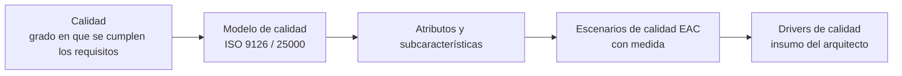

# Calidad del software

> [!note] Primera teoría de clase de la unidad 2
> Hasta el 16/10 la unidad 2 (*Calidad del Software*) no tenía presentación: solo el ejemplo
> resuelto READM y el complemento del SAIP en [[Atributos de calidad]]. Estas láminas cubren los
> puntos **1 y 2** del programa (*conceptos generales*, *¿por qué es importante?*). El punto 3, las
> normas, está en [[Norma ISO 9126]] y [[Familia de normas ISO 25000]].

## 1. Qué es — tres definiciones que da la lámina

**La de la clase** (en negrita en la lámina):

> Proceso **eficaz de software** que se aplica de manera que crea **un producto útil** que
> **proporciona valor** medible a quienes lo producen y a quienes lo utilizan.

**La de la norma**:

> Según **ISO 9000:2000**: la calidad es el *"grado en el que un conjunto de características
> inherentes cumple con los requisitos"*.

**Los cinco puntos de vista de David Garvin**, textuales:

| Punto de vista | La calidad es… |
|---|---|
| **Trascendental** | se reconoce pero es difícil de definir |
| **Usuario** | cumple los requerimientos y funcionalidad |
| **Fabricante** | cumple las especificaciones originales |
| **Producto** | implementación de funciones y características |
| **Valor** | lo que el cliente está dispuesto a pagar |

> [!warning] La trampa
> *Usuario* y *fabricante* se parecen. La diferencia: el **usuario** mide contra **sus
> requerimientos**; el **fabricante**, contra **la especificación** que se escribió. Un producto puede
> cumplir la especificación y no servirle al usuario.

![[adjuntos/capturas-clase-U3/calidad-del-software/u3f1-00-que-es-garvin-iso9000.png]]

## 2. Quién la consigue y por qué es importante

| Pregunta | Respuesta de la lámina |
|---|---|
| **¿Quién la consigue?** | *Todos los involucrados en el proceso de SW* (gerentes, ingenieros, arquitectos SW, QA, *test developer*, implementadores) |
| **¿Por qué es importante?** | *Reduce costos por repetición y mejora la entrada al mercado* |

O sea: no es tarea del área de QA sola. Es la misma idea que [[Stakeholders]]: el arquitecto es uno
más de los que la consiguen.

![[adjuntos/capturas-clase-U3/calidad-del-software/u3f1-01-quien-la-consigue-por-que-importa.png]]

## 3. ¿Por qué calidad en software? — los números

- Un software de calidad **SATISFACE MEJOR** las necesidades de los clientes y es un medio de obtener
  **MÁS GANANCIAS**.
- *El problema del software en el mundo*:

| Dato | Cifra |
|---|---|
| Proyectos de software que se **cancelan** | **25 %** |
| Defectos con que se **liberan** los productos | **15 %** |
| Tiempo y dinero gastado en **retrabajo** sobre código ya escrito | **30 a 44 %** |
| Veces que las compañías **cumplen** | **50 %** |

Y la conclusión, en rojo: **"POR LO TANTO: ALGO ESTAMOS HACIENDO MAL"**.

![[adjuntos/capturas-clase-U3/calidad-del-software/u3f1-02-por-que-calidad-problema-del-software.png]]

## 4. Fuentes de errores

| Origen del error | % |
|---|---|
| **Requerimientos** | **56 %** |
| **Diseño** | **27 %** |
| Programación | 7 % |
| Otros | 10 % |

La pregunta con que cierra: *¿Dónde concentrar el esfuerzo para evitar los errores?*

**La respuesta que se espera**: en los **requerimientos y el diseño**, que juntos son el **83 %**. Es
el argumento de todo el curso: por eso se hacen el caso de negocio, los drivers y la arquitectura
**antes** de programar. Programar mal explica apenas el 7 %.

![[adjuntos/capturas-clase-U3/calidad-del-software/u3f1-03-fuentes-de-errores.png]]

## 5. Cómo se conecta con lo demás

- [[Norma ISO 9126]] — el modelo que la clase desarrolla, con sus seis características.
- [[Atributos observables y no observables vía ejecución]] — la otra clasificación, de Bass.
- [[Escenarios de calidad]] — cómo se vuelve medible un atributo.
- [[Drivers arquitectónicos]] — donde el escenario se convierte en entregable.

## Preguntas de repaso

1. Dá la definición de calidad de la clase y la de ISO 9000:2000. ¿Cuál habla de *requisitos*?
2. Nombrá los cinco puntos de vista de Garvin. ¿En qué se distinguen *usuario* y *fabricante*?
3. ¿Quién consigue la calidad, según la lámina? ¿Y por qué es importante?
4. ¿Qué porcentaje de los errores nace en requerimientos y diseño? ¿Qué se concluye de eso?
5. Citá dos de los números de *"el problema del software en el mundo"*.
