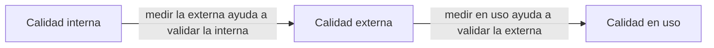
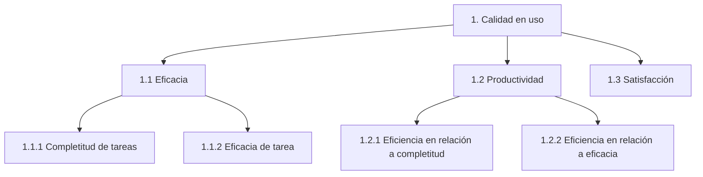

# Calidad en uso (Covella y Olsina)

## 1. Qué es

> **ISO 9126-1**: calidad en uso es *"la capacidad de un producto de software de facilitar a usuarios
> específicos alcanzar metas específicas con **eficacia, productividad, seguridad y satisfacción** en
> un **contexto específico de uso**"*. Y agrega: *"…es medida sobre **los resultados de usar el
> software** en el ambiente, antes que sobre las propiedades del software en sí mismo"*.

Dicho fácil: la **calidad que percibe el usuario real**, haciendo tareas reales, en su contexto real.

### Las cuatro características (tabla 1)

| Característica | Definición |
|---|---|
| **Eficacia** | facilitar a los usuarios alcanzar metas específicas con **exactitud y completitud** |
| **Productividad** | **invertir la cantidad apropiada de recursos** en relación a la eficacia alcanzada |
| **Seguridad** | alcanzar **niveles aceptables de riesgo** de dañar a las personas, el negocio, el software, la propiedad o el ambiente |
| **Satisfacción** | satisfacer a los usuarios. *Nota del estándar*: es la respuesta del usuario a la interacción, **e incluye la actitud** hacia el uso |

Todas terminan igual: *"…en un contexto específico de uso"*.

## 2. Para qué existe — las tres perspectivas de calidad

ISO 9126-1 define **tres perspectivas** de calidad de producto, y la de uso es un **modelo distinto,
complementario** al de calidad interna y externa (→ la rueda de [[Norma ISO 9126]] §5).

| Perspectiva | Se mide sobre | Modelo |
|---|---|---|
| **Interna** | el producto sin ejecutar (código, diseño) | 6 características + subcaracterísticas |
| **Externa** | el producto ejecutándose | las mismas 6 |
| **En uso** | **los resultados de usarlo**, con usuarios reales | **4**: eficacia, productividad, seguridad, satisfacción |

La relación, textual: *"medir y evaluar la calidad en uso… puede ayudar a validar la calidad externa…
A su vez, medir y evaluar la calidad externa puede ayudar a validar la calidad interna."*

**Origen**: el modelo de calidad en uso de ISO 9126-1 es *"una ampliación (o adaptación) del modelo
**ISO 9241-11**, específicamente para software"*. Y **ISO 14598-1** ya evaluaba la calidad en uso
según *eficacia, productividad y satisfacción*. ISO 9000 da la definición general de calidad
(*"grado en el que un conjunto de características inherentes cumple con los requerimientos"*), y
aclara que **inherente** significa *"característica o propiedad permanente"*.

## 3. La trampa: usabilidad ≠ calidad en uso

| | Usabilidad | Calidad en uso |
|---|---|---|
| Qué es | **una característica** de la calidad del producto (ISO 9126) | un **modelo** aparte, más amplio |
| Origen del término | reemplazó a *"user friendly"*, que se había vuelto *"vago y subjetivo"* | ISO 9126-1, ampliando la 9241-11 |
| Alcance | entender, aprender, operar, atractividad | eficacia, productividad, seguridad y satisfacción **del usuario con la tarea** |

*"Los términos usabilidad y calidad en uso han estado empleándose como sinónimos… por un largo
período"*: el artículo dice que **no lo son**. La calidad en uso *"ofrece una idea más amplia y
completa de calidad que usabilidad"*.

**Nielsen** no da una definición precisa de usabilidad: la evalúa con **heurísticas** y la construye
sobre **cinco atributos**: facilidad de aprendizaje, eficiencia, facilidad de memorización, baja tasa
de errores y satisfacción.

## 4. Cómo se evalúa — tres técnicas

| Técnica | Cómo es | A favor | En contra |
|---|---|---|---|
| **Testing con usuarios** | se observa a usuarios haciendo tareas reales | evaluación rápida y eficaz | difícil replicar el ambiente y conseguir usuarios representativos a costo razonable |
| **Inspección** | la hacen **expertos**, sin usuarios ni laboratorio | **abarata costos** | la confiabilidad depende del conocimiento de los evaluadores. **WebQEM** fue la primera para la Web |
| **Heurísticas** | checklist de principios de usabilidad (Nielsen) | sirve también como base de cuestionario | expertos distintos parten de heurísticas distintas y opinan distinto |

Lo mínimo para documentar una evaluación: **(a)** el contexto de uso (tipo de usuario, equipamiento,
ambiente y tareas) y **(b)** las métricas e indicadores según el propósito. *"No es posible
generalizar los resultados… en otros contextos"*: la validez está **restringida por el contexto**.

## 5. El marco de medición INCAMI — el vocabulario que se pregunta

INCAMI tiene base **ontológica**. Supone que para medir con propósito hay que: especificar los
requerimientos no funcionales (empezando por la **necesidad de información**) → definir **métricas** →
interpretarlas con **indicadores**.

**Componentes del marco**: (a) definición y especificación de requerimientos no funcionales,
(b) diseño y ejecución de la **medición**, (c) diseño y ejecución de la **evaluación**, (d) gestión de
las recomendaciones, (e) definición del proyecto.

| Concepto | Definición del artículo |
|---|---|
| **Necesidad de información** | la visión y el conocimiento necesario para administrar objetivos, metas, riesgos y problemas |
| **Concepto calculable** | relación abstracta entre atributos de entidades y una necesidad de información (ej.: *calidad*, *calidad en uso*). Se representa con un **modelo de concepto** |
| **Entidad** | objeto caracterizado por atributos mensurables (acá, la aplicación e-Learning) |
| **Atributo** | propiedad mensurable de una entidad. Puede tener varias métricas, pero **en un proyecto se elige una** |
| **Métrica** | contiene un **método de medición** (o de cálculo) y una **escala** |
| **Métrica directa** | se le aplica un método de medición **objetivo o subjetivo** |
| **Métrica indirecta** | definida en función de **otras métricas**, con un método de cálculo (una **fórmula**) |
| **Escala** | conjunto de valores con propiedades definidas. Tipo **categórica** o **numérica**; por la relación entre valores: **nominal, ordinal, intervalo, proporción o absoluta** |
| **Indicador** | método de cálculo y escala que, con un modelo y **criterios de decisión**, evalúa un concepto calculable |
| **Indicador elemental** | no depende de otros indicadores; nivel de abstracción **bajo** (un atributo) |
| **Indicador parcial o global** | derivado de otros indicadores; nivel **más alto** |

> [!important] La idea que más se pregunta
> **El valor de una métrica no dice si el requisito se cumple.** Para eso hace falta un **indicador**:
> la métrica se pasa por un **modelo elemental** y se compara contra **criterios de decisión** (rangos
> de aceptabilidad). Es lo mismo que la *medida de la respuesta* de un
> [[Escenarios de calidad|escenario de calidad]]: sin criterio, el número no dice nada.

![[adjuntos/covella-calidad-en-uso/fig1-modelo-conceptual-requerimientos.png]]

![[adjuntos/covella-calidad-en-uso/fig2-modelo-conceptual-medicion.png]]

## 6. El caso de estudio: QPlus Campus Virtual

| Dato | Valor |
|---|---|
| Producto | **QPlus Campus Virtual**, curso de nivelación de ingresantes, Facultad de Ingeniería UNLPam |
| Cuándo | abril de 2004 |
| Usuarios | **6** alumnos al azar (Nielsen: pocos usuarios bastan si se puede repetir) |
| Tareas | **4**: navegar contenidos, consultar a un profesor (asincrónico), participar en un foro, organizar el material en carpetas |
| Satisfacción | cuestionario de **10 ítems** adaptado del **SUE** |
| Método | **WebQEM** adaptado a calidad en uso, con WebQEM_Tool |
| Hipótesis | *"al menos a nivel de características, el sitio está por encima del umbral"* de **70 %** |

**Árbol de requerimientos** (figura 3):

**La métrica de ejemplo**: *P_CT* = promedio de la proporción de tareas completadas sobre propuestas,
`P_CT = Σ CT / n` (n usuarios). Entre 0 y 1, mejor cerca de 1. Resultado: **0,542**.

**Su indicador elemental**: `%P_CT_P = P_CT × 100`, con criterio de decisión **0-45 no satisfactorio,
45-70 marginal, 70-100 satisfactorio** → 54,2 = **marginal**.

| Resultado (tabla 3) | Valor |
|---|---|
| **Calidad en uso global** | **57,45 %** |
| Eficacia | 59,70 % |
| Productividad | 51,89 % |
| **Satisfacción** | **87,08 %** — la única sobre el 70 % |

**Conclusión**: no se cumple la hipótesis. Los usuarios **se sintieron satisfechos** aunque **no
fueron eficaces ni productivos**: la percepción subjetiva no coincide con el desempeño medido. Causas
posibles: falta de entrenamiento de los alumnos o un diseño débil en requerimientos no funcionales.

> [!warning] Dos errores del propio artículo
> 1. En §3.4 dice que se usaron *"Eficiencia, Productividad y Satisfacción"*, pero el árbol y los
>    resultados usan **Eficacia**: es **eficacia**. La cuarta, **seguridad**, quedó afuera.
> 2. En la tabla 3, el texto de los indicadores 1.1.1 y 1.2.1 está cruzado (dice *eficiencia* en los
>    dos). Manda el árbol.

## Preguntas de repaso

1. Definí calidad en uso según ISO 9126-1. ¿Sobre qué se mide, según la norma?
2. Nombrá y definí sus cuatro características.
3. ¿Por qué usabilidad y calidad en uso no son sinónimos?
4. ¿Cómo se relacionan las calidades interna, externa y en uso?
5. ¿Qué diferencia hay entre métrica directa e indirecta? ¿Y entre métrica e indicador?
6. ¿Qué tipos de escala nombra el artículo?
7. En el caso QPlus, ¿qué característica superó el umbral y qué conclusión se sacó?
