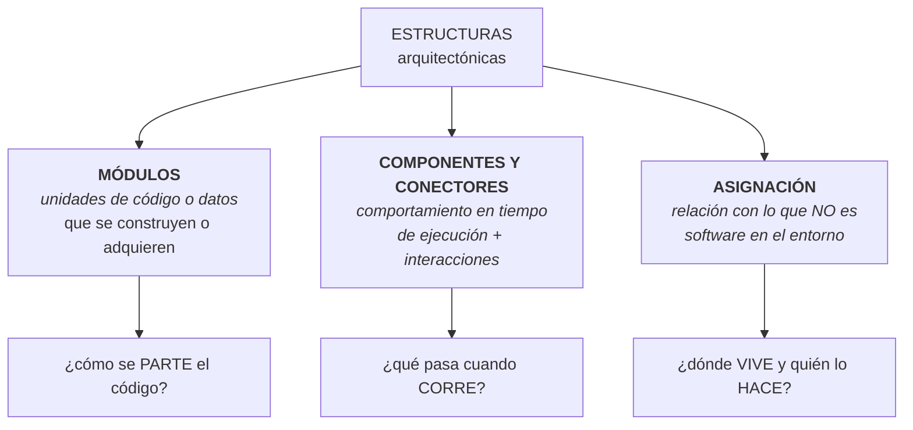

# Categorías de estructuras

Las **tres** categorías en que se agrupan todas las estructuras arquitectónicas. Es el subpunto
explícito del **1.8** del programa.

> [!important] Esta nota es NÚCLEO
> Sale de la diapositiva **"Categorías de Estructuras"**. Antes este punto estaba cubierto solo como
> complemento del SAIP dentro de [[Diagrama de despliegue]]; ahora tiene fuente de clase y nota propia.

---

## 1. Lo que dice la diapositiva

> Hay **tres categorías** de estructuras:
>
> - Las estructuras de los **módulos** muestran cómo se debe estructurar un sistema como un conjunto
>   de **unidades de código o de datos** que se deben **construir o adquirir**.
> - Las estructuras de **componentes y conectores** muestran cómo se debe estructurar el sistema como
>   un conjunto de elementos que tienen un **comportamiento en tiempo de ejecución** (componentes) e
>   **interacciones** (conectores).
> - Las estructuras de **asignación** muestran cómo se relacionará el sistema con las estructuras que
>   **no son de software** en su entorno (como CPU, sistemas de archivos, redes, equipos de
>   desarrollo, etc.).

![[adjuntos/capturas-clase/categorias-de-estructuras.png]]

## 1 bis. La segunda versión: la lámina *"Estructuras"* (capturas_U2_F2, 27)

En la clase del 2026-09-16 mostró **otra diapositiva** con las mismas tres categorías, pero con
**otros nombres y otras definiciones**. No está en ninguno de los dos PDF de *Arquitectura de
Software*. Textual:

> **Estructuras**
>
> - **Módulos**: los elementos son módulos, los cuales son **unidades de implementación**.
> - **Componentes-y-Conector**: los elementos son **componentes de ejecución** (los cuales son
>   principalmente **unidades de computación**) y **conectores** (los cuales son el **vehículo de
>   comunicación** entre los componentes).
> - **De Localización**: muestran la relación entre los elementos de software y los elementos en
>   **uno o más ambientes externos** en los cuales el software es **creado o ejecutado**.

![[adjuntos/capturas-clase-U2/fundamentos-arquitectura/estructuras-modulos-componentes-conector-localizacion.png]]

### Las dos versiones, lado a lado

| | Lámina *"Categorías de Estructuras"* (19/08) | Lámina *"Estructuras"* (16/09, captura 27) |
|---|---|---|
| **1ª** | estructuras de los **módulos** — unidades de **código o de datos** que se deben **construir o adquirir** | **Módulos** — **unidades de implementación** |
| **2ª** | estructuras de **componentes y conectores** — comportamiento en **tiempo de ejecución** (componentes) e **interacciones** (conectores) | **Componentes-y-Conector** — **componentes de ejecución** (unidades de **computación**) y conectores (**vehículo de comunicación**) |
| **3ª** | estructuras de **asignación** — relación con estructuras que **no son de software** (CPU, sistemas de archivos, redes, **equipos de desarrollo**) | **De Localización** — relación con elementos de **ambientes externos** donde el software es **creado o ejecutado** |

> [!warning] La trampa: "De Localización" y "Asignación" son **la misma categoría**
> No son cuatro categorías. Las dos láminas traducen con dos palabras distintas la misma tercera
> categoría, la que el SAIP llama *allocation structures* *(el nombre en inglés es complemento)*. La
> prueba está en la propia redacción de las dos láminas:
>
> | Lámina *"Estructuras"* (27) | Lámina *"Categorías"* (19/08) | Pregunta |
> |---|---|---|
> | software **ejecutado** en ambientes externos | CPU, sistemas de archivos, redes | **dónde corre** |
> | software **creado** en ambientes externos | **equipos de desarrollo** | **quién lo construye** |
>
> Lo mismo con la segunda: *"componentes y conectores"* y *"Componentes-y-Conector"* (en singular,
> con guiones, calcado del inglés *component-and-connector*) son la misma.
>
> **Regla para el examen**: escribí **asignación (o de localización)** — así cubrís las dos láminas.
> Queda anotado como pregunta para clase cuál nombre prefiere.

Lo que **suma** la segunda versión, y conviene citar:

- **"unidades de implementación"** — la forma corta de decir qué es un módulo.
- **"unidades de computación"** — lo que hace un componente de ejecución.
- **"vehículo de comunicación"** — la definición de conector más citable de las dos.
- **"uno o más ambientes externos"** — la asignación puede mapear a **varios** entornos a la vez
  (por ejemplo, el de desarrollo *y* el de producción — el ejemplo es lectura propia, no de la lámina).

## 2. La tabla que hay que memorizar

| Categoría | Elementos | La pregunta que responde | Momento |
|---|---|---|---|
| **Módulos** | unidades de **código o datos** — construidas o **adquiridas** | *¿cómo se parte el código?* | **estático**, antes de correr |
| **Componentes y conectores** | **componentes** (comportamiento) + **conectores** (interacciones) | *¿qué pasa cuando el sistema corre?* | **tiempo de ejecución** |
| **Asignación** *(o "De Localización", captura 27)* | software ↔ **entorno no-software**: CPU, sistemas de archivos, redes, **equipos de desarrollo** | *¿dónde vive y quién lo construye?* | **despliegue y organización** |

> [!important] Tres detalles de la redacción que valen puntos
> **1. "construir o adquirir".** Un módulo no es solo código propio: una librería o un producto COTS
> que se **compra** también es un módulo de la arquitectura. Decidir *build vs. buy* es una decisión
> arquitectónica.
>
> **2. Componentes y conectores son DOS cosas.** El componente tiene comportamiento; el conector es la
> **interacción**. La interacción es un elemento de primera clase, no una línea decorativa.
>
> **3. "equipos de desarrollo" está en la categoría de asignación.** Junto a CPU y redes. O sea que
> **quién construye qué** es parte de la arquitectura — es la estructura de **asignación de trabajo**.
> Es la base de la ley de Conway: la estructura del equipo y la del software se reflejan.

## 3. Por qué son exactamente tres

Porque cada una responde a un tipo distinto de pregunta, y las tres juntas cubren el sistema:

| Si querés saber… | Mirás la estructura de… |
|---|---|
| qué archivo tocar para cambiar algo | **módulos** |
| por qué el sistema se cae bajo carga | **componentes y conectores** |
| en qué servidor corre cada cosa | **asignación** |
| a qué equipo asignar una tarea | **asignación** |
| si un cambio rompe otra cosa | **módulos** (dependencias) |
| cuántos procesos hay en vivo | **componentes y conectores** |

Y de ahí sale una regla práctica: **una vista sola nunca alcanza.** Un diagrama de módulos no dice
nada sobre el rendimiento; un diagrama de despliegue no dice nada sobre qué tocar para modificar algo.

> Conecta con la definición de la clase: *"una **vista** es una representación de **una o más
> estructuras**"* (→ [[Estructuras y vistas arquitectónicas]]). Las categorías clasifican las
> estructuras; las vistas son cómo se muestran.

## 4. Cómo se corresponden con lo que ya tenés

> [!warning] Corrección (capturas_U2_F2, 10-13)
> Esta tabla ponía **secuencia, actividad y comunicación** en la vista de procesos, sin marcarlo
> como complemento. La clase dice que la vista de procesos *"la vamos a complementar con los
> diagramas UML: **Diagrama de Actividad**"* — **solo actividad**. La columna de diagramas quedó
> alineada con sus diapositivas del 4+1 (detalle en [[Modelo 4+1 vistas]]). También se separó la
> vista lógica de la *"de Despliegue o de Desarrollo"*: en clase son vistas distintas, con
> diagramas distintos.

| Categoría | Vista del modelo 4+1 | Diagramas UML **según su lámina del 4+1** | Nota |
|---|---|---|---|
| **Módulos** | vista **lógica** · vista **de Despliegue o de Desarrollo** | lógica → **clases** y **paquetes** · despliegue/desarrollo → **componentes** y **paquetes** | [[Modelo 4+1 vistas]] |
| **Componentes y conectores** | vista de **procesos** | **actividad** (solo ese) | [[Modelo 4+1 vistas]] |
| **Asignación** *(o De Localización)* | vista **física** | **deployment** (despliegue / distribución) | [[Diagrama de despliegue]] |

> [!note] Qué es de clase y qué es lectura en esta tabla
> Los **diagramas por vista** son textuales de sus diapositivas del 4+1. El **cruce categoría → vista**
> (columnas 1 y 2) **no está en ninguna lámina**: es lectura propia para conectar 1.8 con el 4+1.
> Si en otro material ves secuencia o comunicación en la vista de procesos, es **complemento**
> (Kruchten / UML general), no lo que ella pidió.

El [[Diagrama de despliegue]] es, entonces, **la representación de una estructura de asignación** —
que es justo lo que enseña el punto 1.7 del programa. Los dos puntos están encadenados: 1.7 te da
*un* diagrama, 1.8 te da la **clasificación** que explica de qué es ese diagrama.

---

## Notas relacionadas

- [[Estructuras y vistas arquitectónicas]] — estructura vs. vista vs. viewpoint
- [[Arquitectura de software]] — la definición: "el conjunto de estructuras necesarias para razonar"
- [[Diagrama de despliegue]] — una estructura de asignación, dibujada
- [[Modelo 4+1 vistas]] — cómo se reparten las categorías en vistas
- [[Estilos arquitectónicos]] — cada estilo organiza sobre todo una categoría
- [[Evaluación de la arquitectura]] — el paso 3 del ATAM pide vistas de las tres

## Preguntas de repaso

1. Nombrá las tres categorías de estructuras y la pregunta que responde cada una.
2. ¿De qué están hechas las estructuras de módulos? ¿Y qué significa "construir o **adquirir**"?
3. ¿Cuál es la diferencia entre un **componente** y un **conector**?
4. ¿Con qué se relaciona una estructura de asignación? Dá cuatro ejemplos de la diapositiva.
5. ¿Por qué "equipos de desarrollo" cae en la categoría de asignación?
6. ¿Qué categoría mirás para saber por qué el sistema se cae bajo carga? ¿Y para saber qué archivo tocar?
7. ¿A qué categoría pertenece un diagrama de despliegue?
8. ¿Por qué una sola vista nunca alcanza?
9. La lámina *"Estructuras"* habla de estructuras **"De Localización"**. ¿A cuál de las tres categorías corresponde, y qué palabra de su definición lo demuestra?
