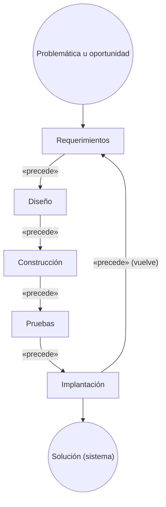
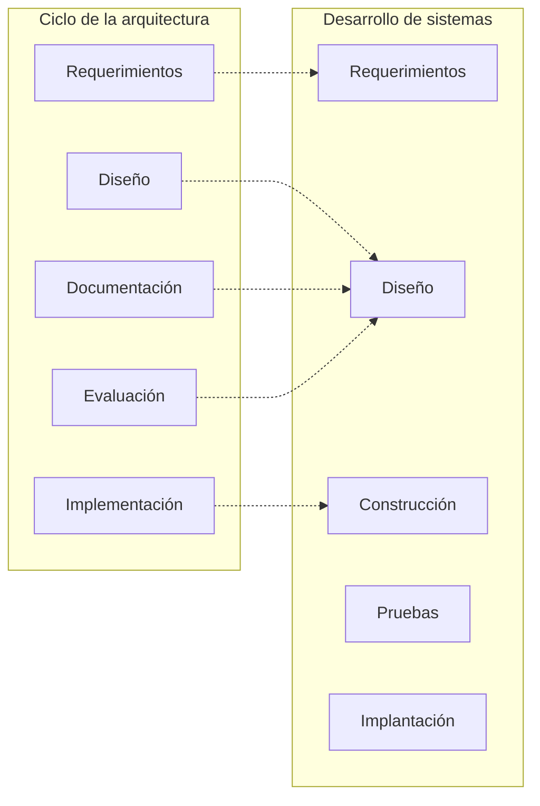
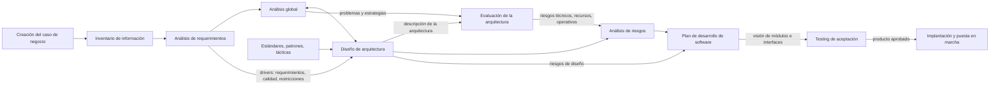

# Ciclo de desarrollo de la arquitectura

## 1. La visión general del desarrollo de sistemas

*"La etapa de actividades técnicas del desarrollo de sistemas"*: un diagrama de actividad que arranca
en **Problemática u oportunidad** y termina en **Solución (sistema)**:

Cinco actividades técnicas con su retorno. Al lado, la misma idea como **rueda**: Requerimientos →
Diseño → Desarrollo → Test → Despliegue → Revisión, que vuelve a empezar.

![[adjuntos/capturas-clase-U3/diseno-arquitectura/u3f3-3-vision-general-desarrollo-sistemas.png]]

## 2. El ciclo de la arquitectura — lo que ya estaba

Las **cinco etapas** del ciclo de la arquitectura, cada una *(de la arquitectura)*: **Requerimientos →
Diseño → Documentación → Evaluación → Implementación**, con `«precede»` y retorno. La clase la volvió a
dar con su título original *"Pasos para la definición de una Arquitectura de software"* (F3/0): está
desarrollada en [[Proceso de diseño arquitectónico]].

![[adjuntos/capturas-clase/pasos-definicion-ciclo-precede.png]]

## 3. El mapeo: dónde cae cada etapa de la arquitectura

> *"Actividades asociadas al ciclo de desarrollo de la arquitectura (a la izquierda) y su **mapeo**
> dentro de las actividades técnicas del desarrollo de sistemas (a la derecha)."*

Las líneas punteadas, **leídas con zoom**, encierran cada grupo de la izquierda dentro de una actividad
de la derecha:

| Ciclo de la **arquitectura** (izquierda) | Cae dentro de… (desarrollo de sistemas) |
|---|---|
| Requerimientos *(de la arquitectura)* | **Requerimientos** |
| Diseño *(de la arquitectura)* | **Diseño** |
| Documentación *(de la arquitectura)* | **Diseño** |
| Evaluación *(de la arquitectura)* | **Diseño** |
| Implementación *(de la arquitectura)* | **Construcción** |
| — | Pruebas *(sin etapa de arquitectura)* |
| — | Implantación *(sin etapa de arquitectura)* |

> [!warning] Las dos trampas
> 1. **Documentación y evaluación de la arquitectura ocurren durante el Diseño** del sistema, no
>    después de construir. Se evalúa la arquitectura **antes** de programar.
> 2. **Implementación de la arquitectura ≠ Implantación del sistema.** La primera cae en
>    **Construcción** (construir el esqueleto que respeta la arquitectura); la implantación es poner el
>    sistema en producción, y no tiene etapa de arquitectura.

![[adjuntos/capturas-clase-U3/diseno-arquitectura/u3f3-4-ciclo-desarrollo-arquitectura-mapeo.png]]

**Regla memorizable**: *requerimientos con requerimientos, tres en diseño, implementación en
construcción, y pruebas e implantación sin arquitectura.*

## 4. El modelo del ciclo de vida guiado por arquitecturas

La lámina *"Modelo del CV guiado por Arquitecturas"* junta todo en un solo flujo:

| Tramo | Qué pasa |
|---|---|
| **Entrada (en rojo)** | **Creación del Caso de Negocio** → **Inventario de Información** → entran al **Análisis de Requerimientos** junto con los *requerimientos funcionales* y los *atributos de calidad* (tres flechas rojas) |
| Análisis | *Análisis de Requerimientos* → **Análisis Global** (flecha gris) y → **Diseño de Arquitectura** (flecha roja). El rótulo *requerimientos, atributos de calidad y restricciones* (los **tres tipos de driver**) está **entre las dos flechas**, sin tocar ninguna: leído con zoom, no se puede decir a cuál pertenece. Lectura tomada: es lo que sale del análisis de requerimientos |
| **Diseño de Arquitectura** (caja oscura) | recibe también, en rojo, **estándares, patrones y tácticas**; tiene ida y vuelta con el Análisis Global |
| Evaluación | el diseño entrega la *descripción de la arquitectura* a la **Evaluación de la Arquitectura**, que también recibe *problemas y estrategias* del Análisis Global |
| Riesgos | la evaluación pasa *riesgos (técnicos, recursos, operativos)* al **Análisis de Riesgos**, que sale con *estrategias de mitigación, estrategia de ciclo de vida, secuencia de elaboración, estimaciones, criterios de aceptación* |
| Plan | **Plan de Desarrollo de software**, alimentado por los *riesgos de diseño* y por el análisis de riesgos; debajo: **diseño de detalle → código/parametriz. → testing** |
| Salida | *visión de módulos e interfaces* → **Testing de Aceptación** → *producto aprobado* → **Implantación y puesta en marcha** → *producto implantado* |
| Base (todo el ciclo) | **Gestión de Configuración** sobre **Aseguramiento de la Calidad** |

![[adjuntos/capturas-clase-U3/diseno-arquitectura/u3f3-14-modelo-cv-guiado-por-arquitecturas.png]]

> [!important] Por qué esta lámina resume el curso
> Arranca en el **caso de negocio** (el *paso 0* de su método,
> → [[Método de diseño centrado en la arquitectura]]), los drivers entran **por tipo** (RF, calidad, restricción), el diseño usa
> **patrones y tácticas**, la arquitectura **se evalúa antes de planificar** el desarrollo, y el
> **aseguramiento de la calidad** es la base de todo. El diseño detallado y el código vienen
> **después**, dentro del plan.

## 5. Cómo se conecta

- [[Proceso general de diseño de la arquitectura]] — qué pasa dentro de *Diseño (de la arquitectura)*
- [[Metodologías predictivas y ágiles]] — en ágil este mapeo se repite en cada iteración
- [[Arquitectura de software en el modelo en espiral]] — la NT1 mete la arquitectura en el análisis de riesgo de cada vuelta
- [[Evaluación de la arquitectura]] — la etapa de evaluación en detalle (complemento: ATAM)

## Preguntas de repaso

1. ¿Cuáles son las cinco actividades técnicas del desarrollo de sistemas? ¿Dónde empieza y dónde termina el diagrama?
2. ¿Cuáles son las cinco etapas del ciclo de la arquitectura?
3. ¿En qué actividad del desarrollo caen la documentación y la evaluación de la arquitectura?
4. ¿Qué diferencia hay entre *implementación de la arquitectura* e *implantación*?
5. ¿Qué actividades del desarrollo no tienen etapa de arquitectura asociada?
6. En el modelo del CV guiado por arquitecturas, ¿qué entra antes del análisis de requerimientos y qué recibe el diseño de arquitectura?
