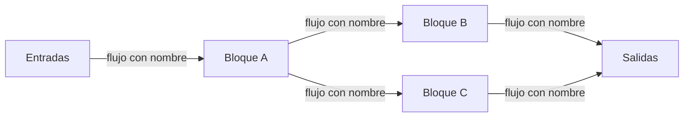

# Diagrama de bloques de alto nivel

La tercera de las tres formas de modelar una arquitectura que da la clase —ADLs, diagramas UML y
**diagramas de bloque de alto nivel**— → [[Cómo se modela la arquitectura]]. Un diagrama de alto nivel **no usa notación
UML**: usa **bloques y líneas**, y sirve para mostrar la arquitectura **entera, de un vistazo**, antes
de bajar al detalle.

## 1. Las definiciones de clase

Hay **tres** definiciones en tres diapositivas. Van textuales, porque se citan.

**Diagramas de alto nivel** (captura 13, "¿Cómo se modela? –Diagramas de Alto Nivel"):

> Describen la arquitectura con una **alto nivel de abstracción** [sic]. Suele ser el **primer paso
> antes de un diseño más detallado** (ej. con diagramas de componentes)

**Diagrama de bloques** (captura 14, "Diagramas de Bloque de Alto Nivel"):

> El **diagrama de bloques** es la representación del funcionamiento de un sistema, que se hace
> mediante **bloques y sus relaciones**, y que, además, definen la organización de todo el proceso
> interno, **sus entradas y sus salidas**.

**Diagrama de bloques, segunda redacción** (captura 15):

> representación gráfica simplificada que muestra la estructura y el funcionamiento de un sistema
> mediante **formas geométricas (bloques)** y **líneas de conexión (flechas)**. Se utiliza para
> visualizar las **relaciones funcionales, entradas, salidas y el flujo de información o energía**
> entre los componentes de ingeniería, procesos industriales o software

Las tres dicen lo mismo con distinto énfasis:

| Definición | Qué subraya |
|---|---|
| Alto nivel (13) | el **nivel de abstracción** y el **lugar en el proceso**: va **antes** del diseño detallado |
| Bloques (14) | **bloques + relaciones**, y la organización del proceso con **entradas y salidas** |
| Bloques (15) | la **notación** (formas geométricas y flechas) y el **alcance**: ingeniería, procesos industriales **o** software |

> [!important] Para qué sirve, en una línea
> Para **ver el sistema completo** —sus partes grandes, cómo se conectan y qué fluye entre ellas—
> **antes** de detallarlo con diagramas UML como el de componentes. Es el mapa; el UML es el plano.

## 2. La trampa: "de bloques" no siempre es "de software"

La definición de la captura 15 lo dice: el flujo puede ser **de información o de energía**, entre
componentes de **ingeniería, procesos industriales o software**. Y la mitad de los ejemplos que
mostró son **sistemas de control industrial** (SCADA), no arquitecturas de software. Hay que saber
distinguirlos:

| Si el diagrama muestra… | Es de… |
|---|---|
| sensores, actuadores, PLC, RTU, controladores, *field devices*, niveles de planta | **sistema de control industrial** (hardware + software de planta) |
| servidores, bases de datos, aplicaciones, servicios, zonas de nube | **sistema de software** / infraestructura |
| estrategia, negocio, datos, aplicaciones, tecnología | **arquitectura empresarial** (la organización entera) |

La definición de **SCADA** que dio (captura 16), textual:

> **SCADA** es un sistema de control y adquisición de datos diseñado para supervisar y controlar
> procesos industriales en tiempo real. Consiste en una red de dispositivos y software que trabajan
> en conjunto para recopilar información de sensores y equipos en el campo, transmitirla a un
> sistema central y permitir que los operadores tomen decisiones informadas y realicen ajustes a
> distancia.

La captura 14 lo rotula abajo como *"Supervisión, Control y Adquisición de Datos-scada"*.

## 3. Los ocho ejemplos de clase

La columna **"Atributo que ilustra"** distingue lo que **dice la diapositiva** de lo que es **lectura
propia** (complemento, marcada *lectura*). Los atributos se nombran con la lista de siete de
[[Drivers arquitectónicos]] / [[Atributos de calidad]].

| # | Ejemplo | Dominio | Qué muestra | Atributo que ilustra |
|---|---|---|---|---|
| 13 | **QuestionTrader / CORE / FAMA Extensions** | software | Capas apiladas: `QuestionTrader` arriba, el `CORE` del framework, cinco bloques (`Metamodels`, `Reasoners`, `Questions`, `Reasoner Selection Criteria`, `Benchmarking`) y abajo las **FAMA Extensions** (`FAMA MM`, `SPL Reasoner`, `JaCoP`, `SAT4j`, `Java BDD`, `#Products`, `List Products`, `Pre-defined`, cada grupo con `…`) | *lectura*: **mantenibilidad** — núcleo estable + extensiones enchufables |
| 14 | **FAST/TOOLS SCADA** | control industrial | `Collaboration platform` y `Operator Station` conectadas a un `SCADA Server`; al server llegan (flechas naranjas) un `Remote Gateway Station (RGS)` —que agrupa HIS, ENG, SCS y FCS sobre `VNET/IP`— y un `FAST/TOOLS Server` con un `3rd Party DCS`; bajo el RGS, un `Unified Gateway Station (UGS)` con `RTU` y `PLC` sobre `TCP/IP` | *lectura*: **integración** con equipos de terceros (en los drivers sería una restricción de integración) |
| 15 | **Arquitectura empresarial** | empresa | `Estrategia` (con `Modelo de negocio`) → `Arquitectura de negocio` (procesos, estructura organizacional, objetivos) → `Arquitectura de datos` ↔ `Arquitectura de aplicaciones` → `Arquitectura tecnológica` (servidores, redes, firewall, sistemas operativos, base de datos). Dos columnas **transversales**: `Ciberseguridad` y `Estándares`. Flechas con nombre: *cadena de valor*, *productos y servicios para clientes*, *información de los procesos*, *automatización de procesos*, *infraestructura para datos y aplicaciones* | *lectura*: **seguridad** como preocupación **transversal** a todas las capas |
| 16 | **PlantPAx** (*Process Automation System*) | control industrial | Cuatro **niveles** separados por líneas punteadas: `Level 3 Manufacturing Operations` (Enterprise Integration Server), `Level 2 Supervisory` (EWS, Domain Controller, OWS, Historian, Asset Centre, PASS and Batch), `Level 1 Process Control` (controladores, Remote I/O Rack, SIL1 & 2, TMR SIL 3, SIL 1,2,3) y `Level 0 Field Devices/Process` (Fieldbus, Classic I/O HART, Hazardous Location, Drives, Motor Control Center) | *lectura*: **disponibilidad** — `Redundant Controller Pair`, `Redundant Module Fiber Link`, servidor PASS redundante. Los niveles **SIL** son de seguridad funcional (*safety*) |
| 17 | **SCADA tradicional → SCADA en la nube** | control industrial + nube | Izquierda: HMI, Historian y Operator sobre una `Communication Network` → `MTU` → `PLC`, `IED`, `RTU` → *field devices* (sensores/actuadores). Flecha grande hacia la derecha: clientes móviles, remotos y `HMI Workstations` contra un `Cloud Server`, que pasa por un `Firewall` hacia tres `Remote site` (cada uno con SCADA Server/MTU, Control Network, RTUs/PLCs, sensores/actuadores) | **la diapositiva lo dice**: *"Integrar aplicaciones SCADA con servicios en la nube para mejorar la **escalabilidad**, la accesibilidad y la rentabilidad"*. *lectura*: el firewall = seguridad |
| 18 | **Arquitectura de un Sistema de Software de Facturación** | software | Seis **bases de datos** (`Usage`, `Application`, `Account`, `Customer`, `Payment/Adjustment`, `Billing`) con procesos que las alimentan (`Add/Update …`) y procesos que las encadenan (`Assign use to Application`, `Assign Application to A/C`, `Assign A/C to Application`); a la derecha `Payment/Adjustment`, `Discount`, `Commitment`, `Charge`, y `Bill time to client` → `Billing Database` → `Reviewing Edit billing`. Rótulo interno: *"Arquitectura del sistema"* | ninguno declarado. *lectura*: es un diagrama de **flujo de información** entre procesos y almacenes — el más "de software" de todos |
| 19 | **Multi-AZ: Alta Disponibilidad** (Amazon Web Services) | software / nube comercial | `Load Balancer` → tres `Web Servers` → dos `Application Servers` → base de datos `Primary`. Sobre las franjas `Availability Zone A` y `Availability Zone B`: una base con `Database Failure` (X roja), una `Standby` en gris y una flecha punteada `new standby` desde la Primary | **la diapositiva lo dice**: **disponibilidad** — *"Solución de tolerancia a fallos de nivel empresarial para Bases de Datos en producción"*, con *"Recuperación de fallo automático · Replicación síncrona · Económico y habilitado con un solo clic"* |
| 20 | **Metamodel / Architecture Repository / Stakeholder Views** | documentación de arquitectura empresarial | `Reference Models` y `Application Platform` ↔ `Metamodel`; la `"Real-World" Enterprise` alimenta el metamodelo; el metamodelo alimenta un `Architecture Repository` de `Building Blocks`; de ahí salen *"Standard sets of Catalogs, Matrices, and Diagrams, organized as Viewpoints"* → `Stakeholder Views`, y ↔ `Queries / Analysis Catalogs, Matrices, and Diagrams` para el `Stakeholder` | ninguno. *lectura*: ilustra la idea de **vistas por stakeholder** de [[Estructuras y vistas arquitectónicas]] |

Las imágenes, en el orden de la tabla:

![[adjuntos/capturas-clase-U2/diagramas-alto-nivel/diagramas-alto-nivel-questiontrader-fama.png]]

![[adjuntos/capturas-clase-U2/diagramas-alto-nivel/diagrama-bloques-definicion-scada-fast-tools.png]]

![[adjuntos/capturas-clase-U2/diagramas-alto-nivel/diagrama-bloques-definicion-arquitectura-empresarial.png]]

![[adjuntos/capturas-clase-U2/diagramas-alto-nivel/scada-plantpax-niveles.png]]

![[adjuntos/capturas-clase-U2/diagramas-alto-nivel/scada-tradicional-a-nube.png]]

![[adjuntos/capturas-clase-U2/diagramas-alto-nivel/arquitectura-sistema-facturacion.png]]

![[adjuntos/capturas-clase-U2/diagramas-alto-nivel/multi-az-alta-disponibilidad-aws.png]]

![[adjuntos/capturas-clase-U2/diagramas-alto-nivel/metamodelo-architecture-repository-stakeholder-views.png]]

> [!note] Erratas visibles en las diapositivas, transcritas tal cual
> Captura 13: *"una alto nivel"* [sic]. Captura 18: `Enter Clint receiver` [sic], `Review /Edit Paytm
> receive` [sic], `Add/Update customer to data`. Captura 15: *"sitemas operativos"* [sic].

> [!info] COMPLEMENTO — de dónde vienen algunos ejemplos
> No lo dice la clase; sirve para ubicarlos. Los cuatro niveles de PlantPAx (16) siguen el modelo
> de niveles de automatización industrial (Purdue / ISA-95). El diagrama 20 es el esquema del
> *Architecture Repository* y los *viewpoints* de **TOGAF**. El 13 es del framework **FaMa**
> (análisis de modelos de características; el logo de la diapositiva dice "FW CORE").

## 4. Cómo se lee uno — el patrón

Esquema propio, no es un diagrama de la clase: los tres ingredientes que piden las definiciones.

Tres preguntas, en orden, frente a cualquier diagrama de bloques:

1. **¿Qué es cada bloque?** — ¿un dispositivo, un servidor, una aplicación, una capa, un área?
   Eso dice el **dominio** (tabla de la sección 2).
2. **¿Qué fluye por cada línea?** — ¿información, energía, control? ¿En qué sentido?
3. **¿Qué decisión de calidad se ve?** — redundancia (disponibilidad), capas y extensiones
   (mantenibilidad), nube (escalabilidad), firewall o columna transversal (seguridad).

## 5. Alto nivel también en secuencia

El PDF del TEMA 5 usa "alto nivel" con el mismo sentido para un **diagrama de secuencia**: uno que
no muestra objetos internos sino **la comunicación entre las aplicaciones integradas** (MyApplication
contra GoogleMaps, Tripadvisor y Accuweather). Está en [[Diagrama de secuencia]] §6.

## 6. Diagrama de alto nivel vs diagrama UML

| | Alto nivel / de bloques | UML (componentes, despliegue, secuencia…) |
|---|---|---|
| Notación | libre: bloques, íconos, flechas | estándar: estereotipos, nodos 3D, interfaces |
| Nivel de abstracción | **alto**: el sistema entero | detallado |
| Cuándo | **primer paso** | después, al detallar |
| Público | cualquier stakeholder | técnico |

## Regla para el examen

**Alto nivel = primer paso, antes del diseño detallado. Bloques + relaciones + entradas y salidas.
Puede ser de software, de procesos industriales o de ingeniería.** Y el ejemplo que ata con calidad:
**Multi-AZ = disponibilidad**.

## Notas relacionadas

- [[Cómo se modela la arquitectura]] — las tres formas: ADLs, UML y bloques
- [[Diagramas UML estructurales y de comportamiento]] — la forma UML
- [[Diagrama de componentes]] — el "diseño más detallado" que viene después
- [[Diagrama de despliegue]] — el equivalente UML de los diagramas de servidores y zonas
- [[Diagrama de secuencia]] — el diagrama de secuencia de alto nivel
- [[Atributos de calidad]] y [[Drivers arquitectónicos]] — los atributos que ilustran los ejemplos
- [[Estructuras y vistas arquitectónicas]] — vistas por stakeholder (ejemplo 20)
- [[Diagrama de contexto]] — otro diagrama de bloques y flujos con nombre, del caso de negocio
- [[Tácticas y patrones arquitectónicos]] — las decisiones de diseño que estos diagramas dejan ver

## Preguntas de repaso

1. ¿Qué es un diagrama de alto nivel y en qué momento del diseño se usa, según la clase?
2. Citá los elementos de la definición de diagrama de bloques: ¿qué representa y con qué?
3. ¿Qué es SCADA? ¿Por qué un diagrama SCADA no es, en sentido estricto, una arquitectura de software?
4. ¿Qué atributo de calidad ilustra el ejemplo Multi-AZ de AWS y qué tres mecanismos menciona?
5. ¿Qué tres beneficios le atribuye la diapositiva a integrar SCADA con la nube?
