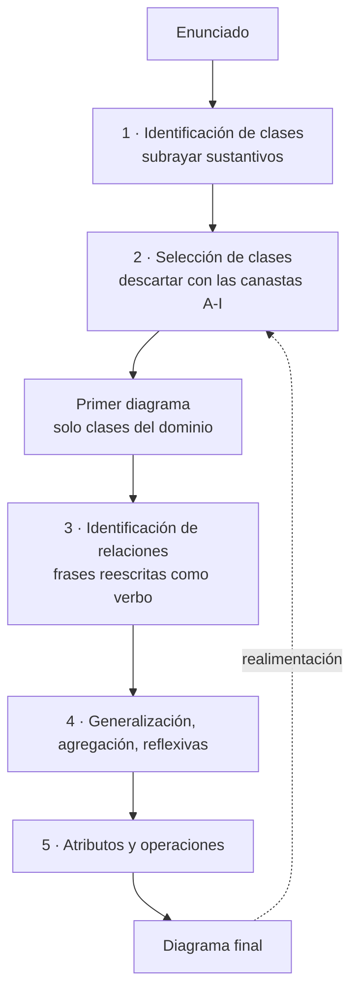

# Diagrama de clases

> [!important] De dónde sale cada cosa
> - **Qué es y sus reglas de notación** → PDF de clase *TEMA 5*, §3. Citado textual.
> - **El ejemplo Persona / Compañía** → captura 53 (*"Ejemplo Diagramas de Clase"*).
> - **El método para sacar clases de un enunciado** → PDF *IS 04 05b Ejemplos de Diagramas de
>   Clases*, que la catedrática usa como fuente de su ejemplo del parque (la captura 56 lo cita:
>   *"Material/Diseño orientado a objetos/IS_04_05b_EJEMPLOS__Diagramas_de_Clases"*).
> - Lo que viene de UML general va marcado **COMPLEMENTO**.
>
> El ejemplo completo del parque, con clases, componentes y despliegue, está en
> [[Ejemplo resuelto - Parque de atracciones]].

---

## 1. Qué es y para qué se usa

Es un diagrama **estructural**: muestra la parte **estática** del sistema, no lo que pasa mientras
corre (→ [[Diagramas UML estructurales y de comportamiento]]). El PDF del parque lo dice así:
*"el diagrama de clases en el que se modela la **parte estática** del sistema"*.

El PDF de clase *TEMA 5* le da **dos fines**:

> Se suelen usar con dos fines:
> - Durante el **análisis de requisitos** para generar a partir de ellos el **esquema de base de
>   datos**.
> - Durante el **diseño detallado** para modelar los **principales elementos del código** (clases,
>   interfaces, enumerados, etc.) **antes de su implementación**.

La misma clase se dibuja distinto según el fin (figura del PDF *TEMA 5*, pág. 3):

| | **Análisis** | **Diseño** |
|---|---|---|
| Qué representa | *"un concepto relevante del dominio sobre la que el sistema debe almacenar información"* | *"una clase en un lenguaje de programación OO"* |
| Atributos | *"la información que se debe almacenar. No se suele indicar el tipo, salvo los enumerados"* | con tipo y visibilidad (`- id: String`, `- total: Currency`) |
| Métodos | no aparecen | con parámetros, retorno y visibilidad (`#calculateTaxes(c: Country, s: State): Currency`) |
| Estereotipo | `<<Entity>>` | — |
| Regla | lo mínimo del dominio | *"todos los detalles necesarios para la implementación"* |

![[adjuntos/modelado-arquitectura-tema5/p3-clase-analisis-vs-diseno-order.jpg]]

> [!warning] La trampa de nivel
> El diagrama de clases **no es el diagrama de la arquitectura**. Es del **diseño detallado**. La
> arquitectura se modela con componentes y despliegue (→ [[Cómo se modela la arquitectura]]). En el
> ejemplo del parque se ve el puente: **las clases se empaquetan en componentes** y los componentes se
> reparten en nodos (→ [[Diagrama de componentes]], [[Diagrama de despliegue]]).

---

## 2. Las reglas de notación de la clase

Textual del PDF *TEMA 5*, §3, ordenado en tabla:

| Elemento | Lo que dice el PDF de clase |
|---|---|
| **Clases** | *"el nombre de las clases debe empezar en mayúscula. Los atributos y métodos se especifican en compartimentos separados."* |
| **Atributos** | *"se debe indicar el tipo y la visibilidad (público, privado, paquete, protegido). El nombre debe empezar por minúscula. Se recomienda usar notación camelCase."* |
| **Métodos** | *"se debe indicar el tipo de los parámetros y la visibilidad. Los métodos estáticos se indican subrayando su nombre. El nombre debe empezar por minúscula."* |
| **Asociaciones** | *"pueden ser bidireccionales o unidireccionales. Deben incluir la **multiplicidad** y el **rol** en cada extremo."* |
| **Dependencias** | *"se emplean para indicar que una clase hace uso de objetos de otra clase en cualquier punto de esta (atributos, parámetros de los métodos, variables locales, etc.)."* |
| **Herencia** | *"representan la herencia entre clases. Si la clase padre es abstracta su nombre se debe escribir con letra cursiva."* |
| **Interfaces** | *"se representan mediante el estereotipo `<<Interface>>`."* |

### La caja de una clase: tres compartimentos

| Compartimento | Contiene | Ejemplo de su diagrama del parque (56) |
|---|---|---|
| 1. Nombre | el nombre, y el estereotipo si lo tiene | `Atracción` · `<<Interfaz>> RegistroAvería` |
| 2. Atributos | visibilidad + nombre (+ tipo) | `-NúmeroAveríasPend` |
| 3. Operaciones | visibilidad + nombre + paréntesis | `+RegAveríaPend()` |

**Visibilidad** *(COMPLEMENTO — símbolos UML estándar; el PDF de clase nombra los cuatro tipos pero no
el símbolo)*: `+` público · `-` privado · `#` protegido · `~` paquete. En sus ejemplos ella usa **`-`
para atributos** y **`+` para operaciones**, siempre.

### Multiplicidad y rol

| Multiplicidad | Se lee | Aparece en |
|---|---|---|
| `1` | exactamente uno | `MolineteDeEntrada` 1 — 1 `Atracción` (56) |
| `0..1` | cero o uno (opcional) | `marido` / `mujer` (53) |
| `*` | cero o muchos | `Persona` * — * `Compañía` (53) |
| `1..*` | uno o muchos | `Noria` 1 — 1..* `Vehículo` (56) |

El **rol** es el nombre del **papel** que juega la clase en ese extremo de la asociación (*jefe*,
*empleado*). La **multiplicidad** va pegada al extremo **de la clase que se cuenta**: en
`Noria 1 ◇—— 1..* Vehículo`, el `1..*` está junto a Vehículo porque una noria tiene uno o más
vehículos.

---

## 3. El ejemplo de clase: Persona y Compañía (captura 53)

![[adjuntos/capturas-clase-U2/ejemplo-parque/ejemplo-clases-persona-compania.png]]

Leído a resolución completa:

**Clases**

| Clase | Atributos | Operaciones |
|---|---|---|
| `Persona` | `nombre`, `s. s.` | — (no se muestran) |
| `Compañía` | `nombre`, `dirección` | — (no se muestran) |

**Asociaciones**

| Asociación | Entre | Tipo de línea | Extremo A (rol · mult.) | Extremo B (rol · mult.) | Nombre |
|---|---|---|---|---|---|
| Empleo | Persona — Compañía | llena, sin punta | Persona · `*` | Compañía · `*` | *trabaja-para* ▶ (se lee Persona → Compañía) y ◀ *emplea-a* (se lee Compañía → Persona) |
| Matrimonio | Persona — Persona (**reflexiva**) | llena | *marido* · `0..1` | *mujer* · `0..1` | *casado-con* |
| Jerarquía | Persona — Persona (**reflexiva**) | llena | *jefe* · `0..1` | *empleado* · `*` | *Administra* |

Lo que enseña este ejemplo, en tres reglas:

1. **Una asociación reflexiva** une una clase **consigo misma**. Se dibuja como un lazo que sale y
   vuelve a la misma caja. Solo tiene sentido si cada extremo lleva **rol**: sin *jefe* / *empleado*
   no sabés quién administra a quién.
2. **Los roles desambiguan**. Dos lazos sobre `Persona` (*casado-con* y *Administra*) serían
   ilegibles sin roles.
3. **El triángulo negro junto al nombre** (▶ *trabaja-para*) indica **en qué sentido se lee el
   nombre**, no la navegabilidad *(COMPLEMENTO: notación UML estándar del "reading direction")*. Por
   eso la misma línea puede tener dos nombres con triángulos opuestos.

*(`s. s.` no se explica en la diapositiva; probablemente sea "seguro social". Inferencia mía.)*

---

## 4. Las relaciones entre clases

El detalle de cada flecha (trazo, punta, dirección) está en [[Relaciones y dependencias en UML]]. Acá
solo lo que **aparece en sus diagramas** y cómo lo dibuja ella:

| Relación | Cómo aparece en la captura 56 | Ejemplo |
|---|---|---|
| **Asociación** con nombre y multiplicidad | línea llena, nombre al medio, `1` y `1` en los extremos | `MolineteDeEntrada` —*Activa*— `Atracción` |
| **Generalización** (herencia) | línea llena con **triángulo hueco** en el padre | `Noria` → `Atracción`, `MolineteDeSalida` → `Molinete` |
| **Agregación** | línea llena con **rombo hueco** en el todo | `Noria` ◇— `Vehículo` |
| **Asociación reflexiva** | lazo sobre la misma clase | `Vagón` —*Arrastra*— `Vagón` |
| **Clase ↔ interfaz que realiza** | **línea llena, sin punta**, de la clase a la caja `<<Interfaz>>` | `Atracción` — `<<Interfaz>> RegistroAvería` |
| **Uso de una interfaz** (dependencia) | **línea punteada con punta** hacia la interfaz | `Averías` ⇢ `RegistroAvería` · `DispositivoOperario` ⇢ `SolicitarServicio` |

> [!warning] Diferencia con el estándar UML — gana la clase, pero declaralo
> En UML estándar la **realización** de una interfaz dibujada como caja es **punteada con triángulo
> hueco** (así figura en [[Relaciones y dependencias en UML]], que es complemento). Ella la dibuja
> como **línea llena sin punta**, y en la captura 54 (*"Clases a Componentes"*) rotula esa misma línea
> **"Realiza"**. Si en un examen lo dibujás a su manera, podés agregar el rótulo *Realiza* para que no
> haya duda.

---

## 5. El método mecánico: del enunciado a las clases

Sale del PDF *IS 04 05b* (ejercicio 1, reserva de vuelos, y ejercicio 2, parque de atracciones). El
PDF lo presenta como **aproximaciones sucesivas**:

> *"El proceso de construcción del diagrama de clases implica la **realimentación** de las soluciones
> conseguidas tantas veces como sea necesario, sin implicar por ello mayor o menor capacidad de los
> analistas."*

Es decir: **no sale a la primera, y no tiene que salir**. Se itera.

*(Esquema propio del método del PDF.)*

### Paso 1 — Identificación de clases: la canasta de sustantivos

> *"se subrayan todos los **sustantivos** en la descripción del problema, identificándose los
> siguientes sustantivos, correspondientes a las **clases candidatas** (excluyendo repeticiones y
> manteniendo todo en singular)"*

Mecánico: **subrayás cada sustantivo**, lo pasás a **singular** y **no repetís**. Todavía no se juzga
nada. En la reserva de vuelos salen 54 candidatas (incluidas *Ratón*, *Teclado*, *Monitor*); en el
parque, 30.

### Paso 2 — Selección de clases: las nueve canastas de descarte

Cada candidata se pasa por estas preguntas. Si cae en una canasta, **sale** (o se transforma):

| Canasta | Pregunta mecánica | Qué pasa | Ejemplo del PDF |
|---|---|---|---|
| **A. Redundantes** | ¿Hay otro sustantivo que nombra lo mismo? | queda **el más descriptivo** | *Cliente* y *Usuario* → queda Cliente · *Costo* → *tarifa* · *Login* → *email* |
| **B. Irrelevantes** | ¿Tiene poco o nada que ver con el problema? | se elimina | *Mostrador del Aeropuerto*, *Agente de Viajes Humano* |
| **C. Imprecisas** | ¿Es vaga, no tiene límites claros? | se elimina (puede volver como superclase) | *Sistema*, *Servicios*, *Actividad*, *Información*, *Estado*, *Opción* |
| **D. Nombres de clases** | ¿Hay un nombre más preciso? | se renombra | *aeropuerto* en lugar de *ciudad* |
| **E. Son atributos** | ¿Es una propiedad de otra clase? | pasa a **atributo** | *Número de Tarjeta* → atributo de *Tarjeta* · *Categoría de Asiento* → de *asiento* |
| **F. Son operaciones** | ¿Es algo que se **hace**? | pasa a **operación** | *Consulta*, *Compra*, *Reserva* |
| **G. Interfaces de usuario** | ¿Es una pantalla o mensaje? | sale del modelo de dominio | *mensaje de bienvenida*, *hoja principal* |
| **H. Sistema completo** | ¿Nombra al sistema entero? | se elimina | *Sistema de reserva* |
| **I. Actores** | ¿Es alguien que usa el sistema desde afuera? | sale, o entra por una clase interfaz | *Cliente*, *Operador* |

El ejercicio 2 lo resume en una sola frase de criterio:

> *"eliminar aquellas clases irrelevantes, ya sea porque tiene poco o nada que ver con el problema que se
> está modelando, porque **no son específicas del entorno de la aplicación** o porque **son atributos
> de clase**."*

Y agrega la regla del **actor que entra por una interfaz**:

> *"Eliminamos la clase **Operario**, ya que consideramos que el operario se relaciona con el sistema
> mediante la **clase interfaz Dispositivo del operario**."*

Con lo que queda se arma un **primer diagrama solo con las clases del dominio**, sin atributos
(figura 1.1 del PDF).

![[adjuntos/ejemplos-diagramas-clases/fig-1.1-primera-aproximacion.png]]

### Paso 3 — Identificación de relaciones: frases reescritas

Mecánico en dos movimientos:

1. **Buscá las frases que unen dos sustantivos** (casi siempre con *"de"* o *"en"*): *"Asientos en
   un vuelo"*, *"Tarifa de vuelo"*, *"Aerolínea deseada"*.
2. **Reescribilas como sujeto + verbo + objeto**. El verbo es el **nombre** de la asociación:

| Frase del enunciado | Reescrita | Asociación |
|---|---|---|
| Asientos en un vuelo | *"El vuelo contiene asientos"* | Vuelo —*Contiene*— Asiento |
| Aerolínea deseada | *"El vuelo pertenece a una aerolínea"* | Vuelo —*Le pertenece*— Aerolínea |
| Tarifa de vuelo | *"El vuelo tiene tarifas"* | Vuelo —*Ida/IV*, *Ofertas*— Tarifa |
| (tarjeta de crédito del pasajero) | *"El pasajero posee una tarjeta de crédito"* | Pasajero —*Posee*— Tarjeta |

Después, **a cada extremo, la multiplicidad**: preguntá *"¿cuántos B tiene un A?"* y *"¿cuántos A
tiene un B?"*. Si la respuesta es "uno o más", `1..*`; si puede no haber, `0..1` o `*`.

![[adjuntos/ejemplos-diagramas-clases/fig-1.2-segunda-aproximacion.png]]
![[adjuntos/ejemplos-diagramas-clases/fig-1.3-1.4-tercera-aproximacion.png]]

### Paso 4 — Generalización, agregación y reflexivas (ejercicio 2)

El ejercicio del parque agrega tres preguntas sobre las clases ya elegidas:

| Pregunta | Si la respuesta es sí | Ejemplo del PDF |
|---|---|---|
| ¿Varias clases son **tipos de** una más general? | **generalización** (herencia) | *"identificamos la clase Torniquete y las subclases Torniquete de Entrada y Torniquete de Salida"* · Atracción → Noria, Montaña rusa |
| ¿Una clase **está formada por** otra? | **agregación** | *"una Noria está formada por vehículos, con lo cual existe una relación de agregación"* |
| ¿Una clase se relaciona **con otra instancia de sí misma**? | **asociación reflexiva** | *"Como un vagón arrastra a otro vagón, tenemos una relación reflexiva en la clase vagón"* |

Y una decisión de diseño que el PDF deja **escrita con su razón**: podría haber una sola relación
Atracción—Torniquete, pero *"hemos preferido conservarlas para matizar que la asociación es distinta con
cada uno de los tipos de Torniquete"*.

### Paso 5 — Atributos y operaciones

> *"Los atributos de las clases los hemos podido obtener antes de proceder a la determinación de las
> asociaciones, pero en este caso nos ha parecido más fácil su representación al final, aunque es obvio
> que mientras estábamos obteniendo las relaciones extraíamos los atributos."*

Las fuentes de atributos son **las candidatas que cayeron en la canasta E**. Las de operaciones, **las
de la canasta F** y los **verbos** del enunciado que describen lo que hace cada clase (*detecta*,
*busca un operario*, *indica ocupado*).

![[adjuntos/ejemplos-diagramas-clases/fig-1.5-atributos.jpg]]

El resultado final del ejercicio 1:

![[adjuntos/ejemplos-diagramas-clases/fig-1.6-version-final-reserva-vuelos.png]]

> [!note] Dos descuidos del PDF, para no copiarlos
> - *Billete aéreo* aparece a la vez como **sustantivo preferido** (canasta A) y como **irrelevante**
>   (canasta B).
> - Después de la identificación de relaciones dice que *"queda el diagrama de la Figura 1.1"*, cuando
>   se refiere a la versión con asociaciones (1.2 en adelante).
>
> No cambian el método; sí muestran que conviene **declarar** en qué canasta cae cada candidata.

---

## 6. Las trampas, dichas antes

| Trampa | Por qué está mal | Qué hacer |
|---|---|---|
| Hacer una clase por cada sustantivo | *Ratón*, *Teclado*, *Sistema* no son del dominio | pasar las 9 canastas |
| Dejar **el actor** como clase | el actor está **afuera** del sistema | eliminarlo, o que entre por una **clase interfaz** (*Dispositivo del operario*) |
| Dejar como clase algo que es un **dato** | *Número de tarjeta* no tiene comportamiento propio | canasta E: atributo |
| Dejar como clase algo que es una **acción** | *Consulta*, *Compra* son cosas que se hacen | canasta F: operación |
| Asociación **sin multiplicidad ni rol** | el PDF de clase dice que *deben* incluirse en cada extremo | preguntar "¿cuántos?" en los dos sentidos |
| Reflexiva **sin roles** | no se sabe quién es jefe y quién empleado | poner rol en cada extremo |
| Usarlo como diagrama de **arquitectura** | es del diseño detallado | la arquitectura va en componentes y despliegue |

---

## 7. Checklist de verificación

- [ ] ¿Cada clase salió de un **sustantivo del enunciado** (o de una decisión escrita)?
- [ ] ¿Cada candidata descartada tiene **canasta asignada** (A-I)?
- [ ] ¿Ningún **actor**, **pantalla** ni **"Sistema"** quedó como clase?
- [ ] ¿Nombres de clase en **mayúscula**, atributos y operaciones en compartimentos separados?
- [ ] ¿Atributos con **visibilidad** (y tipo, si lo piden)? ¿Operaciones con `()`?
- [ ] ¿Cada asociación tiene **nombre**, **multiplicidad en los dos extremos** y **rol** donde haga falta?
- [ ] ¿Las reflexivas tienen **rol** en cada extremo?
- [ ] ¿Herencia con **triángulo hueco en el padre**, agregación con **rombo hueco en el todo**?
- [ ] ¿Las interfaces llevan **estereotipo** `<<Interfaz>>` y se ve **quién la realiza** y **quién la usa**?
- [ ] ¿Declaraste las decisiones de diseño con su razón (como la de los dos torniquetes)?

> **Regla para el examen:** *sustantivos → canastas → frases con verbo → multiplicidad en los dos
> sentidos → atributos y operaciones. Y se itera.*

---

## Notas relacionadas

- [[Ejemplo resuelto - Parque de atracciones]] — el encadenamiento CDU → clases → componentes → despliegue
- [[Relaciones y dependencias en UML]] — el detalle de cada flecha *(complemento)*
- [[Diagrama de componentes]] — adónde van a parar las clases
- [[Diagrama de despliegue]] — dónde corren esos componentes
- [[Diagramas UML estructurales y de comportamiento]] — el diagrama de clases es estructural
- [[Cómo se modela la arquitectura]] — por qué no es el diagrama de la arquitectura
- [[Caso de uso]] — lo que el diagrama de clases termina realizando

## Preguntas de repaso

1. Según el PDF de clase, ¿cuáles son los dos fines del diagrama de clases, y en qué momento del ciclo se usa cada uno?
2. En el ejemplo Persona/Compañía, ¿qué es una asociación reflexiva y por qué *casado-con* y *Administra* necesitan roles?
3. Nombrá las nueve canastas de descarte del método y da un ejemplo de tres de ellas.
4. ¿Cómo se convierte una frase como *"asientos en un vuelo"* en una asociación con nombre y multiplicidad?
5. ¿Por qué el PDF elimina la clase *Operario* del parque, y qué la reemplaza?
