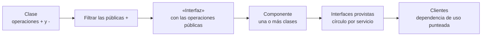

# Diagrama de componentes

Muestra **de qué piezas de software está hecho el sistema** y **cómo dependen unas de otras**, a
través de sus interfaces. Es el diagrama de la vista que en [[Modelo 4+1 vistas]] se llama *de
despliegue o de desarrollo* — **no** es el [[Diagrama de despliegue]], que muestra dónde corre cada
pieza.

Las interfaces (provista/requerida, forma icónica/expandida) tienen su propia nota:
[[Interfaces de componentes]].

---

## 1. Qué es — lo que dice la clase

La diapositiva, textual (captura 23):

> ✓ Los diagramas de componentes describen los **elementos físicos y sus realizaciones** en el entorno.
> ✓ Muestran las opciones de realización incluyendo **código fuente, binario y ejecutable**
> ✓ Los componentes representan **todos los tipos de elementos software** que entran en la fabricación de aplicaciones informáticas
> ✓ Pueden ser simples archivos, paquetes de Ada, bibliotecas cargadas dinámicamente, etc.

![[adjuntos/capturas-clase-U2/componentes/que-describen-los-diagramas-de-componentes.png]]

Y el PDF del TEMA 5 (pág. 1-2) lo define así:

> Describen el sistema como una **agregación de componentes**. Un componente es una **unidad software
> que puede ser reemplazada y actualizada de forma independiente**.
> Los componentes se definen en términos de los **servicios que ofrecen** (interfaces de salida) y los
> **servicios que requieren** de otros componentes (interfaces de entrada).

> [!warning] Dos descripciones que no dicen lo mismo
> | Fuente | Dice que el diagrama representa… |
> |---|---|
> | Captura 23 (diapositiva) | *"los elementos **físicos** y sus realizaciones"* |
> | PDF TEMA 5, pág. 2 | *"Se utilizan para representar la arquitectura **lógica** del sistema"* |
>
> Manda la **diapositiva** (captura). La forma de conciliarlas: el componente es **físico** en el
> sentido de que existe como archivo o binario (DLL, ejecutable, código fuente), y el diagrama muestra
> la **organización** del software, que es lo que el PDF llama "lógica". Si en el examen piden la
> definición, citá la de la diapositiva.

### Definición en una línea, para memorizar

**Componente = unidad de software reemplazable, que se define por los servicios que ofrece y los que
requiere.** El diagrama muestra esos componentes y sus dependencias.

---

## 2. Para qué existe

| Sirve para… | Porque… |
|---|---|
| Ver **de qué piezas** está hecho el software | Es el diagrama de la vista de desarrollo del [[Modelo 4+1 vistas]] |
| Hacer los componentes **reusables y reemplazables** | Cada uno expone **interfaces**: mientras la interfaz se respete, el componente se puede cambiar (captura 30, ver [[Interfaces de componentes]]) |
| Mostrar **dependencias** entre piezas | Si cambia un proveedor, se ve qué componentes clientes se ven afectados (ver [[Relaciones y dependencias en UML]]) |
| Pasar del **diseño lógico** (clases) al **físico** (lo que se compila y despliega) | Un componente implementa una o más clases (captura 24) y luego se despliega en un nodo ([[Diagrama de despliegue]]) |

---

## 3. La trampa

> [!danger] Tres confusiones que cuestan puntos
> 1. **Componente ≠ clase.** La clase es una abstracción; el componente es la pieza de software que la
>    *personifica*, y **puede implementar más de una clase** (captura 24).
> 2. **Diagrama de componentes ≠ diagrama de despliegue.** Componentes = *en qué piezas se divide el
>    software*. Despliegue = *en qué hardware corre cada pieza*.
> 3. **"Componente de ejecución" no es el único tipo.** La clase distingue **tres** tipos (sección 5):
>    también son componentes los archivos de código y las DLL.

---

## 4. Componente vs. clase

La diapositiva, textual (captura 24):

> **¿Cuál es la relación entre un componente y una clase?**
> • Imagine a un componente como la **personificación en software de una clase**.
> • La clase representa una **abstracción de un conjunto de atributos y operaciones**.
> • Los componentes y clases es [sic] que **un componente puede ser la implementación de más de una clase**.

![[adjuntos/capturas-clase-U2/componentes/relacion-componente-clase.png]]

| | Clase | Componente |
|---|---|---|
| Qué es | abstracción de atributos y operaciones | la personificación en software de una o más clases |
| Plano | lógico (vista lógica, [[Diagrama de clases]]) | físico / de implementación (vista de desarrollo) |
| Cardinalidad | — | **1 componente → 1 o más clases** |
| Qué muestra hacia afuera | sus operaciones públicas `+` | sus **interfaces** (ver [[Interfaces de componentes]]) |

---

## 5. Tipos de componentes

La diapositiva, textual (captura 29), con los tres nombres en rojo:

> ○ **Componentes de distribución**, que conforman el fundamento de los sistemas ejecutables (DLL,
> ejecutables, controles ActiveX , Java y Webservices).
> ○ **Componentes para trabajar en el producto,** a partir de los cuales se han creado los componentes
> de distribución (como archivos de base de datos y de código).
> ○ **Componentes de ejecución**, creados como resultado de un sistema en ejecución.

![[adjuntos/capturas-clase-U2/componentes/tipos-de-componentes.png]]

| Tipo | Cuándo existe | Ejemplos de la diapositiva | Pregunta para clasificar |
|---|---|---|---|
| **De distribución** | lo que se entrega e instala | DLL, ejecutables, controles ActiveX, Java, Webservices | ¿se instala/distribuye? |
| **Para trabajar en el producto** | durante la construcción | archivos de base de datos y de código | ¿de esto **se genera** lo que se distribuye? |
| **De ejecución** | mientras el sistema corre | los creados por el sistema en ejecución | ¿solo existe **con el sistema corriendo**? |

> [!note] El PDF del TEMA 5 usa otra clasificación — no es contradicción
> El PDF (pág. 2) lista *"Componentes: buildComponent, Entity, Service, Subsystem"*: son
> **estereotipos** que se escriben entre `«»` sobre el componente. La diapositiva clasifica por
> **momento del ciclo de vida**. Son dos ejes distintos. Para responder "tipos de componentes", usá
> los **tres de la diapositiva**.

---

## 6. La notación

### Lo que se ve en las diapositivas

Hay **dos formas** de dibujar el componente en el material, y conviene reconocer las dos. *(Los rótulos "UML 1.x" y "UML 2.x" son COMPLEMENTO: la clase solo escribe "UML 2.X" en la captura 32.)*

| Notación | Cómo se ve | Dónde aparece |
|---|---|---|
| **UML 1.x** | rectángulo con **dos rectangulitos** saliendo del borde izquierdo | captura 22 (Firewall), captura 54 (Dictionary, Transactions) |
| **UML 2.x** | rectángulo con el estereotipo **`«component»`** y el **iconito** del componente en la esquina superior derecha | capturas 31, 32, 33 y el PDF del TEMA 5 |

### El ejemplo "1.- Diagrama de Componentes" (captura 22)

![[adjuntos/capturas-clase-U2/componentes/componentes-ejemplo-firewall-certificate-authority.png]]

Leído con zoom:

| Elemento | Tipo | Detalle |
|---|---|---|
| `Customer Browser` | componente (UML 1.x) | dentro de un recuadro **punteado** rotulado `Internet` |
| `Server Components::Firewall` | componente | el `::` indica que `Firewall` está dentro del paquete `Server Components` *(COMPLEMENTO: convención UML, la diapositiva no lo explica)*. Tres interfaces provistas (círculo): `AcceptRequest() : HTML Request`, `ForwardRequest() : HTML Request`, `ReturnResponse() : HTML Response` |
| `Certificate Authority` | componente | ícono de candado arriba a la derecha (la diapositiva no lo explica). Una interfaz provista: `ValidateCertificate() : bool` |

| Conexión | Trazo | Rótulo |
|---|---|---|
| `Customer Browser` — `Server Components::Firewall` | línea **llena**, sin punta | `«https»` |
| `Customer Browser` — `Certificate Authority` | línea **llena**, sin punta | ninguno |

Lo que enseña el ejemplo: el estereotipo va también **sobre la conexión** (`«https»` dice el
protocolo), y las operaciones que el componente ofrece se listan **junto a cada interfaz**.

### Los elementos del diagrama, según el PDF (TEMA 5, pág. 2-3)

> Los elementos de este tipo de diagramas son: **componentes, dependencias, interfaces, puertos.**

| Elemento | Definición del PDF (textual) | Notación |
|---|---|---|
| **Componente** | *"unidad software que puede ser reemplazada y actualizada de forma independiente"* | rectángulo `«component»` + ícono |
| **Dependencia** | (sin texto, solo figura) | flecha **punteada** con punta **abierta**, del que usa hacia el que es usado |
| **Interfaz** | *"describen los servicios proporcionados o requeridos por el componente y suelen incluir prototipo de métodos, descripción funcional, limitaciones de uso, etc."* | círculo (provista) y semicírculo (requerida) — ver [[Interfaces de componentes]] |
| **Puerto** | *"los puertos agrupan interfaces relacionadas entre sí. Su uso es más habitual en componentes de caja blanca donde además sirven para relacionar las interfaces con los elementos internos del componente."* | cuadradito sobre el borde del componente |

El ejemplo del PDF es un *mashup* de predicción meteorológica: `WeatherForecast` usa las interfaces
`DayForecast` (de `Weather.com API`) y `WeatherMap` (de `GoogleMaps API`).

![[adjuntos/modelado-arquitectura-tema5/p2-componente-estereotipo-weatherforecast.jpg]]

*PDF pág. 2 — el estereotipo `«component»` y las interfaces ensambladas.*

![[adjuntos/modelado-arquitectura-tema5/p2-dependencias-entre-componentes.jpg]]

*PDF pág. 2 — "Dependencias": `WeatherForecast` depende de las dos API (flechas punteadas que salen
del que depende).*

### Caja negra y caja blanca (PDF TEMA 5, pág. 2-3)

| Vista | Definición del PDF (textual) |
|---|---|
| **Caja negra** | *"los detalles de implementación quedan ocultos. Sería lo visto anteriormente."* — solo se ven el componente y sus interfaces |
| **Caja blanca** | *"se muestran los detalles de implementación del componente, normalmente a través de un diagrama de clases o de otros componentes."* |

![[adjuntos/modelado-arquitectura-tema5/p3-caja-blanca-y-puertos.jpg]]

*PDF pág. 3 — izquierda: `WeatherForecast` en caja blanca (clases `Place`, `Map`, `WeatherForecast`,
`Forecast`, `Time` adentro, y **puertos** en el borde que conectan con `WeatherMap` y
`DayForecast`). Derecha: el subsistema `«subsystem» Accounting` con su *internal structure*
(`:Orders`, `:Customers`, `:Accounts`) y puertos en el borde.*

La caja blanca es la prueba visual de la captura 24: **un componente implementa varias clases**.

---

## 7. Cómo se hace: de clases a componentes

La diapositiva *"Clases a Componentes"* (captura 54) muestra el camino completo:

![[adjuntos/capturas-clase-U2/componentes/clases-a-componentes-dictionary.png]]

Leída con zoom:

| Paso que muestra | Qué hay |
|---|---|
| La clase | `Dictionary` — atributos `Tipo Palabra`, `Definición` — operaciones `- Add Words`, `+ Spell_check`, `+ Synoyms` [sic] |
| La interfaz | `«Interfaz» Servicios Diccionario` con `Spell_check` y `Synoyms` — **solo las públicas**; `Add Words` (privada, `-`) **no** pasa |
| La relación | línea **llena** entre la clase y la interfaz, con la flecha roja **"Realiza"** |
| El componente | `Dictionary` (notación UML 1.x) con **dos** interfaces provistas (círculos): `spell-check` y `synonyms` |
| El diagrama anotado | `Transactions` (*component*) → realiza la interfaz `Update` (*interface*, línea llena al círculo, rotulada *realization dependency*); `ATM-GUI` → flecha **punteada** a `Update` (*usage dependency*); `Transactions` → flecha **punteada** a `«database» Account` (*stereotyped component*) |

### La checklist mecánica

> [!tip] Método — sistematización propia de la captura 54 (y 24, 26)
> Para cada clase (o grupo de clases) que se va a volver componente:
>
> 1. **Listá las operaciones públicas (`+`).** Solo esas salen hacia afuera: la captura 26 dice que el
>    compartimento de la interfaz lleva las *"Operaciones que la clase pondrá a disposición de otras
>    clases (+)"*. Las privadas (`-`) quedan adentro.
> 2. **Agrupalas en una `«Interfaz»`** y relacioná la clase con ella por **realización**.
> 3. **Decidí qué clases van juntas en un mismo componente.** Un componente puede implementar más de
>    una clase (captura 24).
> 4. **Dibujá el componente** y ponele **una interfaz provista (círculo) por servicio**. Se pueden
>    separar: `Servicios Diccionario` terminó como dos círculos, `spell-check` y `synonyms`.
> 5. **Buscá quién usa cada servicio** y conectalo con una **dependencia de uso** (punteada, hacia la
>    interfaz). En forma icónica, el que usa lleva el **semicírculo** (interfaz requerida).
> 6. **Marcá las dependencias directas** entre componentes (punteada con punta abierta, del que usa al
>    usado) y **estereotipá** los componentes especiales (`«database»`, `«subsystem»`…).
> 7. **Verificá**: ¿ninguna operación privada quedó expuesta?, ¿toda interfaz requerida tiene quien la
>    provea?, ¿todas las dependencias salen del que depende?

Esquema propio del flujo (no es un diagrama de la clase):

---

## 8. Checklist de verificación del diagrama

- [ ] Cada componente tiene **nombre** y, si usa UML 2.x, el estereotipo `«component»` o el ícono.
- [ ] Cada servicio ofrecido es una **interfaz provista** (círculo) con nombre.
- [ ] Cada servicio que se consume es una **interfaz requerida** (semicírculo) o una **dependencia**.
- [ ] Las dependencias son **punteadas** y salen **del que depende**.
- [ ] No hay **nodos ni hardware** (eso va al [[Diagrama de despliegue]]).
- [ ] No hay **clases sueltas** fuera de un componente de caja blanca.
- [ ] Toda interfaz requerida tiene un componente que la **provea**.

## Regla para el examen

> **Componente = pieza reemplazable que se define por lo que ofrece (círculo) y lo que requiere
> (semicírculo). Un componente puede implementar varias clases. Tres tipos: distribución, trabajo en
> el producto, ejecución.**

## Notas relacionadas

- [[Interfaces de componentes]] — provista/requerida, icónica/expandida
- [[Relaciones y dependencias en UML]] — dependencia, realización y la tabla de la Vista Lógica
- [[Modelo 4+1 vistas]] — la vista de despliegue/desarrollo, donde vive este diagrama
- [[Estructuras y vistas arquitectónicas]] — la estructura de módulos y la de componente-y-conector
- [[Diagrama de despliegue]] — dónde se despliegan los componentes
- [[Diagrama de clases]] — de donde salen los componentes

## Preguntas de repaso

1. Según la diapositiva, ¿qué describen los diagramas de componentes y qué opciones de realización muestran?
2. ¿Cuál es la relación entre un componente y una clase? ¿Puede un componente implementar más de una clase?
3. Nombrá los tres tipos de componentes y un ejemplo de cada uno.
4. ¿Qué diferencia hay entre ver un componente como caja negra y como caja blanca? ¿Para qué sirven los puertos?
5. Tenés una clase con operaciones públicas y privadas: ¿qué pasos seguís para convertirla en componente y qué operaciones terminan en su interfaz?
