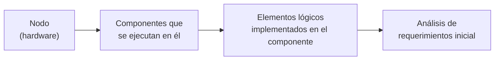
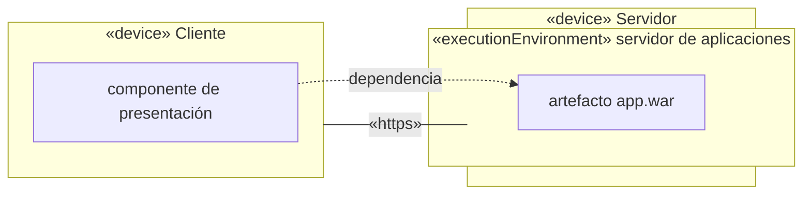
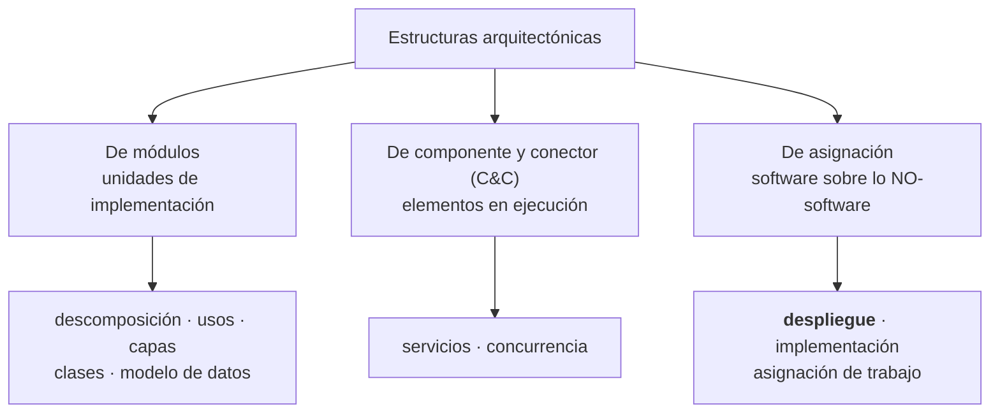

# Diagrama de despliegue (o de distribución)

> [!important] Qué es de clase y qué es complemento
> **Ahora sí hay material de clase del punto 1.7.** Hasta el 15/09 esta nota decía que el tema solo
> aparecía de refilón en el modelo 4+1; eso quedó atrás. Hay dos fuentes nuevas, las dos **núcleo**:
>
> - las **capturas de clase** de la serie "2.- Diagrama de Distribución" (capturas_U2: 34 a 38, 42,
>   48, y el ejemplo del parque de atracciones, 57-58);
> - el **PDF "TEMA 5: Modelado de arquitectura software"**, sección *4. Diagrama de despliegue*
>   (págs. 4 a 6).
>
> Las secciones 1 a 7 son **clase**. Las secciones 8 a 11 son **complemento** (SAIP y Reynoso),
> conservadas porque ayudan a entender; si dicen algo distinto, **manda la clase**, y donde choca
> está dicho.

---

## 1. Un diagrama, tres nombres

La clase titula todas sus diapositivas **"2.- Diagrama de Distribución"**, pero dentro de las mismas
diapositivas lo llama **"diagramas de despliegue"** (capturas 38 y 42), y el PDF lo llama
**"Diagrama de despliegue"**. En inglés es el ***deployment diagram***. **Son el mismo diagrama.**

| Nombre | Dónde aparece |
|---|---|
| **Diagrama de Distribución** | Título de las diapositivas de clase (capturas 34-38, 40) |
| **Diagrama de despliegue** | Texto de las diapositivas 38 y 42, PDF TEMA 5, captura 57 |
| **Diagrama de *Deployment*** | Presentación del [[Modelo 4+1 vistas]] (Vista Física) |

> [!warning] El cruce de nombres con el 4+1 — ahora con dos versiones en el material de clase
> | Material | Llama "vista de despliegue" a… | El diagrama de despliegue/distribución va en… |
> |---|---|---|
> | Presentación del **4+1** (Arquitectura de Software.pdf) | la vista de **componentes** ("Vista de Despliegue o de Desarrollo") | la **Vista Física** |
> | Capturas de **Distribución** (captura 37) | la **topología de hardware** ("el modelado de la vista de despliegue estática implica modelar la topología del hardware") | la vista de **despliegue** |
>
> No es que una esté mal: la captura 37 usa el nombre de **UML** (Booch, Rumbaugh y Jacobson, ver
> §11), y la presentación del 4+1 usa el de **Kruchten** para la vista física pero reserva
> "despliegue" para la de desarrollo. **Regla para el examen**: si te preguntan por el 4+1, el
> diagrama de despliegue es de la **Vista Física**; si te preguntan "qué modela la vista de
> despliegue estática", es la **topología del hardware**. Decí siempre qué marco estás usando.

---

## 2. Qué es — las definiciones de clase

**PDF TEMA 5, pág. 4** (la definición corta, la más citable):

> "Se utilizará para representar la **arquitectura física** sobre la que un sistema software es
> desplegado. Por tanto, describe tanto **dispositivos hardware como software**."

**Captura 42, "En cuanto al diagrama de despliegue"**:

> - "Presenta la **arquitectura de tiempo de ejecución** de los procesadores, dispositivos, y los
>   componentes de software que se ejecutan en esa arquitectura."
> - "Es la **descripción física última de la topología del sistema**, y describe la estructura de
>   las unidades de hardware y el software que se ejecuta en cada unidad."
> - "Debe ser posible mirar un nodo específico de la topología, ver qué componentes se ejecutan en
>   el nodo, ver qué elementos lógicos están implementados en el componente, y finalmente, **trazar
>   esos elementos al análisis de requerimientos inicial del sistema**"

![[adjuntos/capturas-clase-U2/despliegue/despliegue-descripcion-fisica-y-trazabilidad.png]]

El tercer punto es el que más pesa, porque arma una **cadena de trazabilidad** de punta a punta:

*(Esquema propio de la cadena que describe la captura 42.)* Es la misma idea que la frase del 4+1
—"los elementos definidos en la vista lógica se mapean a componentes de software o de hardware"— y
la misma que persigue la [[Matriz de trazabilidad de requisitos]]: nada en el diagrama sin un
requerimiento detrás.

La frase del **4+1** sigue valiendo (Vista Física, presentación Arquitectura de Software):

> Representa cómo están distribuidos los componentes entre los distintos equipos que conforman la
> solución incluyendo los servicios. **Los elementos definidos en la vista lógica se mapean a
> componentes de software o de hardware.**

![[adjuntos/arquitectura-de-software/arq-p29.png]]

---

## 3. Para qué se usa

**Captura 37, "Aplicación de los Diagramas de distribución"**:

> - "A veces el modelado de la vista de despliegue estática implica modelar la **topología del
>   hardware** sobre el que se ejecuta el sistema."
> - "Aunque UML no es un lenguaje de especificación hardware de propósito general, se ha diseñado
>   para modelar muchos de los aspectos hardware de un sistema a un nivel suficiente."
> - "Para que un ingeniero de sistemas pueda manejar la **frontera entre el hardware y el
>   software** cuando se trata de la relación entre hardware y software, se utilizan los diagramas
>   de distribución para razonar sobre la **topología de procesadores y dispositivos** sobre los que
>   se ejecuta el software."

![[adjuntos/capturas-clase-U2/despliegue/distribucion-aplicacion-topologia-hardware.png]]

**Captura 38** — "Los diagramas de despliegue se suelen utilizar para modelar:"

| Tipo de sistema | Textual de la diapositiva | Qué decide el diagrama |
|---|---|---|
| **Sistemas empotrados** | "involucran software que controla dispositivo (motores, actuadores) que a su vez están controlados por estímulos externos como sensores." | Qué software corre en qué dispositivo físico |
| **Sistemas cliente-servidor** | "Son un extremos [sic] del espectro de los sistemas distribuidos y requieren tomar decisiones sobre la **conectividad de red** de los clientes a los servidores y sobre la **distribución física de los componentes** software del sistemas [sic] a través de nodos." | Red cliente↔servidor y en qué nodo va cada componente |
| **Sistemas completamente distribuidos** | "Normalmente incluyen **varios niveles de servidores**, contienen a menudo **varias versiones** de componentes software, alguno de los cuales pueden incluso **migrar de un nodo a otro**." | Niveles, versiones y migración |

![[adjuntos/capturas-clase-U2/despliegue/distribucion-empotrados-cliente-servidor-distribuidos.png]]

> [!tip] El "migrar de un nodo a otro" de la captura 38 es la relación *migrates-to* del SAIP (§8).
> Clase y complemento dicen lo mismo con palabras distintas.

---

## 4. Los elementos — PDF TEMA 5

> "Elementos principales: ✓ **Nodo**. o Dispositivo. o Entorno de ejecución. ✓ **Artefacto**.
> ✓ **Despliegue**."

| Elemento | Definición textual del PDF | Estereotipo en sus figuras |
|---|---|---|
| **Nodo** | "entidades físicas (o software) capaces de ejecutar artefactos." "Un nodo puede contener uno o más nodos en su interior." | cubo 3D |
| ↳ **Dispositivo** (*device*) | "representan elementos **hardware**, como por ejemplo un servidor, capaces de ejecutar artefactos." | `«device»` |
| ↳ **Entorno de ejecución** (*execution environment*) | "representan elementos **software**, como por ejemplo una máquina virtual, capaces de ejecutar artefactos. **Siempre deben representarse dentro de un dispositivo.**" | `«executionEnvironment»` |
| **Artefacto** | "cualquier producto obtenido durante el desarrollo: ✓ Ejecutable. ✓ Manual de usuario. ✓ Script de BD. ✓ Librería." | rectángulo con ícono de documento |
| **Despliegue** | "relación entre dos o más artefactos y el/los nodo/nodos donde éstos de [sic] ejecutan." | el artefacto **dentro** del nodo |

La figura de la pág. 4 rotula tres de ellos: dos **dispositivos** (`«device» AndroidPhone`,
`«device» GoogleServer`), un **camino** (la línea que los une) y un **entorno de ejecución**
(`«executionEnvironment» AppEngine`, dentro del GoogleServer):

![[adjuntos/modelado-arquitectura-tema5/p4-despliegue-dispositivo-entorno-camino.jpg]]

Un **artefacto** suelto (pág. 5):

![[adjuntos/modelado-arquitectura-tema5/p5-artefacto-weatherforecast-war.jpg]]

Y un **despliegue** completo, con el anidamiento de tres niveles (pág. 5): el artefacto `e-shop.war`
dentro del `«executionEnvironment» Tomcat server`, dentro del `«device» Red Hat Server`.

![[adjuntos/modelado-arquitectura-tema5/p5-despliegue-redhat-tomcat-eshop.jpg]]

La tabla resumen de la pág. 6 — **la de memorizar**, porque da un ejemplo por elemento:

| Elemento | Ejemplo |
|---|---|
| Artefacto | Fichero jar |
| Dispositivo | PC |
| Entorno de ejecución | Java Runtime Environment (JRE) |
| **Camino** | Conexión wifi/ethernet entre dos dispositivos |
| Despliegue | Fichero jar ejecutándose en el JRE de un PC |

![[adjuntos/modelado-arquitectura-tema5/p6-tabla-elementos-despliegue.jpg]]

### Dos distinciones finas del PDF

**Entorno de ejecución vs. artefacto** (pág. 5):

> "un mismo elemento, dependiendo del **punto de vista**, puede ser considerado como un entorno de
> ejecución o un artefacto. Ejemplo: Eclipse: ✓ Artefacto desde el punto de vista de los
> desarrolladores de IDE. ✓ Entorno de ejecución desde el punto de vista del desarrollador de uno de
> sus plugins."

**Artefacto vs. componente** (pág. 6):

> "los diagramas de componentes y despliegue están relacionados entre sí mediante componentes y
> artefactos. **Un artefacto manifiesta (o implementa) uno o varios componentes.**"

| | Artefacto | Componente |
|---|---|---|
| Es | el **producto físico** (jar, war, script, librería) | la **pieza lógica** de software |
| Vive en | el diagrama de **despliegue** | el diagrama de [[Diagrama de componentes\|componentes]] |
| Relación | **manifiesta** uno o varios componentes | es manifestado por un artefacto |

*(COMPLEMENTO: en UML esa relación se dibuja como una dependencia punteada con el estereotipo
`«manifest»` del artefacto al componente. El PDF dice "manifiesta" pero no muestra la flecha.)*

---

## 5. La notación en las diapositivas de clase

Las capturas de "Distribución" usan **componentes** dentro de los nodos (no artefactos): es la otra
forma válida, la que conecta directo con el diagrama de componentes.

| Regla | Textual / de dónde |
|---|---|
| **Nodo = cubo** | Captura 36: "dos cubos" |
| **Conexión = línea entre cubos** | Captura 36: "Una línea que asocie a dos cubos representará una **conexión** entre ellos." |
| **Componentes dentro del nodo, con dependencias** | Captura 35: "Otra forma de indicar los componentes distribuidos es mostrarlos en **relaciones de dependencia** en un nodo" |
| **La conexión lleva el protocolo como estereotipo** | Captura 34: `«TCP/IP»` · captura 57: `<<https>>`, `<<TCP/IP, FTP>>`, `<<wifi>>` |

### Captura 35 — componentes con dependencia dentro de un nodo

![[adjuntos/capturas-clase-U2/despliegue/distribucion-componentes-dependencia-en-nodo.png]]

| Elemento | Tipo | Dentro de |
|---|---|---|
| Nodo | nodo (cubo) | — |
| Directorio Telefonico Corporativo | componente | Nodo |
| Programa de Busqueda | componente, con interfaz *Resultado Busqueda* (círculo) | Nodo |

| Relación | Trazo | De → a |
|---|---|---|
| Dependencia | **punteada**, punta abierta | Programa de Busqueda → Directorio Telefonico Corporativo |
| Realización de interfaz | línea llena + círculo (*lollipop*) | Programa de Busqueda — Resultado Busqueda |

### Captura 36 — la conexión entre dos nodos

![[adjuntos/capturas-clase-U2/despliegue/distribucion-conexion-entre-nodos.png]]

| Elemento | Tipo | Dentro de |
|---|---|---|
| Servidor | nodo | — |
| Directorio Telefonico Corporativo · Programa de Busqueda (+ interfaz Resultado Busqueda) | componentes | Servidor |
| Cliente | nodo | — |
| ProgramadePresentacion | componente | Cliente |

| Relación | Trazo | De → a |
|---|---|---|
| **Comunicacion** | línea **llena**, sin puntas, con nombre | Servidor — Cliente |
| Dependencia | punteada, punta abierta | Programa de Busqueda → Directorio Telefonico Corporativo |
| Dependencia **entre nodos** | punteada, punta abierta | ProgramadePresentacion (Cliente) → interfaz Resultado Busqueda (Servidor) |

Lo que enseña: la **línea llena** entre cubos es la conexión física; la **punteada** es una
dependencia de software que **cruza** esa conexión. El cliente no depende del programa entero, sino
de su **interfaz**.

### Captura 34 — el ejemplo con servidores reales

![[adjuntos/capturas-clase-U2/despliegue/distribucion-ejemplo-servidores-tcpip.png]]

| Nodo | Tipo (tras los dos puntos) | Agrupación |
|---|---|---|
| Production Server | :PC Server | dentro del recuadro punteado *Clustered Win2000 Application Servers* |
| Production Server | :PC Server | ídem (son **dos**: el clúster) |
| Database Server | :UNIX Server | — |
| Warehouse Server | :Mainframe | — |

| Conexión | Estereotipo | Mensaje numerado junto a la línea | Sentido del mensaje |
|---|---|---|---|
| Production Server — Production Server | `«TCP/IP»` | — | — |
| Production Server (arriba) — Database Server | `«TCP/IP»` | **2 Order** | hacia Database Server |
| Production Server (abajo) — Database Server | `«TCP/IP»` | **3 Order** | hacia Database Server |
| Database Server — Warehouse Server | `«TCP/IP»` | **1 Billing File** | hacia Warehouse Server |

Tres cosas que muestra y hay que saber leer:

- **`Nombre :Tipo`** en el nodo: *Production Server* es la instancia, *PC Server* el tipo de nodo.
- El **recuadro punteado** agrupa nodos (un clúster), no es un nodo.
- Las **líneas son llenas y sin punta**; la dirección la dan las **flechitas de los mensajes
  numerados**, que van al lado de la línea. La conexión es bidireccional; lo que tiene sentido es el
  mensaje.

### Captura 48 — "Ejemplo" web con base de datos

![[adjuntos/capturas-clase-U2/despliegue/despliegue-ejemplo-web-mysql.png]]

| Nodo | Componentes adentro |
|---|---|
| Workstation | Web browser |
| Web Server | Presentation layer (web interface) · Database interface · Log file |
| Database Server | MySQL database |
| *(fuera de todo nodo)* | **User** (actor, monigote) |

| Conexión | Etiqueta | Puntas |
|---|---|---|
| User — Web browser | Keyboard/monitor | dos puntas (↔) |
| Web browser — Presentation layer | HTTP/HTTPS connection | dos puntas (↔) |
| Presentation layer — Database interface | *(sin etiqueta)* | dos puntas (↔) |
| Database interface — MySQL database | TCP/IP or local socket | dos puntas (↔) |
| Database interface → Log file | *(sin etiqueta)* | **una** punta, hacia Log file |

Fijate: la etiqueta **"TCP/IP or local socket"** dice que la base puede estar en otra máquina o en
la misma — el diagrama deja abierta la decisión de despliegue y la nombra. Y el *Log file* recibe
**una sola** punta: solo se escribe, nadie lo lee de vuelta.

### Captura 57-58 — el ejemplo del parque de atracciones

La diapositiva dice: **"Diagrama de Despliegue Incluye: • Componentes • Distribución"**. Es decir,
*qué piezas hay* (componentes) y *dónde corre cada una* (distribución) en un mismo dibujo.

![[adjuntos/capturas-clase-U2/ejemplo-parque/despliegue-parque.png]]

| Nodo (estereotipo) | Contenido |
|---|---|
| `<<Usuario>>` | componente Navegador HTML |
| `<<Servidor Datos>>` | componente SQL Server |
| `<<ServidorAplicaciones>>` | componente Parque EntornoEjec · **paquete** `ImplClases` con los componentes IngresoAAtracciones (Torniquete, TorniqueteEntrada, TorniqueteSalida), Gestión de Atracciones (Atracción, Noria, MontañaRusa, Vehículo, Vagón), Gestión de Averías (Averías), SolicitudesMnt (DispositivosOperarios) e interfaces RegistroAverias y SolicitarServicio |
| `<<Dispositivo Operario>>` | componente APP |

| Conexión (línea llena) | Estereotipo |
|---|---|
| Usuario — ServidorAplicaciones | `<<https>>` |
| Servidor Datos — ServidorAplicaciones | `<<TCP/IP, FTP>>` |
| ServidorAplicaciones — Dispositivo Operario | `<<wifi>>` |

| Dependencia (punteada) | De → a |
|---|---|
| Navegador HTML → Parque EntornoEjec | cruza nodos |
| Parque EntornoEjec → paquete ImplClases | dentro del servidor |
| ImplClases (desde IngresoAAtracciones) → Servidor Datos | cruza nodos |
| Gestión de Atracciones → IngresoAAtracciones | dentro del paquete |
| Gestión de Averías → interfaz RegistroAverias (de Gestión de Atracciones) | dentro del paquete |
| SolicitudesMnt → interfaz SolicitarServicio (de Gestión de Averías) | dentro del paquete |
| APP → SolicitudesMnt | cruza nodos |

En la captura 58 la misma lámina se colorea en **FrontEnd** (verde: el nodo `<<Usuario>>` con el
Parque EntornoEjec, y el `<<Dispositivo Operario>>`) y **BackEnd** (naranja: `<<Servidor Datos>>` y
el paquete de lógica del servidor de aplicaciones):

![[adjuntos/capturas-clase-U2/ejemplo-parque/despliegue-parque-frontend-backend.png]]

Lo que enseña este ejemplo: los **estereotipos de nodo pueden ser de rol** (`<<Usuario>>`,
`<<Servidor Datos>>`) y no solo `«device»`; un nodo puede contener un **paquete** (ver
[[Diagrama de paquetes]]); y el diagrama de despliegue sirve para **marcar la frontera
frontend/backend**.

---

## 6. Despliegue en la nube — PDF TEMA 5, págs. 5-6

El PDF mete la computación en la nube dentro del diagrama de despliegue:

> "**Computación en la nube**: permite ofrecer servicios de computación a través de Internet. Los
> usuarios pueden contratar y usar los servicios sin necesidad de tener que conocer cómo están
> implementados. Evita que los clientes (usuarios y empresas) tengan que comprar y mantener su
> propia infraestructura. El pago por los servicios se suele hacer en función del consumo que se
> haga de los mismos."

| Modelo | Textual | Ejemplos de la figura |
|---|---|---|
| **IaaS** — Infrastructure as a Service | "servicios básicos de computación, como servidores, almacenamiento o redes." | Amazon EC2, Rackspace, VMware, Joyent, Google Cloud Storage |
| **PaaS** — Platform as a Service | "entornos avanzados de computación, como bases de datos o entornos de ejecución ya configurados." | Google App Engine, Force.com, Windows Azure, Amazon Elastic Beanstalk… |
| **SaaS** — Software as a Service | "productos software, como aplicaciones o clientes de correo, listos para ser usados." | Google Apps, Salesforce.com, Zoho, Hotmail… |

![[adjuntos/modelado-arquitectura-tema5/p5-nube-piramide-saas-paas-iaas.jpg]]

Y la figura que lo conecta con los elementos del diagrama (pág. 6): cada capa de la pirámide apunta
a un nivel del anidamiento.

| Capa | Apunta a |
|---|---|
| **IaaS** | el `«device» GoogleServer` (el **dispositivo**) |
| **PaaS** | el `«executionEnvironment» AppEngine` (el **entorno de ejecución**) |
| **SaaS** | el artefacto `WeatherForecast.war` (el **artefacto**) |

![[adjuntos/modelado-arquitectura-tema5/p6-nube-mapeo-a-despliegue-googleserver.jpg]]

Regla memorizable: **IaaS te da el dispositivo, PaaS te da el entorno de ejecución, SaaS te da el
artefacto funcionando.**

---

## 7. Cómo se dibuja, en orden (con el vocabulario de clase)

1. **Nodos**: listá los **dispositivos** (`«device»`), un cubo cada uno. Poné `Nombre :Tipo` si hay
   varias instancias del mismo tipo (captura 34).
2. **Entornos de ejecución**: anidalos **siempre dentro de un dispositivo** (`«executionEnvironment»`).
3. **Contenido**: metés los **artefactos** (PDF) o los **componentes** (capturas) donde se
   ejecutan. Si hay muchos, agrupalos en un **paquete** dentro del nodo (captura 57).
4. **Conexiones / caminos**: línea **llena** entre cubos, con el protocolo o la red como
   estereotipo (`«TCP/IP»`, `<<https>>`, `<<wifi>>`).
5. **Dependencias**: punteadas, de quien usa a quien es usado, preferentemente **a la interfaz**
   (capturas 35-36).
6. **Trazabilidad**: comprobá que cada componente implementa elementos lógicos que llevan a un
   requerimiento (captura 42). Si un nodo no se justifica por ningún requerimiento, sobra.

Esquema propio del patrón (no es un diagrama de ella):

> Mermaid **no tiene diagrama de despliegue nativo**: los `subgraph` no son cubos 3D y se pierden al
> importar a StarUML. El formal se dibuja a mano en StarUML (*Deployment Diagram*). Ver
> [[StarUML]] y [[De la teoría al diagrama]].

---

## 8. La estructura de despliegue *(COMPLEMENTO — SAIP cap. 1)*

> La **estructura de despliegue** muestra cómo el software se **asigna** a los elementos de
> procesamiento y de comunicación del hardware.

| Elemento | Qué es |
|---|---|
| **Elementos de software** | Normalmente un **proceso** (de la estructura de componente-y-conector) |
| **Entidades de hardware** | Los **procesadores** |
| **Vías de comunicación** | Por dónde se hablan (*communication pathways*) — el **camino** del PDF |

| Relación | Cuándo |
|---|---|
| ***allocated-to*** ("asignado a") | Sobre qué unidad física **reside** el elemento de software — el **despliegue** del PDF |
| ***migrates-to*** ("migra a") | Si la asignación es **dinámica** — los componentes que "pueden incluso migrar de un nodo a otro" de la captura 38 |

Sirve para razonar sobre **rendimiento**, **integridad de datos**, **seguridad** y
**disponibilidad**. Es de interés particular en **sistemas distribuidos** y es la estructura clave
para la ***deployability***.

---

## 9. Dónde encaja: las tres categorías de estructuras *(COMPLEMENTO — SAIP cap. 1)*

| Categoría | Mapea sobre | Relación típica |
|---|---|---|
| **Módulos** | Unidades de implementación (código) | usa, es-un, es-parte-de |
| **Componente y conector** | Elementos en **ejecución** | *attachment* |
| **Asignación** | Cosas que **no son software**: hardware, equipos de trabajo, sistemas de archivos | *allocated-to* / *migrates-to* |

Las tres estructuras de asignación: **despliegue** (software sobre procesadores), **implementación**
(elementos sobre la estructura de archivos) y **asignación de trabajo** (qué equipo hace qué
módulo). Los mapeos entre estructuras son **muchos a muchos**: un módulo puede ser un servicio
replicado mil veces, y mil módulos pueden enlazarse en un único ejecutable. Detalle en
[[Categorías de estructuras]].

---

## 10. La notación del SAIP *(COMPLEMENTO — figura 1.10)*

![[adjuntos/saip-libro/saip-fig-1-10-estructura-de-despliegue.png]]

| Elemento | Cómo se dibuja | Ejemplo en la figura |
|---|---|---|
| **Nodo** | Caja 3D con estereotipo | `«Win server»`, `«Linux server»`, `«Win desktop»` |
| **Nodo anidado** | Caja 3D dentro de otra | `«execution environment» :WebSphere` |
| **Artefacto** | Rectángulo con esquina doblada | `EnterpriseWebApp.ear`, `app-client.jar` |
| **Vía de comunicación** | Línea simple, con estereotipo y multiplicidad | `«internet»` con `*` y `1`, `«intranet»` |
| **`«deploy»`** | Flecha **punteada** del artefacto al nodo | `app-client.jar` → Admin user PC |

> [!warning] Dónde el complemento y la clase dibujan distinto
> | Tema | SAIP | Clase |
> |---|---|---|
> | Artefacto en el nodo | flecha punteada `«deploy»` | el artefacto se dibuja **adentro** del nodo (PDF págs. 5-6) |
> | Estereotipo del entorno | `«execution environment»` (dos palabras) | `«executionEnvironment»` (PDF) |
> | Qué va dentro del nodo | artefactos | artefactos (PDF) **o componentes** (capturas 35, 36, 48, 57) |
> | Conexión con puntas | nunca: línea simple | captura 34: línea simple ✔ · captura 48: **flechas de dos puntas** |
>
> Las dos notaciones son UML válido. Para entregar, **usá la de clase**: artefacto o componente
> adentro del nodo, `«device»` / `«executionEnvironment»`, conexión llena con estereotipo de
> protocolo.

---

## 11. La tabla de vistas y el origen del lío de nombres *(COMPLEMENTO — Reynoso)*

| Área | Vista | Diagrama | Conceptos principales |
|---|---|---|---|
| Gestión del modelo | **Vista de despliegue** | **Diagrama de despliegue** | **Nodo, componente, dependencia, localización** |
| Gestión del modelo | Vista de implementación | Diagrama de componentes | Componente, interfaz, dependencia, realización |

Los cuatro conceptos coinciden con lo que muestran las capturas 35-36: nodos, componentes adentro,
dependencias entre ellos, y la localización (en qué nodo va cada uno).

En las cinco vistas de **Booch, Rumbaugh y Jacobson**, la **vista de despliegue** comprende *"los
nodos que forman la topología de hardware sobre la que se ejecuta el sistema"* — es exactamente la
redacción de la **captura 37**. En el **4+1 de Kruchten**, la **vista física** es *"un mapeado del
software sobre el hardware"*.

| Marco | Nombre de "software sobre hardware" |
|---|---|
| Kruchten 4+1 | Vista **física** |
| Booch/Rumbaugh/Jacobson (UML) | Vista de **despliegue** |
| SAIP (Bass/Clements/Kazman) | Estructura de **despliegue** (de asignación) |
| Presentación de clase del **4+1** | Vista **Física** |
| Capturas de clase de **Distribución** | Vista de **despliegue** estática |

---

## 12. Errores típicos

| Error | Por qué está mal |
|---|---|
| Poner **clases** sueltas en el nodo | El diagrama es de nodos con **artefactos o componentes**. Las clases van en la vista lógica (si hacen falta, dentro de un componente, como en la captura 57) |
| Dibujar un **entorno de ejecución** suelto | "Siempre deben representarse dentro de un dispositivo" (PDF) |
| Confundir **artefacto** con **componente** | El artefacto es el producto físico y **manifiesta** componentes; el componente es la pieza de software que se reparte en los nodos. Ojo: la captura 23 dice que los componentes son *"elementos **físicos**"* (código fuente, binario, ejecutable, DLL) y la 29 distingue **tres tipos** —de distribución, para trabajar en el producto y **de ejecución**—: no todo componente es algo en ejecución (→ [[Diagrama de componentes]]) |
| Dejar la **conexión sin estereotipo** | Todos los ejemplos de clase nombran el protocolo o la red: `«TCP/IP»`, `<<https>>`, `<<wifi>>`, "HTTP/HTTPS connection" |
| Confundir **conexión** con **dependencia** | Conexión = línea **llena** entre cubos (hardware). Dependencia = **punteada** entre componentes (software) |
| Creer que "Distribución" y "Despliegue" son dos diagramas | Son el mismo (§1) |
| Usar el diagrama de **componentes** creyendo que es el de despliegue | Componentes = de qué piezas está hecho; despliegue = dónde corre cada pieza |
| Dibujarlo **sin requerimientos detrás** | Captura 42: hay que poder trazar cada elemento "al análisis de requerimientos inicial del sistema" |

---

## Notas relacionadas

- [[Modelo 4+1 vistas]] — la Vista Física y el cruce de nombres
- [[Diagrama de componentes]] — lo que va dentro de los nodos; el artefacto lo manifiesta
- [[Diagrama de paquetes]] — el paquete `ImplClases` dentro del servidor (captura 57)
- [[Relaciones y dependencias en UML]] — por qué la dependencia es punteada
- [[Diagramas UML estructurales y de comportamiento]] — dónde cae este diagrama en la clasificación
- [[Cómo se modela la arquitectura]] — el punto 1.7 del programa
- [[Estructuras y vistas arquitectónicas]] · [[Categorías de estructuras]] — estructura vs vista
- [[Matriz de trazabilidad de requisitos]] — la trazabilidad que pide la captura 42
- [[De la teoría al diagrama]] · [[StarUML]] — por qué se dibuja a mano y no se importa
- [[Programa oficial del curso]] — el punto 1.7

## Preguntas de repaso

1. La clase titula "Diagrama de Distribución" y el PDF "Diagrama de despliegue": ¿son diagramas distintos? ¿Y a qué vista del 4+1 pertenece?
2. ¿Cuáles son los dos tipos de nodo según el PDF, qué representa cada uno y cuál **siempre** va dentro del otro?
3. Según la captura 42, ¿qué cadena de trazabilidad tiene que poder recorrerse desde un nodo?
4. ¿En qué se diferencia una **conexión** entre cubos de una **dependencia** entre componentes, en significado y en trazo?
5. Relacioná IaaS, PaaS y SaaS con los elementos del diagrama de despliegue.
6. ¿Qué tres tipos de sistema se suelen modelar con diagramas de despliegue y qué decisión obliga a tomar el cliente-servidor?
