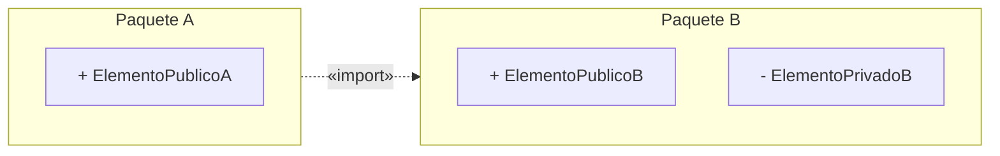

# Diagrama de paquetes

Un **paquete** es la carpeta de UML: agrupa elementos del modelo para que se entienda y para
controlar quién ve qué. La clase lo presenta **dentro de la serie "2.- Diagrama de Distribución"**
(el título de la captura 40), justo después de los nodos, y lo vuelve a usar en el ejemplo del
parque de atracciones, donde un paquete vive **dentro de un nodo**.

---

## 1. Qué es — lo que dice la clase

**Captura 39, "Paquetes"**:

> - "Los paquetes ayudan a **organizar los elementos en los modelos** con el fin de poder
>   comprenderlos más fácilmente."
> - "Permiten **controlar el acceso a sus contenidos** para controlar las **líneas de separación**
>   de un sistema."

Y el **recuadro rojo** —lo que ella marcó para memorizar—:

> "**Un paquete puede contener otros elementos, incluyendo clases, interfaces, componentes, nodos,
> colaboraciones, casos de uso, diagramas e incluso otros paquetes. La posesión es una relación
> compuesta, lo que significa que el elemento se declara en el paquete.**"

![[adjuntos/capturas-clase-U2/despliegue/paquetes-definicion-y-contenido.png]]

Las dos funciones, en tabla:

| Función | Para qué | Qué error evita |
|---|---|---|
| **Organizar** | Comprender el modelo más fácilmente | Un diagrama de 80 clases que nadie puede leer |
| **Controlar el acceso** | Marcar las **líneas de separación** del sistema | Que cualquier parte use cualquier otra (acoplamiento sin control) |

Lo que puede contener, como checklist (del recuadro rojo): **clases · interfaces · componentes ·
nodos · colaboraciones · casos de uso · diagramas · otros paquetes**. O sea: **cualquier elemento
de UML**, de cualquier diagrama. Por eso el paquete aparece en la vista lógica (agrupando clases) y
en la de despliegue (agrupando componentes).

> [!note] "La posesión es una relación compuesta"
> Quiere decir que el elemento **se declara en** el paquete: le pertenece. *(COMPLEMENTO — Booch,
> Rumbaugh y Jacobson: como es composición, cada elemento pertenece a **un solo** paquete, y si se
> elimina el paquete se eliminan sus elementos.)*

---

## 2. La notación — captura 40

> "UML proporciona una representación gráfica de los paquetes como se muestra en la figura:"

![[adjuntos/capturas-clase-U2/despliegue/paquetes-notacion.png]]

La figura muestra **tres formas** de dibujar un paquete. En todas, el símbolo es la **carpeta**: un
rectángulo con una **pestaña** arriba a la izquierda.

| Forma | Ejemplo de la figura | Dónde va el nombre | Qué muestra adentro |
|---|---|---|---|
| **Simple** | Sensor de Fusión | **en el cuerpo** (la etiqueta *nombre* lo señala) | nada |
| **Con lista de contenido** | Cliente | **en la pestaña** | una lista: `+ FormularioDePedido`, `+ FormularioDeSeguimiento` |
| **Con elementos dibujados** | GestionClientes | **en la pestaña** | los elementos como cajas: Cliente, Facturación, Envios |

Regla: si el cuerpo muestra contenido, **el nombre sube a la pestaña**.

---

## 3. Importar y exportar — captura 41

> - "Para poder utilizar los elementos que se encuentran en otros paquetes se ha de **importar** el
>   paquete que interesa."
> - "Cuando un paquete importa a otro **sólo podrá acceder a los elementos que sean públicos** en el
>   paquete que está importando, estos elementos se dice que son **exportados** por el paquete que
>   los contiene."

![[adjuntos/capturas-clase-U2/despliegue/paquetes-importar-exportar.png]]

Leída con zoom:

| Paquete | Elementos (visibilidad) |
|---|---|
| **Cliente** | `+ FormularioPedido` · `+ FormularioSeguimiento` · `- Pedido` |
| **Políticas** | `+ ReglasDePedidos` · `- GUI::Ventana` |
| **GUI** | `+ Ventana` · `+ Formulario` · `# GestorEventos` |

| Relación | Trazo | De → a | Etiqueta |
|---|---|---|---|
| Importación | **punteada**, punta **abierta** | **Cliente → Políticas** | `<< import >>` |
| Importación | **punteada**, punta **abierta** | **Políticas → GUI** | `<< import >>` |

Las notas de la figura: la etiqueta ***exportaciones*** señala los elementos con `+`
(FormularioPedido, FormularioSeguimiento, ReglasDePedidos, Ventana, Formulario); la etiqueta
***importación*** señala las dos flechas `<< import >>`.

Cómo se lee:

- **La flecha va del que importa al importado.** Cliente usa lo de Políticas; Políticas usa lo de
  GUI. Es una **dependencia** (por eso punteada) con el estereotipo `«import»` — misma familia que
  `«include»` y `«extend»`, ver [[Relaciones y dependencias en UML]].
- **Exportado = público (`+`).** Es lo único que el importador puede usar.
- `GUI::Ventana` dentro de Políticas es el **nombre calificado**: *Ventana, del paquete GUI*. Es el
  elemento que Políticas trae de GUI por importarlo.

| Símbolo | Visibilidad | ¿Lo ve quien importa? |
|---|---|---|
| `+` | pública — **exportada** | **sí** |
| `-` | privada | no |
| `#` | protegida | no *(COMPLEMENTO: solo los paquetes que heredan del contenedor)* |

*(El significado de `+`, `-` y `#` es COMPLEMENTO: la diapositiva los usa pero no los define; son
los símbolos estándar de visibilidad de UML.)*

> [!warning] La trampa: la importación no es transitiva *(COMPLEMENTO — Booch, Rumbaugh y Jacobson)*
> Cliente importa Políticas, y Políticas importa GUI. **Eso no le da a Cliente acceso a GUI.** Si
> Cliente quisiera usar `Ventana`, tendría que importar GUI directamente. La figura está armada
> justamente para eso: no hay flecha de Cliente a GUI.
>
> **Ojo con la versión de UML.** Esa regla es la de **UML 1.x** (el libro de Booch, Rumbaugh y
> Jacobson). En **UML 2.x** cambió: un `«import»` **público** vuelve visibles los nombres importados
> también para quien importe a Políticas, y el que **no** los reexporta es `«access»` (importación
> privada). La diapositiva de clase no dice cuál usa: si lo preguntan, **declará la versión**.

---

## 4. El patrón conceptual

Esquema propio (no es la figura de ella), con nombres genéricos:

A puede usar `ElementoPublicoB` (exportado); no puede usar `ElementoPrivadoB`.

> Mermaid no tiene diagrama de paquetes nativo: los `subgraph` son una aproximación y no llevan la
> pestaña. Para la entrega, StarUML (*Package Diagram*) o Excalidraw. Ver [[StarUML]].

---

## 5. Dónde aparecen los paquetes en el curso

| Lugar | Cómo aparece | Fuente |
|---|---|---|
| **Vista Lógica** del 4+1 | "Se complementa con: diagrama de clases y **diagrama de paquetes**" | [[Modelo 4+1 vistas]] (clase) |
| **Vista de Despliegue (o de Desarrollo)** del 4+1 | "Se complementa con: diagrama de componentes y **diagrama de paquetes**" | [[Modelo 4+1 vistas]] (clase) |
| Serie **Diagrama de Distribución** | la captura 40 los presenta con ese título | capturas_U2 40 |
| **Ejemplo del parque** | el paquete `ImplClases` agrupa los componentes **dentro** del nodo `<<ServidorAplicaciones>>` | capturas_U2 57, ver [[Diagrama de despliegue]] |
| Identificadores de la **NT1** | los CU se prefijan con su paquete: `Administración::CU-011` — el mismo `::` de `GUI::Ventana` | [[Matriz de trazabilidad de requisitos]] |

![[adjuntos/capturas-clase-U2/ejemplo-parque/despliegue-parque.png]]

---

## 6. Checklist para dibujar uno

1. ¿Cada paquete agrupa elementos **relacionados** (un subsistema, una capa, un área)?
2. ¿Cada elemento está en **un solo** paquete (posesión compuesta)?
3. ¿El nombre está en la **pestaña** cuando el cuerpo muestra contenido?
4. ¿Los elementos tienen visibilidad, y lo que otros usan está en `+`?
5. ¿Cada uso entre paquetes tiene su flecha **punteada** `«import»`, **del que importa al importado**?
6. ¿Nadie usa un elemento de un paquete que **no importó directamente**?

## Errores típicos

| Error | Por qué está mal |
|---|---|
| Flecha `«import»` con línea llena | Es una **dependencia**: va punteada |
| Flecha del importado al que importa | Va **del que importa** (el que usa) **al importado** |
| Usar un elemento privado (`-`) de otro paquete | Solo se accede a lo **público**, lo exportado |
| Suponer que la importación se hereda en cadena | Cliente → Políticas → GUI no da acceso de Cliente a GUI *(complemento)* |
| Creer que un paquete solo agrupa clases | El recuadro rojo: clases, interfaces, componentes, nodos, colaboraciones, casos de uso, diagramas y otros paquetes |

## Notas relacionadas

- [[Diagrama de despliegue]] — la serie de "Distribución" y el paquete dentro del nodo
- [[Diagrama de componentes]] — lo que se agrupa en los paquetes de la vista de desarrollo
- [[Modelo 4+1 vistas]] — las dos vistas que usan diagrama de paquetes
- [[Relaciones y dependencias en UML]] — `«import»` es una dependencia, como `«include»`
- [[Diagramas UML estructurales y de comportamiento]] — el diagrama de paquetes es estructural

## Preguntas de repaso

1. ¿Cuáles son las dos funciones de un paquete según la clase?
2. Nombrá los elementos que puede contener un paquete (recuadro rojo). ¿Qué significa que "la posesión es una relación compuesta"?
3. ¿Cuándo va el nombre del paquete en la pestaña y cuándo en el cuerpo?
4. En la figura de la captura 41, ¿qué elementos de GUI puede usar Políticas y por qué no `GestorEventos`?
5. ¿Qué dirección y qué trazo tiene la flecha `«import»`? ¿Puede Cliente usar `Ventana` de GUI?
