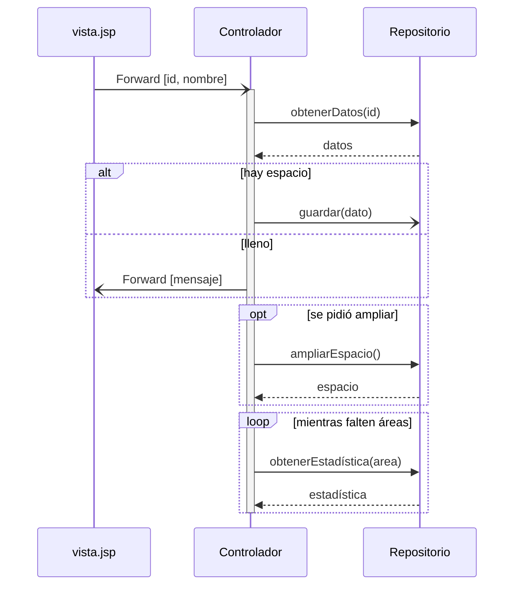

# Diagrama de secuencia

El diagrama UML que muestra **quién le habla a quién, con qué mensaje y en qué orden**. Es de la
familia de **comportamiento** (dinámico) → [[Diagramas UML estructurales y de comportamiento]]. La
diapositiva de la captura 12 lo nombra como ejemplo de *"Descripción de comportamiento (dinámico)"*.

> [!note] De dónde sale
> Todo lo que sigue es del PDF **TEMA 5** (material de clase, descargado por la catedrática). Ese
> texto habla de *"nuestro proyecto"* y *"nuestro mashup"*: es el proyecto del autor original del
> apunte, **no** una tarea de este curso. Las convenciones que marca como **no estándar** (flechas
> azules de *Forward*, flechas rojas en *break*) son de ese apunte — están señaladas en cada caso.

## 1. Qué es (PDF, pág. 6, §5)

Textual:

> Son un tipo de **diagrama de comportamiento**. Muestran la **interacción de un conjunto de objetos**
> en una aplicación **a través del tiempo**. Contiene detalles de implementación del escenario:
> - Objetos y clases usados para la implementación.
> - Mensajes intercambiados entre los objetos.
> - Invocaciones a métodos de otros objetos.
>
> Ayudan a mostrar **qué se hace y en qué orden**. También los usaremos para modelar la interacción
> entre las distintas aplicaciones integradas en nuestro mashup.

**Para qué existe**: el diagrama de componentes dice *qué piezas hay*; el de secuencia dice *cómo
colaboran esas piezas para cumplir un escenario*, paso a paso. Es donde se ve si un caso de uso
realmente se puede ejecutar con la arquitectura propuesta.

## 2. Participantes y línea de vida (pág. 6)

Textual:

> **Participantes**: son instancias de clases, es decir, objetos. Se especifica la clase a la que
> instancian. Pueden tener nombre o ser anónimos. La **línea discontinua es su línea de vida**. En
> nuestro proyecto los usaremos también para representar ficheros que participen en el flujo de
> mensajes (ej. formulario.html). Tendrán el color que se le asignó en el diagrama de clases.

![[adjuntos/modelado-arquitectura-tema5/p6-secuencia-participantes-anonimos.jpg]]

La figura: `: contactListView.jsp` y `: ContactUpdateController.java`, con el rótulo *"Dos
participantes anónimos (no tienen nombre)"*. **Anónimo = empieza con `:`** — no hay nombre de objeto
antes de los dos puntos, solo la clase.

## 3. Los mensajes (pág. 7)

| Elemento | Definición del PDF (textual) | Cómo se dibuja | Ejemplo de la figura |
|---|---|---|---|
| **Comunicación síncrona** | *"el objeto que envía el mensaje **queda bloqueado** hasta que recibe la respuesta"* | flecha con **cabeza llena**. La **respuesta**, con **línea discontinua** | `1. getContacts()` de `ContactListController` a `ContactRepository`, y `2. contacts` de vuelta (discontinua) |
| **Comunicación asíncrona** | *"los mensajes asíncronos **terminan inmediatamente**"* | flecha con **cabeza abierta**, sin respuesta | `addContact(name,phone)` de `ContactNewController` a `ContactRepository` |
| **Redirección de flujo de control** | *"usaremos un tipo distinto de flecha para las redirecciones (**no forma parte de la notación estándar**)"* | flecha **azul** con cabeza abierta, texto `Forward [parámetros]` | `Forward [contacts]` de `ContactListController` a `contactListView.jsp` |
| **Activación** | *"indican cuándo un participante está realizando una acción"*. *"Un mismo participante puede activarse y desactivarse varias veces durante su vida"* | **rectángulo** a lo largo de la línea de vida | ver figura de activación |

Y la regla del texto de las flechas: *"El texto de las flechas indica el **método llamado** y lo que
se envía como **respuesta**"* (síncrona) · *"indica el método llamado"* (asíncrona).

![[adjuntos/modelado-arquitectura-tema5/p7-comunicacion-sincrona.jpg]]

![[adjuntos/modelado-arquitectura-tema5/p7-comunicacion-asincrona.jpg]]

![[adjuntos/modelado-arquitectura-tema5/p7-redireccion-forward.jpg]]

**La figura de activación**, leída con zoom (los recuadros rojos marcan las activaciones):

| # | De | A | Mensaje | Tipo de flecha |
|---|---|---|---|---|
| 1 | ContactUpdateController | ContactRepository | `getContact(id)` | síncrona (cabeza llena) |
| 2 | ContactRepository | ContactUpdateController | `contact` | respuesta (discontinua) |
| 3 | ContactUpdateController | contactEditView.jsp | `Forward [contact]` | redirección (azul) |
| 4 | contactEditView.jsp | ContactUpdateController | `Forward [id, name, phone]` | redirección (azul) |
| 5 | ContactUpdateController | ContactRepository | `updateContact(contact)` | asíncrona (cabeza abierta) |
| 6 | ContactUpdateController | ContactListController | `Forward [message]` | redirección (azul) |
| 7 | ContactListController | ContactRepository | `getContacts()` | síncrona |
| 8 | ContactRepository | ContactListController | `contacts` | respuesta |

![[adjuntos/modelado-arquitectura-tema5/p7-activacion.jpg]]

> [!warning] La trampa: cabeza **llena** vs cabeza **abierta**
> Es lo único que distingue síncrona de asíncrona. Síncrona = cabeza **llena** + respuesta
> discontinua. Asíncrona = cabeza **abierta** y **sin** respuesta. Una respuesta **no** es otra
> síncrona al revés: es **línea discontinua**.

## 4. Los fragmentos combinados (págs. 7-8)

Un **fragmento** es un marco rectangular con una etiqueta en la esquina (`alt`, `opt`, `break`,
`loop`) y una **condición** que decide si se ejecuta lo de adentro.

| Fragmento | Definición del PDF (textual) | Etiqueta | Condición en la figura |
|---|---|---|---|
| **Alternativas** | *"indican si ejecutar un flujo **u otro** de acuerdo con una condición"* | `alt` | dos compartimentos separados por **línea discontinua**: `numContactos < numMaxContactos` / `numContactos = numMaxContactos` |
| **Flujo opcional** | *"permite ejecutar ciertas acciones **sólo si** se cumple una condición"* | `opt` | `numContactos = numMaxContactos` |
| **Break** | *"**detiene la ejecución** si se cumple una determinada condición. Se utilizan para mostrar los **casos de error**. Representaremos en rojo las flechas dentro de un break (**no es parte de la notación**)"* | `break` | `invalid parameters` |
| **Bucles** | *"parte del flujo se ejecuta **repetidamente mientras** se cumpla una condición"* | `loop` | `{areAreasWithoutCrimeStats}` (entre llaves) |

**Alternativas** (`ContactNewController`): `1. Forward [id, name, phone]` entra desde
`contactEditView.jsp`; si `numContactos < numMaxContactos` → `2.1. addContact(contact)` al
repositorio; si `numContactos = numMaxContactos` → `2.2 Forward [message]` de vuelta a la vista.

![[adjuntos/modelado-arquitectura-tema5/p7-alternativas-alt.jpg]]

**Flujo opcional** (`ContactListController`): `1. getContacts()` / `2. contacts`; dentro del `opt`,
`3 (optional). allocateMoreSpace()` y su respuesta `3.1 (optional). spaceFor10MoreContacts`; fuera,
`3. Forward [contacts, message]` a `contactListView.jsp`.

![[adjuntos/modelado-arquitectura-tema5/p8-flujo-opcional-opt.jpg]]

**Break** (`ContactNewController`): `1. Forward [id, name, phone]`; dentro del `break`
(`invalid parameters`), la flecha **roja** `3(optional). error` a `error.jsp`; fuera,
`3. addContact(contact)` al repositorio (asíncrona).

![[adjuntos/modelado-arquitectura-tema5/p8-break.jpg]]

**Bucle** (`SearchController`): `1. Forward [search parameters]` desde `searchView.html`;
`2. getProperties (params)` a `HousingResource` y `3. properties`; dentro del `loop`,
`4. getCrimeStats (area)` a `PoliceResource` y `5. stats`; al final `6. Forward [properties, stats]`
a `resultsView.jsp`.

![[adjuntos/modelado-arquitectura-tema5/p8-bucle-loop.jpg]]

> [!note] Numeración de las figuras, transcrita tal cual
> En *opt* aparecen **dos mensajes "3"** (`3 (optional)` y `3. Forward`) [sic]; en *break* se salta
> el 2 y hay dos "3" [sic]; en el de alto nivel la respuesta `map` **no tiene número** y después sigue
> `3.` [sic]. No son reglas: son descuidos de la figura.

## 5. La diferencia que se pregunta: `alt` vs `opt` vs `break`

| | ¿Cuántos caminos? | Si la condición no se cumple… | Uso típico |
|---|---|---|---|
| `alt` | **dos o más**, excluyentes | se ejecuta **otro** compartimento | *si hay espacio, guardar; si no, avisar* |
| `opt` | **uno** | no pasa nada, se sigue | *si se llenó, pedir más espacio* |
| `break` | **uno**, y **corta** | se sigue el flujo normal | **casos de error** |
| `loop` | uno, **repetido** | se sale del bucle | recorrer una colección |

Regla memorizable: **alt = uno u otro · opt = solo si · break = error y corto · loop = mientras**.

## 6. Diagrama de secuencia de alto nivel (pág. 8)

Textual:

> **Alto nivel**: además de diagramas de secuencia como el anterior, en el proyecto se usa este tipo
> de diagramas para describir la **comunicación entre las aplicaciones integradas**.

Participantes: `MyApplication`, `GoogleMaps API`, `Tripadvisor API`, `Accuweather API` (sin `:`, sin
colores). Mensajes: `1. getMap(location)` / `map`, `3. getHotels(search parameters)` / `4. hotels`,
`5. getForecast(location)` / `6. forecast` — todas síncronas con su respuesta discontinua.

![[adjuntos/modelado-arquitectura-tema5/p8-alto-nivel-aplicaciones-integradas.jpg]]

Es el mismo sentido de "alto nivel" de [[Diagrama de bloques de alto nivel]]: los participantes ya
no son objetos sino **sistemas enteros**. Sirve para mostrar la arquitectura de integración sin
bajar al código.

## 7. El patrón en Mermaid *(esquema propio — COMPLEMENTO)*

No es un diagrama de la clase: es la notación del PDF resumida en un ejemplo inventado. Mermaid
**no** permite flechas azules ni rojas, así que el *Forward* y el error del *break* se escriben como
mensajes comunes.

Equivalencias: `->>` = síncrona (cabeza llena) · `-->>` = respuesta (discontinua) · `-)` = asíncrona
(cabeza abierta).

El `break` se dejó **fuera** del esquema a propósito: Mermaid lo soporta recién desde la versión
10.3 y en un renderizador más viejo rompe **todo** el diagrama. Se escribe igual que los otros
(`break condición` … `end`).

> [!info] COMPLEMENTO — notación estándar
> En UML 2 hay más operadores de fragmento (`par`, `critical`, `ref`, `neg`…); el PDF muestra solo
> estos cuatro. Y la condición de un fragmento en UML se escribe como **guarda entre corchetes**
> (`[condición]`); las figuras del PDF la ponen sin corchetes en `alt`, `opt` y `break`, y entre
> **llaves** en `loop`. Si hay que dibujar uno para entregar, conviene seguir la figura del PDF y,
> ante duda, preguntar.

## 8. Dónde encaja en el curso

- Es uno de los diagramas de las **realizaciones** de casos de uso del negocio →
  [[Realizaciones de casos de uso del negocio]].
- En [[Categorías de estructuras]] aparece como diagrama típico de la estructura de **componentes y
  conectores**, vista de **procesos** del [[Modelo 4+1 vistas]].
- Complementa al [[Diagrama de componentes]]: los componentes y sus interfaces son los participantes
  de un diagrama de secuencia de alto nivel.

## Checklist para dibujar uno

1. ¿Cada participante indica su **clase** (`: Clase` si es anónimo)?
2. ¿Cada línea de vida es **discontinua**?
3. ¿Las síncronas tienen **cabeza llena** y su **respuesta discontinua**?
4. ¿Las asíncronas tienen **cabeza abierta** y **no** tienen respuesta?
5. ¿Las **activaciones** están donde el participante está haciendo algo?
6. ¿Cada fragmento tiene su **etiqueta** (`alt`/`opt`/`break`/`loop`) y su **condición**?
7. ¿La numeración de los mensajes es **correlativa**? (no copiar los saltos de las figuras)

## Notas relacionadas

- [[Diagramas UML estructurales y de comportamiento]] — por qué es de comportamiento
- [[Diagrama de bloques de alto nivel]] — el "alto nivel" en bloques
- [[Diagrama de componentes]] y [[Diagrama de despliegue]]
- [[Realizaciones de casos de uso del negocio]]
- [[Modelo 4+1 vistas]] y [[Categorías de estructuras]]
- [[Caso de uso]] — el escenario que un diagrama de secuencia realiza

## Preguntas de repaso

1. ¿Qué muestra un diagrama de secuencia y qué tres detalles de implementación contiene, según el PDF?
2. ¿En qué se diferencian gráficamente un mensaje síncrono, uno asíncrono y una respuesta?
3. ¿Qué es una activación y cómo se dibuja?
4. Explicá la diferencia entre `alt`, `opt` y `break`. ¿Para qué usa el PDF el `break`?
5. ¿Qué es un diagrama de secuencia de alto nivel y quiénes son sus participantes?
