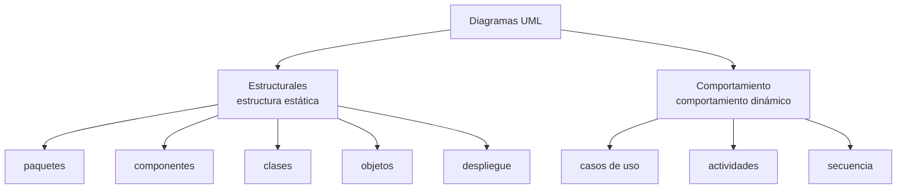

# Diagramas UML estructurales y de comportamiento

Una de las tres formas de modelar una arquitectura que da la clase —ADLs, **diagramas UML** y
diagramas de bloque de alto nivel— → [[Cómo se modela la arquitectura]]. Los diagramas UML se
reparten en **dos familias**. Una muestra **cómo está armado** el sistema (lo estático); la
otra, **qué hace mientras corre** (lo dinámico).

## 1. Lo que dice la diapositiva (captura 12)

Título: **"¿Cómo se modela? –Diagramas UML"**. Textual:

> **Diagramas UML**
> - Descripción de aspectos **estructurales (estático)**: – Diagrama de componentes, diagrama de
>   despliegue, etc.
> - Descripción de **comportamiento (dinámico)** – Diagrama de actividad, diagrama de secuencia etc.

![[adjuntos/capturas-clase-U2/diagramas-alto-nivel/uml-estructurales-vs-comportamiento.png]]

Los dos dibujos de la diapositiva son ejemplos de la familia **estructural**:

| Dibujo | Tipo | Qué se lee con zoom |
|---|---|---|
| Izquierda | **Diagrama de componentes** | `«component» Account Management` arriba; abajo `«component» Logger` y `«component» CreditCardServices`. Las dos uniones usan la notación de **interfaz** (bola y socket): `TransactionLogger` entre Account Management y Logger, `IdentityVerifier` entre Account Management y CreditCardServices |
| Derecha | **Diagrama de despliegue** | Dos **nodos 3D** unidos por una línea simple. El de la izquierda tiene un nodo anidado que contiene un **artefacto** (icono de documento); el de la derecha, un nodo anidado. **Los estereotipos y nombres son ilegibles** en la captura, aun ampliada: no se transcriben |

El detalle de cada uno está en [[Diagrama de componentes]] y [[Diagrama de despliegue]].

## 2. Lo que dice el PDF (TEMA 5, pág. 1)

El PDF agrega la **definición** y completa las listas. Textual:

> Una **vista** representa un aspecto parcial de una arquitectura software. Cada participante en el
> desarrollo estará interesado en una o varias vistas. (Ver modelo de vistas "4+1"; Tema 2).
>
> El lenguaje unificado de modelado, conocido por sus siglas en inglés como **UML** (Unified Modeling
> Language), es un **lenguaje gráfico de modelado de sistemas software**. Está compuesto por
> distintos tipos de diagramas que pueden dividirse en dos tipos principales:
>
> - **Estructurales**: muestran la **estructura estática** de los elementos de un sistema.
> - **Comportamiento**: muestran el **comportamiento dinámico** de los elementos de un sistema.

| Familia | Qué muestra | Diagramas que lista el PDF ("entre otros") | Diagramas de la captura 12 |
|---|---|---|---|
| **Estructurales** | la estructura **estática** | paquetes, componentes, clases, objetos, despliegue | componentes, despliegue |
| **Comportamiento** | el comportamiento **dinámico** | casos de uso, actividades, secuencia | actividad, secuencia |

La misma página 1 abre la sección **"2. Diagrama de componentes"** con su primer ejemplo de la
familia estructural, *"Ejemplo: mashup de predicción meteorológica"*: `«component» WeatherForecast`
unido por las interfaces `DayForecast` a `«component» Weather.com API` y `WeatherMap` a
`«component» GoogleMaps API`. El desarrollo de ese diagrama está en [[Diagrama de componentes]].

![[adjuntos/modelado-arquitectura-tema5/p1-diagrama-componentes-weatherforecast.jpg]]

> [!warning] La trampa: el diagrama de casos de uso es de **comportamiento**
> Se suele pensar que como no tiene flechas de tiempo es "estático". El PDF lo pone explícitamente
> en la familia de **comportamiento**. Lo mismo el de secuencia: el PDF lo vuelve a decir en su
> sección 5 (*"Son un tipo de diagrama de comportamiento"*) → [[Diagrama de secuencia]].

## 3. El puente con el modelo 4+1 (PDF, pág. 1)

Textual:

> En el modelo de vistas "4+1", el diagrama de componentes y de paquetes representa a la **vista de
> desarrollo**, el diagrama de clases a la **vista lógica**, el diagrama de actividad a la **vista de
> proceso**, el diagrama de despliegue a la **vista física** y el diagrama de casos de uso a la
> **vista de escenarios**.

| Vista 4+1 | Diagrama según el PDF | Familia |
|---|---|---|
| Lógica | clases | estructural |
| De desarrollo | componentes y paquetes | estructural |
| De proceso | actividad | comportamiento |
| Física | despliegue | estructural |
| Escenarios (+1) | casos de uso | comportamiento |

> [!note] Cómo encaja con la nota del 4+1
> En [[Modelo 4+1 vistas]] (deck *Arquitectura de Software*) la vista de componentes se llama
> **"Vista de Despliegue (o de Desarrollo)"** y el diagrama de paquetes aparece **en la lógica y en
> la de despliegue**. El PDF usa el nombre de Kruchten —**vista de desarrollo**— y pone paquetes
> **solo** en desarrollo. No se contradicen en lo esencial: confirma que el diagrama de despliegue
> va en la **física** y el de componentes en la de **desarrollo**.

Esquema propio (no es un diagrama de la clase) para memorizar la clasificación:

## 4. Regla para el examen

**Estructural = de qué está hecho y dónde está (estático). Comportamiento = qué pasa y en qué orden
(dinámico).** Casos de uso, actividad y secuencia son de comportamiento; componentes, despliegue,
clases, paquetes y objetos son estructurales.

## Notas relacionadas

- [[Modelo 4+1 vistas]] — qué vista usa cada diagrama
- [[Estructuras y vistas arquitectónicas]] — qué es una vista
- [[Diagrama de componentes]] y [[Diagrama de despliegue]] — la familia estructural
- [[Diagrama de secuencia]] — la familia de comportamiento
- [[Cómo se modela la arquitectura]] — las tres formas de modelar
- [[Diagrama de bloques de alto nivel]] — la forma informal, de alto nivel
- [[Relaciones y dependencias en UML]]

## Preguntas de repaso

1. ¿En qué dos familias divide la clase los diagramas UML y qué describe cada una?
2. ¿El diagrama de casos de uso es estructural o de comportamiento? ¿Y el de despliegue?
3. Según el PDF, ¿qué diagrama representa a cada una de las cinco vistas del 4+1?
4. ¿Qué dos diagramas estructurales usa la diapositiva como ejemplo, y qué notación de interfaz
   aparece en el de componentes?
5. ¿Qué es una vista según el TEMA 5?
