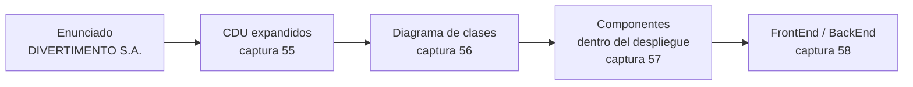

# Ejemplo resuelto — Parque de atracciones

El único ejemplo del curso donde la catedrática lleva **un mismo caso** por cuatro artefactos
seguidos:

*(Esquema propio del encadenamiento.)*

**El valor no está en cada diagrama suelto: está en que se puede seguir un mismo elemento de punta a
punta.** La sección 7 arma esa trazabilidad. Las secciones 1-6 transcriben cada artefacto tal como
está.

> [!warning] Este no es un caso de negocio
> Los cuatro encadenamientos de [[Ejemplos resueltos de casos de negocio]] se quedan en el plano del
> **negocio** (contexto → core → descomposición). Este baja al **sistema**: clases, componentes y
> nodos. Es la continuación, no otro ejemplo del mismo molde.

---

## 1. El enunciado (PDF, ejercicio 2, textual)

> **EJERCICIO 2. PARQUE DE ATRACCIONES.**
>
> La empresa DIVERTIMENTO, S. A., tiene varios parques de atracciones repartidos por la geografía
> colombiana. Lo que más preocupa a esta empresa es la seguridad en algunas de las atracciones, ya que un
> error mecánico podría producir daños materiales y humanos que plantearían serios problemas para la
> empresa. Hoy por hoy sólo es posible detectar fallos en las atracciones, cuando los operarios
> encargados realizan actividades de mantenimiento.
>
> La empresa quiere informatizar sus parques de atracciones y para ello ya ha decidido poner en marcha un
> proyecto piloto cuyo objetivo será el de dotar a uno de sus parques de atracciones de un sistema de
> detección automática de fallos en las atracciones.
>
> En un primer momento se va a preparar el sistema para gestionar la noria (rueda de chicago) y la
> montaña rusa. La noria tiene una serie de vehículos dotados cada uno de ellos de un detector gracias al
> cual se sabe en cada momento si el vehículo está suficientemente bien anclado a la estructura metálica
> de la noria. Si en un momento determinado se detectara pérdida de anclaje, el correspondiente vehículo
> se lo comunicaría a la Central Receptora de Averías (CRA) y también a la atracción de la que forma parte
> dicho vehículo, así en la próxima parada de dicha atracción se tendrá constancia de que uno de sus
> vehículos ha solicitado revisión. Por su parte, en la montaña rusa cada vagón está dotado de igual modo
> de un detector de anclaje con el vagón que lleva detrás (en el caso de llevarlo). Cada vagón detecta si
> existe suficiente anclaje con el vagón posterior y en caso de falta de anclaje avisa a la CRA y a la
> atracción, en este caso la montaña rusa.
>
> Cuando la CRA recibe un aviso, en el que se le indica el vehículo o vagón con posible avería y la
> atracción de que se trata, busca inmediatamente un operario de mantenimiento disponible. En caso de no
> haber ninguno libre, informa al componente en cuestión de que su petición no puede ser atendida, así
> dicho componente emitirá una señal de solicitud de revisión hasta que su petición le sea satisfecha.
>
> Como cada operario de mantenimiento cobra un extra en función del número de averías que atiende al mes,
> cada uno tiene asignado mensualmente un dispositivo gracias al cual recibe las posibles averías a
> atender, independientemente de en qué zona del parque se encuentre. Cuando la CRA demanda la revisión de
> una posible avería y encuentra un operario de mantenimiento libre le manda un mensaje indicándole la
> calle del parque en la que se encuentra la atracción y el número de vehículo o vagón con posible avería.
> Automáticamente, el dispositivo del operario pasa a indicar que ese operario se encuentra ocupado
> atendiendo una posible avería. Cuando el operario ha terminado de supervisarla, indica a su dispositivo
> que ha quedado libre para la siguiente petición de avería que reciba. A su vez dicho dispositivo informa
> a la CRA y al componente revisado. Dicho componente avisará a su atracción de que la operación de
> mantenimiento solicitada ha terminado para que ésta lo tenga en cuenta a la hora de poner la atracción
> en marcha de nuevo.
>
> Además, el sistema tendrá que ser capaz de contabilizar las personas que entran y salen de una
> atracción, con el fin de controlar dos cosas; en primer lugar, que no entren más personas de las que la
> atracción es capaz de sostener y, en segundo lugar, que todo el mundo abandone la atracción una vez
> finalizado cada viaje.
>
> El controlador de arranque y parada de la atracción puede recibir un mensaje indicando que la atracción
> está llena, para que inicie las labores de puesta en marcha de la atracción; dicho mensaje puede
> provenir del torniquete de entrada que detecta cuando se produce la ocupación máxima de la atracción, o
> bien del propio operario que vigila la atracción siempre que aún no estando llena no hay más personas
> esperando para subir y él considera que es tiempo suficiente como para que se ponga en marcha. Una vez
> que el dispositivo de parada y arranque de la atracción detecta que la atracción está detenida, le envía
> al torniquete de salida un mensaje para que se prepare para que la gente pase por él. El torniquete de
> salida sabe el número de personas que hay en la atracción gracias al torniquete de entrada, así sabe el
> número de personas que se tienen que bajar de la atracción.
>
> Cuando el torniquete de salida determina que el número de personas que han abandonado la atracción es
> igual al número de ellas que entró, envía al torniquete de entrada un mensaje para que ponga a cero el
> contador de personas en la atracción y además se libere y muestre un indicador verde para que la gente
> pueda tomar asiento en la atracción. Si pasados cinco minutos desde que la atracción se paró el
> torniquete de salida no ha liberado al torniquete de entrada, es indicativo de que alguien se ha quedado
> dentro y es necesario entrar a buscarlo.
>
> Cuando el torniquete de entrada recibe, del torniquete de salida, el mensaje de liberarse, primero
> consulta a la atracción si tiene alguna avería pendiente. Esto se reflejará en la atracción cuando uno
> o varios de los vehículos o vagones soliciten reparación. La atracción lleva un contador de averías
> pendientes de manera que sólo en el caso en que este contador esté a 0 el torniquete de entrada se
> pondrá verde para que entren los usuarios. En caso contrario permanecerá en amarillo, indicativo de estar
> esperando reparación.

*(Se corrigieron solo los espacios partidos por la extracción del PDF, como "atra cciones".)*

---

## 2. La solución del PDF (antes de la versión de ella)

Aplica el método de [[Diagrama de clases]] §5.

**Candidatas** (sustantivos del enunciado, 30): Parque de atracciones · Geografía · Empresa ·
Atracción · Problema · Instalación · Operario · Actividad · Proyecto · Sistema · Noria · Montaña rusa ·
Vehículo · Detector · Central Receptora de Averías (CRA) · Componente · Señal · Petición · Mes ·
Dispositivo del operario · Mensaje · Calle · Número de vehículo · Personas · Sala · Controlador ·
Torniquete · Contador · Avería · Vagón.

**Eliminadas** — *"porque tiene poco o nada que ver con el problema…, porque no son específicas del
entorno de la aplicación o porque son atributos de clase"*: Parque de atracciones, Geografía, Empresa,
Problema, Instalación, Actividad, Proyecto, Sistema, Detector, Componente, Señal, Petición, Mes,
Mensaje, Calle, Número de vehículo, Personas, Sala, Controlador, Contador, Avería, Daños materiales.
Y además **Operario**, *"ya que consideramos que el operario se relaciona con el sistema mediante la
clase interfaz Dispositivo del operario"*.

**Finales (8):** Atracción · Noria · Montaña rusa · Vehículo · CRA · Dispositivo de Operario ·
Torniquete · Vagón (más las subclases Entrada y Salida de Torniquete).

![[adjuntos/ejemplos-diagramas-clases/fig-2.1-modelo-clases-parque.png]]

| Relación (figura 2.1) | Tipo | Multiplicidad | Razón que da el PDF |
|---|---|---|---|
| Entrada, Salida → Torniquete | generalización | — | *"generalización y especialización"* |
| Entrada —*Comunica*— Salida | asociación | 1 — 1 | *"permite comparar si el número de personas que salen es igual al que entran"* |
| Entrada —*Activa*— Atraccion | asociación | 1 — 1 | *"Una Atracción se activa por un Torniquete de Entrada"* |
| Salida —*Comunica*— Atraccion | asociación | 1 — 1 | *"una Atracción comunica a un Torniquete de Salida que debe prepararse"* |
| Noria, Montana_Rusa → Atraccion | generalización | — | *"una Atracción puede ser una Noria o una Montaña"* |
| Noria ◇— Vehiculo | agregación | — / 1..* | *"una Noria está formada por vehículos"* |
| Montana_Rusa ◇— Vagon | agregación | — / 1..* | *"De igual forma ocurre entre Montaña rusa y vagón"* |
| Vagon —*Arrastra a*— Vagon | reflexiva | 1 — 0..1 | *"un vagón arrastra a otro vagón"* |
| Atraccion — CRA | asociación | 1..* — 1 | *"La CRA mantiene a una o varias Atracciones"* |
| CRA —*Gestiona*— Dispositivo_Operario | asociación | 1 — 1..* | *"una CRA gestiona varios Dispositivos de operario"* |

---

## 3. CDU expandidos — Gestión de Ficha Técnica (captura 55)

![[adjuntos/capturas-clase-U2/ejemplo-parque/cdu-expandidos-gestion-ficha-tecnica.png]]

**Elementos**

| Elemento | Tipo | Punto de extensión declarado (compartimento inferior) |
|---|---|---|
| **Operario Mnt** | actor (figura con **barra diagonal**) | — |
| **Gestión de Ficha Técnica de Atracciones** | caso de uso base | *Más Atracciones* |
| **Gestión Ficha Noria** | caso de uso | *Detectar Falla* |
| **Gestión Ficha Montaña Rusa** | caso de uso | *Detectar Falla* |
| **Generar Alerta** | caso de uso | — (no declara) |

**Relaciones** (dirección verificada con zoom en cada punta)

| Desde | Hacia (punta) | Línea | Estereotipo | Se lee |
|---|---|---|---|---|
| Operario Mnt | Gestión Ficha Noria | llena, sin punta | asociación | — |
| Operario Mnt | Gestión de Ficha Técnica de Atracciones | llena, sin punta | asociación | — |
| Gestión Ficha Noria | Gestión de Ficha Técnica de Atracciones | punteada | `<<Extend>>` | Noria **extiende** a la ficha general, en *Más Atracciones* |
| Gestión Ficha Montaña Rusa | Gestión de Ficha Técnica de Atracciones | punteada | `<<Extend>>` | Montaña Rusa **extiende** a la ficha general, en *Más Atracciones* |
| Generar Alerta | Gestión Ficha Noria | punteada | `<<Extend>>` | Generar Alerta **extiende** a Noria, en *Detectar Falla* |
| Generar Alerta | Gestión Ficha Montaña Rusa | punteada | `<<Extend>>` | Generar Alerta **extiende** a Montaña Rusa, en *Detectar Falla* |

Cómo encaja con la teoría de [[Relación de extensión extend]]:

- **La flecha va del extendido al base**, las cuatro veces. Coincide con la nota.
- **Los puntos de extensión están dibujados** como compartimento dentro de la elipse del base
  (*Más Atracciones*, *Detectar Falla*). Es la pieza *"el caso de uso base declara un conjunto de
  puntos de extensión"* hecha visible: cada `<<Extend>>` entra por un punto declarado.
- **Es un `extend` en cadena**: Generar Alerta extiende a Noria, que a su vez extiende a la ficha
  general. *La alerta solo pasa a veces* (cuando se detecta falla), y *cada tipo de atracción es la
  ficha general "que hace un poco más"*.

> [!question] Tres cosas que no cierran — para preguntar, no para corregirle
> 1. **Montaña Rusa no tiene asociación con el actor** y Noria sí. Por el convenio de la clase, un CU
>    sin actor es error salvo excepciones (→ [[Convenios del diagrama de CUN]]). Puede ser un olvido o
>    que asuma que la comunicación la describe el base.
> 2. **El actor lleva barra diagonal** (notación de **negocio**) pero la lámina dice *"CDU EXPANDIDOS"*
>    y los casos de uso **no** la llevan. Mezclar estereotipos de planos es lo que el `CLAUDE.md`
>    marca como error; conviene confirmar qué plano quiso.
> 3. **Generar Alerta no tiene actor**. Lo dispara el detector del vehículo o vagón, que no aparece como
>    actor.

---

## 4. Diagrama de clases de ella (captura 56)

![[adjuntos/capturas-clase-U2/ejemplo-parque/diagrama-clases-parque.png]]

La lámina cita su fuente arriba a la derecha: *"Material/Diseño <orientado a objetos/
IS_04_05b_EJEMPLOS__Diagramas_de_Clases"*. **La captura está cortada abajo**: se ve el inicio de la
reflexiva *Arrastra* de Vagón (un `1.` y la palabra *Arrastra*), pero no su otro extremo.

**Clases** (leídas con zoom, con sus mayúsculas y tildes)

| Clase | Estereotipo | Atributos | Operaciones |
|---|---|---|---|
| Molinete | — | `-NúmeroDePersonas` | `+CuentaPersonas()` |
| MolineteDeEntrada | — | (vacío) | `+PersonasAmarillo()` `+PersonasRojo()` `+PersonasVerde()` |
| MolineteDeSalida | — | (vacío) | `+Abrirse()` `+Cerrarse()` |
| Atracción | — | `-NúmeroAveríasPend` `-NumMaxOcupantes` | `+RegAveríaPend()` `+AnularAveríaPend()` |
| RegistroAvería | `<<Interfaz>>` | (vacío) | `+RegAveríaPend()` `+AnularAveríaPend()` |
| Averías | — | `- FechaAvería` `-FechaSolución` | `+RegistroAvería()` `+BuscarOperarioLibre()` |
| Noria | — | `-NúmVehículos` | (vacío) |
| MontañaRusa | — | `-NúmCarros` `-Velocidad Máxima` | (vacío) |
| Vehículo | — | `-NumSerieVehículo` | `+DetectFaltaPresión()` `+SolMnt()` |
| Vagón | — | `-NúmSerieVagón()` [sic, atributo con paréntesis] `-Capacidad` | `+DetectFallaPorRiel()` `+SolMnt()` |
| SolicitarServicio | `<<Interfaz>>` | (vacío) | `+BuscarOperarioLibre()` |
| DispositivoOperario | — | `-Cédula` | `+IndicarOcupado()` `+IndicarFinRevisión()` |

*(En Noria, MontañaRusa y Vagón las líneas de compartimento se superponen al texto y parecen
tachados o subrayados. Por la posición son divisores de compartimento, no un subrayado de "estático".
Inferencia por lectura visual.)*

**Relaciones**

| Desde | Hacia | Tipo de línea | Extremos / multiplicidad | Nombre | Qué es |
|---|---|---|---|---|---|
| MolineteDeEntrada | Molinete | llena + triángulo hueco en Molinete | — | — | generalización |
| MolineteDeSalida | Molinete | llena + triángulo hueco en Molinete | — | — | generalización |
| MolineteDeEntrada | MolineteDeSalida | llena, sin punta | 1 — 1 | *Activa* | asociación |
| MolineteDeEntrada | Atracción | llena, sin punta | 1 — 1 | *Activa* | asociación |
| Noria | Atracción | llena + triángulo hueco en Atracción | — | — | generalización |
| MontañaRusa | Atracción | llena + triángulo hueco en Atracción | — | — | generalización |
| Noria ◇ | Vehículo | llena + **rombo hueco** en Noria | 1 (Noria) — 1..* (Vehículo) | — | agregación |
| MontañaRusa ◇ | Vagón | llena + **rombo hueco** en MontañaRusa | 1 (MontañaRusa) — 1..* (Vagón) | — | agregación |
| Vagón | Vagón | llena (cortada en la captura) | `1.` visible, resto fuera de cuadro | *Arrastra* | reflexiva |
| Atracción | `<<Interfaz>>` RegistroAvería | llena, sin punta | — | — | realiza la interfaz (ver captura 54, *"Realiza"*) |
| Averías | `<<Interfaz>>` RegistroAvería | **punteada con punta** en la interfaz | — | — | dependencia de uso |
| Averías | `<<Interfaz>>` SolicitarServicio | llena, sin punta | — | — | realiza la interfaz |
| DispositivoOperario | `<<Interfaz>>` SolicitarServicio | **punteada con punta** en la interfaz | — | — | dependencia de uso |

### Qué cambió ella respecto del PDF

| Aspecto | PDF (figura 2.1) | Captura 56 |
|---|---|---|
| Nombre de la jerarquía de entrada | Torniquete / Entrada / Salida | **Molinete** / MolineteDeEntrada / MolineteDeSalida |
| Luces del torniquete de entrada | `Ponerse_Amarillo/Rojo/Verde` | `PersonasAmarillo()/Rojo()/Verde()` |
| Entrada—Salida | *Comunica* 1—1 | *Activa* 1—1 |
| Salida—Atracción | *Comunica* 1—1 | **no está** |
| Atributos de Atracción | Numero_Averias_Pendientes, Calle, Nombre | NúmeroAveríasPend, **NumMaxOcupantes** (subió desde Noria/Montaña) |
| Noria / Montaña rusa | Num_Max_Ocupantes | NúmVehículos · NúmCarros, Velocidad Máxima |
| **Central Receptora de Averías** | clase CRA con `Buscar_Operario_Libre` | **desaparece**. En su lugar: clase **Averías** + interfaces **RegistroAvería** y **SolicitarServicio** |
| Avería | eliminada como candidata | **vuelve** como clase *Averías*, con fechas |
| CRA—Dispositivo_Operario | *Gestiona* 1—1..* | DispositivoOperario **usa** la interfaz SolicitarServicio |
| Detección en Vagón | Detectar_Falta_Presion | DetectFallaPorRiel(), más atributo Capacidad |
| Visibilidad y paréntesis | `+Nombre` sin paréntesis | `+Nombre()` con paréntesis |

**Lectura del cambio grande** *(INFERENCIA mía, no lo dice la lámina)*: ella rediseña la CRA como
**interfaces**. En vez de una clase central que conoce a todos, cada parte expone un **contrato**:
la atracción ofrece *RegistroAvería* y el gestor de averías ofrece *SolicitarServicio*. Eso es lo que
permite, en el paso siguiente, **cortar el sistema en componentes** que se hablan por interfaces.

---

## 5. Componentes dentro del despliegue (captura 57)

![[adjuntos/capturas-clase-U2/ejemplo-parque/despliegue-parque.png]]

El texto de la lámina: *"Diagrama de Despliegue Incluye: • Componentes • Distribución"*. Es decir,
**un solo diagrama** con los dos niveles: qué componentes hay (→ [[Diagrama de componentes]]) y en qué
nodo corre cada uno (→ [[Diagrama de despliegue]]).

**Nodos** (cajas 3D)

| Nodo | Estereotipo | Qué contiene |
|---|---|---|
| Usuario | `<<Usuario>>` | componente **Navegador HTML** |
| Servidor de datos | `<<Servidor Datos>>` | componente **SQL Server** |
| Servidor de aplicaciones | `<<ServidorAplicaciones>>` | componente **Parque EntornoEjec** + paquete **ImplClases** |
| Dispositivo del operario | `<<Dispositivo Operario>>` | componente **APP** |

**Componentes del paquete `ImplClases`** (con las clases que listan adentro)

| Componente | Clases que lista | Interfaz que **ofrece** (piruleta) |
|---|---|---|
| IngresoAAtracciones | Torniquete, TorniqueteEntrada, TorniqueteSalida | — |
| Gestión de Atracciones | Atracción, Noria, MontañaRusa, Vehículo, Vagón | **RegistroAverias** |
| Gestión de Averías | Averías | **SolicitarServicio** |
| SolicitudesMnt | DispositivosOperarios | — |

*(En "IngresoAAtracciones" la I inicial queda tapada por el ícono de componente.)*

**Vías de comunicación entre nodos** (líneas llenas)

| Entre | Estereotipo |
|---|---|
| `<<Usuario>>` — `<<ServidorAplicaciones>>` | `<<https>>` |
| `<<Servidor Datos>>` — `<<ServidorAplicaciones>>` | `<<TCP/IP, FTP>>` |
| `<<ServidorAplicaciones>>` — `<<Dispositivo Operario>>` | `<<wifi>>` |

**Dependencias** (punteadas con punta; la punta verificada con zoom)

| Desde | Hacia (punta) |
|---|---|
| Navegador HTML | Parque EntornoEjec |
| Parque EntornoEjec | paquete ImplClases |
| paquete ImplClases (sale del borde del paquete) | nodo Servidor Datos |
| Gestión de Atracciones | IngresoAAtracciones |
| Gestión de Averías | interfaz RegistroAverias |
| SolicitudesMnt | interfaz SolicitarServicio |
| APP | SolicitudesMnt |

---

## 6. FrontEnd y BackEnd (captura 58)

![[adjuntos/capturas-clase-U2/ejemplo-parque/despliegue-parque-frontend-backend.png]]

Es **el mismo diagrama** de la captura 57 con tres zonas pintadas encima a mano alzada:

| Zona | Color | Qué cubre |
|---|---|---|
| **FrontEnd** (arriba a la izquierda) | verde | nodo `<<Usuario>>` con Navegador HTML, y el componente Parque EntornoEjec |
| **BackEnd** | naranja | nodo `<<Servidor Datos>>` con SQL Server, y la franja del servidor de aplicaciones con IngresoAAtracciones, Gestión de Averías, SolicitudesMnt y las dos interfaces |
| **FrontEnd** (abajo a la derecha) | verde | nodo `<<Dispositivo Operario>>` con APP |

*Gestión de Atracciones* queda **casi fuera** de la mancha naranja. Como la mancha es a mano alzada y el
componente está dentro de `ImplClases` junto a los demás, lo más probable es que lo cuente como
BackEnd. **Inferencia**: no lo dice.

La idea que deja la lámina: **FrontEnd y BackEnd no son nodos**, son una **agrupación lógica que
atraviesa nodos**. El servidor de aplicaciones tiene una parte de cada lado (Parque EntornoEjec en el
FrontEnd, ImplClases en el BackEnd).

---

## 7. La trazabilidad entre artefactos

Esto **no está dibujado por ella** como tabla: se arma leyendo las láminas juntas. Cada fila dice de
dónde sale.

### 7.1 Enunciado → clase

| En el enunciado | En la captura 56 | Cómo se vincula |
|---|---|---|
| torniquete de entrada / de salida | MolineteDeEntrada / MolineteDeSalida | sinónimo. El PDF usa *Torniquete*, y la captura 57 también |
| contabilizar las personas | `-NúmeroDePersonas`, `+CuentaPersonas()` en Molinete | canasta E (atributo) + F (operación) |
| indicador verde / amarillo | `+PersonasVerde()`, `+PersonasAmarillo()` | verbos del enunciado → operaciones |
| contador de averías pendientes | `-NúmeroAveríasPend` en Atracción | canasta E |
| noria / montaña rusa son atracciones | Noria, MontañaRusa → Atracción | generalización |
| la noria tiene vehículos | Noria ◇ Vehículo 1..* | agregación |
| el vagón lleva detrás otro vagón | Vagón —*Arrastra*— Vagón | reflexiva |
| detector de anclaje | `+DetectFaltaPresión()`, `+DetectFallaPorRiel()` | *Detector* se eliminó como clase y quedó como operación |
| Central Receptora de Averías (CRA) | Averías + `<<Interfaz>>` RegistroAvería + `<<Interfaz>>` SolicitarServicio | **INFERENCIA**: ella reemplaza la CRA del PDF |
| busca un operario disponible | `+BuscarOperarioLibre()` | verbo → operación |
| dispositivo del operario (ocupado / libre) | DispositivoOperario `+IndicarOcupado()`, `+IndicarFinRevisión()` | el actor Operario entra por esta clase (lo dice el PDF) |
| controlador de arranque y parada | *(sin clase)* — asociación *Activa* | eliminado como candidata en el PDF |
| cinco minutos sin liberar | *(sin elemento)* | **no modelado**. `PersonasRojo()` podría ser eso; **inferencia**, el enunciado no menciona rojo |

### 7.2 Caso de uso (55) → clases que lo realizan

**Toda esta tabla es INFERENCIA**: ella no dibujó la realización. Se deduce por nombres y operaciones.

| Caso de uso | Clases involucradas | Por qué |
|---|---|---|
| Gestión de Ficha Técnica de Atracciones | Atracción | es la ficha general de cualquier atracción |
| Gestión Ficha Noria | Noria, Vehículo (+ Atracción por herencia) | ficha específica de la noria |
| Gestión Ficha Montaña Rusa | MontañaRusa, Vagón (+ Atracción por herencia) | ficha específica de la montaña |
| punto *Detectar Falla* | Vehículo `DetectFaltaPresión()` · Vagón `DetectFallaPorRiel()` | es donde se engancha la alerta |
| Generar Alerta | Vehículo/Vagón `SolMnt()` → RegistroAvería → Averías `RegistroAvería()`, `BuscarOperarioLibre()` → SolicitarServicio → DispositivoOperario | recorre el camino del aviso del enunciado |
| actor Operario Mnt | DispositivoOperario | el PDF: el operario se relaciona *"mediante la clase interfaz Dispositivo del operario"* |
| *(ningún CU en la captura 55)* | Molinete, MolineteDeEntrada, MolineteDeSalida | el conteo de personas **no está** en esta lámina de CDU: realizan casos de uso que no se mostraron |

### 7.3 Clase (56) → componente → nodo → zona (57-58)

| Clase (56) | Componente (57) | Nodo | Zona (58) |
|---|---|---|---|
| Molinete, MolineteDeEntrada, MolineteDeSalida | IngresoAAtracciones *(lista Torniquete, TorniqueteEntrada, TorniqueteSalida)* | `<<ServidorAplicaciones>>` | BackEnd |
| Atracción, Noria, MontañaRusa, Vehículo, Vagón | Gestión de Atracciones | `<<ServidorAplicaciones>>` | BackEnd *(inferencia, ver §6)* |
| `<<Interfaz>>` RegistroAvería | interfaz **ofrecida** RegistroAverias, en Gestión de Atracciones | `<<ServidorAplicaciones>>` | BackEnd |
| Averías | Gestión de Averías | `<<ServidorAplicaciones>>` | BackEnd |
| `<<Interfaz>>` SolicitarServicio | interfaz **ofrecida** SolicitarServicio, en Gestión de Averías | `<<ServidorAplicaciones>>` | BackEnd |
| DispositivoOperario | SolicitudesMnt *(lista DispositivosOperarios)* | `<<ServidorAplicaciones>>` | BackEnd |
| *(sin clase)* | APP | `<<Dispositivo Operario>>` | FrontEnd |
| *(sin clase)* | Navegador HTML | `<<Usuario>>` | FrontEnd |
| *(sin clase)* | Parque EntornoEjec | `<<ServidorAplicaciones>>` | FrontEnd |
| *(sin clase)* | SQL Server | `<<Servidor Datos>>` | BackEnd |

### 7.4 Relación entre clases (56) ↔ dependencia entre componentes (57)

| En el diagrama de clases | En el de componentes | ¿Coincide? |
|---|---|---|
| Atracción **realiza** RegistroAvería | Gestión de Atracciones **ofrece** RegistroAverias | sí |
| Averías **usa** RegistroAvería (punteada) | Gestión de Averías ⇢ RegistroAverias | sí |
| Averías **realiza** SolicitarServicio | Gestión de Averías **ofrece** SolicitarServicio | sí |
| DispositivoOperario **usa** SolicitarServicio (punteada) | SolicitudesMnt ⇢ SolicitarServicio | sí |
| MolineteDeEntrada —*Activa*— Atracción (asociación sin dirección) | Gestión de Atracciones ⇢ IngresoAAtracciones | sí en existencia; **la dirección** la agrega el de componentes *(inferencia)* |
| *(no hay)* | APP ⇢ SolicitudesMnt | es el operario real usando su dispositivo |

**La regla que se ve funcionando**: *lo que en clases es una interfaz realizada por una clase, en
componentes es una piruleta ofrecida por el componente que contiene esa clase; y lo que en clases es
una dependencia punteada hacia la interfaz, en componentes es una dependencia punteada hacia la
piruleta.*

---

## 8. Inconsistencias de nombres entre las láminas

Para no copiarlas en un entregable propio:

| Lámina | Dice | Otra lámina dice |
|---|---|---|
| 56 | Molinete, MolineteDeEntrada, MolineteDeSalida | 57: Torniquete, TorniqueteEntrada, TorniqueteSalida |
| 56 | `<<Interfaz>>` RegistroAvería | 57: RegistroAverias |
| 56 | DispositivoOperario | 57: DispositivosOperarios |
| 56 | `-NúmSerieVagón()` | un atributo no lleva paréntesis |
| 56 | `<<Interfaz>>` | PDF de clase *TEMA 5*: `<<Interface>>` |
| 56 | nombres de atributos y operaciones con mayúscula inicial | PDF de clase *TEMA 5*: *"El nombre debe empezar por minúscula… camelCase"* |

---

## 9. Checklist para encadenar tu propio caso así

- [ ] ¿Cada **clase** sale de un sustantivo del enunciado o de una decisión escrita?
- [ ] ¿Cada **caso de uso** tiene al menos una clase que lo realiza (tabla como la 7.2)?
- [ ] ¿Cada clase terminó **dentro de un componente** (tabla como la 7.3)?
- [ ] ¿Cada **interfaz** del diagrama de clases aparece como **piruleta** en el componente correcto?
- [ ] ¿Cada **dependencia** entre clases tiene su dependencia entre componentes (tabla como la 7.4)?
- [ ] ¿Cada componente está **en un nodo**, y cada vía entre nodos tiene **protocolo** como estereotipo?
- [ ] ¿Los **mismos nombres** en todas las láminas? (el error de la sección 8)
- [ ] ¿Declaraste qué es FrontEnd y qué es BackEnd?

---

## Notas relacionadas

- [[Diagrama de clases]] — la notación y el método para sacar las clases
- [[Diagrama de componentes]] — cómo se agrupan las clases y se exponen interfaces
- [[Diagrama de despliegue]] — nodos y vías de comunicación
- [[Relación de extensión extend]] — los `<<Extend>>` y puntos de extensión de la captura 55
- [[Caso de uso]] — lo que se realiza con las clases
- [[Ejemplos resueltos de casos de negocio]] — los encadenamientos del plano de negocio

## Preguntas de repaso

1. En la captura 55, ¿hacia dónde apunta cada `<<Extend>>` y en qué punto de extensión se engancha *Generar Alerta*?
2. ¿Qué clase del PDF desaparece en el diagrama de la catedrática, y qué elementos la reemplazan?
3. ¿En qué componente termina la clase Vagón, en qué nodo corre y en qué zona (FrontEnd/BackEnd) queda?
4. Explicá cómo una interfaz realizada por una clase en el diagrama de clases se ve después en el diagrama de componentes.
5. ¿Por qué FrontEnd y BackEnd no son nodos? Usá el servidor de aplicaciones como ejemplo.
