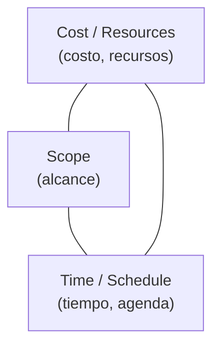

# Equilibrio de restricciones del proyecto

Todo el trabajo del arquitecto es **equilibrar fuerzas que se contradicen**. No se puede tener
todo: subir una dimensión obliga a bajar otra. La presentación lo muestra con tres
representaciones distintas de la misma idea.

## 1. El triángulo del proyecto

Las tres restricciones clásicas, una sobre cada **lado** del triángulo:

La frase que lo resume, tomada del *project management triangle*:

> "I can make it for you **fast**, **cheap**, or **good**. Pick any two."
> (Te lo puedo hacer rápido, barato o bueno. Elegí dos.)

Ese "elegí dos" es el punto: **son tres y solo se pueden fijar dos**; la tercera queda como
consecuencia.

> [!note] Lo volvió a proyectar el 2026-09-16 (capturas_U2_F2, 35)
> Misma lámina que la página 19 del PDF, con el enlace a
> `en.wikipedia.org/wiki/Project_management_triangle` al pie. Ojo con la posición de las etiquetas:
> en la figura **no van en los vértices sino sobre los lados** — *Cost/Resources* a la izquierda,
> *Scope* a la derecha, *Time/Schedule* en la base.

![[adjuntos/arquitectura-de-software/arq-p19.png]]

## 2. El diagrama de Kiviat — "diagrama de flexibilidad"

Un **diagrama de Kiviat** (radar) con cinco ejes graduados de 0 a 10, donde se marca qué tan
flexible es el proyecto en cada dimensión:

| Eje | Dimensión |
|---|---|
| **Features** | Funcionalidad / características |
| **Quality** | Calidad |
| **Cost** | Costo |
| **Schedule** | Agenda / tiempo |
| **Staff** | Personal |

La utilidad es que hace **visible y negociable** la prioridad: el polígono que se dibuja al
unir los valores muestra de un vistazo en qué somos rígidos y en qué podemos ceder.

Por eso se llama diagrama de **flexibilidad**: no mide cuánto hay de cada cosa, mide **cuánto
se puede mover** cada cosa.

Los valores del ejemplo, leídos con zoom sobre la captura 36 (la escala 0-10 solo está rotulada
en el eje *Features*; los demás son **aproximados**):

| Eje | Valor aproximado | Lectura con el título "de flexibilidad" |
|---|---|---|
| **Features** | ~8 | lo **más flexible**: se puede recortar alcance |
| **Quality** | ~5 | flexibilidad intermedia |
| **Cost** | ~2 | poco margen |
| **Schedule** | ~0 | **rígido**: la fecha no se mueve |
| **Staff** | ~0 | **rígido**: no se puede sumar gente |

> [!warning] Corrección (capturas_U2_F2, 36)
> Esta nota decía que *Features* cerca de 8 significaba **"mucha funcionalidad exigida"**. Eso
> contradice la frase de arriba — si el diagrama mide flexibilidad, un 8 en *Features* es que el
> alcance **es lo que más se puede ceder**, no lo más exigido. La diapositiva **no define** qué
> significa un valor alto; la lectura *alto = más flexible* es la única coherente con el título
> *"Diagrama de flexibilidad"*, pero es **lectura**, no texto de la lámina. Si lo preguntan,
> declará la escala antes de interpretar.

![[adjuntos/arquitectura-de-software-v1/arqv1-p10.png]]

## 3. El cubo de las dimensiones clave

La tercera representación va más allá de tres o cinco ejes: un cubo cuyas aristas y vértices
son las dimensiones clave del proyecto — **functionality, people, value, time, tools, money,
process, quality**. El título de la diapositiva es el mensaje:

> Puede ser difícil equilibrar todas las dimensiones clave...

![[adjuntos/arquitectura-de-software-v1/arqv1-p11.png]]

## Cómo se conecta con el resto

Esta nota es el "por qué" del [[Arquitecto de software]]: si las restricciones no chocaran, no
haría falta alguien que decida. Y es la contracara del primer beneficio de la arquitectura
(→ [[Beneficios de la arquitectura de software]]): los stakeholders piden cosas incompatibles
—bajos costos *y* rendimiento *y* seguridad *y* modificabilidad— y el arquitecto tiene que
proponer una solución acorde a cada escenario en particular.

## Notas relacionadas

- [[Arquitecto de software]]
- [[Beneficios de la arquitectura de software]]
- [[Ciclo de influencias en la arquitectura]]
- [[Proceso de diseño arquitectónico]]

## Preguntas de repaso

1. ¿Cuáles son las tres restricciones del triángulo del proyecto y qué significa "pick any two"?
2. ¿Cuáles son los cinco ejes del diagrama de Kiviat de la presentación?
3. ¿Por qué se le llama "diagrama de flexibilidad" y no "diagrama de calidad"?
4. En el ejemplo, *Schedule* y *Staff* están casi en 0. Con la lectura "alto = flexible", ¿qué le dice eso al arquitecto?
5. Relacioná este tema con el primer beneficio de la arquitectura de software.
