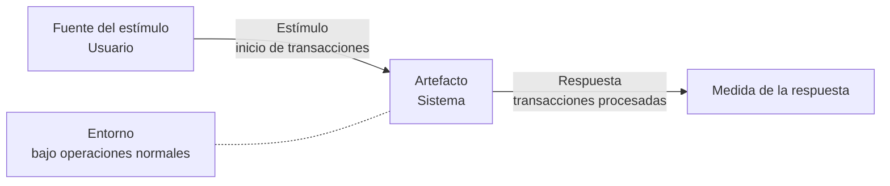

# Escenarios de calidad (EAC)

> [!note] Esto es la teoría; el ejemplo resuelto ya estaba
> Hasta el 16/10, lo único de clase sobre escenarios era la tabla `EAC-nn` del
> [[Ejemplo resuelto - Sistema de Transporte READM]] §5, y la estructura de seis partes venía del SAIP
> ([[Atributos de calidad]] §7). Ahora la clase la da **con su definición, su estructura y tres
> ejemplos**. La portada lo confirma: **«ESCENARIOS DE CALIDAD (EAC)»**.

## 1. Qué es

> *"Los **Escenarios de Calidad** permiten detallar **en qué condiciones y de qué manera** debe
> cumplirse un atributo de calidad. Son **casos precisos** en los que podremos **evidenciar si el
> sistema cumple o no** con un atributo de calidad, además se centran en lo que concierne al atributo
> y no en los términos utilizados."*

## 2. Para qué existe

> *"Los Escenarios de Calidad son **fundamentales** al momento de establecer y garantizar los atributos
> de calidad, ya que son uno de los tantos **input que reciben los Arquitectos de Software para tomar
> decisiones**, respecto de **qué estilos o patrones arquitectónicos** se aplicarán en el sistema a
> desarrollar."*

Ahí está la cadena del curso: **escenario → driver de calidad → elección de estilo**. Un escenario
que no ayuda a elegir entre dos estilos no está haciendo su trabajo.

![[adjuntos/capturas-clase-U3/escenarios-de-calidad/u3f1-19-definicion-y-figura-seis-partes.png]]

## 3. La estructura — seis partes más el atributo afectado

*"Existe la siguiente estructura para identificar los escenarios de calidad"*:

| # | Parte | Definición de la lámina | En la figura |
|---|---|---|---|
| 1 | **Fuente del estímulo** | quién o qué genera el estímulo para el escenario; pueden ser agentes **externos** (usuarios, sistema) o **internos** (procesos) | *Usuario* |
| 2 | **Estímulo** | qué estímulo es el que va a ocurrir para evidenciar el atributo (eventos de intercambio/request de datos entre las fuentes). **Es lo que se quiere llevar a cabo o realizar** | *Inicio de transacciones* |
| 3 | **Entorno** | condiciones dentro de las cuales se presenta el estímulo | *Bajo operaciones normales* (la figura dice **Ambiente**) |
| 4 | **Artefacto** | qué parte del sistema va a recibir el estímulo (servicios del sistema) | *Sistema* |
| 5 | **Respuesta** | actividad que ocurre luego de la llegada del estímulo | *Transacciones procesadas* |
| 6 | **Medida de la respuesta** | **criterio para testear el requerimiento** | (gráfico de barras) |
| + | **Atributo de calidad afectado** | atributo de calidad relacionado con el escenario | — |

> [!warning] Tres nombres para una misma parte
> - **Fuente del estímulo** en la definición, **Origen del estímulo** en las tablas de ejemplo.
> - **Entorno** en la definición, **Ambiente** en la figura.
> - La medida es *"criterio para testear"*: eso la vuelve la parte que convierte un deseo en un
>   requisito comprobable.

![[adjuntos/capturas-clase-U3/escenarios-de-calidad/u3f1-20-fuente-y-estimulo.png]]

![[adjuntos/capturas-clase-U3/escenarios-de-calidad/u3f1-21-entorno-artefacto-respuesta-medida.png]]

## 4. La plantilla de sus ejemplos

Los tres ejemplos usan la **misma tabla de dos columnas**:

| Campo | Contenido |
|---|---|
| **Escenario N.º n** | título |
| **Descripción** | qué se busca, en una frase |
| **Afecta** | el atributo (o la subcaracterística) |
| ***Validación del Escenario*** | *(fila de encabezado)* |
| Origen del estímulo | … |
| Estímulo | … |
| Entorno | … |
| Artefacto | … |
| Respuesta | … |
| Medida de la respuesta | … |
| Atributo de calidad afectado | … |

## 5. Los tres ejemplos, textuales

### Escenario N.º 1 — Identificación de contribuyentes

Sobre una pantalla de *login* con **RUT** y **Clave** (y los enlaces *recuperar clave*, *obtener clave*,
*acceso con certificado digital*).

| Campo | Valor |
|---|---|
| Descripción | Se busca que el usuario se demoré *(sic)* la menor cantidad de tiempo en aprender a usar el sistema; por esto cada *input text* debe aparecer una breve descripción de qué ingresar en ese campo |
| Afecta | Usuario — **Capacidad de aprendizaje** |
| Origen del estímulo | Usuario |
| Estímulo | Colocar cursor en un *input text* |
| Entorno | Condiciones normales |
| Artefacto | **Capa de presentación** |
| Respuesta | Mostrar una breve descripción de qué se debe entrar en este campo |
| Medida de la respuesta | **Inmediata** |

![[adjuntos/capturas-clase-U3/escenarios-de-calidad/u3f1-23-ejemplo-1-identificacion-contribuyentes.png]]

### Escenario N.º 2 y N.º 3

| Campo | N.º 2 | N.º 3 |
|---|---|---|
| Descripción | La aplicación web deberá ser visible desde cualquier tipo de dispositivo | Usuarios que utilizan por primera vez el sistema |
| Afecta | **Adaptabilidad** | **Usabilidad** |
| Origen del estímulo | Usuario | Usuario |
| Estímulo | Acceso a la aplicación web | Usar el sistema |
| Entorno | **Explotación** | Aplicación finalizada y operativa |
| Artefacto | Sitio Web | Aplicación |
| Respuesta | Debe visualizarse todo el contenido desde distintos dispositivos | La aplicación presentará una estructura simple y fácil de utilizar |
| Medida de la respuesta | Debe estar probado en diferentes dispositivos y navegadores | El usuario debe aprender a utilizar la aplicación en el menor tiempo posible |
| Atributo de calidad afectado | Adaptabilidad | Usabilidad |

![[adjuntos/capturas-clase-U3/escenarios-de-calidad/u3f1-24-ejemplos-2-y-3.png]]

## 6. Lo que enseñan los ejemplos — y la crítica

**El atributo se nombra al nivel de la subcaracterística ISO 9126.** *Capacidad de aprendizaje* es
de **usabilidad**; *adaptabilidad* es de **portabilidad** (está en la rueda de [[Norma ISO 9126]] §5).
Nombrar la subcaracterística es más preciso que nombrar solo la característica.

**El artefacto puede ser una capa** (*capa de presentación*): conecta con la perspectiva lógica de
[[Arquitectura en capas]].

> [!warning] La trampa: sus medidas no tienen número
> *"Inmediata"*, *"probado en diferentes dispositivos"*, *"en el menor tiempo posible"*: ninguna se
> puede medir con un número. Choca con la regla de los drivers (*"un driver de calidad sin número es
> un deseo"*) y con su propio ejemplo READM, donde `EAC-01` dice **"no mayor a dos segundos"** y
> `EAC-02` **"no mayor a cinco minutos"**.
>
> **En una entrega o un examen, poné número siempre**: *"en menos de 1 s"* en vez de *"inmediata"*,
> *"en 5 navegadores y 3 tamaños de pantalla"*, *"en menos de 10 minutos sin capacitación"*. Así se
> cumple la definición de la lámina —*criterio para testear*— y no se pierde nada. Anotado como
> duda 54.

## 7. Cómo se escribe uno — método mecánico

1. **Elegí el atributo** y bajalo a una subcaracterística ISO 9126 (o a una de las siete de drivers,
   declarando cuál lista usás).
2. **Fuente**: ¿quién lo dispara? Usuario, sistema externo, proceso interno… o un **desarrollador**, si
   el atributo es [[Atributos observables y no observables vía ejecución|no observable]].
3. **Estímulo**: un verbo concreto (*colocar cursor*, *buscar corridas*, *cambiar el idioma*).
4. **Entorno**: condiciones normales, pico de carga, falla, explotación, desarrollo.
5. **Artefacto**: la parte que lo recibe (capa, servicio, sitio, componente).
6. **Respuesta**: qué hace el sistema (o el equipo).
7. **Medida**: **un número con unidad**. Si no lo encontrás, el escenario no está listo.

**Checklist**: ¿están las seis partes y el atributo? ¿la medida tiene número? ¿el artefacto existe en
la arquitectura? ¿el escenario ayudaría a elegir un estilo?

## 8. Bibliografía de la sección

La lámina 25 cierra con tres libros: **Pressman** (*Ingeniería del Software: un enfoque práctico*,
7.ª ed., 2006), **Bass, Clements y Kazman** (*Software Architecture in Practice*, 2.ª ed., 2006) y
**Rozanski y Woods** (*Software Systems Architecture*, 2005). En disco está el SAIP en su **4.ª**
edición.

![[adjuntos/capturas-clase-U3/escenarios-de-calidad/u3f1-25-bibliografia.png]]

![[adjuntos/capturas-clase-U3/escenarios-de-calidad/u3f1-18-portada-eac.png]]

## Notas relacionadas

- [[Ejemplo resuelto - Sistema de Transporte READM]] §5 — la tabla `EAC-nn` con prioridad
- [[Atributos de calidad]] §7 — generales vs concretos, y cómo sacarle un número a un stakeholder
- [[Drivers arquitectónicos]] — donde el escenario se vuelve driver de calidad
- [[Norma ISO 9126]] — de donde salen los nombres del campo *Afecta*

## Preguntas de repaso

1. Citá la definición de escenario de calidad de la clase. ¿Para qué decisiones del arquitecto sirve?
2. Nombrá las seis partes y el campo que se agrega. ¿Cuál es *"criterio para testear"*?
3. ¿Qué dos nombres recibe la fuente del estímulo en las láminas? ¿Y el entorno?
4. En el escenario N.º 1, ¿cuál es el artefacto y qué subcaracterística afecta?
5. ¿Qué tienen de flojo las medidas de sus tres ejemplos, y cómo las corregirías?
