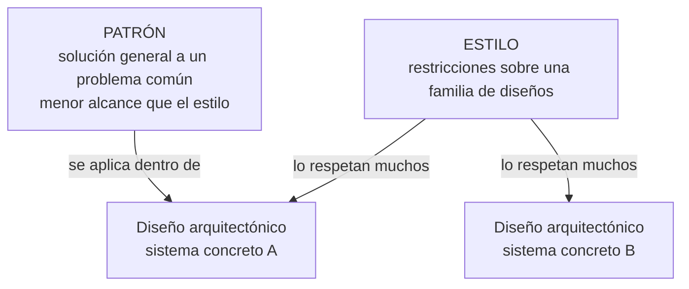
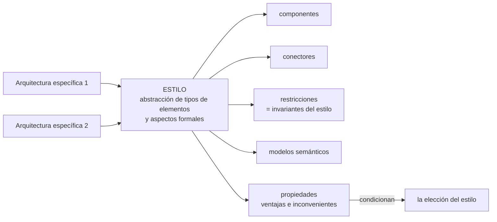
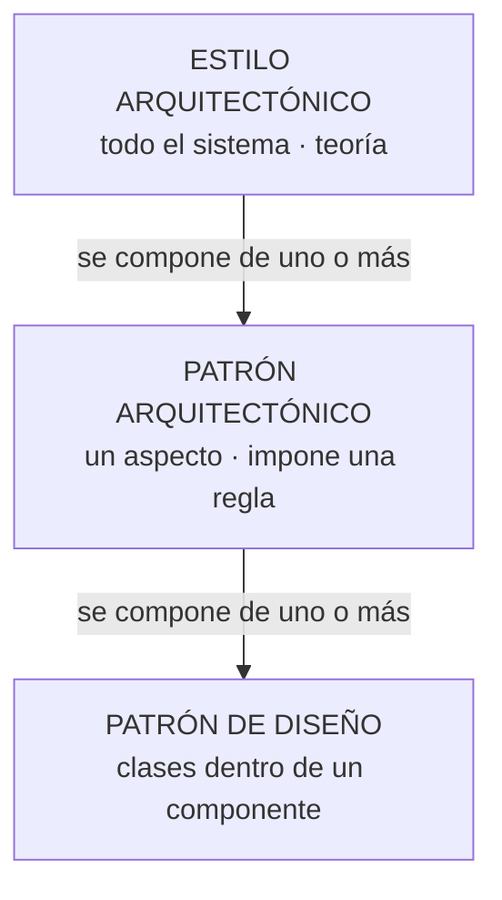
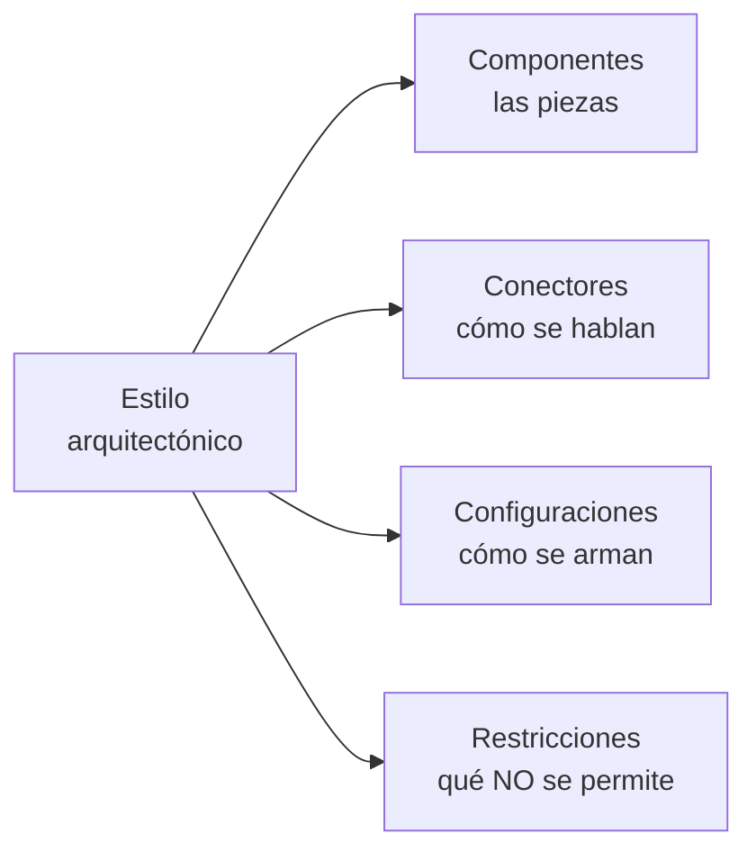
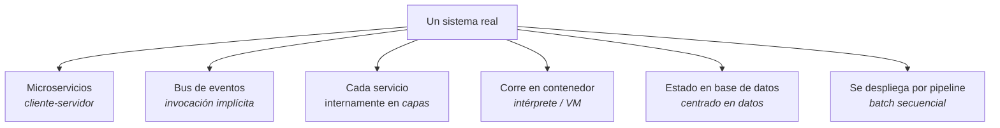
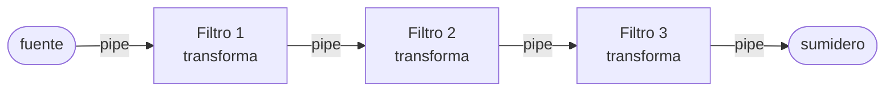
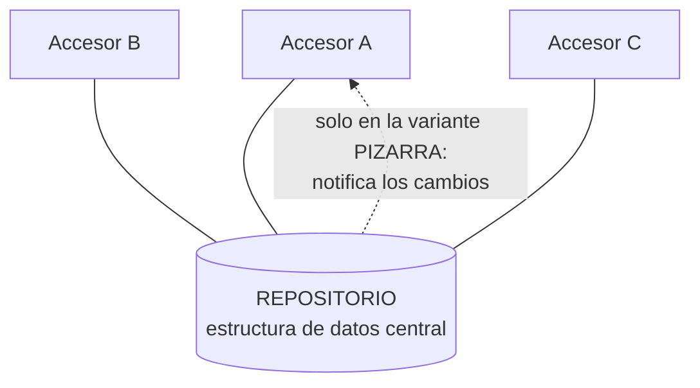
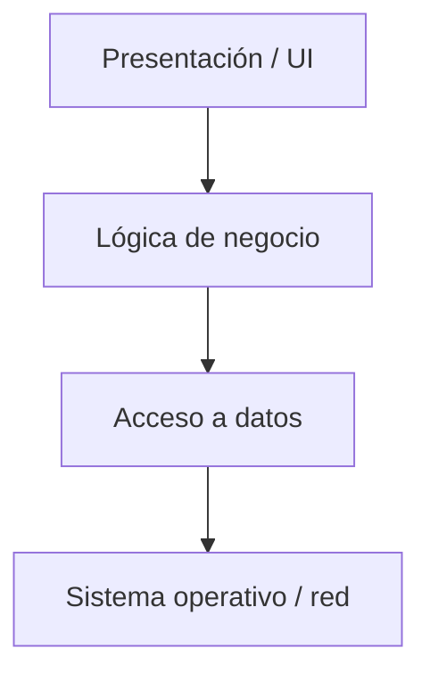
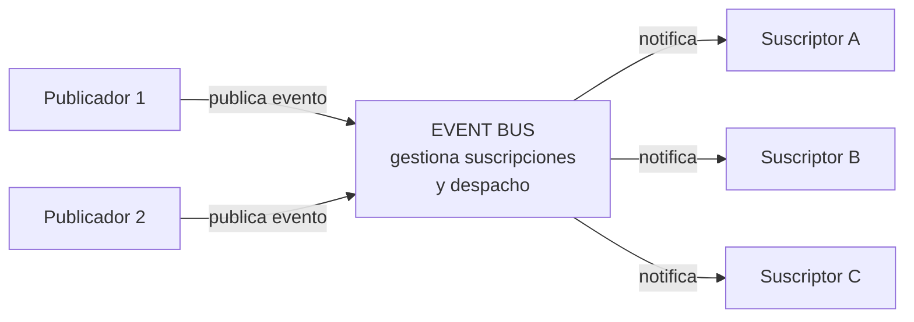
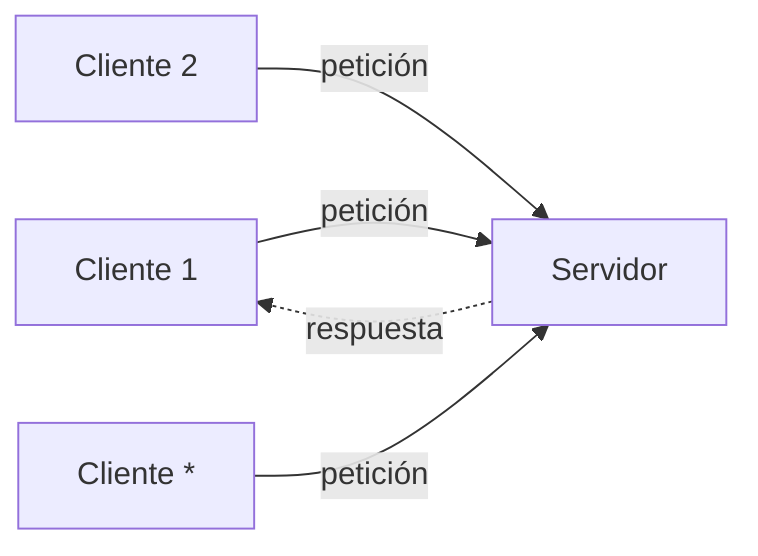

# Estilos arquitectónicos

> [!info] Cómo está armada esta nota
> - **Parte I — NÚCLEO (clase).** Las definiciones de *diseño*, *estilo* y *patrón* arquitectónico
>   de la diapositiva "Estilos y Patrones Arquitectónicos"; **qué es un estilo** (Elementos-Forma-Razón,
>   transformación impuesta, invariantes) y **en qué se diferencia de un patrón** (capturas_U2_F2);
>   su **lista de 9 estilos**, y los que desarrolló: monolítica, N-capas, 2 capas
>   (cliente-servidor) y la nube. Es lo que se evalúa.
> - **Parte II — COMPLEMENTO.** El catálogo de Reynoso, el SAIP y la guía de estudio, que existía
>   antes de que llegara la clase. Sirve para **entender** los estilos que ella solo nombró (centrado
>   en datos, flujo de datos, eventos…), **nunca** para contradecir la Parte I.
>
> Si algo de la Parte II choca con la Parte I, **manda la clase**. Los choques que ya se detectaron
> están señalados en su lugar (capa vs. nivel, patrón vs. estilo).

---

# Parte I — Lo que dio la clase (NÚCLEO)

## 1. Diseño, estilo y patrón: las tres definiciones

La diapositiva *"Estilos y Patrones Arquitectónicos"* define tres términos que se confunden. Textual:

> Un **diseño arquitectónico** se refiere a la arquitectura de un sistema concreto.

> Un **estilo arquitectónico** establece las restricciones sobre la arquitectura de una **familia de
> diseños arquitectónicos**. Algunos ejemplos: centrado en datos, flujo de datos, llamar y regresar,
> capas.

> Un **patrón arquitectónico** es una solución general a un problema común del diseño
> arquitectónico. **Menor alcance que los estilos arquitectónicos.**

![[adjuntos/capturas-clase-U2/estilos/definiciones-diseno-estilo-patron.png]]

> [!note] La volvió a dar
> La captura **capturas_U2_F2 (14)** es **la misma diapositiva**, palabra por palabra, en otra
> sesión. Que la repita es señal de que la considera central.

> [!warning] Dos definiciones de *estilo* en el material de clase — no son la misma frase
> | Versión | Textual | Dónde |
> |---|---|---|
> | **A — restricciones** | *"Un estilo arquitectónico establece las **restricciones** sobre la arquitectura de una **familia de diseños arquitectónicos**."* | capturas_U2 (21) y capturas_U2_F2 (14) |
> | **B — marco de referencia** | *"Un estilo arquitectónico establece un **marco de referencia** a partir del cual es posible **construir aplicaciones que comparten un conjunto de atributos y características** mediante el cual es posible identificarlos y clasificarlos"* | capturas_U2_F2 (6), con el dibujo estilo ⊃ patrón arquitectónico ⊃ patrón de diseño |
>
> La **B** es la misma idea que la cita de Blancarte en la 15 (*"marco de referencia o estilo de
> trabajo"*). A eso se suman las miradas de §1.1 (*transformación impuesta*, *abstracción de tipos
> de elementos*). **No se eligió una**: si hay que escribir la definición en el examen, preguntale
> cuál espera, o dá la A (la que repitió dos veces) y mencioná la B.

Puestos lado a lado, la diferencia es **de qué habla cada uno**:

| Término | Habla de… | Alcance | Ejemplo con material de clase |
|---|---|---|---|
| **Diseño arquitectónico** | **un** sistema concreto | uno solo | el diagrama de componentes de la clínica veterinaria (ver [[Arquitectura en capas]]) |
| **Estilo arquitectónico** | una **familia** de diseños: les impone **restricciones** | el mayor | *capas*, *centrado en datos*, *flujo de datos*, *llamar y regresar* |
| **Patrón arquitectónico** | un **problema común** dentro del diseño, y su solución general | **menor que el estilo** | esta diapositiva no da ejemplo, pero **su lista de 13** sí (capturas_U2_F2, 8): DTO, DAO, Polling, Webhook, Load Balance, Service Registry, Service Discovery, API Gateway, Access Token, SSO, Store and forward, Circuit Breaker, Log aggregation → [[Patrones arquitectónicos]] |

Esquema propio (no es un diagrama de la clase) de cómo se encadenan:

> [!warning] Las dos trampas de esta diapositiva
> 1. **Estilo ≠ diseño.** "En capas" no es la arquitectura de nada: es una restricción que cumplen
>    muchas arquitecturas. *La arquitectura de la clínica veterinaria* sí es un diseño.
> 2. **Patrón arquitectónico ≠ patrón de diseño**, y **patrón ≠ estilo**. Para ella el patrón tiene
>    **menor alcance** que el estilo: no son sinónimos. (El SAIP llama *patrones* a capas o
>    cliente-servidor; en esta clase esos son **estilos**. Ver el choque señalado en
>    [[Tácticas y patrones arquitectónicos]] §2.)

**Regla para el examen:** *diseño = un sistema · estilo = una familia (restricciones) · patrón = un
problema (menor alcance que el estilo).*

### Los dos tipos de patrón (capturas_U2_F2, 0)

La diapositiva que abre el bloque *"Patrones / Estilos Arquitectónicos"* ordena el tema así —textual:

> 1. **Tipos de Patrones**
>    - Patrones de diseño
>    - Patrones arquitectónicos
> 2. **Estilos Arquitectónicos**

![[adjuntos/capturas-clase-U2/estilos/patrones-estilos-tipos-de-patrones.png]]

El dibujo, leído a resolución completa:

| Elemento | Qué es |
|---|---|
| `Component` | un componente (caja con dos rectángulos en el borde izquierdo, a modo de puertos/interfaces) |
| `<subcomponent> Singleton`, `<subcomponent> Composite`, `<subcomponent> Factory Method` | tres **patrones de diseño** (GoF) dibujados como subcomponentes **dentro** del componente |
| flechas **punteadas** | salen de `Composite` y apuntan a `Singleton` y a `Factory Method` (dependencias) |

Lo que se lee de ahí *(lectura nuestra, la diapositiva no lo dice con palabras)*: los **patrones de
diseño** viven **dentro de un componente**, a nivel de clases; los **patrones arquitectónicos** y los
**estilos** operan sobre la organización de los componentes entre sí. Es la misma escala de alcance
de la definición de arriba: **patrón de diseño < patrón arquitectónico < estilo**. Ver §5 y
[[Tácticas y patrones arquitectónicos]].

Cada tipo de patrón tiene su nota: [[Patrones de diseño]] (creacionales, estructurales, de
comportamiento) y [[Patrones arquitectónicos]] (impacto global, su lista de 13). La lectura de
arriba **ya no es solo nuestra**: ella dibujó la jerarquía completa —un **estilo** contiene
**patrones arquitectónicos**, y cada uno contiene **patrones de diseño**—:

![[adjuntos/capturas-clase-U2/patrones/estilo-contiene-patrones-arquitectonicos-y-de-diseno.png]]

Y la captura 15 (§1.2) lo dice con palabras.

### 1.1 Qué es un estilo: lo que dijo la clase (capturas_U2_F2, 18-21)

Cuatro diapositivas seguidas definen el estilo desde cuatro ángulos. Textual:

**(18) Qué describe y para qué sirve.**

> - Un estilo **describe una clase de arquitectura o piezas de la misma**.
> - Los estilos **se pueden reutilizar** en situaciones semejantes en el futuro.
> - Desde que surgió la arquitectura del software se generalizó la arquitectura **cliente – servidor**,
>   posteriormente entró en auge las arquitecturas **en capas** y las **basadas en componentes** y más
>   recientemente las **basadas en recursos y servicios**.

![[adjuntos/capturas-clase-U2/estilos/estilo-describe-clase-de-arquitectura-evolucion.png]]

**(19) Qué incluye.**

> Cada estilo describe una **categoría de sistemas** que incluye:
> - Un conjunto de **componentes** (una base de datos o módulos de computo) que realizan una función
>   requerida por el sistema.
> - Un conjunto de **conectores** que permiten la comunicación, coordinación y cooperación entre los
>   componentes.
> - **Restricciones** que definen como se integran los componentes para formar el sistema.
> - **Modelos semánticos** que permiten que un diseñador entienda las propiedades generales del
>   sistema al analizar las propiedades conocidas de sus partes.

![[adjuntos/capturas-clase-U2/estilos/estilo-categoria-de-sistemas-que-incluye.png]]

**(20) Elementos, Forma y Razón.**

> Se establece que una arquitectura se define mediante la afirmación:
>
> **Arquitectura del Software = Elementos, Forma y Razón.**
>
> - **Elementos:**
>   - **Procesamiento:** Suministra la transformación de los datos
>   - **Datos:** Contiene la información a procesar
>   - **Conexión:** Llamadas a procedimientos, mensajes, etc.
> - **Forma:** las propiedades y relaciones entre los elementos.
> - **Razón:** motivación para la elección de elementos y sus formas.
>
> Por tanto **un estilo arquitectónico es una abstracción de tipos de elementos y aspectos formales a
> partir de arquitecturas específicas**.

![[adjuntos/capturas-clase-U2/estilos/arquitectura-elementos-forma-razon.png]]

> [!info] De dónde sale la fórmula (complemento, la diapositiva no lo cita)
> *Elementos, Forma y Razón* es la definición de **Perry y Wolf (1992)**, el mismo texto fundacional
> en que se apoya Reynoso en §4. Sirve para ubicarla; en el examen citá la diapositiva.

**(21) Transformación impuesta e invariantes** — lo que ella marca **en rojo** va en negrita:

> - Un estilo arquitectónico **es una transformación impuesta** al diseño de **todo un sistema**. El
>   objetivo es establecer una estructura para todos los componentes del sistema.
> - Indican
>   - Los tipos de componentes y sus conectores involucrados
>   - Patrones y restricciones de interconexión o composición entre ellos
>     - **Invariantes del estilo** (restricciones)
> - Asociado a cada estilo hay una serie de **propiedades** que lo caracterizan
>   - Determinan sus **ventajas e inconvenientes**
>   - **Condicionan la elección** de uno u otro estilo

![[adjuntos/capturas-clase-U2/estilos/estilo-transformacion-impuesta-invariantes.png]]

Las cuatro juntas, ordenadas *(síntesis nuestra)*:

| Pregunta | Respuesta de la clase | Captura |
|---|---|---|
| ¿Qué **es**? | una **abstracción** de tipos de elementos y aspectos formales a partir de arquitecturas específicas · una **transformación impuesta** al diseño de todo un sistema | 20, 21 |
| ¿Qué **describe**? | una **clase** de arquitectura (o piezas) · una **categoría** de sistemas | 18, 19 |
| ¿De qué **se compone**? | **componentes**, **conectores**, **restricciones** (= *invariantes del estilo*) y **modelos semánticos** | 19, 21 |
| ¿De qué está hecha la arquitectura que abstrae? | **Elementos** (procesamiento, datos, conexión) + **Forma** + **Razón** | 20 |
| ¿Para qué **sirve**? | se **reutiliza** en situaciones semejantes · sus **propiedades** dan ventajas e inconvenientes y **condicionan la elección** | 18, 21 |

> [!warning] La trampa de la 20
> *Elementos, Forma y Razón* define **la arquitectura**, no el estilo. El estilo sale **después**,
> con el *"por tanto"*: es lo que queda cuando de muchas arquitecturas concretas se abstraen **los
> tipos** de elementos y la forma. Y ojo con **Razón**: es la *motivación* de las decisiones — una
> arquitectura sin su porqué está incompleta según esta definición.

> [!note] Cruce con el complemento
> Los ingredientes de la 19 son casi los de Reynoso en §4 (componentes, conectores, configuraciones,
> restricciones). La clase **agrega los modelos semánticos** y no nombra las *configuraciones* —
> aunque la *"forma"* de la 20 cumple ese papel. **No chocan**: citá la lista de la 19.

### 1.2 Estilo vs. patrón arquitectónico: lo que dijo la clase (capturas_U2_F2, 15, 16, 17, 22)

**(15) Qué son y cómo se componen** — la diapositiva cita a **Óscar Blancarte**, *Introducción a
la Arquitectura de Software*, p. 48, como *"lectura recomendada"*. Es **complemento citado por
ella**: vale como material de clase porque lo puso en la diapositiva, pero el libro no está en la
bibliografía oficial ni en disco. Textual:

> Es importante también tener claro también estos conceptos, ya que están relacionados pero no son
> lo mismo, pero seamos prácticos y en un par de párrafos dejemos claro sus diferencias y qué son:
> - Los **patrones arquitectónicos** son aquellas **soluciones recurrentes a un problema de diseño
>   entre componentes y su relación entre ellos** y puede estar **conformada de uno o más patrones de
>   diseño**.
> - Por otra parte un **estilo arquitectónico** es un **marco de referencia o estilo de trabajo** que
>   puede **componerse de uno o más patrones arquitectónicos**. (Óscar Blancarte, en su libro
>   Introducción a la Arquitectura de software en la página 48, disponible desde
>   https://reactiveprogramming.io/books/software-architecture/es lectura recomendada.) Entre algunos
>   ejemplos de los principales estilos arquitectónicos tenemos a la arquitetura [sic] **monolítica,
>   cliente-servidor, SOA, microkernel, en capas y microservicios**.

![[adjuntos/capturas-clase-U2/estilos/estilos-y-patrones-de-arquitectura-blancarte.png]]

**(16) Similitudes y diferencias** — la tabla, textual:

| SIMILITUDES | DIFERENCIAS |
|---|---|
| Ambos solucionan un **problema arquitectónico recurrente**. | Los *estilos* establecen restricciones sobre la arquitectura de **todo el sistema**, y los *patrones* tienen un **alcance menor** y abordan **problemas más específicos**. |
| Se **describen de la misma forma**. | Cada estilo describe una **familia de sistemas** que comparten un conjunto amplio de decisiones de diseño. |

![[adjuntos/capturas-clase-U2/estilos/estilos-vs-patrones-similitudes-diferencias.png]]

**(17) Se complementan** — textual:

> Un aspecto muy importante en arquitectura del software son los patrones tanto de diseño como de
> arquitectura
> - Los **complementan** los estilos arquitectónicos
> - Ambos se preocupan de los **stakeholders**
> - Los **estilos** favorecen al tratamiento **estructural, la investigación, la teoría**
> - Los **patrones** están más cerca del **diseño, la práctica, el proceso, el código**

![[adjuntos/capturas-clase-U2/estilos/estilos-y-patrones-se-complementan-atributos-calidad.png]]

El dibujo: un óvalo rotulado **Estilos** que contiene **Atributos de calidad → Arquitectura**
(flecha gruesa). Leído: el estilo es el **puente** por el que los atributos de calidad se convierten
en arquitectura — exactamente lo que dice la §9: elegir estilo es elegir qué atributos favorecer.

**(22) Diferencias patrón-estilo** — lo que ella marca **en rojo** va en negrita:

> - Un patrón arquitectónico, **al igual que un estilo**, impone una transformación en el diseño de
>   una arquitectura.
> - Diferencias entre patrón y estilos
>   - El alcance de un patrón **es menor**, ya que se concentra en un aspecto en lugar de hacerlo en
>     toda la arquitectura.
>   - Un patrón **impone una regla** sobre la arquitectura, pues describe la manera en que el SW
>     manejará algún aspecto de su funcionalidad al nivel de la infraestructura (por ejemplo,
>     concurrencia).
>   - Los patrones arquitectónicos tienden a **abarcar aspectos específicos** del comportamiento dentro
>     del contexto de la arquitectura (por ejemplo, como maneja una aplicación en tiempo real la
>     sincronización o las interrupciones ).
> - Los patrones **se usan junto con** un estilo arquitectónico para determinar la forma de la
>   estructura general de un sistema.

![[adjuntos/capturas-clase-U2/estilos/patron-vs-estilo-alcance-regla-aspectos.png]]

**Las cuatro diapositivas en una tabla** *(síntesis nuestra, cada celda con su captura)*:

| | **Estilo arquitectónico** | **Patrón arquitectónico** | **Patrón de diseño** |
|---|---|---|---|
| **Alcance** | **todo el sistema** (16, 21) | **menor**: un aspecto (16, 22) | un componente, sus clases (0, 6) |
| **Qué impone** | una **transformación** al diseño de todo el sistema (21) | también una transformación (22), en forma de **una regla** (22) | — |
| **Qué aborda** | una **familia de sistemas** con decisiones de diseño compartidas (16) | problemas **más específicos**: concurrencia, sincronización, interrupciones (16, 22) | problemas de diseño a nivel de clases → [[Patrones de diseño]] |
| **Se compone de** | uno o más **patrones arquitectónicos** (15) | uno o más **patrones de diseño** (15) | — |
| **Está más cerca de** | lo estructural, la investigación, la **teoría** (17) | el diseño, la práctica, el proceso, el **código** (17) | — |
| **En común** | los dos resuelven un problema arquitectónico **recurrente**, **se describen de la misma forma**, se preocupan de los **stakeholders** y **se usan juntos** (16, 17, 22) | | |

> [!warning] Las tres trampas de estas diapositivas
> 1. **"El estilo impone y el patrón no"** — falso. La 22 dice que el patrón, **al igual que un
>    estilo**, impone una transformación. La diferencia **no es si impone**, es **cuánto abarca**:
>    todo el sistema vs. un aspecto.
> 2. **"Se describen distinto"** — falso. La 16 pone como **similitud** que *se describen de la
>    misma forma*.
> 3. **"Se elige uno u otro"** — falso. La 17 dice que se **complementan** y la 22 que se usan
>    **junto con** un estilo.

**Regla para el examen:** *el estilo es el marco de todo el sistema y se compone de patrones
arquitectónicos; el patrón arquitectónico impone una regla sobre un aspecto y se compone de
patrones de diseño. Los dos imponen una transformación: los separa el alcance.*

## 2. Los estilos que mostró la clase

### Su lista: nueve estilos (capturas_U2_F2, 9)

La diapositiva *"Estilos Arquitectónicos"*, textual:

> 1. Monolítico
> 2. Cliente-Servidor
> 3. Arquitectura en Capas
> 4. Microkernel
> 5. Service-Oriented Architecture (SOA)
> 6. Microservicios
> 7. Event Drive [sic] Architecture (EDA)
> 8. REST
> 9. Peer to Peer (P2P)

![[adjuntos/capturas-clase-U2/estilos/estilos-lista-nueve-estilos.png]]

> [!warning] El nombre del archivo no manda
> La captura cruda se llama `9-Microservicios-Patron.png`, pero **la diapositiva dice "Estilos
> Arquitectónicos"** y pone **Microservicios** como estilo 6. Para ella, microservicios es un
> **estilo**, no un patrón. (La 15 confirma: *"ejemplos de los principales estilos … SOA,
> microkernel, en capas y microservicios"*.)

Cruzada con el resto del material:

| # | Estilo de su lista | ¿Lo desarrolló? | ¿Está en los 6 del programa (§7)? | ¿Está en la 15 (Blancarte)? | Dónde leerlo |
|---|---|---|---|---|---|
| 1 | **Monolítico** | ✅ definición + tabla + Prime Video | ❌ | ✅ | [[Arquitectura monolítica]] |
| 2 | **Cliente-Servidor** | ✅ como *2 capas* y como *call return: cliente-servidor* (U2_F3 32) | ✅ | ✅ | [[Arquitectura en capas]] §3 · [[Arquitectura de llamada y retorno]] §3 |
| 3 | **Arquitectura en Capas** | ✅ como *N-Capas*, y una serie propia *"en o por capas"* (U2_F3 0-12) | ✅ | ✅ | [[Arquitectura en capas]] |
| 4 | **Microkernel** | ❌ solo nombrado | ❌ (en el complemento, variante jerárquica de capas) | ✅ | §8, *En o por capas* (complemento) |
| 5 | **SOA** | ✅ **desarrollado** (U2_F3 33-39, *"call return: SOA"*) | ❌ (en el complemento, descendiente de cliente-servidor; en clase, **hermano** bajo Call-return) | ✅ | [[Arquitectura orientada a servicios]] |
| 6 | **Microservicios** | ❌ solo nombrado | ❌ | ✅ | §8, *Cliente-servidor* (complemento) |
| 7 | **EDA** | ❌ solo nombrado | ✅ como *basada en eventos* | ❌ | §8, *publish-subscribe* (complemento) |
| 8 | **REST** | 🟡 una diapositiva: definición de *API RESTful* (U2_F3 20), puesta **dentro de la serie de flujo de datos** | ❌ | ❌ | [[Tuberías y filtros]] §4 |
| 9 | **P2P** | ❌ solo nombrado | ❌ (el complemento lo pone junto a cliente-servidor) | ❌ | §8, *Cliente-servidor* (complemento) |

Y del otro lado: **centrada en datos**, **flujo de datos** y **llamada y retorno**, que están en el
programa y en la diapositiva de definiciones, **no están en esta lista de 9**. Aparecen como
**familias** en su catálogo de estilos → [[Catálogo de estilos arquitectónicos]].

> [!tip] Cómo se entienden las dos listas sin que choquen
> Son **dos niveles**. Las *familias* (centrada en datos, flujo de datos, llamada y retorno,
> basada en eventos) son las del programa y el catálogo; la lista de 9 son **estilos concretos**,
> de los que se habla hoy en la industria. Si en el examen piden "los estilos que vimos", dá **la
> lista de 9**; si piden "el catálogo del 1.9", dá **las familias**.
>
> Ojo: sus dos diapositivas de catálogo (la textual y el árbol C & C) **no ubican igual** P2P,
> eventos, SOA y pizarra. Está documentado en [[Catálogo de estilos arquitectónicos]].

### Los que nombró y los que desarrolló

La diapositiva de definiciones **nombra** cuatro estilos de ejemplo; después la catedrática
**desarrolló** otros con diapositivas propias. Conviene distinguir los dos grupos:

| Estilo | ¿Cómo aparece en clase? | Nota |
|---|---|---|
| **Monolítica** | desarrollada: definición + tabla de 7 características + caso Amazon Prime Video | [[Arquitectura monolítica]] |
| **N-Capas** (multinivel) | desarrollada: definición + diagrama presentación / negocio / datos + ejemplo de componentes; **y la serie "en o por capas"** (U2_F3 0-12): definición externa/intermedias/interna, anillos, 3 niveles web, Apache/MySQL, thin/rich, three-tier, capas IoT, infografía, ventajas/desventajas y 2 ejercicios | [[Arquitectura en capas]] |
| **2 capas — modelo cliente-servidor** | desarrollada: petición/respuesta + ejemplo smartphone/smartwatch; y como *call return: cliente-servidor* (U2_F3 32): *"los servidores no conocen los clientes"* | [[Arquitectura en capas]] §3 · [[Arquitectura de llamada y retorno]] §3 |
| **En la nube** (cloud computing, N-niveles en la nube) | desarrollada: definición + dos arquitecturas de referencia (AWS y Azure) | [[Arquitectura en la nube]] |
| **Centrado en datos** | solo **nombrada** como ejemplo en la definición de estilo | Parte II (complemento) |
| **Flujo de datos** | **desarrollada** desde U2_F3 (13-28): computación dirigida por el flujo de datos, definición, cuándo usarla, analogía textil, tuberías y filtros con ventajas/desventajas, ejemplo de seguridad, y el estilo secuencial por lotes | [[Arquitectura centrada en el flujo de datos]] · [[Tuberías y filtros]] |
| **Llamar y regresar** | **desarrollada** desde U2_F3: definición y bloqueo (30-31), cliente-servidor (32), sus patrones RPC, OO y MVC (40), RPC (41-43), SOA (33-39) y MVC (44-48). Ojo con el nombre: la definición dice *"llamar y regresar"*; el programa y la serie, *"llamada y retorno"* | [[Arquitectura de llamada y retorno]] · [[Llamada a procedimiento remoto]] · [[Arquitectura orientada a servicios]] · [[Modelo-Vista-Controlador]] |
| **Capas** | nombrada **y** desarrollada (es la N-Capas de arriba) | [[Arquitectura en capas]] |

> [!note] Monolítica vs. capas: no se excluyen
> En la diapositiva del monolito los tres bloques son **Interfaz de usuario**, **Lógica del
> negocio** y **Capa de acceso a los datos**: las mismas capas de N-Capas. Lo que distingue al
> monolito no es la ausencia de capas sino que **todo vive en una base de código única** y se
> despliega junto. Un monolito puede estar bien estratificado por dentro.

## 3. Qué del punto 1.9 del programa cubrió la clase

El programa, punto 1.9: *arquitectura candidata, arquitectura de referencia, diseño on premise vs
cloud, y el catálogo: cliente-servidor, centrada en datos, en capas, flujo de datos, llamada y
retorno, basada en eventos.* Contra las capturas de la unidad 2 (`capturas_U2`, desde el
2026-09-16 `capturas_U2_F2` y desde el 2026-09-17 `capturas_U2_F3`):

| Punto del programa | ¿Lo cubrió la clase? | Dónde |
|---|---|---|
| **Cliente-servidor** | ✅ sí, como *"Arquitectura de 2 capas — Modelo Cliente Servidor"* y como *"call return: cliente-servidor"* (U2_F3 32) | [[Arquitectura en capas]] §3 · [[Arquitectura de llamada y retorno]] §3 |
| **En capas** | ✅ sí, como *"Arquitectura N-Capas"*, *"Arquitectura: Capas"* y la serie *"en o por capas"* (U2_F3 0-12) | [[Arquitectura en capas]] |
| **Diseño cloud** | ✅ sí: Cloud Computing, Prime Video en AWS, N-niveles en la nube (Azure) | [[Arquitectura en la nube]] |
| **Diseño on premise** | ⚠️ **sigue sin diapositiva propia** (tampoco en capturas_U2_F2); queda implícito por contraste con la nube | [[Arquitectura en la nube]] §4 |
| **Centrada en datos** | 🟡 **nombrada** en la definición de estilo y como familia del catálogo (capturas_U2_F2, 30) | [[Catálogo de estilos arquitectónicos]] · Parte II |
| **Flujo de datos** | ✅ **sí**, desde capturas_U2_F3 (13-28): la familia, tuberías y filtros y secuencial por lotes | [[Arquitectura centrada en el flujo de datos]] · [[Tuberías y filtros]] |
| **Llamada y retorno** | ✅ **sí**, desde capturas_U2_F3: definición (30-31), cliente-servidor (32), SOA (33-39), patrones RPC/OO/MVC (40-48) | [[Arquitectura de llamada y retorno]] · [[Catálogo de estilos arquitectónicos]] |
| **Basada en eventos** | 🟡 **nombrada**: *EDA* en su lista de 9 (capturas_U2_F2, 9), en el catálogo textual (30) y como *Event-based* en el árbol C & C (30-componentes-conectores); **no se desarrolla** | §2 · [[Catálogo de estilos arquitectónicos]] · Parte II |
| **Arquitectura candidata** | 🟡 hay una diapositiva con ese título, capturas_U2_F2 (25) | [[Arquitectura de referencia]] · §10 |
| **Arquitectura de referencia** | ✅ **sí**, con ese nombre, en capturas_U2_F2 (23, 24, 26) | [[Arquitectura de referencia]] · §10 |
| *(no está en el programa)* **Monolítica** | ✅ desarrollada | [[Arquitectura monolítica]] |
| *(no está en el programa)* **SOA** | ✅ desarrollada (capturas_U2_F3 33-39) | [[Arquitectura orientada a servicios]] |
| *(no está en el programa)* **MVC** · **RPC** | ✅ desarrollados como **patrones arquitectónicos** de llamada y retorno (capturas_U2_F3 40-48) | [[Modelo-Vista-Controlador]] · [[Llamada a procedimiento remoto]] |
| *(no está en el programa)* **Microkernel, Microservicios, REST, P2P** | 🟡 **nombrados** en su lista de 9 (capturas_U2_F2, 9) | §2 |

---

# Parte II — COMPLEMENTO (Reynoso, SAIP, guía de estudio)

> [!warning] Todo lo que sigue es COMPLEMENTO
> Viene de **Reynoso**, *Introducción a la Arquitectura de Software* (`00-Fuentes/lecturas/`), del
> **SAIP 4ª ed.** (Bass, Clements, Kazman — bibliografía oficial) y de la **Guía de estudio**
> (`Unidad_1/Guia_Arquitectura_Software.pdf`, Parte IX). Sirve para entender los estilos que la
> clase solo nombró. **No se cita en lugar de la Parte I.**

## 4. Qué es un estilo según Reynoso

Reynoso, textual, apoyándose en el texto fundacional de Perry y Wolf:

> Un estilo es un **concepto descriptivo** que define una forma de articulación u organización
> arquitectónica. El conjunto de los estilos **cataloga las formas básicas posibles** de estructuras
> de software, mientras que las formas complejas se articulan mediante **composición** de los
> estilos fundamentales.

Y los cuatro ingredientes con que se describe un estilo:

> Los estilos conjugan **elementos** (o "componentes", como se los llama aquí), **conectores**,
> **configuraciones** y **restricciones**.

El detalle que Reynoso subraya: al poner los **conectores** como elemento de primera clase, el
concepto de estilo se sitúa en un orden de discurso que **el modelado orientado a objetos y UML no
cubren satisfactoriamente**. Esa es la razón de fondo por la que existen los ADLs (lenguajes de
descripción arquitectónica) y por la que un diagrama de clases no alcanza para describir una
arquitectura.

## 5. Estilo ≠ patrón de diseño

La diferencia más preguntable, y es de escala:

| | Cantidad | Nivel |
|---|---|---|
| **Patrones de diseño** | **Centenares** (las 23 fichas de GoF son solo un catálogo — la clase dio **25**, ver abajo) | Estructura interna de un grupo de clases |
| **Estilos arquitectónicos** | **Seis o siete clases** fundamentales y unos **veinte ejemplares** como máximo | Organización del sistema completo |

> [!note] El número de la clase (capturas_U2_F2, 7)
> Su lista *"Patrones de Diseño"* tiene **25**: los **23 de GoF** más **Object Pool** (6) y **Null
> Object** (23). Si preguntan *cuántos patrones de diseño vimos*, la respuesta es **25**, no 23 ni
> "centenares". Detalle en [[Patrones de diseño]]. Lo de "centenares" es Reynoso hablando de todos
> los que existen, no de la clase.

Reynoso lo remarca: *"es digno de señalarse el empeño por subsumir todas las formas existentes de
aplicaciones en un conjunto de dimensiones tan modestas"*.

Esa modestia es deliberada y es la misma idea del "menos es más" que ya aparece en
[[Beneficios de la arquitectura de software]]: restringir el vocabulario de alternativas es una
ventaja, no una limitación.

> [!note] Contra la clase: no choca, y la clase agrega el eslabón del medio
> Reynoso compara **estilo** con **patrón de diseño** y salta el nivel intermedio. La clase
> (capturas_U2_F2, 15 y 22) pone el **patrón arquitectónico** entre los dos: el estilo se compone de
> patrones arquitectónicos, y estos de patrones de diseño. En el examen, **los tres niveles** de
> §1.2, no los dos de Reynoso.

## 6. Los estilos se componen — el rasgo más importante del catálogo

Reynoso lo dice dos veces, y es lo que más se equivoca en un examen:

> Las arquitecturas complejas o compuestas resultan del **agregado o la composición** de estilos
> más básicos.

**Ningún sistema real "es de un estilo".** Los sistemas reales son mezclas. Ejemplo del material:

Cinco o seis estilos en un solo sistema, y eso es **lo normal, no la excepción**.

---

## 7. El catálogo: los seis del programa

El programa lista seis estilos. Así se corresponden con el catálogo del material:

| Estilo del programa | En el catálogo | ¿Material disponible? |
|---|---|---|
| **Cliente-Servidor** | Cliente-servidor (+ peer-to-peer) | ✅ SAIP como patrón |
| **Centrada en Datos** | Repositorio y pizarra | ✅ ficha completa |
| **En o por capas** | Jerárquicos: capas y microkernel | ✅ **de clase** (capturas_U2 y U2_F3 0-12: definición y ventajas/desventajas) → [[Arquitectura en capas]] §5, §9; el SAIP queda de complemento |
| **Centrada en el flujo de datos** | Tubería y filtro, batch secuencial | ✅ **de clase** (capturas_U2_F3 13-28) → [[Arquitectura centrada en el flujo de datos]] · [[Tuberías y filtros]]; la ficha de §8 queda de complemento |
| **Basada en eventos** | Invocación implícita: publish-subscribe y broker | ✅ SAIP como patrón |
| **Llamada y retorno** | — | ✅ **de clase** desde capturas_U2_F3 → [[Arquitectura de llamada y retorno]]. En el complemento no está con ese nombre (ver abajo) |

> [!note] Sobre "llamada y retorno"
> La **clase sí lo nombra**, como *"llamar y regresar"*, entre los ejemplos de estilo (§1), pero
> **no lo desarrolla**. En el complemento el nombre **no aparece** ni en Reynoso ni en el SAIP ni en
> la guía. Es el nombre de familia de
> la taxonomía clásica (estilo Pressman), que agrupa los estilos donde el control se transfiere por
> **invocación y vuelve**: programa principal y subrutina, orientado a objetos, y llamada a
> procedimiento remoto (RPC).
>
> Bajo esa taxonomía, **capas y cliente-servidor suelen clasificarse dentro de "llamada y
> retorno"**, porque en los dos el que llama espera la respuesta. Se contrapone a la **invocación
> implícita** (basada en eventos), donde el emisor no espera a nadie.
>
> Ojo: la clase pone **capas** y **llamar y regresar** como ejemplos **separados** en la misma
> lista. Si para ella capas estuviera dentro de llamar y regresar, no los listaría a la par.
> **Preguntalo** antes de afirmar esa clasificación en un examen.

> [!warning] Corrección (capturas_U2_F2, 30)
> Lo de arriba decía que la clasificación de capas dentro de "llamada y retorno" era **dudosa** y
> había que preguntarla. **Su catálogo de estilos lo resuelve**: textual, *"Arquitecturas de
> llamada y retorno (llamadas a procedimientos remotos, Modelo Vista Controlador –MVC-, **en
> Capas**, Orientadas a Objetos, basadas en Componentes)"*. Y en el árbol C & C de `30-componentes-conectores`,
> *Client-server* (con *Multi-tier* debajo) cuelga de **Call-return**. O sea: para ella **capas y
> cliente-servidor son estilos de la familia llamada y retorno**; la diapositiva de definiciones
> los lista a la par porque mezcla familias y estilos concretos. Detalle en
> [[Catálogo de estilos arquitectónicos]].

> [!warning] Corrección (capturas_U2_F3, 2026-09-17): llamada y retorno ya no es "solo nombrada"
> La clase la **desarrolló** con serie propia: *"Interacción por invocación síncrona de capacidades
> proporcionadas por los componentes"* (30), el que invoca *"permanece en estado de bloqueo"* (31),
> cliente-servidor (32) y SOA (33-39) como miembros, y RPC, orientado a objetos y MVC como
> *"Patrones Arquitéctónicos [sic] para arquitectura de llamada y retorno"* (40). Lo de arriba sobre
> Pressman queda como complemento → [[Arquitectura de llamada y retorno]].

Además, el material trae dos estilos que el programa no lista pero que Reynoso sí incluye entre los
seis típicos: **peer-to-peer** e **intérprete / máquina virtual**.

---

## 8. Las fichas

### Centrada en el flujo de datos: tubería y filtro

> [!warning] Ahora hay NÚCLEO: esta ficha es complemento (capturas_U2_F3, 13-28)
> La clase la desarrolló → [[Arquitectura centrada en el flujo de datos]] · [[Tuberías y filtros]].
> Tres choques con lo de abajo, y **manda la clase**:
> - La ficha dice que los filtros trabajan **de forma incremental**. La clase pone como desventaja
>   *"Problemas de rendimiento (los datos se transmiten de forma completa)"* (27).
> - La ficha pone *latencia por etapa* y *manejo de errores pobre* entre lo que sacrifica. La clase
>   dice: *"Demasiado simplista · No maneja condicionales, bucles y otras lógicas de control de flujo ·
>   No apto para situaciones interactivas · Problemas de rendimiento"* (27).
> - La clase **no nombra** *fuente* ni *sumidero*.

| | |
|---|---|
| **Componentes** | **Filtros**: transforman un flujo de entrada en uno de salida, **de forma incremental** (empiezan a producir antes de terminar de consumir). Casos especiales: *fuente* (solo produce) y *sumidero* (solo consume) |
| **Conectores** | **Tuberías** (*pipes*): flujos unidireccionales que **preservan el orden** y no transforman nada |
| **Restricciones** | Los filtros **no comparten estado ni conocen la identidad de sus vecinos**; todo pasa por las tuberías. La corrección no debe depender del orden en que los filtros procesan |
| **Cuándo** | El problema es una serie de transformaciones sucesivas sobre datos que fluyen, sin interacción del usuario en el medio |
| **Favorece** | Modificabilidad y reutilización (se reordenan y recombinan), performance por **paralelismo**, testabilidad (cada filtro aislado), comprensibilidad |
| **Sacrifica** | **Interactividad**, estado compartido, latencia por etapa (cada frontera serializa), manejo de errores pobre |
| **Ejemplos** | Los shells de UNIX (`ps \| grep java \| wc -l`), las fases de un compilador, procesamiento de imágenes |

**Batch secuencial** es el caso degenerado: cada etapa espera a que la anterior **termine del todo** y pasa archivos completos. Sin concurrencia. Es el estilo de los procesos nocturnos de mainframe — y también, señala la guía, el de un *pipeline* de despliegue con *quality gates*.

### Centrada en datos: repositorio y pizarra

| | |
|---|---|
| **Componentes** | Un **almacén central** (base de datos, repositorio, pizarra) más **accesores o agentes** independientes |
| **Conectores** | Consultas y actualizaciones, típicamente **transacciones**. En la pizarra se suma la **notificación** del almacén hacia los agentes |
| **Restricciones** | Los accesores solo interactúan **a través del almacén**, nunca entre sí. El **esquema de datos es el contrato** compartido |
| **Cuándo** | Datos de larga vida que muchos componentes leen y modifican, con requisitos de integridad; o cuando el orden de las contribuciones no se puede predeterminar (pizarra) |
| **Favorece** | Integrabilidad y modificabilidad (agregar un accesor no toca los existentes), integridad centralizada, escalabilidad de lectura con réplicas |
| **Sacrifica** | Performance y disponibilidad (el almacén es **cuello de botella y punto único de falla**), **acoplamiento oculto** por el esquema, dificultad de distribución |
| **Ejemplos** | Sistemas de gestión con base central, IDEs con modelo compartido, el *object store* de Git; y HEARSAY-II (reconocimiento del habla) como caso canónico de pizarra |

La diferencia entre las dos variantes es **quién tiene la iniciativa**: en el repositorio, los accesores; en la pizarra, el propio almacén al notificar. La pizarra es, de hecho, repositorio **+** invocación implícita: un ejemplo de composición de estilos.

### En o por capas

| | |
|---|---|
| **Componentes** | **Capas**: agrupaciones cohesivas de módulos que ofrecen servicios por una **interfaz pública** |
| **Relación** | "Tiene permitido usar", **unidireccional y estrictamente ordenada** |
| **Restricciones** | Partición **completa** del software; **nunca** usos hacia arriba; normalmente solo la capa inmediata inferior. Usar una no adyacente es ***layer bridging*** |
| **Favorece** | Modificabilidad (cambiar una capa sin afectar las de arriba si la interfaz no cambia), **portabilidad** (la capa baja aísla el SO), testabilidad de abajo hacia arriba |
| **Sacrifica** | **Performance** (una llamada del tope puede atravesar muchas capas); si la estratificación está mal diseñada, estorba; mucho *bridging* destruye la portabilidad que justificaba el estilo |
| **Ejemplos** | El modelo **OSI**, UNIX System V, las arquitecturas de 3 capas. **En clase:** [[Arquitectura en capas]] |

Origen: el **THE de Dijkstra (1968)** — capas que se comunican solo con las adyacentes y se superponen "como capas de cebolla". Cada capa es una *máquina virtual* con interfaz gestionada, y de ahí sale la portabilidad.

> [!important] Capa ≠ tier — la distinción del complemento, que la clase NO hace
> Una **capa** es una partición del **código**: vive en la estructura de **módulos** (visión estática).
> Un **tier** es una partición del **despliegue**: vive en la estructura de **asignación**.
>
> Se pueden tener tres capas en un solo tier (un monolito bien estratificado) o una capa repartida
> en varios tiers. Ver [[Categorías de estructuras]].
>
> **Desfase con la clase:** la catedrática usa *capa* y *nivel* **como sinónimos** — define N-Capas
> como *"arquitecturas multinivel o Programación por capas"*, llama *"2 capas"* al modelo
> cliente-servidor (que son dos máquinas) y *"N-niveles"* a los *tiers* de Azure. En el examen usá
> **su vocabulario**, pero sabé que la distinción existe. Detalle en [[Arquitectura en capas]] §4.

**Microkernel / plug-in** es la otra forma del estilo jerárquico: un **núcleo** con mecanismos mínimos y **plug-ins** que aportan la funcionalidad por interfaces fijas. Favorece extensibilidad controlada y evolución independiente, y habilita **dos mercados** (el del núcleo y el de los plug-ins). Sacrifica **seguridad**: los plug-ins pueden venir de terceros. Ejemplos: micro-kernels de SO, VS Code, los navegadores, R.

La diferencia con capas: en **capas** la jerarquía es de **abstracción** (cada nivel oculta el de abajo); en **microkernel** es de **extensión** (el centro es mínimo y la funcionalidad se enchufa).

### Basada en eventos: publish-subscribe

| | |
|---|---|
| **Componentes** | **Publicadores** (emiten), **suscriptores** (se registran y reciben) y el **bus de eventos**, parte de la infraestructura de runtime |
| **Conectores** | Mensajes **asíncronos** sobre eventos o *topics*. Un conector de pub-sub puede tener un número **arbitrario** de publicadores y suscriptores |
| **Restricción clave** | El publicador **no conoce a los suscriptores**; los suscriptores solo conocen **tipos de mensaje** |
| **Favorece** | Modificabilidad máxima e integrabilidad: agregar un suscriptor = registrarse en un evento, **cero cambios en el publicador** |
| **Sacrifica** | **Determinismo y trazabilidad del control**: nadie sabe cuánto tarda en llegar el mensaje ni en qué orden se invocan los suscriptores. Latencia y cifrado extremo a extremo |

El rasgo definitorio y el origen del nombre: el emisor **no invoca a nadie directamente** — anuncia un evento y la infraestructura decide a quién le llega. La invocación de los suscriptores es **implícita**.

### Cliente-servidor

> La clase lo dio como **arquitectura de 2 capas** ([[Arquitectura en capas]] §3) y como miembro de **llamada y retorno** (capturas_U2_F3 32): *"El cliente requiere conocer el servidor y el servicio a invocar; los servidores no conocen los clientes"* → [[Arquitectura de llamada y retorno]] §3. Lo que sigue es complemento.

| | |
|---|---|
| **Componentes** | **Servidores** que proveen servicios y **clientes** que los consumen. Puede haber **múltiples instancias** del servidor |
| **Conectores** | **Petición-respuesta** por protocolo acordado, **iniciada siempre por el cliente**, precedida por un **descubrimiento** para ubicar al servidor |
| **Restricciones** | La comunicación la inicia el cliente; **los clientes no se comunican entre sí**. Si el servidor guarda estado del cliente, cada petición debe identificarlo y hace falta un fin de sesión o *timeout* |
| **Favorece** | Bajo acoplamiento servidor-clientes y **nulo entre clientes**; escalabilidad; evolución independiente; la interacción con el usuario queda aislada en el cliente |
| **Sacrifica** | Performance impredecible (va por red); el servidor es **cuello de botella** y foco de disponibilidad; seguridad (hay que proveer confidencialidad e integridad explícitamente) |
| **Descendientes** | **n-tiers**, **SOA** y **microservicios** (SAIP). En clase, el árbol C & C y la serie *"call return: SOA"* ponen a SOA como **hermano** de cliente-servidor bajo Call-return, no como descendiente → [[Arquitectura orientada a servicios]] |

> [!warning] Microservicios NO es "cliente-servidor moderno"
> El SAIP los distingue: **SOA** supone servicios **heterogéneos y de organizaciones distintas**,
> reutilizables y con SLA. **Microservicios** componen **un solo sistema de una sola organización**,
> con equipos pequeños ("regla de las dos pizzas"), dependencias acíclicas y la **prohibición
> estricta** de cualquier comunicación que no sea por mensajes: sin enlace directo, sin leer el
> almacén de datos de otro equipo, sin memoria compartida, sin puertas traseras.

Esto conecta con la **unidad 5 del laboratorio** (arquitecturas orientadas al servicio).

**Peer-to-peer** es el simétrico: **pares** que actúan como cliente y servidor a la vez, sin coordinador central, con *churn* (cualquiera entra y sale). Favorece escalabilidad sin centro y resiliencia (no hay punto único de falla). Sacrifica consistencia, seguridad y administrabilidad. Ejemplos: BitTorrent, blockchain, Gnutella.

### Intérprete / máquina virtual

En vez de ejecutar directamente sobre el hardware, se construye una **máquina abstracta en software** que ejecuta un programa expresado en un lenguaje propio. Es el estilo que hace posible "escribí una vez, corré en cualquier parte".

**Cuatro elementos**: el motor de interpretación, la representación del programa (bytecode o AST), el estado del programa y el estado del propio intérprete.

Favorece portabilidad y modificabilidad **en runtime**. Sacrifica performance y depurabilidad.

---

## 9. Tabla comparativa

Reconstruida a partir de las fichas de arriba:

| Estilo | Favorece | Sacrifica |
|---|---|---|
| Tubería y filtro | Modificabilidad · reutilización · paralelismo *(complemento; la lista de clase, textual, en [[Tuberías y filtros]] §8)* | Interactividad · latencia por etapa · estado compartido |
| Batch secuencial | Simplicidad · repetibilidad | Latencia total · uso de recursos |
| Repositorio | Integrabilidad · integridad de datos | Performance (cuello de botella) · acoplamiento por el esquema |
| Pizarra | Extensibilidad con orden de contribución impredecible | Determinismo · trazabilidad del control |
| Capas | Modificabilidad · **portabilidad** · testabilidad | Performance (atravesar niveles) |
| Microkernel | Extensibilidad · evolución independiente | **Seguridad** (código de terceros) |
| Publish-subscribe | Modificabilidad máxima · integrabilidad | Latencia · determinismo · cifrado E2E |
| Cliente-servidor | Escalabilidad · servicios compartidos · evolución independiente | Performance por red · disponibilidad del servidor |
| Peer-to-peer | Escalabilidad sin centro · resiliencia | Consistencia · seguridad · administrabilidad |
| Intérprete / VM | Portabilidad · modificabilidad en runtime | Performance · depurabilidad |

**La lectura correcta de esta tabla:** un estilo no es bueno ni malo — **cambia un atributo de calidad por otro**. Elegir estilo es elegir qué sacrificar, y eso solo se puede decidir contra requerimientos concretos. Es exactamente lo que documenta la matriz de la sección de arquitectura en [[Matriz de trazabilidad de requisitos]].

---

## 10. Arquitectura candidata, de referencia y on premise vs cloud

> [!note] Candidata y de referencia ya tienen material de clase — y nota propia
> Esta sección decía que *candidata* y *de referencia* **no aparecían** en clase y las cubría con
> el SAIP. Llegaron en **capturas_U2_F2 (23-26)** —modelo de referencia, patrón arquitectónico →
> arquitectura de referencia → software, y la tabla de la arquitectura candidata— y se desarrollan
> en [[Arquitectura de referencia]]. El **catálogo de estilos** de la clase (30) está en
> [[Catálogo de estilos arquitectónicos]]. Lo único del 1.9 que sigue sin diapositiva es
> **on premise**.

**On premise vs cloud.** La clase dio la parte **cloud** ([[Arquitectura en la nube]]); el
contraste con *on premise* no tiene diapositiva. Es la decisión de dónde
reside la infraestructura, y por lo tanto es una decisión de la **estructura de despliegue** (ver
[[Diagrama de despliegue]]), no de estilo: el mismo estilo en capas puede desplegarse en un
servidor propio o en la nube, y lo que cambia son los atributos de calidad alcanzables.

---

## 11. Trampas típicas

| Trampa | Lo correcto |
|---|---|
| Confundir **diseño** con **estilo** (clase) | Diseño = un sistema concreto. Estilo = restricciones sobre una **familia** de diseños |
| Tratar **patrón** y **estilo** como sinónimos (clase) | Para ella el patrón es una solución a un problema común, de **menor alcance** que el estilo |
| Decir que el estilo impone y el patrón no (clase, F2 22) | **Los dos** imponen una transformación; el patrón lo hace como **una regla** sobre **un aspecto** (concurrencia, sincronización) |
| Decir que estilos y patrones se describen distinto (clase, F2 16) | Es una **similitud**: *se describen de la misma forma* |
| Creer que se elige estilo **o** patrón (clase, F2 17 y 22) | Se **complementan** y se usan **juntos** |
| Atribuir *Elementos, Forma y Razón* al estilo (clase, F2 20) | Define **la arquitectura**; el estilo es la **abstracción** de tipos de elementos y forma a partir de arquitecturas específicas |
| Llamar **patrón** a microservicios (clase, F2 9) | En su lista es el **estilo** 6, junto a SOA, microkernel, EDA, REST y P2P |
| Creer que monolítico = "sin capas" (clase) | El monolito de la diapositiva tiene UI, lógica y acceso a datos: lo que lo define es la **base de código única** |
| "Este sistema es de estilo X" | Los sistemas reales **combinan** estilos. Nombrar uno solo casi siempre es incompleto |
| Confundir **estilo** con **patrón de diseño** | Estilos: sistema completo (la clase lista 9). Patrones de diseño: grupos de clases dentro de un componente (la clase lista **25**: GoF + Object Pool + Null Object; Reynoso habla de centenares en general). Ver [[Patrones de diseño]] |
| Confundir **capa** con **tier** (complemento) | Capa = partición del código. Tier = partición del despliegue. **La clase los usa como sinónimos**: en el examen, su vocabulario |
| Decir que un estilo "es mejor" | Cada estilo **canjea** un atributo de calidad por otro. Sin requerimientos no hay mejor |
| Llamar "microservicios" a cualquier cliente-servidor | Microservicios: un sistema, una organización, solo mensajes, dependencias acíclicas |
| Creer que **pizarra** = repositorio | La pizarra **notifica**: es repositorio + invocación implícita |
| Olvidar que **capas prohíbe usar hacia arriba** | Es la restricción que define el estilo; saltear capas es *layer bridging* |

---

## Notas relacionadas

- [[Arquitectura monolítica]] — estilo desarrollado en clase: base de código única
- [[Arquitectura en capas]] — N-Capas y 2 capas (cliente-servidor), con el ejemplo de la clínica veterinaria
- [[Arquitectura en la nube]] — cloud computing, Prime Video en AWS y N-niveles en Azure
- [[Tácticas y patrones arquitectónicos]] — táctica < patrón < estilo, y el choque de nomenclatura con el SAIP
- [[Patrones arquitectónicos]] y [[Patrones de diseño]] — los dos tipos de patrón de la clase; el estilo se compone de los primeros, y estos de los segundos
- [[Catálogo de estilos arquitectónicos]] — las familias de la clase (centrada en datos, flujo de datos, llamada y retorno, P2P…) y el árbol C & C
- [[Arquitectura de referencia]] — modelo de referencia + patrón arquitectónico → arquitectura de referencia, y la arquitectura candidata
- [[Arquitectura de software]] — la definición que *Elementos, Forma y Razón* completa
- [[Programa oficial del curso]] — el punto 1.9
- [[Proceso de diseño arquitectónico]] — el paso 3 es "analizar alternativas de estilos o patrones"
- [[Estructuras y vistas arquitectónicas]] y [[Categorías de estructuras]] — dónde vive una capa y dónde un tier
- [[Diagrama de despliegue]] — la estructura de asignación
- [[Atributos de calidad]] — lo que cada estilo favorece o sacrifica
- [[Matriz de trazabilidad de requisitos]] — cómo se justifica la elección de un estilo

## Preguntas de repaso

1. Según la clase, ¿qué diferencia hay entre **diseño**, **estilo** y **patrón** arquitectónico? ¿Cuál tiene mayor alcance?
2. ¿Qué cuatro estilos da la diapositiva como ejemplo, y cuáles de ellos desarrolló después la catedrática?
3. ¿Por qué el monolito de la clase no contradice al estilo en capas?
4. ¿Qué partes del punto 1.9 del programa **no** aparecieron en clase?
5. ¿Qué significa *Arquitectura del Software = Elementos, Forma y Razón*, cuáles son los tres tipos de elemento, y cómo se deriva de ahí qué es un estilo?
6. Un patrón arquitectónico y un estilo **imponen** los dos una transformación. Entonces, ¿qué los diferencia según la clase? Dá las tres diferencias marcadas en rojo.
7. ¿Cuáles son los nueve estilos de su lista, y cuáles de ellos desarrolló con diapositivas propias?
8. (Complemento) ¿Cuál es la restricción que **define** el estilo en capas, y cómo se llama violarla?
9. (Complemento) Diferencia entre **capa** y **tier**. ¿La hace la clase?
10. (Complemento) ¿Qué diferencia a la **pizarra** del **repositorio**? ¿Qué se gana y se pierde con publish-subscribe?
11. (Complemento) ¿Por qué no se puede decir que un estilo es mejor que otro?
