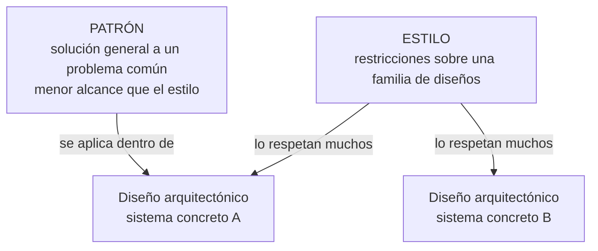
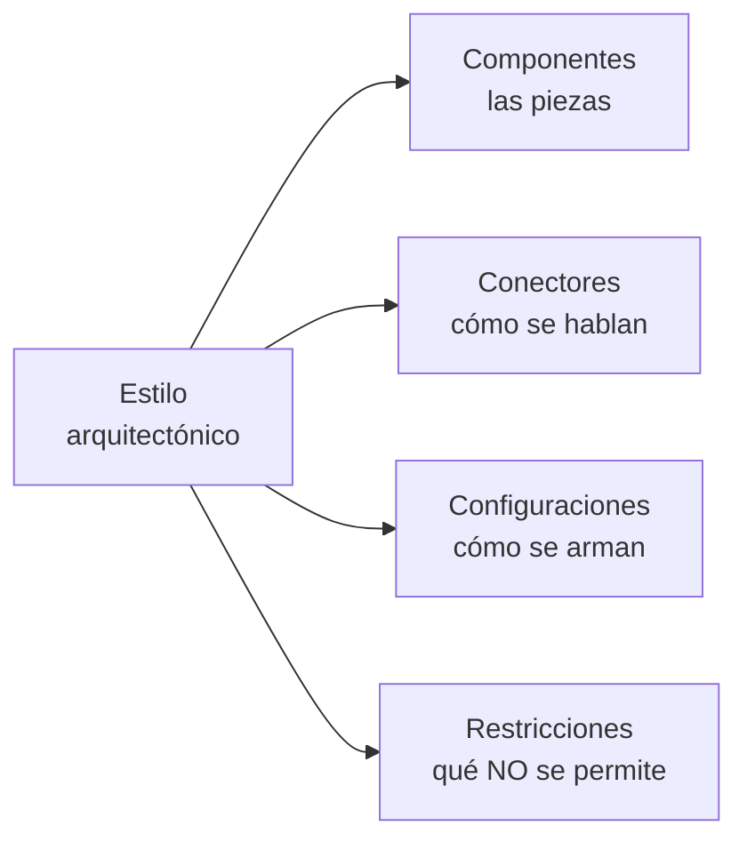
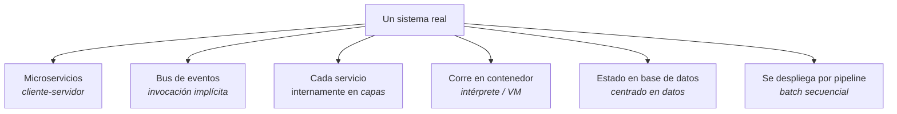
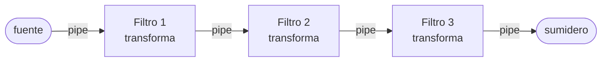
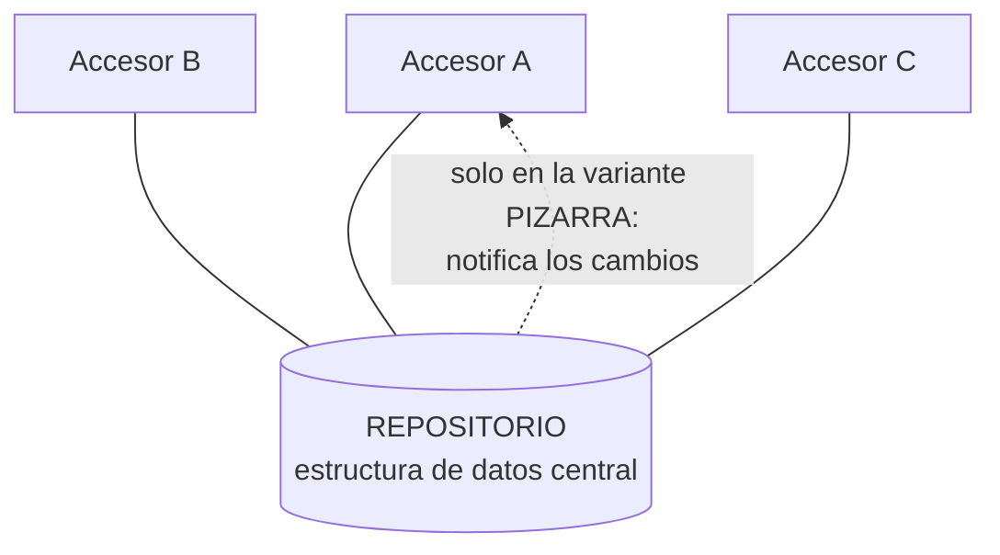
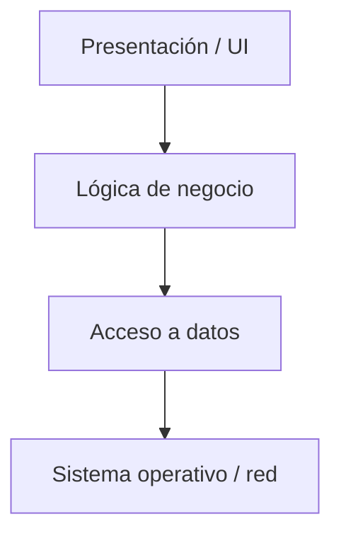
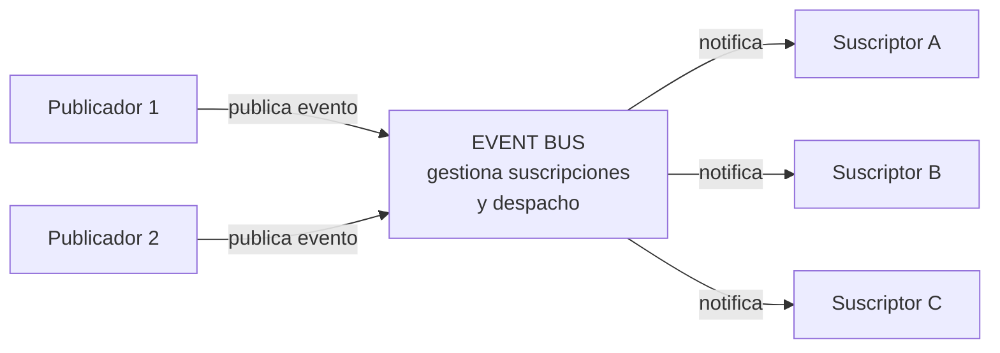
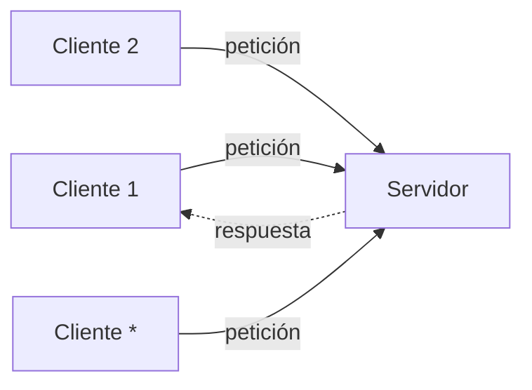

# Estilos arquitectónicos

> [!info] Cómo está armada esta nota
> - **Parte I — NÚCLEO (clase).** Las definiciones de *diseño*, *estilo* y *patrón* arquitectónico
>   de la diapositiva "Estilos y Patrones Arquitectónicos", y los estilos que la catedrática
>   desarrolló: monolítica, N-capas, 2 capas (cliente-servidor) y la nube. Es lo que se evalúa.
> - **Parte II — COMPLEMENTO.** El catálogo de Reynoso, el SAIP y la guía de estudio, que existía
>   antes de que llegara la clase. Sirve para **entender** los estilos que ella solo nombró (centrado
>   en datos, flujo de datos, eventos…), **nunca** para contradecir la Parte I.
>
> Si algo de la Parte II choca con la Parte I, **manda la clase**. Los choques que ya se detectaron
> están señalados en su lugar (capa vs. nivel, patrón vs. estilo).

---

# Parte I — Lo que dio la clase (NÚCLEO)

## 1. Diseño, estilo y patrón: las tres definiciones

La diapositiva *"Estilos y Patrones Arquitectónicos"* define tres términos que se confunden. Textual:

> Un **diseño arquitectónico** se refiere a la arquitectura de un sistema concreto.

> Un **estilo arquitectónico** establece las restricciones sobre la arquitectura de una **familia de
> diseños arquitectónicos**. Algunos ejemplos: centrado en datos, flujo de datos, llamar y regresar,
> capas.

> Un **patrón arquitectónico** es una solución general a un problema común del diseño
> arquitectónico. **Menor alcance que los estilos arquitectónicos.**

![[adjuntos/capturas-clase-U2/estilos/definiciones-diseno-estilo-patron.png]]

Puestos lado a lado, la diferencia es **de qué habla cada uno**:

| Término | Habla de… | Alcance | Ejemplo con material de clase |
|---|---|---|---|
| **Diseño arquitectónico** | **un** sistema concreto | uno solo | el diagrama de componentes de la clínica veterinaria (ver [[Arquitectura en capas]]) |
| **Estilo arquitectónico** | una **familia** de diseños: les impone **restricciones** | el mayor | *capas*, *centrado en datos*, *flujo de datos*, *llamar y regresar* |
| **Patrón arquitectónico** | un **problema común** dentro del diseño, y su solución general | **menor que el estilo** | — (la diapositiva no da ejemplo) |

Esquema propio (no es un diagrama de la clase) de cómo se encadenan:

> [!warning] Las dos trampas de esta diapositiva
> 1. **Estilo ≠ diseño.** "En capas" no es la arquitectura de nada: es una restricción que cumplen
>    muchas arquitecturas. *La arquitectura de la clínica veterinaria* sí es un diseño.
> 2. **Patrón arquitectónico ≠ patrón de diseño**, y **patrón ≠ estilo**. Para ella el patrón tiene
>    **menor alcance** que el estilo: no son sinónimos. (El SAIP llama *patrones* a capas o
>    cliente-servidor; en esta clase esos son **estilos**. Ver el choque señalado en
>    [[Tácticas y patrones arquitectónicos]] §2.)

**Regla para el examen:** *diseño = un sistema · estilo = una familia (restricciones) · patrón = un
problema (menor alcance que el estilo).*

### Los dos tipos de patrón (capturas_U2_F2, 0)

La diapositiva que abre el bloque *"Patrones / Estilos Arquitectónicos"* ordena el tema así —textual:

> 1. **Tipos de Patrones**
>    - Patrones de diseño
>    - Patrones arquitectónicos
> 2. **Estilos Arquitectónicos**

![[adjuntos/capturas-clase-U2/estilos/patrones-estilos-tipos-de-patrones.png]]

El dibujo, leído a resolución completa:

| Elemento | Qué es |
|---|---|
| `Component` | un componente (caja con dos rectángulos en el borde izquierdo, a modo de puertos/interfaces) |
| `<subcomponent> Singleton`, `<subcomponent> Composite`, `<subcomponent> Factory Method` | tres **patrones de diseño** (GoF) dibujados como subcomponentes **dentro** del componente |
| flechas **punteadas** | salen de `Composite` y apuntan a `Singleton` y a `Factory Method` (dependencias) |

Lo que se lee de ahí *(lectura nuestra, la diapositiva no lo dice con palabras)*: los **patrones de
diseño** viven **dentro de un componente**, a nivel de clases; los **patrones arquitectónicos** y los
**estilos** operan sobre la organización de los componentes entre sí. Es la misma escala de alcance
de la definición de arriba: **patrón de diseño < patrón arquitectónico < estilo**. Ver §5 y
[[Tácticas y patrones arquitectónicos]].

## 2. Los estilos que mostró la clase

La diapositiva de definiciones **nombra** cuatro estilos de ejemplo; después la catedrática
**desarrolló** otros con diapositivas propias. Conviene distinguir los dos grupos:

| Estilo | ¿Cómo aparece en clase? | Nota |
|---|---|---|
| **Monolítica** | desarrollada: definición + tabla de 7 características + caso Amazon Prime Video | [[Arquitectura monolítica]] |
| **N-Capas** (multinivel) | desarrollada: definición + diagrama presentación / negocio / datos + ejemplo de componentes | [[Arquitectura en capas]] |
| **2 capas — modelo cliente-servidor** | desarrollada: petición/respuesta + ejemplo smartphone/smartwatch | [[Arquitectura en capas]] §3 |
| **En la nube** (cloud computing, N-niveles en la nube) | desarrollada: definición + dos arquitecturas de referencia (AWS y Azure) | [[Arquitectura en la nube]] |
| **Centrado en datos** | solo **nombrada** como ejemplo en la definición de estilo | Parte II (complemento) |
| **Flujo de datos** | solo **nombrada** | Parte II (complemento) |
| **Llamar y regresar** | solo **nombrada** — ojo con el nombre: la diapositiva dice *"llamar y regresar"*; el programa dice *"llamada y retorno"* | Parte II (complemento) |
| **Capas** | nombrada **y** desarrollada (es la N-Capas de arriba) | [[Arquitectura en capas]] |

> [!note] Monolítica vs. capas: no se excluyen
> En la diapositiva del monolito los tres bloques son **Interfaz de usuario**, **Lógica del
> negocio** y **Capa de acceso a los datos**: las mismas capas de N-Capas. Lo que distingue al
> monolito no es la ausencia de capas sino que **todo vive en una base de código única** y se
> despliega junto. Un monolito puede estar bien estratificado por dentro.

## 3. Qué del punto 1.9 del programa cubrió la clase

El programa, punto 1.9: *arquitectura candidata, arquitectura de referencia, diseño on premise vs
cloud, y el catálogo: cliente-servidor, centrada en datos, en capas, flujo de datos, llamada y
retorno, basada en eventos.* Contra las capturas de la unidad 2:

| Punto del programa | ¿Lo cubrió la clase? | Dónde |
|---|---|---|
| **Cliente-servidor** | ✅ sí, como *"Arquitectura de 2 capas — Modelo Cliente Servidor"* | [[Arquitectura en capas]] §3 |
| **En capas** | ✅ sí, como *"Arquitectura N-Capas"* y *"Arquitectura: Capas"* | [[Arquitectura en capas]] |
| **Diseño cloud** | ✅ sí: Cloud Computing, Prime Video en AWS, N-niveles en la nube (Azure) | [[Arquitectura en la nube]] |
| **Diseño on premise** | ⚠️ **no hay diapositiva propia**; queda implícito por contraste con la nube | [[Arquitectura en la nube]] §4 |
| **Centrada en datos** | ⚠️ solo **nombrada** en la definición de estilo | Parte II |
| **Flujo de datos** | ⚠️ solo **nombrada** | Parte II |
| **Llamada y retorno** | ⚠️ solo **nombrada**, como *"llamar y regresar"* | Parte II |
| **Basada en eventos** | ❌ **no aparece** en estas capturas | Parte II |
| **Arquitectura candidata** | ❌ no aparece | §10 (complemento) |
| **Arquitectura de referencia** | ❌ no con ese nombre (los diagramas de AWS y Azure **son** arquitecturas de referencia, pero ella no usa el término) | §10 (complemento) |
| *(no está en el programa)* **Monolítica** | ✅ desarrollada | [[Arquitectura monolítica]] |

---

# Parte II — COMPLEMENTO (Reynoso, SAIP, guía de estudio)

> [!warning] Todo lo que sigue es COMPLEMENTO
> Viene de **Reynoso**, *Introducción a la Arquitectura de Software* (`00-Fuentes/lecturas/`), del
> **SAIP 4ª ed.** (Bass, Clements, Kazman — bibliografía oficial) y de la **Guía de estudio**
> (`Unidad_1/Guia_Arquitectura_Software.pdf`, Parte IX). Sirve para entender los estilos que la
> clase solo nombró. **No se cita en lugar de la Parte I.**

## 4. Qué es un estilo según Reynoso

Reynoso, textual, apoyándose en el texto fundacional de Perry y Wolf:

> Un estilo es un **concepto descriptivo** que define una forma de articulación u organización
> arquitectónica. El conjunto de los estilos **cataloga las formas básicas posibles** de estructuras
> de software, mientras que las formas complejas se articulan mediante **composición** de los
> estilos fundamentales.

Y los cuatro ingredientes con que se describe un estilo:

> Los estilos conjugan **elementos** (o "componentes", como se los llama aquí), **conectores**,
> **configuraciones** y **restricciones**.

El detalle que Reynoso subraya: al poner los **conectores** como elemento de primera clase, el
concepto de estilo se sitúa en un orden de discurso que **el modelado orientado a objetos y UML no
cubren satisfactoriamente**. Esa es la razón de fondo por la que existen los ADLs (lenguajes de
descripción arquitectónica) y por la que un diagrama de clases no alcanza para describir una
arquitectura.

## 5. Estilo ≠ patrón de diseño

La diferencia más preguntable, y es de escala:

| | Cantidad | Nivel |
|---|---|---|
| **Patrones de diseño** | **Centenares** (las 23 fichas de GoF son solo un catálogo) | Estructura interna de un grupo de clases |
| **Estilos arquitectónicos** | **Seis o siete clases** fundamentales y unos **veinte ejemplares** como máximo | Organización del sistema completo |

Reynoso lo remarca: *"es digno de señalarse el empeño por subsumir todas las formas existentes de
aplicaciones en un conjunto de dimensiones tan modestas"*.

Esa modestia es deliberada y es la misma idea del "menos es más" que ya aparece en
[[Beneficios de la arquitectura de software]]: restringir el vocabulario de alternativas es una
ventaja, no una limitación.

## 6. Los estilos se componen — el rasgo más importante del catálogo

Reynoso lo dice dos veces, y es lo que más se equivoca en un examen:

> Las arquitecturas complejas o compuestas resultan del **agregado o la composición** de estilos
> más básicos.

**Ningún sistema real "es de un estilo".** Los sistemas reales son mezclas. Ejemplo del material:

Cinco o seis estilos en un solo sistema, y eso es **lo normal, no la excepción**.

---

## 7. El catálogo: los seis del programa

El programa lista seis estilos. Así se corresponden con el catálogo del material:

| Estilo del programa | En el catálogo | ¿Material disponible? |
|---|---|---|
| **Cliente-Servidor** | Cliente-servidor (+ peer-to-peer) | ✅ SAIP como patrón |
| **Centrada en Datos** | Repositorio y pizarra | ✅ ficha completa |
| **En o por capas** | Jerárquicos: capas y microkernel | ✅ SAIP, el más desarrollado |
| **Centrada en el flujo de datos** | Tubería y filtro, batch secuencial | ✅ ficha completa |
| **Basada en eventos** | Invocación implícita: publish-subscribe y broker | ✅ SAIP como patrón |
| **Llamada y retorno** | — | ⚠️ **no está con ese nombre** en el complemento; la clase lo nombra *"llamar y regresar"* (ver abajo) |

> [!note] Sobre "llamada y retorno"
> La **clase sí lo nombra**, como *"llamar y regresar"*, entre los ejemplos de estilo (§1), pero
> **no lo desarrolla**. En el complemento el nombre **no aparece** ni en Reynoso ni en el SAIP ni en
> la guía. Es el nombre de familia de
> la taxonomía clásica (estilo Pressman), que agrupa los estilos donde el control se transfiere por
> **invocación y vuelve**: programa principal y subrutina, orientado a objetos, y llamada a
> procedimiento remoto (RPC).
>
> Bajo esa taxonomía, **capas y cliente-servidor suelen clasificarse dentro de "llamada y
> retorno"**, porque en los dos el que llama espera la respuesta. Se contrapone a la **invocación
> implícita** (basada en eventos), donde el emisor no espera a nadie.
>
> Ojo: la clase pone **capas** y **llamar y regresar** como ejemplos **separados** en la misma
> lista. Si para ella capas estuviera dentro de llamar y regresar, no los listaría a la par.
> **Preguntalo** antes de afirmar esa clasificación en un examen.

Además, el material trae dos estilos que el programa no lista pero que Reynoso sí incluye entre los
seis típicos: **peer-to-peer** e **intérprete / máquina virtual**.

---

## 8. Las fichas

### Centrada en el flujo de datos: tubería y filtro

| | |
|---|---|
| **Componentes** | **Filtros**: transforman un flujo de entrada en uno de salida, **de forma incremental** (empiezan a producir antes de terminar de consumir). Casos especiales: *fuente* (solo produce) y *sumidero* (solo consume) |
| **Conectores** | **Tuberías** (*pipes*): flujos unidireccionales que **preservan el orden** y no transforman nada |
| **Restricciones** | Los filtros **no comparten estado ni conocen la identidad de sus vecinos**; todo pasa por las tuberías. La corrección no debe depender del orden en que los filtros procesan |
| **Cuándo** | El problema es una serie de transformaciones sucesivas sobre datos que fluyen, sin interacción del usuario en el medio |
| **Favorece** | Modificabilidad y reutilización (se reordenan y recombinan), performance por **paralelismo**, testabilidad (cada filtro aislado), comprensibilidad |
| **Sacrifica** | **Interactividad**, estado compartido, latencia por etapa (cada frontera serializa), manejo de errores pobre |
| **Ejemplos** | Los shells de UNIX (`ps \| grep java \| wc -l`), las fases de un compilador, procesamiento de imágenes |

**Batch secuencial** es el caso degenerado: cada etapa espera a que la anterior **termine del todo** y pasa archivos completos. Sin concurrencia. Es el estilo de los procesos nocturnos de mainframe — y también, señala la guía, el de un *pipeline* de despliegue con *quality gates*.

### Centrada en datos: repositorio y pizarra

| | |
|---|---|
| **Componentes** | Un **almacén central** (base de datos, repositorio, pizarra) más **accesores o agentes** independientes |
| **Conectores** | Consultas y actualizaciones, típicamente **transacciones**. En la pizarra se suma la **notificación** del almacén hacia los agentes |
| **Restricciones** | Los accesores solo interactúan **a través del almacén**, nunca entre sí. El **esquema de datos es el contrato** compartido |
| **Cuándo** | Datos de larga vida que muchos componentes leen y modifican, con requisitos de integridad; o cuando el orden de las contribuciones no se puede predeterminar (pizarra) |
| **Favorece** | Integrabilidad y modificabilidad (agregar un accesor no toca los existentes), integridad centralizada, escalabilidad de lectura con réplicas |
| **Sacrifica** | Performance y disponibilidad (el almacén es **cuello de botella y punto único de falla**), **acoplamiento oculto** por el esquema, dificultad de distribución |
| **Ejemplos** | Sistemas de gestión con base central, IDEs con modelo compartido, el *object store* de Git; y HEARSAY-II (reconocimiento del habla) como caso canónico de pizarra |

La diferencia entre las dos variantes es **quién tiene la iniciativa**: en el repositorio, los accesores; en la pizarra, el propio almacén al notificar. La pizarra es, de hecho, repositorio **+** invocación implícita: un ejemplo de composición de estilos.

### En o por capas

| | |
|---|---|
| **Componentes** | **Capas**: agrupaciones cohesivas de módulos que ofrecen servicios por una **interfaz pública** |
| **Relación** | "Tiene permitido usar", **unidireccional y estrictamente ordenada** |
| **Restricciones** | Partición **completa** del software; **nunca** usos hacia arriba; normalmente solo la capa inmediata inferior. Usar una no adyacente es ***layer bridging*** |
| **Favorece** | Modificabilidad (cambiar una capa sin afectar las de arriba si la interfaz no cambia), **portabilidad** (la capa baja aísla el SO), testabilidad de abajo hacia arriba |
| **Sacrifica** | **Performance** (una llamada del tope puede atravesar muchas capas); si la estratificación está mal diseñada, estorba; mucho *bridging* destruye la portabilidad que justificaba el estilo |
| **Ejemplos** | El modelo **OSI**, UNIX System V, las arquitecturas de 3 capas. **En clase:** [[Arquitectura en capas]] |

Origen: el **THE de Dijkstra (1968)** — capas que se comunican solo con las adyacentes y se superponen "como capas de cebolla". Cada capa es una *máquina virtual* con interfaz gestionada, y de ahí sale la portabilidad.

> [!important] Capa ≠ tier — la distinción del complemento, que la clase NO hace
> Una **capa** es una partición del **código**: vive en la estructura de **módulos** (visión estática).
> Un **tier** es una partición del **despliegue**: vive en la estructura de **asignación**.
>
> Se pueden tener tres capas en un solo tier (un monolito bien estratificado) o una capa repartida
> en varios tiers. Ver [[Categorías de estructuras]].
>
> **Desfase con la clase:** la catedrática usa *capa* y *nivel* **como sinónimos** — define N-Capas
> como *"arquitecturas multinivel o Programación por capas"*, llama *"2 capas"* al modelo
> cliente-servidor (que son dos máquinas) y *"N-niveles"* a los *tiers* de Azure. En el examen usá
> **su vocabulario**, pero sabé que la distinción existe. Detalle en [[Arquitectura en capas]] §4.

**Microkernel / plug-in** es la otra forma del estilo jerárquico: un **núcleo** con mecanismos mínimos y **plug-ins** que aportan la funcionalidad por interfaces fijas. Favorece extensibilidad controlada y evolución independiente, y habilita **dos mercados** (el del núcleo y el de los plug-ins). Sacrifica **seguridad**: los plug-ins pueden venir de terceros. Ejemplos: micro-kernels de SO, VS Code, los navegadores, R.

La diferencia con capas: en **capas** la jerarquía es de **abstracción** (cada nivel oculta el de abajo); en **microkernel** es de **extensión** (el centro es mínimo y la funcionalidad se enchufa).

### Basada en eventos: publish-subscribe

| | |
|---|---|
| **Componentes** | **Publicadores** (emiten), **suscriptores** (se registran y reciben) y el **bus de eventos**, parte de la infraestructura de runtime |
| **Conectores** | Mensajes **asíncronos** sobre eventos o *topics*. Un conector de pub-sub puede tener un número **arbitrario** de publicadores y suscriptores |
| **Restricción clave** | El publicador **no conoce a los suscriptores**; los suscriptores solo conocen **tipos de mensaje** |
| **Favorece** | Modificabilidad máxima e integrabilidad: agregar un suscriptor = registrarse en un evento, **cero cambios en el publicador** |
| **Sacrifica** | **Determinismo y trazabilidad del control**: nadie sabe cuánto tarda en llegar el mensaje ni en qué orden se invocan los suscriptores. Latencia y cifrado extremo a extremo |

El rasgo definitorio y el origen del nombre: el emisor **no invoca a nadie directamente** — anuncia un evento y la infraestructura decide a quién le llega. La invocación de los suscriptores es **implícita**.

### Cliente-servidor

> La clase lo dio como **arquitectura de 2 capas**: ver [[Arquitectura en capas]] §3. Lo que sigue es complemento.

| | |
|---|---|
| **Componentes** | **Servidores** que proveen servicios y **clientes** que los consumen. Puede haber **múltiples instancias** del servidor |
| **Conectores** | **Petición-respuesta** por protocolo acordado, **iniciada siempre por el cliente**, precedida por un **descubrimiento** para ubicar al servidor |
| **Restricciones** | La comunicación la inicia el cliente; **los clientes no se comunican entre sí**. Si el servidor guarda estado del cliente, cada petición debe identificarlo y hace falta un fin de sesión o *timeout* |
| **Favorece** | Bajo acoplamiento servidor-clientes y **nulo entre clientes**; escalabilidad; evolución independiente; la interacción con el usuario queda aislada en el cliente |
| **Sacrifica** | Performance impredecible (va por red); el servidor es **cuello de botella** y foco de disponibilidad; seguridad (hay que proveer confidencialidad e integridad explícitamente) |
| **Descendientes** | **n-tiers**, **SOA** y **microservicios** |

> [!warning] Microservicios NO es "cliente-servidor moderno"
> El SAIP los distingue: **SOA** supone servicios **heterogéneos y de organizaciones distintas**,
> reutilizables y con SLA. **Microservicios** componen **un solo sistema de una sola organización**,
> con equipos pequeños ("regla de las dos pizzas"), dependencias acíclicas y la **prohibición
> estricta** de cualquier comunicación que no sea por mensajes: sin enlace directo, sin leer el
> almacén de datos de otro equipo, sin memoria compartida, sin puertas traseras.

Esto conecta con la **unidad 5 del laboratorio** (arquitecturas orientadas al servicio).

**Peer-to-peer** es el simétrico: **pares** que actúan como cliente y servidor a la vez, sin coordinador central, con *churn* (cualquiera entra y sale). Favorece escalabilidad sin centro y resiliencia (no hay punto único de falla). Sacrifica consistencia, seguridad y administrabilidad. Ejemplos: BitTorrent, blockchain, Gnutella.

### Intérprete / máquina virtual

En vez de ejecutar directamente sobre el hardware, se construye una **máquina abstracta en software** que ejecuta un programa expresado en un lenguaje propio. Es el estilo que hace posible "escribí una vez, corré en cualquier parte".

**Cuatro elementos**: el motor de interpretación, la representación del programa (bytecode o AST), el estado del programa y el estado del propio intérprete.

Favorece portabilidad y modificabilidad **en runtime**. Sacrifica performance y depurabilidad.

---

## 9. Tabla comparativa

Reconstruida a partir de las fichas de arriba:

| Estilo | Favorece | Sacrifica |
|---|---|---|
| Tubería y filtro | Modificabilidad · reutilización · paralelismo | Interactividad · latencia por etapa · estado compartido |
| Batch secuencial | Simplicidad · repetibilidad | Latencia total · uso de recursos |
| Repositorio | Integrabilidad · integridad de datos | Performance (cuello de botella) · acoplamiento por el esquema |
| Pizarra | Extensibilidad con orden de contribución impredecible | Determinismo · trazabilidad del control |
| Capas | Modificabilidad · **portabilidad** · testabilidad | Performance (atravesar niveles) |
| Microkernel | Extensibilidad · evolución independiente | **Seguridad** (código de terceros) |
| Publish-subscribe | Modificabilidad máxima · integrabilidad | Latencia · determinismo · cifrado E2E |
| Cliente-servidor | Escalabilidad · servicios compartidos · evolución independiente | Performance por red · disponibilidad del servidor |
| Peer-to-peer | Escalabilidad sin centro · resiliencia | Consistencia · seguridad · administrabilidad |
| Intérprete / VM | Portabilidad · modificabilidad en runtime | Performance · depurabilidad |

**La lectura correcta de esta tabla:** un estilo no es bueno ni malo — **cambia un atributo de calidad por otro**. Elegir estilo es elegir qué sacrificar, y eso solo se puede decidir contra requerimientos concretos. Es exactamente lo que documenta la matriz de la sección de arquitectura en [[Matriz de trazabilidad de requisitos]].

---

## 10. Arquitectura candidata, de referencia y on premise vs cloud

> [!warning] Lo más flojo de esta nota
> El programa lista **"Arquitectura Candidata"**, **"La Arquitectura de Referencia"** y
> **"Diseño Arquitectónico: on premise, cloud"** dentro de 1.9. De los tres, la clase solo dio
> **cloud** (ver [[Arquitectura en la nube]]); *candidata* y *de referencia* **no aparecen** en las
> capturas de la unidad 2. Lo que sigue es complemento. **Confirmalo con ella.**

**Arquitectura de referencia.** Es lo mejor documentado de los tres. El SAIP la trata como una de
las *categorías de concepto de diseño* que se pueden elegir, junto con tácticas y patrones. Lo que
dice sobre cómo usarla:

> En el caso de las arquitecturas de referencia, **instanciar** típicamente significa que se realiza
> algún tipo de **customización**: agregar o quitar elementos que son parte de la estructura definida
> por la arquitectura de referencia.

Su ejemplo: si diseñás una aplicación web que necesita comunicarse con una aplicación externa para
manejar pagos, probablemente tengas que **agregar un componente de integración** al lado de los
*tiers* tradicionales de presentación, negocio y datos.

Los diagramas de AWS y Azure que mostró la clase (en [[Arquitectura en la nube]]) son justamente
arquitecturas de referencia de proveedores, aunque ella no use el término.

O sea: una arquitectura de referencia es una **estructura preestablecida para un dominio** (una app
web, un sistema de comercio electrónico) que se toma como punto de partida y se adapta. No es un
estilo: es más concreta que un estilo y menos que un diseño.

**Arquitectura candidata.** No aparece en el material local. En el uso corriente (RUP) es la
**primera versión de la arquitectura** producida en la fase de elaboración: una propuesta todavía no
validada, que se somete a evaluación y de la que puede haber varias en competencia. Conecta con el
paso 3 del [[Proceso de diseño arquitectónico]] —"se analizan alternativas de estilos o patrones
arquitectónicos"— y con la *evaluación de la arquitectura* de la unidad 3.

**On premise vs cloud.** La clase dio la parte **cloud** ([[Arquitectura en la nube]]); el
contraste con *on premise* no tiene diapositiva. Es la decisión de dónde
reside la infraestructura, y por lo tanto es una decisión de la **estructura de despliegue** (ver
[[Diagrama de despliegue]]), no de estilo: el mismo estilo en capas puede desplegarse en un
servidor propio o en la nube, y lo que cambia son los atributos de calidad alcanzables.

---

## 11. Trampas típicas

| Trampa | Lo correcto |
|---|---|
| Confundir **diseño** con **estilo** (clase) | Diseño = un sistema concreto. Estilo = restricciones sobre una **familia** de diseños |
| Tratar **patrón** y **estilo** como sinónimos (clase) | Para ella el patrón es una solución a un problema común, de **menor alcance** que el estilo |
| Creer que monolítico = "sin capas" (clase) | El monolito de la diapositiva tiene UI, lógica y acceso a datos: lo que lo define es la **base de código única** |
| "Este sistema es de estilo X" | Los sistemas reales **combinan** estilos. Nombrar uno solo casi siempre es incompleto |
| Confundir **estilo** con **patrón de diseño** | Estilos: 6-7 clases, sistema completo. Patrones de diseño: centenares, grupos de clases |
| Confundir **capa** con **tier** (complemento) | Capa = partición del código. Tier = partición del despliegue. **La clase los usa como sinónimos**: en el examen, su vocabulario |
| Decir que un estilo "es mejor" | Cada estilo **canjea** un atributo de calidad por otro. Sin requerimientos no hay mejor |
| Llamar "microservicios" a cualquier cliente-servidor | Microservicios: un sistema, una organización, solo mensajes, dependencias acíclicas |
| Creer que **pizarra** = repositorio | La pizarra **notifica**: es repositorio + invocación implícita |
| Olvidar que **capas prohíbe usar hacia arriba** | Es la restricción que define el estilo; saltear capas es *layer bridging* |

---

## Notas relacionadas

- [[Arquitectura monolítica]] — estilo desarrollado en clase: base de código única
- [[Arquitectura en capas]] — N-Capas y 2 capas (cliente-servidor), con el ejemplo de la clínica veterinaria
- [[Arquitectura en la nube]] — cloud computing, Prime Video en AWS y N-niveles en Azure
- [[Tácticas y patrones arquitectónicos]] — táctica < patrón < estilo, y el choque de nomenclatura con el SAIP
- [[Programa oficial del curso]] — el punto 1.9
- [[Proceso de diseño arquitectónico]] — el paso 3 es "analizar alternativas de estilos o patrones"
- [[Estructuras y vistas arquitectónicas]] y [[Categorías de estructuras]] — dónde vive una capa y dónde un tier
- [[Diagrama de despliegue]] — la estructura de asignación
- [[Atributos de calidad]] — lo que cada estilo favorece o sacrifica
- [[Matriz de trazabilidad de requisitos]] — cómo se justifica la elección de un estilo

## Preguntas de repaso

1. Según la clase, ¿qué diferencia hay entre **diseño**, **estilo** y **patrón** arquitectónico? ¿Cuál tiene mayor alcance?
2. ¿Qué cuatro estilos da la diapositiva como ejemplo, y cuáles de ellos desarrolló después la catedrática?
3. ¿Por qué el monolito de la clase no contradice al estilo en capas?
4. ¿Qué partes del punto 1.9 del programa **no** aparecieron en clase?
5. (Complemento) ¿Cuál es la restricción que **define** el estilo en capas, y cómo se llama violarla?
6. (Complemento) Diferencia entre **capa** y **tier**. ¿La hace la clase?
7. (Complemento) ¿Qué diferencia a la **pizarra** del **repositorio**? ¿Qué se gana y se pierde con publish-subscribe?
8. (Complemento) ¿Por qué no se puede decir que un estilo es mejor que otro?
