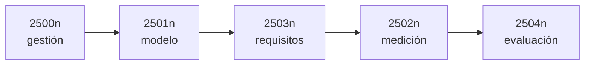

# Familia de normas ISO/IEC 25000

## 1. Qué es

La lámina la presenta como **una familia de normas**, partida en **cinco divisiones**. Cada una se
nombra con el prefijo y una **n** (cualquier dígito), porque agrupa varias normas:

| División | Para qué |
|---|---|
| **ISO/IEC 2500n** | **gestión** de la calidad *(al centro del dibujo)* |
| **ISO/IEC 2501n** | el **modelo** de calidad |
| **ISO/IEC 2502n** | la **medición** de calidad |
| **ISO/IEC 2503n** | los **requisitos** de calidad |
| **ISO/IEC 2504n** | la **evaluación** de calidad |

![[adjuntos/capturas-clase-U3/iso-9126/u3f1-15-familia-iso-25000.png]]

**Regla memorizable**: *0 gestiona, 1 modela, 2 mide, 3 pide, 4 evalúa.*

## 2. Para qué existe

Es la respuesta al tercer punto de [[Norma ISO 9126]] §2: ISO 9126 entregaba el modelo **y** los
procesos de evaluación; la familia 25000 **separa** esas tareas en divisiones. Por eso la catedrática
habló de *"pensamiento ISO, familia de normas"* cuando se le preguntó qué modelo de calidad usar en el
Caso Harley-Davidson.

## 3. La trampa

**«ISO 25000» no es el modelo de calidad.** Es la familia. El modelo vive en la división **2501n**:
la norma concreta es la **ISO/IEC 25010** *(complemento: el número no está en la lámina)*, que sucede
a ISO 9126 con **ocho** características — adecuación funcional, eficiencia de desempeño,
compatibilidad, usabilidad, fiabilidad, **seguridad**, mantenibilidad y portabilidad.

Si una respuesta dice *"usamos ISO 25000"*, la pregunta siguiente es *¿qué norma de la familia?*

## 4. Cómo se conecta

*(El orden del flujo es una lectura propia: se elige el modelo, se piden requisitos con él, se miden
y se evalúa. La lámina solo dibuja los cinco cuadros.)*

- [[Norma ISO 9126]] — la norma que la clase desarrolla en detalle
- [[Calidad del software]] — la definición de ISO 9000:2000
- [[Atributos de calidad]] — las otras listas de atributos

## Preguntas de repaso

1. ¿Cuántas divisiones tiene la familia ISO/IEC 25000 según la lámina? ¿Cuál está al centro?
2. ¿Qué división trata la **medición** y cuál los **requisitos**?
3. ¿Por qué es incorrecto decir que *ISO 25000* es un modelo de calidad?
4. ¿Qué agrega la 25010 respecto de las seis características de la 9126?
