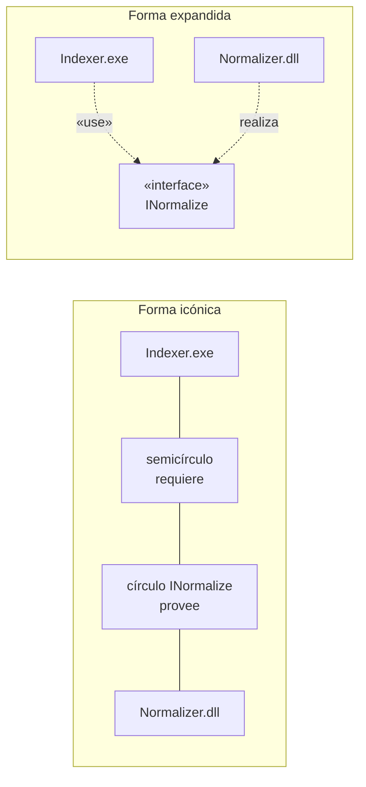

# Interfaces de componentes

La interfaz es **lo único que un componente muestra hacia afuera**: los servicios que ofrece y los
que necesita. Es lo que hace que un [[Diagrama de componentes]] sirva para algo, porque permite
**cambiar un componente por otro** sin tocar a los que lo usan.

---

## 1. Qué es

### La definición general de interfaz (capturas 26 y 27)

> **INTERFAZ:**
> • Conexión o frontera común entre dos aparatos o sistemas independientes
> • Conexión física o lógica entre una computadora y el usuario, un dispositivo periférico o un enlace de comunicaciones

![[adjuntos/capturas-clase-U2/componentes/realizacion-interfaz-plantilla.png]]

En el diagrama de clases, la interfaz es una caja con el estereotipo **`«Interfaz»`** cuyo
compartimento de operaciones lleva las *"Operaciones que la clase pondrá a disposición de otras
clases (+)"* (captura 26). El detalle de cómo una clase **realiza** una interfaz está en
[[Relaciones y dependencias en UML]] § *Realización con interfaz*.

### Las interfaces del componente (captura 30)

> **Interfaces**
> Ilustran las **dependencias** que un componente de sw tiene con otro componente
> • Permite que el componente sea **reusable y reemplazable**
> • Dos tipos
> • **Provides (provista)**
> • **Required (requerida)**

![[adjuntos/capturas-clase-U2/componentes/interfaces-provista-requerida.png]]

Y el PDF del TEMA 5 (pág. 2), textual:

> **Interfaces**: describen los servicios proporcionados o requeridos por el componente y suelen
> incluir prototipo de métodos, descripción funcional, limitaciones de uso, etc. Las **interfaces de
> salida (o proporcionadas)** detallan los servicios que el componente proporciona, mientras que las
> **interfaces de entrada (o requeridas)** describen los servicios que el componente necesita para
> poder realizar su función.

---

## 2. Para qué existe

| Sin interfaces | Con interfaces |
|---|---|
| El componente A llama directo a las clases de B: si B cambia, A se rompe | A solo conoce la interfaz: B se puede **reemplazar** por cualquier otro que la provea |
| No se ve qué necesita cada pieza para funcionar | Las **requeridas** dicen exactamente de qué depende cada componente |
| Reusar B en otro sistema obliga a llevarse sus detalles | B se **reusa** con solo proveer la misma interfaz |

Eso es lo que la captura 30 resume en *"reusable y reemplazable"*.

---

## 3. Los dos tipos, con sus cuatro nombres

El material usa **cuatro nombres** para las dos mismas cosas. No son conceptos distintos:

| Tipo | Captura 30 | Captura 33 | PDF TEMA 5 | Símbolo | Significa |
|---|---|---|---|---|---|
| **Provista** | *Provides (provista)* | *Interfaces proporcionadas* | *interfaz de salida (o proporcionada)* | **círculo** completo — *lollipop* | "yo **ofrezco** este servicio" |
| **Requerida** | *Required (requerida)* | *Interfaces requeridas* | *interfaz de entrada (o requerida)* | **semicírculo** — *socket* | "yo **necesito** este servicio" |

> [!warning] La trampa del PDF: "salida" y "entrada"
> Intuitivamente uno diría que "entrada" es por donde **entran** los pedidos, o sea lo que ofrezco.
> El PDF dice lo **contrario**: **entrada = requerida**, **salida = proporcionada**. Pensalo como
> servicios que *salen* del componente hacia los demás (provista) y servicios que *entran* desde otro
> componente (requerida). Para no confundirte, en la entrega usá **provista / requerida**, que es lo
> de la diapositiva.

### El ejemplo `Pedido` (captura 33 — notación icónica)

![[adjuntos/capturas-clase-U2/componentes/interfaces-requeridas-proporcionadas-pedido.png]]

Leído con zoom:

| Interfaz | Símbolo | Tipo |
|---|---|---|
| `AsignacionItem` | círculo | **proporcionada** |
| `Seguimiento` | círculo | **proporcionada** |
| `Persona` | semicírculo | **requerida** |
| `Factura` | semicírculo | **requerida** |
| `ItemPedido` | semicírculo (debajo del componente) | **requerida** — el globo *"Interfaces requeridas"* apunta solo a `Factura`, pero el símbolo de `ItemPedido` es el mismo |

El componente es `«component» Pedido`, en notación UML 2.x.

---

## 4. Relación componente–interfaz: implementar o usar

La diapositiva, textual (captura 31):

> La **relación** entre componente e interfaz es importante
> • Unos componentes **implementan** las interfaces y otros **acceden a los servicios** proporcionados por esas interfaces
> • Estas relaciones se pueden mostrar en forma **icónica** o **expandida**:

![[adjuntos/capturas-clase-U2/componentes/relacion-componente-interfaz-controlestudiante.png]]

Hay **dos** relaciones posibles, y cada componente está de un lado:

| Relación | Quién | Nombre en la captura 54 | Forma icónica | Forma expandida |
|---|---|---|---|---|
| **Implementar** la interfaz | el que la **provee** | *realization dependency* | línea **llena** hasta el **círculo** | **punteada** con **triángulo hueco** hacia la caja `«interface»` |
| **Usar** la interfaz | el que la **requiere** | *usage dependency* | **semicírculo**, o flecha **punteada** hacia el círculo | **punteada** con punta **abierta** y `«use»` hacia la caja `«interface»` |

Los dos dibujos de la captura 31, leídos con zoom (los dos componentes llevan un estereotipo
`«Annotation»` que la diapositiva no explica):

| Dibujo | Qué muestra |
|---|---|
| Arriba | `ControlEstudiante` con el **círculo** y `ControlCursos` con el **semicírculo** abrazándolo: el **ensamble** — `ControlEstudiante` provee, `ControlCursos` requiere |
| Abajo | Los mismos símbolos **separados**, unidos por una flecha **punteada** con punta abierta que sale del semicírculo de `ControlCursos` y apunta al círculo de `ControlEstudiante`: la **dependencia** del que requiere hacia el que provee |

### Cómo se dibuja, para reproducirlo (verificado con zoom en 31, 32 y 33)

Lo que hay que copiar si te piden el diagrama:

| Regla | De dónde sale |
|---|---|
| El **nombre de la interfaz va ARRIBA del símbolo**, no al costado | capturas 32 (`INormalize`) y 33 (`AsignacionItem`, `Persona`, `Factura`) |
| El símbolo se une al componente con una **línea llena**; en el ensamble la línea es **continua de un componente al otro**, con el símbolo **en el medio** | capturas 31 (fila de arriba) y 32 (*Iconic form*) |
| El **semicírculo va del lado del consumidor** y su parte convexa mira **hacia su propio componente**: la concavidad abraza la bola | capturas 31, 32 y 33 |
| El componente se dibuja con **`«component»` arriba**, el **ícono** en la esquina superior derecha y el **nombre centrado** | captura 33 |
| Un mismo componente puede llevar **provistas de un lado y requeridas del otro** (y una hacia abajo) | captura 33: `AsignacionItem` y `Seguimiento` a la izquierda; `Persona` y `Factura` a la derecha; `ItemPedido` abajo |

> [!warning] El error que cometí al dibujar la lámina de FarmaHosp
> Puse el nombre de cada interfaz **a la derecha** del símbolo y dibujé los componentes sin el
> estereotipo `«component»`. Las dos cosas se corrigieron; la lámina está en
> `02-Diagramas/6-bloques-despliegue/componentes-farmahosp.svg`.

> [!note] La diapositiva no rotula cuál es "icónica" y cuál "expandida"
> Los dos dibujos de la captura 31 usan círculo y semicírculo. La distinción **rotulada** está en la
> captura 32, que es la que hay que usar para responder (sección 5).

---

## 5. Notación: forma icónica y forma expandida (captura 32)

![[adjuntos/capturas-clase-U2/componentes/interfaces-notacion-iconica-expandida.png]]

La diapositiva se titula *"Interfaces (notación)"* y marca **UML 2.X**. Leída con zoom:

| Forma | Elementos | Relaciones |
|---|---|---|
| **Iconic form** | `«component» Indexer.exe`, `«component» Normalizer.dll`, interfaz `INormalize` | `Normalizer.dll` — línea llena — **círculo** `INormalize`. `Indexer.exe` — línea llena — **semicírculo** que abraza ese círculo |
| **Expanded form** | los mismos dos componentes y una caja `«interface» INormalize` | `Indexer.exe` → **punteada, punta abierta, `«use»`** → `INormalize`. `Normalizer.dll` → **punteada, triángulo hueco** → `INormalize` |

| Forma | La interfaz se dibuja como… | Cuándo conviene *(COMPLEMENTO)* |
|---|---|---|
| **Icónica** | un **símbolo**: círculo (provista) o semicírculo (requerida) | vista general: muchos componentes, interesa quién se conecta con quién |
| **Expandida** | una **caja** con estereotipo `«interface»` y sus operaciones | cuando importa **qué operaciones** tiene la interfaz |

El ejemplo de arriba de la misma captura, en forma expandida:

| Elemento | Relación con `«Interface» Ordenar` |
|---|---|
| `«component» Menú` | punteada con **triángulo hueco** → la **implementa** |
| `«component» Restaurante` | punteada con punta **abierta** → la **usa** |

La caja `Ordenar` trae los compartimentos genéricos `+ field1: Type`, `+ field2: Type`,
`+ method1(Type): Type`, `+ method2(Type, Type): Type`.

### Las dos formas son la misma información

Esquema propio (no es notación UML, es la equivalencia):

**Regla de traducción:** semicírculo ⇄ punteada `«use»` · círculo ⇄ punteada con triángulo hueco.

### En el PDF del TEMA 5

![[adjuntos/modelado-arquitectura-tema5/p2-interfaces-entrada-salida.jpg]]

*PDF pág. 2 — `WeatherForecast` con dos interfaces **de entrada (o requeridas)** (semicírculos
`DayForecast`, `WeatherMap`) y las API con las **de salida (o proporcionadas)** (círculos
`DayForecastImpl`, `WeatherMapImpl`). Coincide con las capturas: semicírculo = requerida, círculo =
provista.*

---

## 6. La trampa

> [!danger] Errores típicos
> 1. **Invertir los símbolos.** Círculo = **provee**. Semicírculo = **requiere**. El semicírculo es la
>    "mano" que agarra el servicio del otro.
> 2. **Invertir la flecha de uso.** La punteada sale **del que usa** (requiere) y apunta a la interfaz
>    o al que provee — igual que toda dependencia.
> 3. **Dibujar la realización de componente con punta abierta.** En forma expandida, implementar =
>    **triángulo hueco**; usar = **punta abierta**.
> 4. **Dejar una interfaz requerida sin nadie que la provea.** Es un servicio que el sistema necesita y
>    nadie da.

## Checklist

- [ ] Cada interfaz tiene **nombre** (el material usa las dos costumbres: con `I` delante —`IPago`, `INormalize`— y sin ella —`Servicios`, `Ordenar`—; elegí una).
- [ ] Provistas con **círculo**, requeridas con **semicírculo**.
- [ ] En forma expandida: implementar = punteada + **triángulo hueco**; usar = punteada + punta abierta + `«use»`.
- [ ] Cada requerida está **conectada** a una provista (ensamble o dependencia).
- [ ] No mezclé forma icónica y expandida **para la misma interfaz** en el mismo diagrama.

## Regla para el examen

> **Círculo = provee, semicírculo = requiere. Icónica = símbolo, expandida = caja `«interface»`.
> Implementar = triángulo hueco. Usar = punta abierta `«use»`. Las interfaces hacen al componente
> reusable y reemplazable.**

## Notas relacionadas

- [[Diagrama de componentes]] — el diagrama donde viven, y cómo pasar de clases a componentes
- [[Relaciones y dependencias en UML]] — realización y dependencia en el diagrama de clases
- [[Tácticas y patrones arquitectónicos]] — *(COMPLEMENTO)* aislar piezas detrás de interfaces es la idea de fondo de las tácticas de modificabilidad

## Preguntas de repaso

1. ¿Qué dos tipos de interfaz tiene un componente y con qué símbolo se dibuja cada uno?
2. El PDF habla de interfaces "de entrada" y "de salida": ¿cuál corresponde a la provista y cuál a la requerida?
3. ¿Qué diferencia hay entre la forma icónica y la forma expandida? Dibujá `Indexer.exe` y `Normalizer.dll` en las dos.
4. En forma expandida, ¿qué punta lleva la relación del componente que implementa la interfaz y cuál la del que la usa?
5. ¿Por qué la diapositiva dice que las interfaces hacen al componente "reusable y reemplazable"?
