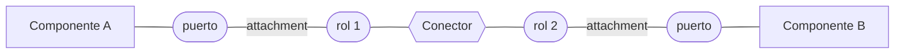

# Lenguajes de descripción de arquitectura (ADL)

Es la **primera** de las tres formas de modelar una arquitectura que da la clase (las otras dos son los
diagramas UML y los diagramas de bloque de alto nivel → [[Cómo se modela la arquitectura]]).

## 1. Definición de clase

> **Lenguajes de descripción de arquitectura (ADLs).** Lenguajes textuales formales ideados para
> describir una arquitectura software en términos de componentes y conectores.

Tres palabras cargan la definición:

| Palabra | Qué significa |
|---|---|
| **textuales** | no es un dibujo: se **escribe**, como código |
| **formales** | tienen sintaxis y semántica precisas: se pueden **verificar con una herramienta**, no solo leer |
| **componentes y conectores** | no describen clases ni tablas: describen **las piezas y cómo se conectan**. Es la estructura de *componentes y conectores* de [[Categorías de estructuras]] |

![[adjuntos/capturas-clase-U2/diseno-arquitectonico/como-se-modela-adl-ejemplo.png]]

## 2. El ejemplo de la diapositiva

La diapositiva pone **el mismo sistema dos veces**: en texto (el ADL) y en un dibujo de cajas. Código
transcrito con zoom, respetando el original:

```text
System simple_cs = {
    Component client = { Port send-request; };
    Component server = { Port receive-request; };
    Connector rpc = { Roels { caller, callee}};
    Attachments {
        client.send-request to rpc.caller;
        server.receive-request to rpc.callee;
    }
}
```

> [!note] `Roels` [sic]
> En la diapositiva dice **`Roels`**. Es una errata de **`Roles`** — la palabra reservada del lenguaje.

El dibujo que lo acompaña, leído con zoom:

| Elemento del dibujo | Forma | Corresponde en el código a |
|---|---|---|
| **Client** | rectángulo | `Component client` |
| **Server** | rectángulo | `Component server` |
| **RPC** | flecha gruesa gris de Client a Server, con una pequeña caja en el borde de Client y punta hueca en Server | `Connector rpc` |
| caja pequeña en el borde de Client | — | el puerto `send-request` enganchado al rol `caller` |
| punta en el borde de Server | — | el puerto `receive-request` enganchado al rol `callee` |

La lección de poner los dos juntos: **el texto dice exactamente lo mismo que el dibujo, pero sin
ambigüedad**. En el dibujo no sabés qué significa la cajita; en el ADL está escrito que es un puerto y a
qué rol se engancha.

## 3. Cómo se lee ese código — COMPLEMENTO

*(La clase no explicó las palabras reservadas. Lo que sigue es conocimiento general: el ejemplo es de
**Acme**, el ADL de Carnegie Mellon —David Garlan y colegas—, el más citado como ejemplo en la
literatura.)*

| Palabra | Qué declara | En el ejemplo |
|---|---|---|
| `System` | el sistema completo, que contiene todo lo demás | `simple_cs` (*simple client-server*) |
| `Component` | una pieza que **hace** algo (cómputo o datos) | `client`, `server` |
| `Port` | un **punto de interacción** de un componente con el exterior | `send-request`, `receive-request` |
| `Connector` | la pieza que **comunica** componentes | `rpc` (llamada a procedimiento remoto) |
| `Roles` | los **extremos** de un conector: qué papel juega cada lado | `caller` (quien llama), `callee` (quien es llamado) |
| `Attachments` | **qué puerto se engancha a qué rol** — es lo que arma la topología | el puerto del cliente al rol `caller`, el del servidor al rol `callee` |

El patrón general, como esquema propio (no es un diagrama de ella):



Regla memorizable: **los componentes tienen puertos, los conectores tienen roles, y los attachments
casan un puerto con un rol.**

> [!tip] Por qué el conector es una pieza y no una línea
> En un ADL el conector es un **elemento de primer nivel**, igual que el componente: tiene nombre, roles y
> propiedades. Eso permite decir *cómo* se comunican (RPC, cola de mensajes, tubería) y analizarlo. En un
> diagrama de cajas, en cambio, la línea no dice nada por sí sola.

## 4. Ventajas y límites — COMPLEMENTO

| A favor | En contra |
|---|---|
| Precisos: no hay dos lecturas | Poco usados en la industria |
| Analizables por herramienta (consistencia, conexiones sueltas) | Curva de aprendizaje, sintaxis propia de cada uno |
| Separan explícitamente componentes y conectores | Los stakeholders no técnicos no los leen |

Otros ADL conocidos, solo para reconocer el nombre: **Acme**, **Wright**, **Rapide**, **Darwin**,
**xADL**, **AADL**. Ninguno aparece en las diapositivas.

Por eso en la práctica —y en este curso— se modela sobre todo con **UML** (→ [[Cómo se modela la arquitectura]]).

## Notas relacionadas

- [[Cómo se modela la arquitectura]] — las tres formas de modelar, esta es la primera
- [[Categorías de estructuras]] — la estructura de componentes y conectores
- [[Estilos arquitectónicos]] — cliente-servidor, el estilo del ejemplo
- [[Diagrama de bloques de alto nivel]] — el dibujo informal equivalente

## Preguntas de repaso

1. Citá la definición de ADL que dio la clase.
2. ¿Qué significan "textual" y "formal" en esa definición?
3. En el ejemplo `simple_cs`, ¿cuáles son los componentes, cuál es el conector y cuáles sus roles?
4. ¿Qué hace la sección `Attachments`?
5. ¿Qué ventaja tiene el ADL frente al dibujo de cajas que lo acompaña en la diapositiva?
