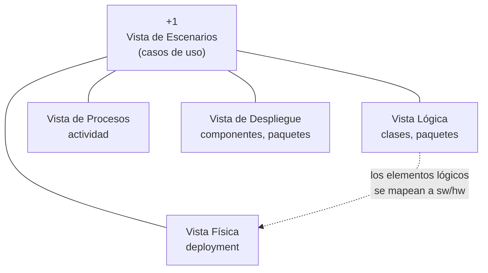

# Modelo 4+1 vistas

La forma de documentar una arquitectura con **cuatro vistas** más una quinta que las amarra.
La lógica de fondo viene de [[Estructuras y vistas arquitectónicas]]: como cada parte
interesada necesita ver el sistema de una manera distinta, se documenta el mismo sistema
cuatro veces desde ángulos diferentes, y la quinta vista (los escenarios) sirve de hilo que
conecta las otras cuatro.

> [!info] La clase lo volvió a dar el 16/09 (capturas_U2_F2)
> Las capturas **10, 11, 12 y 13** son **las mismas diapositivas** que las págs. 25, 27, 28 y 29 del
> PDF *Arquitectura de Software* (verificadas una por una a resolución completa): no cambia ni una
> palabra. Que lo haya repetido en la clase de estilos es señal de que **entra**. Lo nuevo es la
> **captura 29** (§ siguiente): de dónde sale el modelo y para qué sirve separar en vistas.

## De dónde sale: RUP, y por qué se separa en vistas

Textual de la captura 29 (título: *"Estilos Arquitectónicos –Diseño Arquitectónico-"*):

> - Las arquitecturas del sistema son usadas por **diversos conjuntos de personas en tiempos
>   diferentes en el ciclo de desarrollo**, por esta razón es frecuente ver que estas arquitecturas
>   son **separadas en vistas diferentes**.
> - El **Proceso Unificado Racional (RUP)** identifica un conjunto de vistas estándar llamado
>   **4+1 Vistas de Arquitectura**. Este enfoque permite que todos los grupos de participantes
>   **comuniquen las necesidades** (es decir, requisitos), **resuelvan los conflictos**, y **realicen
>   los documentos de decisiones**.

*(En rojo en la diapositiva: "4+1 Vistas de Arquitectura".)*

![[adjuntos/capturas-clase-U2/vistas-4mas1/rup-4mas1-vistas-por-grupos-de-personas.png]]

Leído en limpio, son **dos razones** y **tres usos**:

| | Lo que dice la clase |
|---|---|
| **Por qué hay vistas** | distintos **grupos de personas** usan la arquitectura, y la usan en **distintos momentos** del ciclo de desarrollo |
| **Quién las estandariza** | el **RUP** (Proceso Unificado Racional) |
| **Para qué sirven** — 1 | que todos los grupos **comuniquen sus necesidades** (requisitos) |
| **Para qué sirven** — 2 | **resolver los conflictos** entre ellos |
| **Para qué sirven** — 3 | **documentar las decisiones** |

Es el mismo argumento de [[Estructuras y vistas arquitectónicas]] (*"los arquitectos diseñan
estructuras, documentan vistas"*) y el primer beneficio de
[[Beneficios de la arquitectura de software]] (comunicación entre stakeholders), dicho desde el 4+1.

> [!note] Complemento — RUP vs. Kruchten
> La clase atribuye el conjunto de vistas al **RUP**. El autor del artículo original es **Philippe
> Kruchten** (1995), que después trabajó en Rational y lo metió en el RUP: no es contradicción. Si lo
> citás en una entrega, decí *"el RUP identifica…"*, que es como lo dio ella.

## Las cinco vistas de un golpe

| Vista | Qué representa | *"Esta vista la vamos a complementar con los diagramas UML:"* | A quién le sirve (figura de capturas_U2, 2) |
|---|---|---|---|
| **Lógica** | Requisitos **funcionales**: qué debe hacer el sistema. El dominio de la aplicación, las clases y objetos que forman el *core*. | • Diagrama de Clases • Diagrama de Paquetes | *Analyst; End user* |
| **De Procesos** | Los **flujos de trabajo** paso a paso, de negocio y operacionales, de los componentes. Y varios requisitos **no funcionales**. | • Diagrama de Actividad | *System Integrator* |
| **De Despliegue o de Desarrollo** | Cómo está **dividido el software en componentes** y las dependencias entre ellos. | • Diagrama de Componentes • Diagrama de Paquetes | *Programmer* (ahí se llama *Implementation View*) |
| **Física** | Cómo están **distribuidos los componentes entre los equipos** que conforman la solución, incluyendo los servicios. | • Diagrama de Deployment | *System Administrator* (ahí se llama *Deployment View*) |
| **+1 — Escenarios** | Los **casos de uso**. Es la que une las otras cuatro y da trazabilidad. | Diagrama de casos de uso | — (va al centro, sin participante) |

La columna de diagramas es **textual** de las capturas 10-13 (la de la Lógica dice *"se complementa
con"* en vez de *"la vamos a complementar con"*). La de participantes sale de la figura en inglés de
[[Proceso de diseño arquitectónico]]; las diapositivas del 4+1 no nombran participantes.

![[adjuntos/capturas-clase-U2/diseno-arquitectonico/informacion-diseno-vistas-4mas1.png]]

## Vista Lógica

Los **requisitos funcionales** del sistema: lo que el sistema debe hacer, las funciones y
servicios que se han definido. Está enfocada a lo definido como **dominio de la aplicación**,
o sea las clases y objetos principales que formarán el corazón o *core* de la aplicación.

Se complementa con: **diagrama de clases** y **diagrama de paquetes**.

*Clase del 16/09: capturas_U2_F2 (11), la misma diapositiva.*

![[adjuntos/arquitectura-de-software/arq-p27.png]]

> [!warning] La trampa del diagrama de clases
> Acá el diagrama de clases **sí** documenta arquitectura: es la vista lógica. Pero en
> [[Diagrama de clases]] la clase lo ubica en el **diseño detallado** (o en el análisis → esquema de
> BD), no como vista arquitectónica de primer orden. No se contradicen: en la vista lógica van las
> **clases principales del *core*** —el dominio—, no el detalle de cada clase. Si te preguntan
> "¿qué vista usa el diagrama de clases?", **la lógica**.

## Vista de Procesos

Representa los **flujos de trabajo paso a paso** de negocio y operacionales de los
componentes que conforman el sistema. Además muestra algunos de los **requisitos no
funcionales**, como ejecución, disponibilidad, tolerancia a fallas, integridad, seguridad y
confiabilidad, entre otros.

Se complementa con: **diagrama de actividad**.

Detalle que vale marcar: es la **única vista donde la presentación menciona explícitamente los
requisitos no funcionales**, y eso conecta con la responsabilidad del arquitecto de integrar
los NRFs (→ [[Arquitecto de software]]).

*Clase del 16/09: capturas_U2_F2 (10), la misma diapositiva — y dice **actividad**, no secuencia.*

> [!warning] Actividad, no secuencia
> Es tentador poner el **diagrama de secuencia** en la vista de procesos (muestra la interacción en
> ejecución, y así lo hace parte de la literatura). **Las dos fuentes de clase dicen solo actividad**:
> estas diapositivas y el PDF TEMA 5 (*"el diagrama de actividad a la vista de proceso"*, ver
> [[Diagramas UML estructurales y de comportamiento]]). En el examen: **procesos → actividad**.

![[adjuntos/arquitectura-de-software/arq-p25.png]]

## Vista de Despliegue (o Vista de Desarrollo)

Muestra básicamente **cómo está dividido nuestro sistema de software en componentes**, y las
**dependencias** entre estos componentes.

Los componentes físicos incluyen archivos, cabeceras, bibliotecas compartidas, módulos,
ejecutables o paquetes. Muestra la organización y las dependencias entre el conjunto de
componentes, y cómo se comunican entre ellos.

Se complementa con: **diagrama de componentes** y **diagrama de paquetes**.

*Clase del 16/09: capturas_U2_F2 (12), la misma diapositiva. El texto dice literalmente "Muestra los
componentes físicos incluyen archivos…" [sic]: la idea es "los componentes físicos, que incluyen…".*

> [!note] El diagrama de paquetes aparece en DOS vistas
> Según estas diapositivas, paquetes va en la **Lógica** (agrupando clases) **y** en la de
> **Despliegue/Desarrollo** (agrupando componentes). No es un error: un paquete es un mecanismo de
> agrupación de UML que sirve para cualquier elemento (→ [[Diagrama de paquetes]], que lo explica igual).
> El PDF TEMA 5 lo pone **solo** en desarrollo; si te preguntan "¿en qué vista va paquetes?", la
> respuesta completa es **las dos, según sus diapositivas del 4+1**.

> [!warning] Cuidado con el nombre
> La presentación la llama **"Vista de Despliegue o Vista de Desarrollo"**, pero el diagrama de
> *deployment* (despliegue) pertenece a la **Vista Física**, no a esta. En la literatura
> original de Kruchten esta vista se llama **Vista de Desarrollo** (*development view*) y las
> cuatro son: Lógica, Procesos, Desarrollo y Física. Si en el examen te piden "la vista que usa
> el diagrama de componentes", es esta; si te piden "la que usa el diagrama de deployment", es
> la Física.
>
> **El material de la unidad 2 (capturas_U2) usa otro juego de nombres** y confirma el cruce. La
> figura de la captura 2 dice *Logical / **Implementation** / Process / **Deployment** / Use Case
> View*: ahí **Implementation View** = componentes (la del programador) y **Deployment View** = la
> física (la del administrador de sistemas). Y la captura 37 habla de *"vista de despliegue
> estática"* para la **topología de hardware**. Regla para no perderse: **componentes → vista de
> desarrollo/implementación; nodos y hardware → vista física/deployment**, se llame como se llame.
> Ver [[Proceso de diseño arquitectónico]] y [[Diagrama de despliegue]].

![[adjuntos/arquitectura-de-software/arq-p28.png]]

### Los tres juegos de nombres, en una tabla

| Fuente | Vista de componentes | Vista de nodos / hardware |
|---|---|---|
| Diapositivas del 4+1 (PDF págs. 28-29 = capturas_U2_F2 12-13) — **clase** | *Vista de **Despliegue** o Vista de Desarrollo* | *Vista **Física*** → "Diagrama de Deployment" |
| Figura de capturas_U2 (2) — **clase** | *Implementation View* | *Deployment View* |
| PDF TEMA 5 — **clase** | *vista de desarrollo* | *vista física* |
| Kruchten (1995) — complemento | *Development View* | *Physical View* |

**La palabra "despliegue" cambia de lado** según la fuente; el **contenido** no. Regla que sigue en pie
después del 16/09: **componentes y paquetes → vista de desarrollo/implementación · nodos y hardware →
vista física**, se llamen como se llamen. Si en el examen usás el nombre de sus diapositivas (*"Vista de
Despliegue"* para componentes), agregá entre paréntesis *"o de desarrollo"*, que es como lo escribe
ella, para que no se lea como el diagrama de despliegue.

## Vista Física

Representa **cómo están distribuidos los componentes entre los distintos equipos** que
conforman la solución, incluyendo los servicios. Los elementos definidos en la **vista lógica
se mapean** a componentes de software o de hardware.

Se complementa con: **diagrama de deployment**.

*Clase del 16/09: capturas_U2_F2 (13), la misma diapositiva.* Ella dice *"Diagrama de Deployment"*;
en otras capturas lo llama **"Diagrama de Distribución"**: los tres nombres (deployment, despliegue,
distribución) son el mismo diagrama (→ [[Diagrama de despliegue]]).

![[adjuntos/arquitectura-de-software/arq-p29.png]]

## Vista +1 o Vista de Escenarios

Está representada por los **casos de uso**, que ayudarán a unir las otras cuatro vistas.

Desde un caso de uso podemos ver cómo se van ligando las otras cuatro vistas; con esto
tenemos una **trazabilidad** de componentes, clases, equipo, paquetes, etc., para la
realización de cada caso de uso.

Se complementa con: **diagrama de casos de uso**.

Acá el tema se cruza con el otro deck del curso: los casos de uso que amarran las vistas son
los mismos que se modelan en [[Caso de uso]] y [[Modelo de casos de uso del negocio]]. Es por
eso que el "+1" no es una vista más al mismo nivel: es el **pegamento**.

![[adjuntos/arquitectura-de-software/arq-p26.png]]

## Truco para memorizarlo

Pensá qué pregunta responde cada vista:

| Vista | Pregunta que responde |
|---|---|
| Lógica | **¿Qué** hace el sistema? |
| De procesos | **¿Cómo** fluye paso a paso, y con qué calidad? |
| De despliegue / desarrollo | **¿De qué piezas** de software está hecho? |
| Física | **¿Dónde** corre cada pieza? |
| +1 Escenarios | **¿Para qué?** (y amarra las otras cuatro) |

## Notas relacionadas

- [[Estructuras y vistas arquitectónicas]]
- [[Arquitectura de software]]
- [[Arquitecto de software]]
- [[Beneficios de la arquitectura de software]] — comunicación entre stakeholders
- [[Proceso de diseño arquitectónico]] — la figura con los participantes de cada vista
- [[Diagramas UML estructurales y de comportamiento]] — el mapeo vista → diagrama del PDF TEMA 5
- [[Diagrama de clases]] · [[Diagrama de paquetes]] · [[Diagrama de componentes]] · [[Diagrama de despliegue]]
- [[Caso de uso]]

## Preguntas de repaso

1. Nombrá las cinco vistas del modelo 4+1 y el diagrama UML con que ella dice que se complementa cada una.
2. Según la clase, ¿por qué se separa una arquitectura en vistas, quién estandariza las 4+1 y qué tres cosas permite?
3. ¿En qué vista aparecen los requisitos no funcionales, y por qué ahí va actividad y no secuencia?
4. ¿Qué vista usa el diagrama de componentes y cuál el de deployment? ¿Por qué la palabra "despliegue" confunde?
5. ¿Por qué el diagrama de paquetes aparece en dos vistas, y por qué la quinta se llama "+1"?
