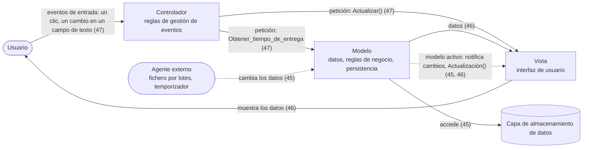
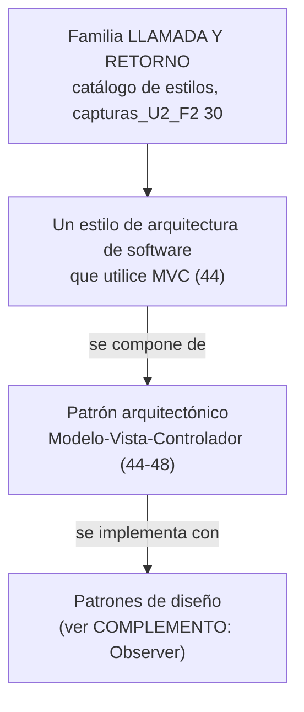

# Modelo-Vista-Controlador (MVC)

El **patrón arquitectónico** que la clase desarrolló con cinco diapositivas propias dentro de la serie
*"Estilos Arquitectónicos"*: una definición, una diapositiva de responsabilidades por cada una de las
tres partes, y un diagrama de un sistema de ventas con las tres partes recuadradas.

> [!important] Esta nota es NÚCLEO
> Las cinco diapositivas llevan el mismo título, que se lee completo:
> **"Patrón Arquitectónico Modelo-Vista-Controlador"** (*"Patrón Arquitectónico"* en gris,
> *"Modelo-Vista-Controlador"* en rojo). Todo lo que no sale de ahí está rotulado **COMPLEMENTO**.

---

## 1. Qué es (captura 44)

Textual:

> Un estilo de arquitectura de software que utilice MVC separa los datos de una aplicación, la
> interfaz de usuario, y la lógica de control en tres componentes distintos.
>
> - El **Modelo** que contiene una representación de los datos que maneja el sistema, su lógica de
>   negocio, y sus mecanismos de persistencia.
> - La **Vista**, o interfaz de usuario, que compone la información que se envía al cliente y los
>   mecanismos interacción [sic] con éste.
> - El **Controlador**, que actúa como intermediario entre el Modelo y la Vista, gestionando el flujo
>   de información entre ellos y las transformaciones para adaptar los datos a las necesidades de
>   cada uno.

![[adjuntos/capturas-clase-U2/mvc/mvc-definicion-modelo-vista-controlador.png]]

En tabla:

| Componente | Lo que **separa** (frase 1) | Qué contiene (bullets) |
|---|---|---|
| **Modelo** | *los datos de una aplicación* | representación de los datos · **lógica de negocio** · mecanismos de **persistencia** |
| **Vista** | *la interfaz de usuario* | la información que se envía al cliente · los mecanismos de interacción con él |
| **Controlador** | *la lógica de control* | intermediario Modelo ↔ Vista · flujo de información · transformaciones de datos |

**Regla para el examen:** *MVC separa en tres componentes distintos: datos (Modelo), interfaz de
usuario (Vista) y lógica de control (Controlador). La lógica de negocio va en el Modelo.*

---

## 2. Responsabilidades de cada parte

### El modelo (captura 45)

Textual:

> El modelo es el responsable de:
> - Acceder a la capa de almacenamiento de datos. Lo ideal es que el modelo sea independiente del
>   sistema de almacenamiento.
> - Define las reglas de negocio (la funcionalidad del sistema). Un ejemplo de regla puede ser: "Si
>   la mercancía pedida no está en el almacén, consultar el tiempo de entrega estándar del
>   proveedor".
> - Lleva un registro de las vistas y controladores del sistema.
> - Si estamos ante un modelo activo, notificará a las vistas los cambios que en los datos pueda
>   producir un agente externo (por ejemplo, un fichero por lotes que actualiza los datos, un
>   temporizador que desencadena una inserción, etc.).

![[adjuntos/capturas-clase-U2/mvc/mvc-responsabilidades-del-modelo.png]]

### Las vistas (captura 46)

Textual:

> Las vistas son responsables de:
> - Recibir datos del modelo y los muestra al usuario.
> - Tienen un registro de su controlador asociado (normalmente porque además lo instancia).
> - Pueden dar el servicio de "Actualización()", para que sea invocado por el controlador o por el
>   modelo (cuando es un modelo activo que informa de los cambios en los datos producidos por otros
>   agentes).

![[adjuntos/capturas-clase-U2/mvc/mvc-responsabilidades-de-las-vistas.png]]

### El controlador (captura 47)

Textual:

> El controlador es responsable de:
> - Recibe los eventos de entrada (un clic, un cambio en un campo de texto, etc.).
> - Contiene reglas de gestión de eventos, del tipo "SI Evento Z, entonces Acción W". Estas acciones
>   pueden suponer peticiones al modelo o a las vistas. Una de estas peticiones a las vistas puede ser
>   una llamada al método "Actualizar()". Una petición al modelo puede ser
>   "Obtener_tiempo_de_entrega ( nueva_orden_de_venta )".

![[adjuntos/capturas-clase-U2/mvc/mvc-responsabilidades-del-controlador.png]]

### Las tres, lado a lado

| | **Modelo** (45) | **Vista** (46) | **Controlador** (47) |
|---|---|---|---|
| **Qué reglas tiene** | **reglas de negocio**: *"Si la mercancía pedida no está en el almacén…"* | — | **reglas de gestión de eventos**: *"SI Evento Z, entonces Acción W"* |
| **Qué recibe** | peticiones del controlador · cambios de un **agente externo** | **datos del modelo** · invocaciones de *"Actualización()"* | **eventos de entrada**: un clic, un cambio en un campo de texto |
| **A quién le habla** | a la **capa de almacenamiento** · a las **vistas** (si es modelo activo) | al **usuario** (le muestra los datos) | al **modelo** y a las **vistas** (peticiones) |
| **Qué registro lleva** | de **las vistas y controladores** del sistema | de **su controlador asociado** (normalmente lo instancia) | — |
| **Ejemplo de la diapositiva** | la regla del tiempo de entrega del proveedor | el servicio *"Actualización()"* | *"Actualizar()"* a la vista · *"Obtener_tiempo_de_entrega ( nueva_orden_de_venta )"* al modelo |

> [!note] "Actualización()" y "Actualizar()" — se citan como están
> La **46** llama al servicio de la vista **"Actualización()"**; la **47** llama al mismo método
> **"Actualizar()"**. Por el contexto es **la misma operación** (la vista la ofrece, el controlador o el
> modelo activo la invocan), con dos nombres distintos en dos diapositivas seguidas. Si lo citás,
> respetá la diapositiva de la que sale.

> [!tip] El ejemplo está encadenado entre la 45 y la 47
> La **regla de negocio** del modelo (45) es *"consultar el tiempo de entrega estándar del
> proveedor"*, y la **petición al modelo** del controlador (47) es
> *"Obtener_tiempo_de_entrega ( nueva_orden_de_venta )"*. El controlador **no calcula** el tiempo de
> entrega: **lo pide**, y la regla que lo resuelve vive en el modelo. Es el mejor ejemplo para
> explicar por qué la lógica de negocio no va en el controlador.

---

## 3. Quién habla con quién — el patrón conceptual

Esquema propio, construido **solo** con las frases de las capturas 44-47 (cada flecha dice de qué
captura sale). **No es un diagrama de la clase**: ella no dibujó el flujo, dibujó un sistema físico con zonas recuadradas (§4).

Cómo se lee, y dónde está la sutileza:

| Camino | De qué captura sale | Qué significa |
|---|---|---|
| Usuario → Controlador → Modelo | 47 | la **entrada** va al controlador, que la traduce en una petición |
| Controlador → Vista | 47 | el controlador también le pide cosas a la vista (*"Actualizar()"*) |
| Modelo → Vista | 46 | la vista **recibe datos del modelo** |
| Modelo → Vista, **sin pasar por el controlador** | 45 y 46 | solo si es un **modelo activo**: un agente externo cambió los datos y el modelo avisa |
| Modelo → almacenamiento | 45 | el modelo accede; lo ideal es que **no dependa** del sistema de almacenamiento concreto |

Los **registros** (45 y 46) no son flujos, por eso no van como flechas: el **modelo** lleva registro
de vistas y controladores; cada **vista** lleva registro de **su** controlador y normalmente lo
instancia.

> [!warning] La trampa: "el controlador está siempre en el medio"
> La 44 dice que el controlador *"actúa como intermediario entre el Modelo y la Vista"*. Pero la 46
> dice que la vista *"recibe datos del modelo"* y que el **modelo activo** invoca directamente el
> servicio *"Actualización()"* de la vista. **No es una línea recta Vista – Controlador – Modelo: es
> un triángulo.** El controlador media en lo que viene del usuario; los cambios que vienen de afuera
> (un lote, un temporizador) el modelo activo se los avisa a la vista por su cuenta.

---

## 4. Su diagrama: el sistema de ventas con tres recuadros (captura 48)

La diapositiva repite **tres veces el mismo dibujo** y en cada copia encierra una parte distinta con
un **recuadro rojo**. No se redibuja; se lee con zoom.

![[adjuntos/capturas-clase-U2/mvc/mvc-sistema-ventas-recuadros-modelo-vista-controlador.png]]

### El dibujo base (igual en las tres copias)

| Nivel (de arriba abajo) | Qué hay | Rótulo |
|---|---|---|
| Título | — | **"Sistema"** |
| 1 | **tres computadoras de escritorio** (monitor, teclado, mouse) | **"Ventas"**, **"Cajero"**, **"Administrador"** |
| — | una línea (bus) que une las tres computadoras y baja | **"Controlador"**, escrito junto a la línea que baja hacia los servidores |
| 2 | **tres servidores** tipo torre, unidos por una línea arriba y otra abajo | — (sin rótulo propio) |
| — | una línea que baja de los servidores a la base de datos | **"Modelo"**, escrito junto a esa línea |
| 3 | un **cilindro** de base de datos | **"Oracle Database"** |
| 4 | **tres discos** (íconos de CD), colgados de la base de datos | — |

Las líneas **no tienen puntas de flecha**: son conexiones, no direcciones.

### Qué encierra cada recuadro

| Copia | El recuadro rojo encierra… | Lo que queda fuera | Parte del MVC |
|---|---|---|---|
| **Izquierda** | la **mitad inferior** de los tres servidores, la línea que los une abajo, el rótulo **"Modelo"**, **Oracle Database** y los **tres discos** | las computadoras, el rótulo "Controlador" y la mitad superior de los servidores | **Modelo** (lo dice el rótulo que queda adentro) |
| **Centro** | el título **"Sistema"**, las **tres computadoras** con sus rótulos (Ventas, Cajero, Administrador), su bus, el rótulo **"Controlador"** y la **parte superior** de los servidores | el cuerpo de los servidores, "Modelo", la base de datos y los discos | **Vista** — *por eliminación*: el dibujo **no tiene ningún rótulo "Vista"** |
| **Derecha** | el rótulo **"Controlador"**, los **tres servidores** completos y las dos líneas que los unen | las computadoras (arriba) y la base de datos con sus discos (abajo). El borde inferior del recuadro **tapa el rótulo "Modelo"**: solo se ve un fragmento | **Controlador** |

> [!warning] Lo que el dibujo no es — leelo con cuidado
> 1. **Los recuadros son aproximados.** Los de la izquierda y el centro **cortan los servidores por
>    la mitad**, y el del centro se lleva adentro el rótulo "Controlador". No hay que leer que *"medio
>    servidor es modelo"*: el recuadro señala **la zona**, no una frontera exacta.
> 2. **No hay rótulo "Vista".** La asignación *computadoras = Vista* es la única que cierra con las
>    otras dos copias, pero es **inferencia**; si la vas a citar, decí *"la parte de las terminales"*.
> 3. **Es un dibujo físico**: terminales, servidores, base de datos y discos. Ilustra dónde **podría
>    correr** cada parte, no cómo se hablan (eso está en §3). Por eso se parece tanto a un
>    **despliegue en tres niveles** — y de ahí sale la trampa de §6.

**Coincidencia con el texto:** el recuadro del **Modelo** incluye **Oracle Database y los discos**,
lo que coincide con la 44 (*"sus mecanismos de persistencia"* están en el Modelo). Pero la 45 dice
*"Acceder a la capa de almacenamiento de datos. Lo ideal es que el modelo sea **independiente** del
sistema de almacenamiento"*. Leídas juntas: los **mecanismos de persistencia** (el código que guarda y
recupera) son del modelo; el **sistema de almacenamiento** concreto (Oracle) es algo que el modelo
**usa** y del que idealmente no depende. El recuadro los junta porque es un dibujo de zonas.

---

## 5. ¿Estilo o patrón? Cómo se lee

Cuatro pistas en el material de clase:

| Evidencia | Qué dice de MVC |
|---|---|
| **Título de las cinco diapositivas** (44-48) | *"**Patrón** Arquitectónico Modelo-Vista-Controlador"* |
| **Primera frase de la 44** | *"Un **estilo** de arquitectura de software **que utilice** MVC separa…"* |
| **Catálogo de estilos** (capturas_U2_F2, 30) | *"Arquitecturas de llamada y retorno (llamadas a procedimientos remotos, **Modelo Vista Controlador –MVC-**, en Capas, …)"* |
| **Diapositiva previa de la misma serie** (capturas_U2_F3, 40) | título *"–Patrones Arquitéctónicos [sic] para arquitectura de llamada y retorno–"*, y bajo *"Ejemplos:"* tres viñetas: *Llamada de procedimiento remoto (RPC)*, *Orientado a objetos* y **"Modelo-Vista-Controlador"** — la única **sin descripción**, porque la desarrollan las cinco que siguen → [[Arquitectura de llamada y retorno]] |

**No se contradicen si se lee con la jerarquía de la clase: estilo ⊃ patrón arquitectónico ⊃ patrón
de diseño** ([[Patrones arquitectónicos]] §4). La frase de la 44 no dice que MVC *sea* un estilo: dice
que un estilo **utiliza** MVC. Es exactamente lo que dicen sus diapositivas de estilo vs. patrón
([[Estilos arquitectónicos]] §1.2): el estilo *"puede componerse de uno o más patrones
arquitectónicos"* (15) y los patrones *"se usan junto con un estilo arquitectónico"* (22).

*(Esquema propio: las dos primeras cajas y la flecha "se compone de" salen de la clase; la última
caja es complemento.)*

**Regla para el examen:** *MVC es un **patrón arquitectónico** (así lo titula la clase). Un **estilo**
lo utiliza, y en el catálogo cae en la familia **llamada y retorno**.* Si te preguntan "¿estilo o
patrón?", respondé **patrón** y nombrá la frase de la 44 para mostrar que la conocés.

> [!note] Dos detalles que quedan sueltos
> - MVC **no está** en la lista de **13** patrones arquitectónicos de la clase (capturas_U2_F2, 8:
>   DTO, DAO, Polling… ver [[Patrones arquitectónicos]] §5). La lista no es exhaustiva: esta serie
>   agrega MVC con diapositivas propias.
> - El catálogo textual (capturas_U2_F2, 30) lo pone **junto a estilos** (*en Capas*, *Orientadas a
>   Objetos*) dentro de una familia. Es la misma mezcla de niveles que ya se señaló en
>   [[Catálogo de estilos arquitectónicos]]: la lista junta estilos y patrones de la familia.

---

## 6. La trampa clásica: MVC no es "3 capas con otros nombres"

Es la confusión más común, y el diagrama de la 48 la alimenta (terminales / servidores / base de
datos se parece mucho a presentación / negocio / datos). Con **lo que dice la clase**:

| | **MVC** (44-47) | **N-Capas** ([[Arquitectura en capas]], capturas_U2) |
|---|---|---|
| **Qué es para la clase** | **patrón arquitectónico** | **estilo** (*"Arquitectura N-Capas"*) |
| **Las partes** | Modelo · Vista · Controlador | Presentación · Negocio · Datos |
| **Dónde está la lógica de negocio** | en el **Modelo**, junto con los datos y la persistencia (44, 45) | en su propia capa, **Negocio**, separada de Datos |
| **Qué hace la tercera pieza** | el **Controlador** tiene reglas de **gestión de eventos** (*"SI Evento Z, entonces Acción W"*), **no** de negocio (47) | la capa del medio es la del **negocio** |
| **Quién habla con quién** | un **triángulo**: controlador → modelo, controlador → vista, modelo → vista (46) | en su diagrama, flechas dobles **solo entre capas vecinas** |

Las tres equivalencias falsas, dichas antes de que las cometas:

1. **Controlador = capa de negocio** → **falso.** Las reglas de negocio las *"Define"* el **modelo**
   (45). El controlador recibe eventos y hace peticiones (47).
2. **Modelo = capa de datos** → **incompleto.** El modelo tiene *"representación de los datos"*,
   *"lógica de negocio"* **y** *"mecanismos de persistencia"* (44): abarca negocio **y** datos.
3. **Vista = capa de presentación, y nada más** → **incompleto.** La vista *"compone la información que
   se envía al cliente"* (44), pero además **recibe datos directamente del modelo** y ofrece
   *"Actualización()"* para que el **modelo activo** la invoque (46). En N-Capas, presentación no se
   salta a negocio para hablar con datos.

**Regla memorizable:** *en capas, el negocio está en el medio; en MVC, el negocio está en el Modelo y
el Controlador solo traduce eventos.*

> [!note] COMPLEMENTO — cómo conviven en la práctica (conocimiento general, no de la clase)
> - Lo más habitual es que **MVC organice la capa de presentación** de una arquitectura en capas: la
>   Vista y el Controlador viven en presentación, y el Modelo es la puerta a las capas de negocio y
>   datos. Por eso *no compiten*: uno es un patrón que se usa **dentro** de un estilo. Encaja con la
>   jerarquía de la clase (§5), pero **ella no lo dijo**.
> - Ojo con el vocabulario de la clase: ella usa **capa** y **nivel** como sinónimos
>   ([[Arquitectura en capas]] §4). El dibujo de la 48 es de **niveles físicos**; MVC es una separación
>   **lógica** de responsabilidades.

---

## 7. COMPLEMENTO — de dónde viene y qué patrones de diseño lleva adentro

> [!note] Conocimiento general, no de las diapositivas
> - **Origen:** Trygve Reenskaug lo formuló a fines de los 70 trabajando en **Smalltalk-80**, para
>   interfaces gráficas. Buschmann et al. (*Pattern-Oriented Software Architecture*, 1996) lo
>   catalogan como **patrón arquitectónico** para sistemas interactivos — la misma etiqueta que usa la
>   clase.
> - **El "modelo activo" es el patrón Observer.** Que el modelo *"lleve un registro de las vistas"* (45)
>   y les *"notifique"* los cambios invocando *"Actualización()"* (46) es, casi palabra por palabra,
>   **Observer**: el sujeto (modelo) guarda la lista de observadores (vistas) y los avisa con un
>   `update()`. Observer está en la lista de 25 patrones de diseño de la clase → [[Patrones de diseño]].
>   Es la jerarquía en acción: el **patrón arquitectónico** MVC se implementa con **patrones de
>   diseño**.
> - **Variantes que vas a encontrar afuera:** MVP (*Model-View-Presenter*) y MVVM
>   (*Model-View-ViewModel*) cambian quién actualiza a la vista. En la web (Spring MVC, ASP.NET MVC,
>   Rails) el modelo casi nunca es "activo": la vista se regenera en cada petición. No son materia de
>   la clase.

---

## Notas relacionadas

- [[Arquitectura de llamada y retorno]] — la familia donde la clase pone a MVC como patrón arquitectónico
- [[Catálogo de estilos arquitectónicos]] — el catálogo textual (capturas_U2_F2, 30) que nombra MVC en llamada y retorno
- [[Patrones arquitectónicos]] — qué es un patrón arquitectónico para la clase, y la jerarquía estilo ⊃ patrón ⊃ patrón de diseño
- [[Estilos arquitectónicos]] — §1.2: el estilo se compone de patrones arquitectónicos
- [[Arquitectura en capas]] — la comparación de §6: N-Capas no es MVC
- [[Patrones de diseño]] — Observer, el patrón de diseño detrás del modelo activo (complemento)
- [[Diagrama de despliegue]] — el tipo de mirada física que tiene el dibujo de la captura 48

## Preguntas de repaso

1. ¿Qué tres cosas separa MVC, según la captura 44, y en qué componente queda cada una? ¿Dónde va la
   lógica de negocio?
2. ¿Qué es un **modelo activo**? Dá el ejemplo de agente externo que da la diapositiva y explicá por
   qué eso hace que el controlador no esté siempre "en el medio".
3. El controlador tiene reglas del tipo *"SI Evento Z, entonces Acción W"* y el modelo tiene reglas de
   negocio. Con el ejemplo del tiempo de entrega, explicá la diferencia.
4. En el diagrama del sistema de ventas (Ventas, Cajero, Administrador, Oracle Database), ¿qué encierra
   cada uno de los tres recuadros rojos? ¿Cuál de las tres partes no tiene rótulo en el dibujo?
5. La 44 dice *"Un estilo de arquitectura de software que utilice MVC"* y el título dice *"Patrón
   Arquitectónico"*. ¿MVC es estilo o patrón para la clase? Justificá con la jerarquía estilo ⊃ patrón.
