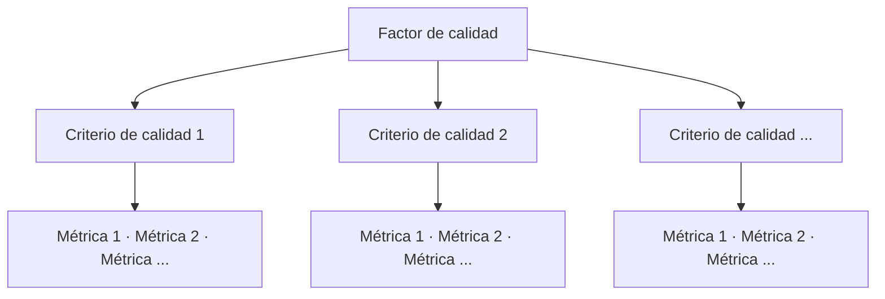

# Modelos de calidad del software (NT, estado del arte)

> [!note] Qué es este documento
> Una **nota técnica** de clase: un artículo de revisión (*estado del arte*) que **clasifica** los
> modelos de calidad y resume casos de implementación. No desarrolla ninguno en profundidad: lo que
> se pregunta de acá es **la clasificación, las definiciones y qué es cada modelo en una línea**.

## 1. Las definiciones de calidad que trae

| Fuente | Definición |
|---|---|
| **El artículo** | *"el grado de desempeño de las principales características con las que debe cumplir un sistema computacional durante su ciclo de vida"* |
| **Pressman (2010)** | *"concordancia con los requisitos funcionales y de rendimiento explícitamente establecidos, con los estándares de desarrollo plenamente documentados y con las características implícitas que se espera de todo software desarrollado profesionalmente"* |
| **IEEE (1990)** | *"el grado con el que un sistema, componente o proceso cumple los requerimientos especificados y las necesidades o expectativas del cliente o usuario"* |

La de Pressman es **la misma idea de los tres puntos de ISO 9126** en la clase: requisitos explícitos,
estándares y requisitos implícitos (→ [[Norma ISO 9126]] §1).

## 2. Qué es un modelo de calidad

> Según **Scalone (2006)**: *"los modelos de calidad son aquellos documentos que integran la mayor
> parte de las mejores prácticas, proponen temas de administración en los que cada organización debe
> hacer énfasis, integran diferentes prácticas dirigidas a los procesos clave y permiten **medir los
> avances en calidad**."*

En software, el modelo *"debe permitir evaluar el sistema, bien sea cualitativa o cuantitativamente"*,
para proponer mejoras en análisis, diseño, desarrollo y pruebas.

## 3. La estructura de un modelo: factor → criterio → métrica

**Figura 1** (Scalone 2006, Bautista 2012): un **factor de calidad** se compone de **criterios de
calidad**, y cada criterio se evalúa con **métricas**. Se va *"de lo general a lo particular"* para
*"reducir la subjetividad en la asignación de un valor"*.

![[adjuntos/nt-modelos-de-calidad/fig1-estructura-factor-criterio-metrica.png]]

| Esta NT | ISO 9126 en clase | Caso Harley-Davidson |
|---|---|---|
| factor | característica | característica |
| criterio | subcaracterística | subcaracterística |
| métrica | (no la da la lámina) | métrica y umbral |

## 4. Los tres enfoques: proceso, producto y uso

| Enfoque | Qué evalúa | Idea clave del artículo |
|---|---|---|
| **Proceso** | cómo se construye | *"la calidad debe ser programada desde el inicio del proyecto"* y controlada en cada etapa; si una etapa se descuida, baja la calidad del proceso **y del producto** |
| **Producto** | el software construido | especificar y evaluar criterios con **medidas internas y/o externas** (Bevan 2010). Las normas definen la calidad de producto en **tres tipos: interna, externa y en uso** |
| **En uso** | el producto usado por usuarios reales | *"conjunto de atributos relacionados con la aceptación por parte del usuario final y seguridad"*, basada en **eficacia, productividad, seguridad y satisfacción** (ISO/IEC 9126) |

> [!warning] Usabilidad ≠ calidad en uso
> Se usan como sinónimos, pero *"el concepto de calidad en uso es más amplio y abarca más elementos que
> la usabilidad"* (Covella, 2005); la usabilidad es **una característica** del producto. Lo desarrolla
> la otra lectura → [[Calidad en uso]].

## 5. Modelos a nivel de PROCESO

**Figura 2 — línea de tiempo**:

| Año | Modelo | En una línea |
|---|---|---|
| 1989 | **ITIL** | Reino Unido, gestión gubernamental. Cinco elementos: perspectiva del negocio, entrega del servicio, soporte del servicio, manejo de la infraestructura y manejo de aplicaciones |
| 1993 | **ISO/IEC 15504** | evaluación de procesos para **pymes** y grupos pequeños. **Seis niveles de madurez** (0 a 5): inmadura, básica, gestionada, establecida, predecible, optimizando |
| 1995 | **Dromey** | evalúa varias etapas: **tres modelos** (de requerimientos, de diseño y de calidad de la implementación), en cinco etapas, para eficiencia, confiabilidad, mantenibilidad, portabilidad, facilidad de uso y funcionalidad |
| 1995 | **PSP** (*Personal Software Process*) | el desarrollo profesional **del ingeniero individual**: calidad, reducción de defectos, estimación y planeación |
| 1996 | **Bootstrap** | metodología de evaluación con **seis actividades**: examinar la necesidad, iniciar el proceso de mejora, preparar y dirigir la evaluación, analizar resultados, implantar y finalizar mejoras |
| 1996 | **TSP** (*Team Software Process*) | *"la fase posterior de PSP"*: **equipos** autodirigidos, mínimo de defectos en tiempo y costo |
| 1996 | **IEEE/EIA 12207** | marco común para **el ciclo de vida**: procesos, actividades y tareas para adquisición, suministro, desarrollo, operación, mantenimiento |
| 1996 | **Cobit 4.0** | orientado a negocios y procesos, **basado en controles**. **Siete criterios** de información: efectividad, eficiencia, confidencialidad, integridad, disponibilidad, cumplimiento y confiabilidad |
| 1997 | **ISO 90003** | guía de aplicación de la **ISO 9001** al software |
| 2000 | **CMMI** | *"de los modelos más utilizados"*; mide con **niveles de madurez**. Dos representaciones (abajo) |
| 2005 | **ISO/IEC 20000** | calidad de los **servicios de TI** gestionados. Dos partes: *Especificaciones* y *Código de buenas prácticas* |

![[adjuntos/nt-modelos-de-calidad/fig2-linea-tiempo-modelos-proceso.png]]

### CMMI — las dos representaciones (pregunta segura)

| Representación | Qué clasifica | Niveles |
|---|---|---|
| **Escalonada** | **la organización** (*"dirigido al software"*) | **5**: inicial, gestionado, definido, gestionado cuantitativamente, en optimización |
| **Continua** | **la capacidad de cada proceso** | **6**: incompleto (0), ejecutado (1), gestionado (2), definido (3), cuantitativamente gestionado (4), en optimización (5) |

> [!warning] Escalonada = 5 niveles de **madurez** (1 a 5); continua = 6 niveles de **capacidad**
> (0 a 5). La diferencia es el nivel 0, *incompleto*, que solo tiene la continua. Y la ISO 15504
> también tiene seis (0 a 5), pero de **madurez de la organización**.

## 6. Modelos a nivel de PRODUCTO

**Figura 3 — línea de tiempo**:

| Año | Modelo | En una línea |
|---|---|---|
| 1977 | **McCall** | *"uno de los modelos pioneros"*. Tres etapas: **factores, criterios y métricas**. **Once criterios base**: exactitud, confiabilidad, eficiencia, integridad, usabilidad, mantenibilidad, testeabilidad, flexibilidad, portabilidad, reusabilidad e interoperabilidad |
| 1984 | **GQM** (*Goal Question Metric*) | define métricas a partir de **metas → preguntas → métricas** |
| 1986 | **Boehm** | ver la trampa de abajo |
| 1987 | **FURPS** | de **Hewlett-Packard**: funcionalidad, usabilidad, confiabilidad (*reliability*), desempeño (*performance*) y soportabilidad |
| 1988 | **Gilb** | atributos **capacidad de trabajo, adaptabilidad, disponibilidad y utilizabilidad**, divididos en subatributos; apoya la gestión de proyectos y la detección de riesgos |
| 1991 | **ISO 9126-1** | *"basado en el modelo de McCall"*. **Cuatro partes**: modelo de calidad, métricas externas, métricas internas y métricas de calidad en uso. Seis características |
| 1997 | **SQAE** (*Software Quality Assessment Exercise*) | basado en Boehm, McCall, Dromey e ISO 9126; evaluación **por terceros**, en tres capas: área, factor y atributo |
| 1998 | **WebQEM** | evaluación de **sitios web** en seis fases (Olsina, 1999) |
| 2005 | **ISO 25000** (SQuaRE) | guía requisitos y evaluación; **ocho** atributos: adecuación funcional, eficiencia de desempeño, compatibilidad, capacidad de uso, fiabilidad, seguridad, mantenibilidad y portabilidad |

![[adjuntos/nt-modelos-de-calidad/fig3-linea-tiempo-modelos-producto.png]]

> [!warning] Las trampas del artículo (está mal en partes — conviene saberlo)
> 1. **Boehm: dos fechas y dos modelos.** La clase dice *Boehm (1978)* como modelo de calidad
>    jerárquico (→ [[Norma ISO 9126]] §2). La NT lo fecha en **1986** y lo describe como *"modelo
>    incremental… cada iteración se divide en cuatro sectores: planeación, análisis de riesgo,
>    ingeniería y evaluación"*: eso es el **modelo en espiral** (→
>    [[Arquitectura de software en el modelo en espiral]]), un modelo de **proceso**, no el modelo de
>    calidad de 1978. Si preguntan por Boehm como **modelo de calidad**, va la versión de clase (1978,
>    jerárquico). Duda 55.
> 2. **"Habilidad" es fiabilidad.** En las listas de ISO 9126 y 25000 dice *"Habilidad"*: es un error de
>    texto por **fiabilidad**.
> 3. **"TPS" en la figura 2 es TSP.**
> 4. **Dromey** aparece en la línea de tiempo de **proceso**, aunque se estructura con características y
>    subcaracterísticas, como los de producto.
> 5. **ISO 9126 en 1991 y ISO 25000 en 2005** son las fechas de la figura; la parte 1 de la 9126 es de
>    2001 (complemento).

## 7. Experiencias de implementación (§4) — lo que hay que retener

Las tablas 1-13 solo listan **empresa, área y país**. Lo que sirve:

| Modelo | Caso que cuenta |
|---|---|
| **CMMI** | *Sistemas y Software Consultores* implementó los niveles 2 y 3; áreas críticas: gestión y desarrollo de requerimientos, verificación y validación. Con **RUP** cubrían parte de CMMI. Cuatro etapas: preparación, inducción y capacitación, implementación y seguimiento, análisis |
| **PSP** | integrado con **Scrum**: bajó el porcentaje de error de casi todos los desarrolladores y mejoró la estimación |
| **TSP** | PRAGMA (Colombia), para subir de nivel en CMMI; roles de las juntas: moderador, cronometrista y anotador |
| **ISO 90003** | Brainstorm Software: menos defectos, más productividad, más compromiso con los requisitos |
| **ITIL** | Eurotrans (Holanda): mesa de servicio centralizada; gestión de incidencias, problemas, cambios, configuración |
| **Cobit 4.0** | Ecopetrol: 28 de los 34 procesos |
| **GQM** | Cuba (académico) y un *core* bancario |
| **FURPS** | diseño y validación de interfaces; útil como **clasificador de requisitos**, pero con muchas métricas |
| **ISO 25000** | Intedya: definición de requisitos de calidad |
| **WebQEM** | universidades argentinas (Rosario, La Plata) |

**Conclusión del artículo**: en Sudamérica hay gran interés por certificar, y **CMMI predomina** en las
empresas de desarrollo. *"Tanto los estándares como los modelos garantizan la calidad tanto del
producto como del proceso"*; cuál implementar *"depende de las necesidades y enfoques de la empresa"*.
Los modelos clásicos son **la base** de los recientes.

## 8. Regla para el examen

- Si piden **clasificar** un modelo: ¿evalúa **cómo se trabaja** (proceso: CMMI, 15504, PSP/TSP, ITIL,
  Cobit, 12207, 90003, 20000, Bootstrap) o **qué se entrega** (producto: McCall, Boehm, FURPS, Gilb,
  GQM, ISO 9126, SQAE, WebQEM, 25000)?
- Si piden la **estructura**: factor → criterio → métrica.
- Si piden **niveles**: CMMI escalonado 5, continuo 6, ISO 15504 6.

## Preguntas de repaso

1. Dá dos definiciones de calidad del artículo (Pressman e IEEE). ¿En qué se parecen a ISO 9126?
2. ¿Qué es un modelo de calidad según Scalone? ¿Cuál es su estructura de tres niveles?
3. ¿Cuáles son los tres enfoques de evaluación de calidad? ¿Por qué calidad en uso no es lo mismo que usabilidad?
4. Nombrá cinco modelos de proceso y cinco de producto, con su año.
5. ¿Qué diferencia hay entre la representación escalonada y la continua de CMMI?
6. ¿Cuáles son los once criterios de McCall? ¿Y de qué letras sale FURPS?
7. ¿Qué tiene de equivocado la descripción de Boehm en el artículo?
