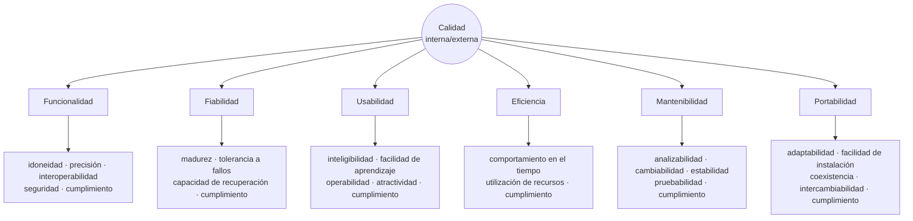

# Norma ISO 9126

> [!note] Ahora es de clase
> Las seis características ya estaban en [[Atributos de calidad]] §3, sacadas del **contenido temático
> del programa** y marcadas como complemento. Desde el 16/10 hay **láminas**: esta nota manda.

## 1. Qué enfatiza la definición — tres puntos

La lámina *DEFINICIÓN* dice que la norma **enfatiza tres puntos importantes**:

| # | Punto | Consecuencia |
|---|---|---|
| 1 | **Los requisitos** del software constituyen el fundamento para medir la calidad | *"La carencia de conformidad con los requisitos es carencia de calidad"* |
| 2 | **Los estándares especificados** definen criterios de desarrollo que guían el trabajo ingenieril | *"Si no se siguen los criterios, la carencia de calidad será un resultado casi seguro"* |
| 3 | Existen **requisitos implícitos** que a menudo no se mencionan (por ejemplo, **mantenibilidad**) | *"Si el software se conforma con los requisitos explícitos pero falla en atender los implícitos, la calidad del software es **sospechosa**"* |

> [!warning] La trampa
> El ejemplo de requisito implícito que da la lámina es la **mantenibilidad**. Nadie la pide en el
> enunciado, y por eso hay que salir a buscarla. Es la misma idea de los atributos **no observables**
> (→ [[Atributos observables y no observables vía ejecución]]).

![[adjuntos/capturas-clase-U3/iso-9126/u3f1-04-definicion-tres-puntos.png]]

## 2. Por qué existe un modelo de calidad

> *"Debido a que la calidad se compone, realmente, de muchas características, la noción de calidad se
> captura, usualmente, en un **modelo** que retrata las características compuestas y sus
> relaciones."*

| | Lo que dice la lámina |
|---|---|
| **Modelos antiguos** | **McCall (1977)** y **Boehm (1978)** |
| **Cómo son** | *"jerárquicos, con refinamientos sucesivos que culminan en **primitivas que se pueden medir directamente**"* |
| **Por qué un estándar** | *"La necesidad de **comparar productos** motiva el trabajo para la definición de un modelo estándar"* |
| **Qué entrega ISO 9126** | *"la definición de las características y los procesos de evaluación de calidad asociados, para usar cuando se **especifican los requisitos** y la **evaluación** de los productos de software a lo largo de su vida útil"* |

![[adjuntos/capturas-clase-U3/iso-9126/u3f1-05-modelado-mccall-boehm.png]]

## 3. La definición de calidad y los seis factores

> ISO 9126 define la Calidad del Software como: *"La totalidad de características de un producto de
> software que se manifiesta en su habilidad para satisfacer necesidades **establecidas o
> implícitas**"*.
>
> *"Se relaciona con **seis factores**: funcionalidad, confiabilidad, eficiencia, usabilidad,
> mantenibilidad y portabilidad."*

![[adjuntos/capturas-clase-U3/iso-9126/u3f1-06-definicion-seis-factores.png]]

### El hexágono: una pregunta por característica

| Característica | La pregunta del hexágono |
|---|---|
| **Funcionalidad** | ¿Las funciones requeridas están disponibles en el software? |
| **Confiabilidad** | ¿Qué tan confiable es el software? |
| **Usabilidad** | ¿Es fácil de usar el software? |
| **Eficiencia** | ¿Qué tan eficiente es el software? |
| **Mantenibilidad** | ¿Qué tan fácil de modificar es el software? |
| **Portabilidad** | ¿Qué tan fácil es transferir el software a otro entorno? |

> [!warning] Confiabilidad = fiabilidad
> El hexágono y la lámina de los seis factores dicen **confiabilidad**; la tabla de subcaracterísticas
> y la rueda dicen **fiabilidad**. En las láminas de ISO 9126 son **la misma característica**
> (*reliability*). Ojo: en la tabla de Bass (§ de no observables) *confiabilidad* también traduce
> *reliability*.

![[adjuntos/capturas-clase-U3/iso-9126/u3f1-07-hexagono-seis-caracteristicas.png]]

## 4. Las seis características con sus subcaracterísticas — las tablas

Cada característica se define como *"un conjunto de atributos relacionados con…"*. Lo que sigue es el
texto de las tablas.

### 4.1 Funcionalidad

> *Un conjunto de atributos que se relacionan con la existencia de un conjunto de funciones y sus
> propiedades específicas. Las funciones son aquellas que satisfacen las necesidades implícitas o
> explícitas.*

| Subcaracterística | Descripción |
|---|---|
| **Adecuación** | presencia y aptitud de un conjunto de funciones para tareas especificadas |
| **Exactitud** | disposición de resultados o efectos correctos o acordados |
| **Interoperabilidad** | habilidad para la interacción con sistemas especificados |
| **Seguridad** | habilidad para prevenir acceso no autorizado, ya sea accidental o deliberado, a programas y datos |
| **Cumplimiento funcional** | *(la lámina lo deja sin descripción)* |

![[adjuntos/capturas-clase-U3/iso-9126/u3f1-08-funcionalidad.png]]

### 4.2 Fiabilidad

> *Un conjunto de atributos relacionados con la capacidad del software de mantener su nivel de
> prestación bajo condiciones establecidas durante un período establecido.*

| Subcaracterística | Descripción |
|---|---|
| **Madurez** | frecuencia de falla por fallas en el software |
| **Recuperabilidad** | capacidad para restablecer su nivel de desempeño y recuperar los datos directamente afectados en caso de falla, y el tiempo y esfuerzo relacionado para ello |
| **Tolerancia a fallos** | habilidad para mantener un nivel especificado de desempeño en casos de fallas de software o de una infracción a su interfaz especificada |
| **Cumplimiento de fiabilidad** | capacidad para adherirse a normas, convenciones o legislación relacionadas con la fiabilidad |

![[adjuntos/capturas-clase-U3/iso-9126/u3f1-09-fiabilidad.png]]

### 4.3 Usabilidad

> *Un conjunto de atributos relacionados con el esfuerzo necesario para su uso, y en la valoración
> individual de tal uso, por un establecido o implicado conjunto de usuarios.*

| Subcaracterística | Descripción |
|---|---|
| **Aprendizaje** | esfuerzo de los usuarios para reconocer el concepto lógico y sus aplicaciones |
| **Comprensión** | esfuerzo de los usuarios para reconocer el concepto lógico y sus aplicaciones |
| **Operatividad** | esfuerzo de los usuarios para la operación y control del software |
| **Atractividad** | *(la lámina lo deja sin descripción)* |

> [!warning] Errata de la lámina
> **Aprendizaje** y **comprensión** tienen la **misma descripción**, palabra por palabra. Es copia y
> pega. La que corresponde a *comprensión* es esa (reconocer el concepto lógico); *aprendizaje* es,
> en la norma, el esfuerzo para **aprender a usar** la aplicación (complemento). Anotado como duda 51.

![[adjuntos/capturas-clase-U3/iso-9126/u3f1-10-usabilidad.png]]

### 4.4 Eficiencia

> *Conjunto de atributos relacionados con la relación entre el nivel de desempeño del software y la
> cantidad de recursos necesitados bajo condiciones establecidas.*

| Subcaracterística | Descripción |
|---|---|
| **Comportamiento en el tiempo** | tiempos de respuesta y procesamiento, y tasas de rendimiento al desempeñar su función |
| **Comportamiento de recursos** | usar las cantidades y tipos de recursos adecuados cuando el software lleva a cabo su función bajo condiciones determinadas |

![[adjuntos/capturas-clase-U3/iso-9126/u3f1-11-eficiencia.png]]

### 4.5 Mantenibilidad

> *Conjunto de atributos relacionados con la facilidad de extender, modificar o corregir errores en un
> sistema software.*

| Subcaracterística | Descripción |
|---|---|
| **Estabilidad** | riesgo de efectos inesperados por modificaciones |
| **Facilidad de análisis** | esfuerzo para el diagnóstico de deficiencias o causas de fallos, o identificación de partes a modificar |
| **Facilidad de cambio** | esfuerzo para la modificación, corrección de falla, o cambio de ambiente |
| **Facilidad de pruebas** | esfuerzo para validar el software modificado |

![[adjuntos/capturas-clase-U3/iso-9126/u3f1-12-mantenibilidad.png]]

### 4.6 Portabilidad

> *Conjunto de atributos relacionados con la capacidad de un sistema software para ser transferido
> desde una plataforma a otra.*

| Subcaracterística | Descripción |
|---|---|
| **Capacidad de instalación** | esfuerzo necesario para instalar el software en un ambiente especificado |
| **Capacidad de reemplazamiento** | oportunidad y esfuerzo de usar el software en lugar de otro software especificado en el ambiente de dicho software |

La tabla deja una **fila vacía** entre las dos: faltan *adaptabilidad* y *coexistencia*, que sí están
en la rueda (§5).

![[adjuntos/capturas-clase-U3/iso-9126/u3f1-13-portabilidad.png]]

## 5. La rueda: el modelo de calidad interna y externa completo

La última lámina de la norma dibuja el modelo entero: al centro **"Calidad Interna/Externa"**, seis
características alrededor y sus subcaracterísticas en el borde. **Cada característica cierra con su
propio *cumplimiento***.

![[adjuntos/capturas-clase-U3/iso-9126/u3f1-14-modelo-calidad-interna-externa.png]]

### Tabla y rueda usan nombres distintos — el mismo concepto

| Característica | En la **tabla** | En la **rueda** |
|---|---|---|
| Funcionalidad | adecuación · exactitud | idoneidad · precisión |
| Fiabilidad | recuperabilidad | capacidad de recuperación |
| Usabilidad | aprendizaje · comprensión · operatividad | facilidad de aprendizaje · inteligibilidad · operabilidad |
| Eficiencia | comportamiento de recursos | utilización de recursos |
| Mantenibilidad | facilidad de análisis · de cambio · de pruebas | analizabilidad · cambiabilidad · pruebabilidad |
| Portabilidad | capacidad de instalación · de reemplazamiento | facilidad de instalación · intercambiabilidad |

| Cuántas | Tabla | Rueda |
|---|---|---|
| Subcaracterísticas | **21** | **27** |
| Lo que falta en la tabla | — | los *cumplimientos* de usabilidad, eficiencia, mantenibilidad y portabilidad, más **adaptabilidad** y **coexistencia** |

> [!important] Regla para el examen
> Si piden **las seis características**: funcionalidad, fiabilidad (o confiabilidad), usabilidad,
> eficiencia, mantenibilidad y portabilidad. Si piden **subcaracterísticas**, la lista completa es la
> de la **rueda** (27); los nombres de la tabla valen como sinónimos. Y recordá que **cada
> característica tiene un *cumplimiento*** (adherirse a normas o legislación de esa característica).

## 6. Dónde cae lo que no está

| Atributo que se busca | Dónde está en ISO 9126 |
|---|---|
| **Seguridad** | subcaracterística de **funcionalidad** |
| **Disponibilidad** | no aparece como tal: se cubre con **fiabilidad** (madurez, tolerancia a fallos, recuperación) |
| **Rendimiento / desempeño** | **eficiencia** (comportamiento en el tiempo) |
| **Interoperabilidad** | subcaracterística de **funcionalidad** |
| **Escalabilidad** | **no está** |

> [!note] Complemento: la sucesora
> ISO 9126 fue reemplazada por **ISO/IEC 25010** (de la familia 25000,
> → [[Familia de normas ISO 25000]]), que tiene **ocho** características: sube **seguridad** y **compatibilidad** a primer
> nivel. Lo de la sucesión no está en las láminas. En el Caso Harley-Davidson se adoptó la 25010
> declarando que sucede a la 9126.

## Notas relacionadas

- [[Calidad del software]] — qué es la calidad y por qué importa
- [[Familia de normas ISO 25000]] — las cinco divisiones
- [[Atributos observables y no observables vía ejecución]] — la otra clasificación de clase
- [[Escenarios de calidad]] — sus ejemplos nombran subcaracterísticas de esta norma
- [[Atributos de calidad]] — la comparación con las otras listas (drivers, FURPS)

## Preguntas de repaso

1. ¿Cuáles son los tres puntos que enfatiza la definición de ISO 9126? ¿Qué ejemplo de requisito implícito da?
2. ¿Qué modelos antiguos nombra la lámina y cómo son? ¿Qué motivó un modelo estándar?
3. Citá la definición de calidad de ISO 9126 y nombrá los seis factores.
4. ¿Bajo qué característica cae la seguridad? ¿Y el tiempo de respuesta?
5. Nombrá las subcaracterísticas de mantenibilidad con los dos juegos de nombres (tabla y rueda).
6. ¿Qué subcaracterística aparece en **todas** las características de la rueda?
