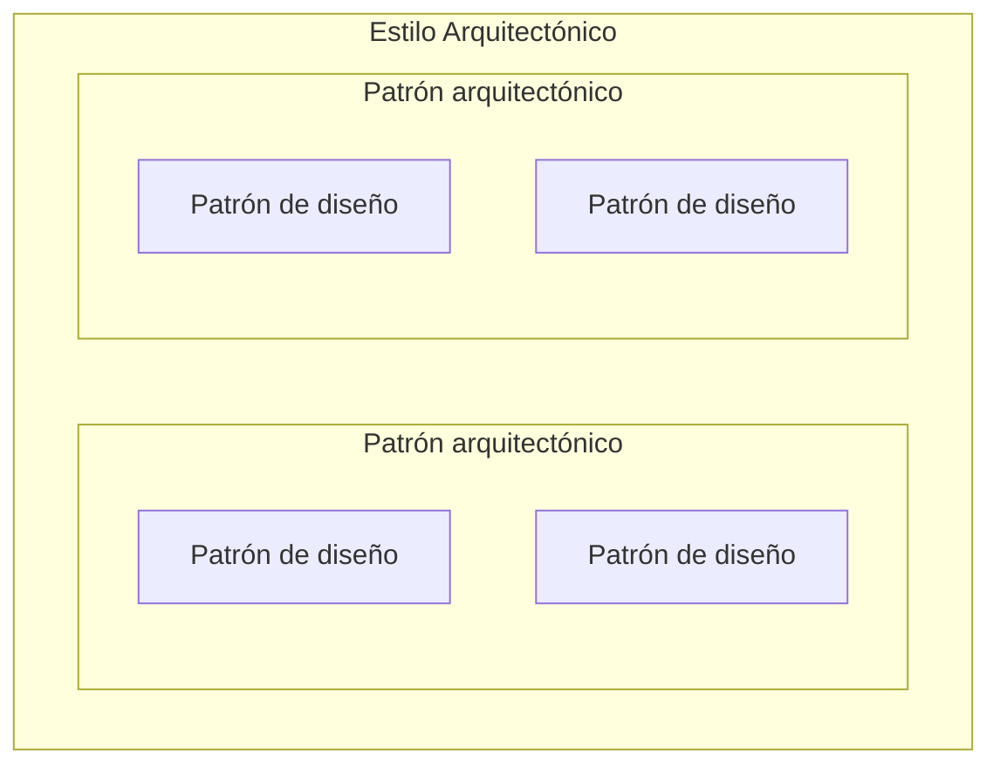

# Patrones arquitectónicos

El segundo de los **dos tipos de patrón** que dio la clase (el primero: [[Patrones de diseño]]).
Se ubican **entre** el patrón de diseño y el estilo: más impacto que el primero, menos alcance que el
segundo.

---

## 1. Qué es: se define por su impacto

Textual de la diapositiva *"Patrones Arquitectónicos"* (capturas_U2_F2, 4):

> Los patrones arquitectónicos tienen un **gran impacto sobre el componente**, lo que quiere decir que
> **cualquier cambio que se realice una vez construido el componente podría tener un impacto mayor**.

![[adjuntos/capturas-clase-U2/patrones/patrones-arquitectonicos-gran-impacto-sobre-el-componente.png]]

El dibujo es el mismo de la portada del tema (capturas_U2_F2, 0), leído a resolución completa:

| Elemento | Qué es |
|---|---|
| `Component` | la caja grande; dos rectángulos en su borde izquierdo (sus puertos/interfaces) |
| `<subcomponent> Singleton` · `<subcomponent> Composite` · `<subcomponent> Factory Method` | tres **patrones de diseño** dibujados **dentro** del componente |
| flechas **punteadas** | salen de `Composite` hacia `Singleton` y hacia `Factory Method` |

> [!note] Lectura nuestra del dibujo (la diapositiva no lo explica)
> Los que aparecen adentro son **patrones de diseño**, no arquitectónicos. El dibujo muestra el
> **componente** sobre el que se mide el impacto: los patrones de diseño viven adentro y lo afectan
> poco; el patrón arquitectónico gobierna al componente entero y a su relación con los otros. Por eso
> la misma figura sirve para las dos definiciones.

## 2. Cómo se reconoce

Textual de *"¿Cómo diferenciar un patrón arquitectónico?"* (capturas_U2_F2, 5):

> Los patrones arquitectónicos son **fáciles de reconocer** debido a que tiene un **impacto global
> sobre la aplicación**, e incluso, el patrón **rige la forma de trabajar o comunicarse con otros
> componentes**, es por ello que a cualquier cambio que se realice sobre ellos tendrá un **impacto
> directo sobre el componente**, e incluso, podría tener **afectaciones con los componentes
> relacionados**

![[adjuntos/capturas-clase-U2/patrones/como-diferenciar-un-patron-arquitectonico.png]]

Las tres señales, en checklist:

1. ¿Tiene **impacto global sobre la aplicación**?
2. ¿**Rige cómo el componente trabaja o se comunica** con otros componentes?
3. Si lo cambiás, ¿el impacto **se propaga** al componente y a los **componentes relacionados**?

Tres "sí" → patrón arquitectónico. Si solo se tocan las clases que lo usan → patrón de diseño.

## 3. Sus categorías, según el árbol

La diapositiva *"Patrones"* (capturas_U2_F2, 1) cuelga de *Patrones Arquitectónicos* tres categorías
conectadas —**Integración**, **Seguridad** y **Web**— y, a la derecha, tres cajas naranjas **sin
línea**: **SOA**, **Comunicación** y **Cloud**.

![[adjuntos/capturas-clase-U2/patrones/arbol-tipos-de-patrones.png]]

> [!question] Pregunta para clase
> ¿*SOA*, *Comunicación* y *Cloud* son también categorías de patrón arquitectónico, o son otra cosa?
> En la diapositiva están en otro color y desconectadas del árbol. Lo más probable es que sean
> categorías que quedaron fuera del conector, pero no está dicho.

## 4. La jerarquía: estilo ⊃ patrón arquitectónico ⊃ patrón de diseño

La diapositiva *"Estilos Arquitectónicos"* (capturas_U2_F2, 6) define el estilo y dibuja cómo se
anidan los tres. Textual:

> Un estilo arquitectónico establece un **marco de referencia** a partir del cual es posible
> construir aplicaciones que **comparten un conjunto de atributos y características** mediante el
> cual es posible identificarlos y clasificarlos

![[adjuntos/capturas-clase-U2/patrones/estilo-contiene-patrones-arquitectonicos-y-de-diseno.png]]

El dibujo es de **contención** (cajas dentro de cajas), no de flechas:

| Caja | Contiene |
|---|---|
| **Estilo Arquitectónico** (gris, la de afuera) | **dos** *Patrón arquitectónico* |
| cada **Patrón arquitectónico** (azul) | **dos** *Patrón de diseño* |
| **Patrón de diseño** (amarillo) | — |

Esquema conceptual:

Lo que se lee: **un estilo se compone de patrones arquitectónicos, y cada patrón arquitectónico se
implementa con patrones de diseño.** Es la misma escala que la definición de capturas_U2 (21): el
patrón tiene *"menor alcance que los estilos arquitectónicos"*. Detalle del estilo en
[[Estilos arquitectónicos]].

## 5. La lista de 13 que dio

Textual de capturas_U2_F2 (8), en su orden:

1. Data Transfer Object (DTO)
2. Data Access Object (DAO)
3. Polling
4. Webhook
5. Load Balance
6. Service Registry
7. Service Discovery
8. API Gateway
9. Access Token
10. Single SignOn (SSO)
11. Store and forward
12. Circuit Breaker
13. Log aggregation

![[adjuntos/capturas-clase-U2/patrones/patrones-arquitectonicos-lista-de-13.png]]

> [!note] COMPLEMENTO — qué es cada uno (conocimiento general, no de la clase)
> La diapositiva solo los nombra. La columna *categoría* es **asignación nuestra** contra las del
> árbol (§3), para ubicarlos; la clase no la hace.
>
> | # | Patrón | Idea en una línea | Categoría probable |
> |---|---|---|---|
> | 1 | DTO | un objeto plano que transporta datos entre capas o por la red, sin lógica | Integración |
> | 2 | DAO | encapsula el acceso a la base de datos detrás de una interfaz | Integración |
> | 3 | Polling | el cliente pregunta periódicamente si hay novedades | Comunicación / Integración |
> | 4 | Webhook | el servidor **avisa** llamando a una URL del interesado cuando ocurre algo (lo inverso de polling) | Comunicación / Web |
> | 5 | Load Balance | reparte las peticiones entre varias instancias | Cloud / Web |
> | 6 | Service Registry | un registro central donde cada servicio anota dónde está | SOA / Cloud |
> | 7 | Service Discovery | cada cliente consulta el registro para encontrar el servicio | SOA / Cloud |
> | 8 | API Gateway | una sola puerta de entrada delante de muchos servicios | Web / SOA |
> | 9 | Access Token | credencial temporal que se envía en cada petición | Seguridad |
> | 10 | SSO | autenticarse una vez y acceder a varias aplicaciones | Seguridad |
> | 11 | Store and forward | guarda el mensaje y lo reenvía cuando el destino está disponible | Comunicación / Integración |
> | 12 | Circuit Breaker | deja de llamar a un servicio que falla repetidamente, para no propagar la caída | Cloud / SOA |
> | 13 | Log aggregation | centraliza los logs de muchos servicios en un solo lugar | Cloud |
>
> Fijate que **ninguno es un estilo**: no organizan el sistema entero (eso hacen capas,
> cliente-servidor, microservicios), sino que resuelven **un aspecto** —cómo se accede a datos, cómo
> se autentica, cómo se toleran fallas— que igual **rige cómo se comunican los componentes**.

## 6. Patrón de diseño vs patrón arquitectónico

La tabla que resume las dos diapositivas (capturas_U2_F2, 2 y 4-5):

| | **Patrón de diseño** | **Patrón arquitectónico** |
|---|---|---|
| **Impacto** | *"relativo con respecto a un componente"*, *"menor"* | *"gran impacto sobre el componente"*, *"impacto global sobre la aplicación"* |
| **Dónde vive** | **dentro** de un componente, entre clases | **entre** componentes: *"rige la forma de trabajar o comunicarse con otros componentes"* |
| **Si lo quitás o cambiás** | *"solo afectaría a las clases que están directamente relacionadas con él"* | *"impacto directo sobre el componente"* y *"afectaciones con los componentes relacionados"* |
| **Para el resto de la arquitectura** | *"impacto imperceptible"* | se nota: arrastra a los relacionados |
| **Reconocerlo** | hay que mirar el código | *"fáciles de reconocer"* |
| **Subtipos que dio** | creacionales · estructurales · comportamiento | integración · seguridad · web (+ SOA, comunicación, cloud) |
| **Ejemplos de su lista** | Singleton, Adapter, Observer (25) | DTO, API Gateway, Circuit Breaker (13) |
| **Dentro de la jerarquía** | el nivel de abajo | contiene patrones de diseño, lo contiene el estilo |

## 7. La trampa: alcance no es impacto

> [!warning] Dos frases que parecen contradecirse, y no se contradicen
> - capturas_U2_F2 (5): el patrón arquitectónico tiene *"un **impacto global** sobre la aplicación"*.
> - capturas_U2 (21): *"**Menor alcance** que los estilos arquitectónicos"*. Y capturas_U2_F2 (22)
>   lo precisa: *"El alcance de un patrón **es menor**, ya que **se concentra en un aspecto** en lugar
>   de hacerlo en toda la arquitectura"*.
>
> ¿Global o menor? Son **dos ejes distintos**:
>
> | Eje | Pregunta | Patrón arquitectónico |
> |---|---|---|
> | **Alcance** | ¿**cuántos aspectos** de la arquitectura cubre? | **uno** (acceso a datos, autenticación, tolerancia a fallas) → **menor que el estilo**, que cubre toda la arquitectura |
> | **Impacto** | si lo cambiás, ¿**hasta dónde se propaga**? | a todo el componente y a los relacionados → **mayor que el patrón de diseño**, que se queda en sus clases |
>
> Ejemplo con su lista: **Circuit Breaker** solo se ocupa de **un aspecto** (qué hacer cuando un
> servicio falla) —alcance chico—, pero cambiarlo altera **cómo se llaman todos los componentes
> entre sí** —impacto grande.

**Regla para el examen:** *el patrón arquitectónico tiene **menos alcance que el estilo** (un solo
aspecto) y **más impacto que el patrón de diseño** (su cambio arrastra al componente y a los
relacionados). Estilo ⊃ patrón arquitectónico ⊃ patrón de diseño.*

## Notas relacionadas

- [[Patrones de diseño]] — el tipo de patrón de menor impacto, y sus tres familias
- [[Estilos arquitectónicos]] — el nivel de mayor alcance, que contiene a los patrones arquitectónicos
- [[Tácticas y patrones arquitectónicos]] — la definición de patrón del SAIP (complemento) y su relación con las tácticas
- [[Diagrama de componentes]] — el componente sobre el que se mide el impacto
- [[Arquitectura en la nube]] — donde viven varios de su lista (load balance, service discovery, circuit breaker)

## Preguntas de repaso

1. ¿Cómo define la clase al patrón arquitectónico? ¿Por qué se dice que es *"fácil de reconocer"*?
2. Si cambiás un patrón arquitectónico, ¿a quién afecta? Compará con un patrón de diseño.
3. Dibujá la jerarquía de la diapositiva *"Estilos Arquitectónicos"*: ¿qué contiene a qué?
4. El patrón arquitectónico tiene *"impacto global"* y *"menor alcance que el estilo"*. ¿Por qué no es
   una contradicción?
5. Nombrá cinco patrones arquitectónicos de la lista de la clase y las tres categorías conectadas en
   el árbol.
