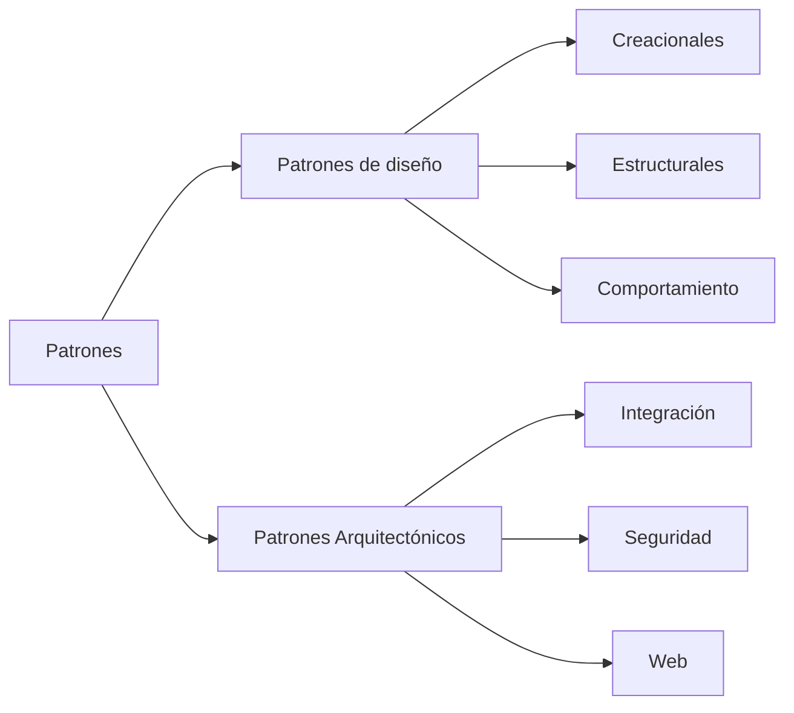

# Patrones de diseño

Uno de los **dos tipos de patrón** que dio la clase; el otro son los [[Patrones arquitectónicos]].
La diferencia entre los dos no es de nombre sino de **impacto**: cuánto se rompe si lo quitás.

> [!info] Dónde está cada cosa
> - Esta nota: qué es un patrón de diseño, sus tres familias y la lista de 25 que dio.
> - [[Patrones arquitectónicos]]: el otro tipo, la tabla comparativa y la jerarquía
>   estilo ⊃ patrón arquitectónico ⊃ patrón de diseño.
> - [[Estilos arquitectónicos]]: el nivel de arriba.

---

## 1. El mapa: dos tipos de patrón

La diapositiva *"Patrones"* (capturas_U2_F2, 1) abre el tema con un árbol:

![[adjuntos/capturas-clase-U2/patrones/arbol-tipos-de-patrones.png]]

Esquema conceptual del árbol (transcripción; la imagen de arriba es la fuente):

Leído a resolución completa:

| Rama | Hijos conectados con línea | Además, sin línea |
|---|---|---|
| **Patrones de diseño** | Creacionales · Estructurales · Comportamiento | — |
| **Patrones Arquitectónicos** | Integración · Seguridad · Web | tres cajas **naranjas sueltas**: **SOA**, **Comunicación**, **Cloud** |

> [!question] Las cajas naranjas no están conectadas
> *SOA*, *Comunicación* y *Cloud* aparecen a la derecha de la rama de patrones arquitectónicos, en
> otro color y **sin línea** que las una al árbol. La lectura más probable es que sean **más
> categorías** de patrón arquitectónico (quedaron fuera del conector), pero la diapositiva no lo
> dice. No las dibujé en el Mermaid por eso. Detalle en [[Patrones arquitectónicos]] §3.

## 2. Qué es

Textual de la diapositiva *"Patrones de Diseño"* (capturas_U2_F2, 2):

> Es la **solución a un problema de diseño**, el cual debe haber **comprobado su efectividad**
> resolviendo problemas similares en el pasado, también tiene que ser **reutilizable**, por lo que se
> deben poder usar para resolver problemas parecidos en contextos diferentes

![[adjuntos/capturas-clase-U2/patrones/patrones-de-diseno-definicion-e-impacto.png]]

De la definición salen **dos condiciones** para que algo sea patrón y no una simple buena idea:

| Condición | Qué exige | Qué descarta |
|---|---|---|
| **Efectividad comprobada** | haber resuelto problemas similares **en el pasado** | la solución ingeniosa que se te ocurrió hoy |
| **Reutilizable** | servir para problemas parecidos **en contextos diferentes** | la solución atada a un solo sistema |

## 3. Su impacto: relativo, local al componente

La misma diapositiva sigue —textual:

> Como regla general, los patrones de diseño tienen un **impacto relativo con respecto a un
> componente**, esto quiere decir que tiene un impacto menor sobre todo el componente. Dicho de otra
> forma, si quisiéramos **quitar o remplazar el patrón de diseño, solo afectaría a las clases que
> están directamente relacionadas con él**, y un **impacto imperceptible para el resto de componentes**
> que conforman la arquitectura.

La prueba mecánica que sale de ahí, y que sirve para clasificar cualquier patrón en el examen:

> **La prueba de quitarlo.** Imaginá que lo sacás.
> - ¿Solo se tocan **las clases que lo usan**, y el resto de componentes ni se entera? → **patrón de diseño**.
> - ¿Cambia **cómo trabaja o se comunica** el componente con otros, y arrastra a los relacionados? →
>   **patrón arquitectónico** (ver [[Patrones arquitectónicos]] §2).

El dibujo que usa para ilustrarlo (capturas_U2_F2, 0 y 4) pone *Singleton*, *Composite* y *Factory
Method* como `<subcomponent>` **dentro** de un `Component`: el patrón de diseño vive **adentro** de
un componente, a nivel de clases. Está embebido en [[Patrones arquitectónicos]] §1.

## 4. Las tres familias

Textual de capturas_U2_F2 (3):

> **Patrones Creacionales:** Son patrones de diseño relacionados con la **creación o construcción de
> objetos**. Estos patrones intentan controlar la forma en que los objetos son creados, implementando
> mecanismos que **eviten la creación directa de objetos**.

> **Patrones Estructurales:** Son patrones que tiene que ver con la **forma en que las clases se
> relacionan con otras clases**. Estos patrones ayudan a dar un mayor orden a nuestras clases
> ayudando a crear componentes más flexibles y extensibles.

> **Patrones de Comportamiento:** Son patrones que están relacionados con **procedimientos y con la
> asignación de responsabilidad a los objetos**. Los patrones de comportamiento engloban también
> **patrones de comunicación** entre ellos

![[adjuntos/capturas-clase-U2/patrones/patrones-de-diseno-creacionales-estructurales-comportamiento.png]]

| Familia | Pregunta que responde | Palabra clave para el examen |
|---|---|---|
| **Creacionales** | ¿**cómo se crea** el objeto? | evitar la creación directa (`new`) |
| **Estructurales** | ¿**cómo se relacionan** las clases? | orden, flexibilidad, extensibilidad |
| **Comportamiento** | ¿**quién hace qué** y cómo se comunican los objetos? | responsabilidad, procedimientos, comunicación |

## 5. La lista de 25 que dio

Textual de capturas_U2_F2 (7), en su orden y numeración:

| # | Patrón | # | Patrón |
|---|---|---|---|
| 1 | Factory Method | 14 | Iterator |
| 2 | Abstract Factory | 15 | Command |
| 3 | Singleton | 16 | Observer |
| 4 | Builder | 17 | Template Method |
| 5 | Prototype | 18 | Strategy |
| 6 | Object Pool | 19 | Chain of Responsibility |
| 7 | Adapter | 20 | Interpreter |
| 8 | Bridge | 21 | Mediator |
| 9 | Composite | 22 | Memento |
| 10 | Decorator | 23 | Null Object |
| 11 | Facade | 24 | State |
| 12 | Flyweight | 25 | Visitor |
| 13 | Proxy | | |

![[adjuntos/capturas-clase-U2/patrones/patrones-de-diseno-lista-de-25.png]]

La diapositiva **no dice a qué familia pertenece cada uno**. Lo que sigue es COMPLEMENTO:

> [!note] COMPLEMENTO — la lista está ordenada por familia (conocimiento general, no de la clase)
> El orden no es casual: coincide con la clasificación clásica.
>
> | Familia | Números de su lista | Patrones |
> |---|---|---|
> | **Creacionales** | 1–6 | Factory Method, Abstract Factory, Singleton, Builder, Prototype, Object Pool |
> | **Estructurales** | 7–13 | Adapter, Bridge, Composite, Decorator, Facade, Flyweight, Proxy |
> | **Comportamiento** | 14–25 | Iterator, Command, Observer, Template Method, Strategy, Chain of Responsibility, Interpreter, Mediator, Memento, Null Object, State, Visitor |
>
> Son **25 y no 23**: los 23 del libro de la "pandilla de los cuatro" (GoF, 1994) más **Object Pool**
> y **Null Object**, que no están en GoF pero aparecen en catálogos posteriores. Si en el examen piden
> "los patrones que vimos", la lista es **la de ella, de 25**.

> [!note] COMPLEMENTO — una línea por patrón (conocimiento general, para ubicarlos)
> | Patrón | Idea en una línea |
> |---|---|
> | Factory Method | una subclase decide qué clase concreta instanciar |
> | Abstract Factory | crea **familias** de objetos relacionados sin nombrar sus clases concretas |
> | Singleton | una sola instancia de la clase, con acceso global |
> | Builder | arma un objeto complejo paso a paso |
> | Prototype | crea objetos **clonando** uno existente |
> | Object Pool | reutiliza objetos caros de crear (conexiones) en vez de crearlos cada vez |
> | Adapter | hace compatible una interfaz con otra que el cliente espera |
> | Bridge | separa una abstracción de su implementación para que varíen por separado |
> | Composite | trata igual a un objeto y a un árbol de objetos |
> | Decorator | agrega responsabilidades a un objeto envolviéndolo |
> | Facade | una interfaz simple delante de un subsistema complejo |
> | Flyweight | comparte el estado común de muchos objetos pequeños |
> | Proxy | un sustituto que controla el acceso al objeto real |
> | Iterator | recorre una colección sin exponer su estructura |
> | Command | encapsula una petición como objeto (deshacer, colas) |
> | Observer | cuando un objeto cambia, notifica a sus suscriptores |
> | Template Method | el esqueleto del algoritmo en la clase base, los pasos en las subclases |
> | Strategy | algoritmos intercambiables detrás de una misma interfaz |
> | Chain of Responsibility | la petición pasa por una cadena hasta que alguien la atiende |
> | Interpreter | evalúa sentencias de un lenguaje pequeño |
> | Mediator | los objetos se comunican a través de un intermediario, no directamente |
> | Memento | guarda y restaura el estado de un objeto |
> | Null Object | un objeto que "no hace nada" en lugar de `null` |
> | State | el comportamiento cambia según el estado interno |
> | Visitor | agrega operaciones a una estructura sin modificar sus clases |

---

## 6. La trampa

> [!warning] Tres confusiones que esta diapositiva busca evitar
> 1. **Patrón de diseño ≠ patrón arquitectónico.** No se distinguen por el nombre sino por el
>    **impacto**: el de diseño afecta solo a *"las clases que están directamente relacionadas con
>    él"*; el arquitectónico, a cómo el componente *"trabaja o se comunica con otros componentes"*.
> 2. **Patrón de diseño ≠ estilo.** Los estilos (capas, cliente-servidor) organizan el sistema
>    entero; los patrones de diseño viven **dentro** de un componente. Ver la jerarquía en
>    [[Patrones arquitectónicos]] §4.
> 3. **Impacto "relativo" no es "sin importancia".** Es *local*: grande para las clases que lo usan,
>    imperceptible para el resto de la arquitectura.

**Regla para el examen:** *patrón de diseño = solución probada y reutilizable a un problema de
diseño · impacto local (solo las clases relacionadas) · tres familias: creacionales (crear),
estructurales (relacionar clases), comportamiento (responsabilidades y comunicación).*

## Notas relacionadas

- [[Patrones arquitectónicos]] — el otro tipo de patrón, y la tabla que los compara
- [[Estilos arquitectónicos]] — el nivel de mayor alcance, que contiene a los patrones
- [[Tácticas y patrones arquitectónicos]] — el uso de "patrón" en el SAIP (complemento)
- [[Diagrama de clases]] — el nivel en el que se ve un patrón de diseño
- [[Diagrama de componentes]] — el componente dentro del cual viven

## Preguntas de repaso

1. Dá la definición de patrón de diseño de la clase. ¿Cuáles son las dos condiciones que exige?
2. ¿Qué pasa si quitás o reemplazás un patrón de diseño? ¿A quién afecta y a quién no?
3. Nombrá las tres familias de patrones de diseño y qué pregunta responde cada una.
4. ¿A qué familia pertenecen Singleton, Adapter y Observer? ¿Cómo lo deducís de la lista de 25?
5. ¿Por qué la lista de la clase tiene 25 patrones si el catálogo GoF tiene 23?
