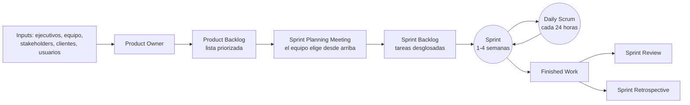

# Proceso Scrum en la arquitectura de software

Los tres roles y la comparación con la cascada están en [[Metodologías predictivas y ágiles]]. Esta
nota cubre **cómo funciona un sprint** y, sobre todo, **dónde entra la arquitectura** dentro de Scrum.

## 1. Scrum en una lámina — el flujo del sprint

| Elemento (lámina) | Lo que dice | En español *(complemento)* |
|---|---|---|
| **Inputs** | *from Executives, Team, Stakeholders, Customers, Users* | todo entra por el Product Owner |
| **Product Backlog** | *Ranked list of what is required: features, stories, …* | **pila de producto**, priorizada |
| **Sprint Planning Meeting** | *Team selects starting at top as much as it can commit to deliver by end of Sprint* | el equipo toma **desde arriba** lo que puede comprometer |
| **Sprint Backlog** | *Task Breakout* | **pila del sprint**, en tareas |
| **Sprint** | *1-4 Week Sprint* | iteración de 1 a 4 semanas |
| **Daily Scrum Meeting** | *Every 24 Hours* | reunión diaria |
| *Burndown/up Charts* | (junto al Scrum Master) | gráficos de avance |
| La regla | ***Sprint end date and team deliverable do not change*** | **la fecha de fin y el entregable del sprint no cambian** |
| Salidas | *Finished Work*, *Sprint Review*, *Sprint Retrospective* | trabajo terminado, revisión y retrospectiva |

![[adjuntos/capturas-clase-U3/metodologias/u3f3-06-scrum-flujo-sprint.png]]

## 2. Las ceremonias y sus preguntas

| Ceremonia | Qué se hace (lámina) |
|---|---|
| **Product / Release Planning** | creación de la **Pila de Producto** a muy alto nivel · discutir riesgos, costes, fechas, estimaciones y prioridades · **modelado o diseño de alto nivel** (opcional) |
| **Sprint planning meeting** | el **DP** (dueño del producto) identifica la **meta del sprint** · re-priorización de la Pila de Producto · crear tareas desde la Pila de Producto · estimación de las tareas · crear la **Pila de Sprint** |
| **Daily meeting** | ¿qué has hecho desde la última reunión? · ¿qué harás hasta la próxima? · ¿problemas? |
| **Sprint review / Demo** | demostración de lo hecho en el sprint · revisar el progreso: ¿qué se ha terminado? ¿qué no se ha finalizado? |
| **Sprint retrospective** | ¿qué hemos hecho bien? · ¿qué debemos mejorar? · ¿qué deberíamos intentar? |

> [!warning] Dos trampas
> 1. **Review ≠ retrospective.** La *review* mira el **producto** (qué se terminó); la
>    *retrospective* mira **el proceso del equipo** (qué mejorar).
> 2. **¿1-4 o 2-4 semanas?** Las láminas 6 y 38 dicen **1-4**; la de ceremonias dice **2-4**. Si
>    preguntan, *"de 1 a 4 semanas"* cubre las dos; mencioná la otra cifra. Duda 56.

![[adjuntos/capturas-clase-U3/metodologias/u3f3-08-scrum-ceremonias-preguntas.png]]

## 3. Qué hace cada rol — las responsabilidades

| Product Owner | Team | Scrum Master |
|---|---|---|
| User Stories | Perform the 'Work' | Facilitate Meetings |
| Acceptance Criteria | Adapt to Change | Coach the team |
| Product Vision | Decompose Stories | Impediments |
| Prioritization | Size Stories | Provide Feedback |
| Stakeholders | Shippable Features | Help write stories |

*(En español: el PO escribe historias, criterios de aceptación, visión y prioridades, y trata con los
stakeholders; el equipo hace el trabajo, se adapta, descompone y estima historias y entrega
funcionalidades listas; el Scrum Master facilita reuniones, entrena al equipo, quita impedimentos, da
retroalimentación y ayuda a escribir historias.)*

![[adjuntos/capturas-clase-U3/metodologias/u3f3-07-scrum-responsabilidades-por-rol.png]]

## 4. Proceso Scrum en la arquitectura de software — los 14 pasos

La lámina clave. El centro es el **Backlog del proyecto**; los pasos giran alrededor, con su rol
dibujado encima. La leyenda distingue **ceremonia**, **historia de usuario**, **tarea**, **flujo de
información** y los roles: propietario del producto, maestro Scrum, otros interesados y equipo de
desarrollo.

| # | Paso | ¿Recuadro resaltado? |
|---|---|---|
| 1 | **Especificación de CDU** | **sí** |
| 2 | **Priorización de CDU** | **sí** |
| 3 | Especificación de tareas | |
| 4 | **Definición de la arquitectura base (primer *sprint*)** | **sí** |
| 5 | Estimación de esfuerzos | |
| 6 | Planeación de entregas | |
| 7 | Planeación del *sprint* | |
| 8 | Refinamiento de historias de usuario | |
| 9 | **Refinamiento de la arquitectura (*sprint* 1 al *n*)** | **sí** |
| 10 | Desarrollo del producto | |
| 11 | Junta diaria del *sprint* | |
| 12 | Revisión del *sprint* | |
| 13 | Retrospectiva del *sprint* | |
| 14 | Refinamiento del *backlog* | |

Entre el 13 y el 14 aparecen ***Ideas o problemas***; del 10 sale el **incremento — producto
ejecutable**; del 8 se arma el **Backlog del sprint**.

![[adjuntos/capturas-clase-U3/metodologias/u3f3-05-proceso-scrum-en-la-arquitectura.png]]

> [!important] Lo que hay que llevarse
> Los **cuatro pasos resaltados** son los de la arquitectura: **1, 2, 4 y 9**.
> - Los requisitos entran como **CDU** especificados y **priorizados** (pasos 1-2): son los drivers
>   funcionales del curso (→ [[Drivers arquitectónicos]]).
> - La arquitectura **base** se define en el **primer sprint** (paso 4).
> - Y se **refina en cada sprint, del 1 al n** (paso 9).
>
> O sea: en Scrum **no se renuncia a la arquitectura**; se hace una base temprana y se la refina
> iterando. Es lo mismo que defiende la NT3 con los RSA (→ [[Arquitectura ágil]]).

## Preguntas de repaso

1. ¿Qué entra al Product Backlog y quién lo gestiona?
2. ¿Qué no puede cambiar durante un sprint?
3. ¿Qué tres preguntas tiene la daily? ¿Y la retrospectiva?
4. ¿En qué se diferencian sprint review y sprint retrospective?
5. En el proceso de 14 pasos, ¿cuáles son los pasos de arquitectura y en qué sprint ocurre cada uno?
