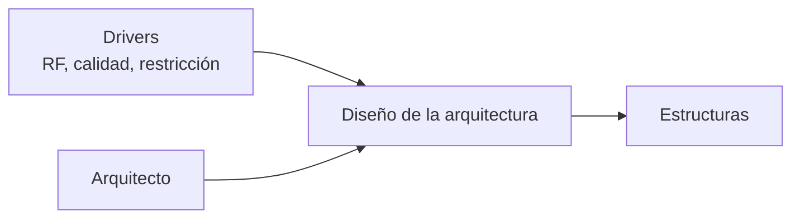
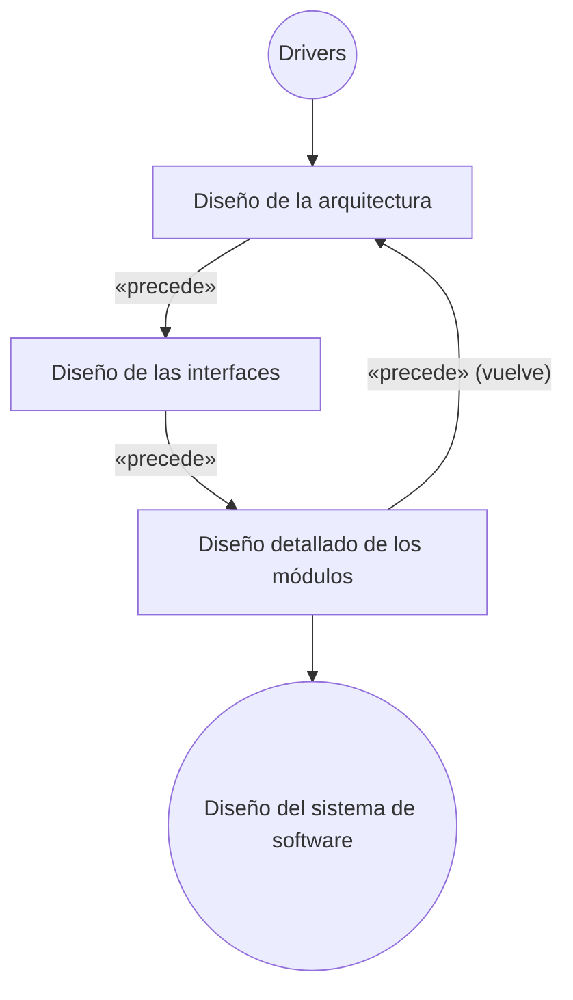
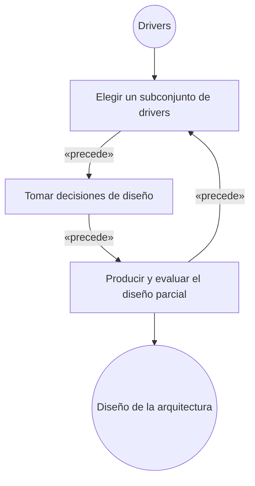

# Proceso general de diseño de la arquitectura

## 1. El diseño como caja negra

> **Diseño como caja negra**: *"las entradas están a la izquierda, las salidas a la derecha y los
> responsables arriba"*.

| Posición | Qué hay | En la lámina |
|---|---|---|
| **Entrada** (izquierda) | **Drivers** | *RF, CALIDAD, RESTRICCIÓN* (los tres tipos, → [[Drivers arquitectónicos]]) |
| **Responsable** (arriba) | **Arquitecto** | → [[Arquitecto de software]] |
| **Proceso** (centro) | **Diseño de la arquitectura** | — |
| **Salida** (derecha) | **Estructuras** | → [[Estructuras y vistas arquitectónicas]] |

Al lado, en verde, la definición de arquitectura que explica **por qué la salida son estructuras**:

> *"La Arquitectura de Software de un programa o sistema es **la estructura o estructuras del
> sistema**, la cual comprende los componentes de software, las propiedades externas visibles de estos
> elementos y las relaciones entre ellos."*

*(Es la definición de Bass, Clements y Kazman — complemento: la lámina no da el autor.)*

![[adjuntos/capturas-clase-U3/diseno-arquitectura/u3f1-43-caja-negra-drivers-estructuras.png]]

> [!important] La frase que resume todo
> *"La etapa del diseño de la arquitectura puede verse como una **transformación**, que realiza el
> **arquitecto**, de los **drivers** hacia las distintas **estructuras** que componen a la
> arquitectura."* (lámina 45)

## 2. Los niveles de diseño

*"Representación de los niveles de diseño"*:

| Nivel | Qué produce |
|---|---|
| 1. **Diseño de la arquitectura** | las estructuras (el nivel más abstracto) |
| 2. **Diseño de las interfaces** | cómo se comunican los elementos |
| 3. **Diseño detallado de los módulos** | el interior de cada módulo |
| Salida | **Diseño del sistema de software** |

**Tres niveles, en ese orden, con `«precede»` entre cada uno y un `«precede»` de retorno** desde el
diseño detallado hasta el de la arquitectura: es un ciclo, no una cascada.

> [!warning] La trampa
> El diseño de la arquitectura **precede** al detallado: es lo que ya decía
> [[Arquitectura en el ciclo de vida del software]] (*"previo al diseño detallado"*). Por eso el
> [[Diagrama de clases]] pertenece al **tercer** nivel, no al primero.

![[adjuntos/capturas-clase-U3/diseno-arquitectura/u3f1-44-niveles-de-diseno.png]]

## 3. El proceso general: dos ciclos

La lámina 45 pone los niveles de diseño a la izquierda (cajas oscuras) y, a la derecha, **lo que
pasa dentro de "Diseño de la arquitectura"** (cajas claras), unidos por dos líneas punteadas:

| Ciclo de la **derecha** (dentro del diseño de la arquitectura) | |
|---|---|
| Entrada | **Drivers** |
| 1 | **Elegir un subconjunto de *drivers*** |
| 2 | **Tomar decisiones de diseño** |
| 3 | **Producir y evaluar el diseño (parcial)** |
| Retorno | `«precede»` de vuelta a *Elegir un subconjunto* |
| Salida | **Diseño de la arquitectura** |

**Leído con zoom**: la punteada de arriba sale de la esquina superior de *Diseño de la arquitectura*
hacia *Elegir un subconjunto de drivers*; la de abajo sale del costado de *Diseño de las interfaces* y
llega a la base de *Producir y evaluar*. **Lectura tomada:** el ciclo de la derecha es la **ampliación**
de la caja *Diseño de la arquitectura* (convención de "zoom" del libro de origen).

> [!tip] Por qué un **subconjunto** de drivers
> No se diseña con todos los drivers a la vez: se toma un grupo (los de prioridad más alta), se decide,
> se produce un diseño **parcial**, se evalúa y se vuelve por el siguiente grupo. Es la misma idea que
> el método ADD del SAIP *(complemento)* y que la priorización por dos ejes de los drivers de calidad.

![[adjuntos/capturas-clase-U3/diseno-arquitectura/u3f1-45-proceso-general-dos-ciclos.png]]

## 4. Cómo se conecta con lo que ya estaba

| Ya estaba | Qué agrega esta serie |
|---|---|
| [[Proceso de diseño arquitectónico]]: los 4 pasos, los 7 pasos y el ciclo de 5 etapas con `«precede»` | qué pasa **dentro** de la etapa DISEÑO (los dos ciclos) |
| [[Método de diseño centrado en la arquitectura]]: 8 etapas | el mismo movimiento (drivers → decisiones → evaluación), más compacto |
| [[Ciclo de desarrollo de la arquitectura]] | dónde cae este diseño dentro del desarrollo del sistema |

## Preguntas de repaso

1. Dibujá el diseño como caja negra: ¿qué va a la izquierda, a la derecha y arriba?
2. ¿Por qué la salida del diseño son *estructuras*? Citá la definición de la lámina.
3. ¿Cuáles son los tres niveles de diseño y en qué orden van?
4. ¿Cuáles son los tres pasos del ciclo interno del diseño de la arquitectura?
5. ¿Por qué se elige un *subconjunto* de drivers y no todos?
