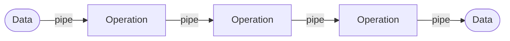
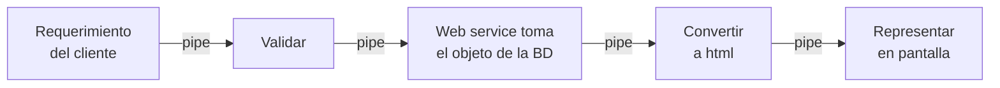

# Tuberías y filtros

El miembro de la familia [[Arquitectura centrada en el flujo de datos]] que la clase **desarrolló a
fondo**: definición, cuándo usarlo, aplicación típica, ejemplos, un caso con requisito de seguridad y
ventajas/desventajas. En el árbol C & C es *Pipes and filters*, con dos hijos: *Pipeline* y *UNIX
pipe-and-filter* (ver [[Catálogo de estilos arquitectónicos]] §2).

> [!important] Esta nota es NÚCLEO
> Sale de diapositivas con el subtítulo en rojo **"–arquitectura centrada en el flujo de datos–"** y el
> encabezado **"Tuberías y filtros"** (18, 19, 21, 27), más sus figuras de ejemplo (20, 22-24) y la
> lámina **"Un ejemplo de uso del patrón Filtros y Tuberías - Requisito de Seguridad"** (25, 26).
> La ficha que había en [[Estilos arquitectónicos]] §8 era **complemento** (Reynoso, SAIP); donde choca
> con esto, **manda esta nota** (ver §9).

---

## 1. Qué es (captura 18)

Textual:

> **Tuberías y filtros**
> - Una tubería (pipeline) es una arquitectura que conecta componentes computacionales (filtros) a
>   través de los conectores (pipes) y las comunicaciones se ejecutan como un flujo.

![[adjuntos/capturas-clase-U2/flujo-datos/tuberias-filtros-definicion-pipeline.png]]

| Término de la diapositiva | Qué es | Tipo |
|---|---|---|
| **Tubería (*pipeline*)** | la **arquitectura completa**: la cadena entera | la configuración |
| **Filtro** | *"componente computacional"* | **componente** |
| **Pipe** | *"conector"* | **conector** |
| **Flujo** | cómo se ejecutan las comunicaciones | la interacción |

> [!warning] Ojo con la palabra "tubería"
> La diapositiva usa **"tubería"** para *pipeline* (la arquitectura entera) y **"pipes"** para el
> conector. En la figura, en cambio, **"Tuberías"** rotula los **conectores** (las flechas). En la
> captura 21 queda claro: **Pipe** = un tramo, **Pipeline** = todo. Cuando lo escribas: *pipe* o
> tubería = conector · *pipeline* = la cadena completa.

### La figura de la 18, leída con zoom

Diez cajas iguales rotuladas **"Filtro"** y un rótulo **"Tuberías"** con tres líneas que señalan
tres de las flechas (la de entrada, la de Filtro 1 → Filtro 2 y una de las que salen de Filtro 2).
Para poder nombrarlas, se numeran **por posición** (la numeración es propia, la diapositiva no la tiene):

| Filtro | Posición |
|---|---|
| F1 | columna 1 (recibe la entrada) |
| F2 | columna 2 |
| F3 · F4 · F5 · F6 | columna 3, de arriba abajo (F6 es el más bajo) |
| F7 · F8 | columna 4, arriba y abajo |
| F9 · F10 | columna 5, arriba y abajo |

| # | Desde | Hacia |
|---|---|---|
| 1 | entrada | F1 |
| 2 | F1 | F2 |
| 3 | F2 | F3 |
| 4 | F2 | F4 |
| 5 | F2 | F5 |
| 6 | F3 | F7 |
| 7 | F7 | F9 |
| 8 | F4 | F9 |
| 9 | F5 | F8 |
| 10 | F8 | F9 |
| 11 | F8 | F10 |
| 12 | F8 | F6 (vuelve hacia la izquierda, por abajo) |
| 13 | F6 | F5 (sube y entra a F5) |
| 14 | F9 | salida |
| 15 | F10 | salida |

**Lo que muestra la figura** y hay que notar: un filtro puede tener **varias salidas** (F2, F8) y
**varias entradas** (F9, F5); hay **dos salidas** del sistema; y **hay un ciclo** F5 → F8 → F6 → F5.
O sea: el *pipeline* no tiene por qué ser una línea recta. (Contrastalo con la desventaja de la 27,
§8.)

---

## 2. Qué hace un filtro (captura 19)

Textual:

> - Los filtros no necesariamente realizan únicamente tareas de filtrado sino que ejecutan formas
>   variables de transformación
> - Esta [sic] diseñado para esperar la entrada de datos con cierta forma y producir su salida (al
>   siguiente filtro) de una forma específica. (no es necesario que el filtro conozca el
>   funcionamiento de los filtros vecinos. [sic: el paréntesis no se cierra]

![[adjuntos/capturas-clase-U2/flujo-datos/tuberias-filtros-transformacion-aplicacion-tipica.png]]

| Idea | Lo que implica |
|---|---|
| **"Filtro" no es solo filtrar** | *transforma*: convierte, enriquece, valida, agrega, formatea |
| **Contrato de forma** | espera la entrada **con cierta forma** y entrega la salida **de una forma específica** |
| **No conoce a los vecinos** | solo conoce el **formato** de lo que recibe y de lo que entrega → por eso se puede **reemplazar o reordenar** |

---

## 3. Cuándo usarlo (captura 21)

Textual:

> **Tuberías y filtros**
> Este estilo se podría usar cuando:
> - Se puede especificar la secuencia de un número conocido de pasos
> - No se requiere esperar la respuesta asincrónica de cada paso
> - Se busca que todos los componentes de abajo sean capaces de inspeccionar y
> - actuar sobre los datos que vienen de arriba (no viceversa).

![[adjuntos/capturas-clase-U2/flujo-datos/tuberias-filtros-cuando-usar-pipeline.png]]

> [!note] Son **tres** condiciones, no cuatro
> La diapositiva muestra cuatro viñetas, pero la tercera está **partida**: *"…capaces de inspeccionar
> y / actuar sobre los datos que vienen de arriba (no viceversa)"* es **una sola** condición.

| Condición | En palabras de todos los días |
|---|---|
| **Número conocido de pasos**, en secuencia especificable | sé de antemano qué transformaciones van y en qué orden |
| **No hay que esperar la respuesta asincrónica** de cada paso | ningún paso se queda esperando que otro le conteste: el dato **sigue de largo** |
| Los de **abajo** inspeccionan y actúan sobre lo que viene de **arriba**, **no viceversa** | el flujo es **unidireccional**: nadie devuelve datos río arriba |

**La figura de la 21**, leída con zoom: una caja **Data** a la izquierda con una flecha curva que
entra a un tubo; **tres tramos de tubo** separados por **tres piezas trapezoidales**; una flecha curva
sale del último tubo hacia otra caja **Data** a la derecha. Rótulos: **Pipe** señala un tubo,
**Operation** señala una pieza trapezoidal, y una llave debajo de todo dice **Pipeline**.

| Rótulo | Señala | Equivale a |
|---|---|---|
| **Data** (dos) | entrada y salida | los datos |
| **Pipe** | un tramo de tubo | el **conector** (tubería) |
| **Operation** | una pieza entre tubos | el **filtro** |
| **Pipeline** | la llave bajo todo el conjunto | la **arquitectura** completa |

Patrón conceptual (esquema propio, no el dibujo de la clase):

---

## 4. La aplicación típica (captura 19) y la API RESTful (captura 20)

La segunda mitad de la 19, textual:

> - La aplicación típica es un procesamiento clásico de datos:
>   - El cliente hace un requerimiento
>   - El requerimiento se valida
>   - Un web Service toma el objeto de la base de datos
>   - Este objeto se convierte en html
>   - Se efectúa la representación en pantalla

Cada viñeta es un **filtro**; lo que pasa de una a otra es el dato transformado:

La **captura 20**, con el mismo subtítulo *"–arquitectura centrada en el flujo de datos–"*, trae una
figura de un **servicio web RESTful** y, a la derecha, esta definición textual:

> Una API RESTful es una interfaz que dos sistemas de computación utilizan para intercambiar
> información de manera segura a través de Internet.

![[adjuntos/capturas-clase-U2/flujo-datos/api-restful-web-service-azure-table.png]]

La figura, leída con zoom (cinco pasos numerados en círculos rojos):

| Paso | Qué muestra |
|---|---|
| **1** | tres teléfonos móviles (Android, iPhone, Windows Phone) → la caja **HTTP Verb + URL** |
| — | una línea **punteada** une esa caja con la tabla de abajo: *"The mobile client application issues a **GET**, sending the following **URL**:"* · HTTP verb = `GET` · URL = `http://fastmotorcycleservice.cloudapp.net/FastMotorcycleListService.svc/list/Bruno` |
| — | de la caja *HTTP Verb + URL* sale una flecha que entra al **RESTful Web Service** (con código de consulta adentro) |
| **2** | *RESTful Web Service* → **Windows Azure Table** (flecha hacia arriba) |
| **3** | *Windows Azure Table* → *RESTful Web Service* (flecha hacia abajo). Junto a la tabla, **All the Data**: PartitionKey/RowKey = Bruno/GSXR1000, Bruno/Hayabusa, John/ZX-10, John/Repsol, John/Harley |
| **4** | *RESTful Web Service* → caja *HTTP Verb + URL* (flecha hacia arriba: la respuesta) |
| **5** | junto a los teléfonos, **Subset of the Data**: solo Bruno/GSXR1000 y Bruno/Hayabusa |

> [!note] Por qué REST aparece acá — lectura propia, no lo dice la diapositiva
> La 20 está **entre** la aplicación típica (19) y *"cuándo usar"* (21), con el subtítulo de flujo de
> datos. La lectura más consistente es que **ilustra la aplicación típica** de la 19: el cliente hace
> un requerimiento (1: `GET` + URL), un web service toma los objetos de la base de datos (2-3), filtra
> *all the data* hasta el *subset* de Bruno y lo devuelve para mostrarlo (4-5). **El dato atraviesa
> una cadena de transformaciones.** No afirma que REST **sea** un estilo de flujo de datos: en el
> catálogo textual de clase, *"basadas en Recursos"* (REST) va bajo **peer-to-peer**, y en su lista de
> 9 REST es un estilo propio. Ver §9.

---

## 5. Por qué favorece la reutilización (capturas 22 y 23)

### Captura 22 — sin tuberías y filtros: módulos monolíticos

Leída con zoom (en inglés en la diapositiva):

| Elemento | Contenido |
|---|---|
| **Data from Source 1** → círculo de arriba | el módulo tiene adentro **Task A, Task B, Task C, Task D** |
| **Data from Source 2** → círculo de abajo, rotulado ***"Monolithic module processing data from Source 2"*** | adentro **Task A, Task B, Task E, Task F** |
| Cada círculo → **Business logic** | flechas rotuladas **Transformed data** |
| Nota a la izquierda, con una llave que apunta a los dos módulos | *"Modules developed independently. The code for Task A and Task B in the module for processing data from source 1 is different for [sic: from] the code that performs the same transformations in the module for processing data from source 2."* |

![[adjuntos/capturas-clase-U2/flujo-datos/tuberias-filtros-modulos-monoliticos-dos-fuentes.png]]

**El problema:** Task A y Task B hacen **lo mismo** en los dos módulos, pero están **escritas dos
veces**, porque cada módulo es un bloque cerrado.

### Captura 23 — con tuberías y filtros: componentes reutilizados

Dos figuras. **Arriba**:

| Elemento | Contenido |
|---|---|
| **Data from Source 1** → pipeline de arriba | tubo → **Task A** → tubo → **Task B** → tubo → **Task C** → tubo → **Task D** |
| **Data from Source 2** → pipeline de abajo | tubo → **Task A** → tubo → **Task B** → tubo → **Task E** → tubo → **Task F** |
| Cada pipeline → **Business logic** | flechas rotuladas **Transformed data** |
| Nota con llave a los dos *Task A* | ***"Components reused in different pipelines"*** |

**Abajo** (sin rótulos más que las tareas): **Data from Source 1** → se abre en **tres Task A en
paralelo** (con tubos) → las tres convergen en **Task B** → **Task C** → se abre en **tres Task D en
paralelo** (con tubos) → convergen → **Business logic**.

![[adjuntos/capturas-clase-U2/flujo-datos/tuberias-filtros-componentes-reutilizados-en-pipelines.png]]

| | 22 — módulo monolítico | 23 — tuberías y filtros |
|---|---|---|
| Task A y Task B | **duplicadas** en cada módulo | **el mismo componente** en los dos pipelines |
| Agregar una fuente nueva | otro módulo entero | otro *pipeline* que **recombina** filtros existentes |
| Una tarea lenta | frena el módulo entero | se **replica en paralelo** (las tres Task A, las tres Task D) |

> [!note] Lectura propia de la figura de abajo (COMPLEMENTO)
> Replicar un filtro lento en varias instancias paralelas es la forma en que el estilo **escala**: se
> multiplica solo el paso cuello de botella. Es lo que la 27 llama **ejecución concurrente**.
> **Procedencia probable** de 22-24: el patrón *Pipes and Filters* del **Microsoft Azure Architecture
> Center** (las figuras y los rótulos coinciden); no está en `00-Fuentes/`.

---

## 6. Ejemplo: filtros unidos por colas de mensajes (captura 24)

Encabezado **"Ejemplo"**. La figura, leída con zoom, de izquierda a derecha:

**Incoming message** (sobre) → **Message queue** (recuadro con tres sobres) → **Filter** (engranaje) →
cola (tres sobres) → engranaje (sin rótulo) → cola (tres sobres) → **Fully transformed message** (sobre
abierto con documento).

![[adjuntos/capturas-clase-U2/flujo-datos/tuberias-filtros-ejemplo-cola-de-mensajes.png]]

| Pieza del estilo | En este ejemplo |
|---|---|
| dato | un **mensaje** |
| filtro | **Filter** (dos engranajes) |
| tubería | **Message queue** (tres colas) |
| salida | **Fully transformed message** |

**Lo que enseña:** la tubería **no tiene que ser un tubo en memoria**; puede ser una **cola de
mensajes**. La cola **desacopla** a los filtros: si el siguiente está ocupado, los mensajes esperan en
la cola.

---

## 7. Un requisito de seguridad sobre tuberías y filtros (capturas 25 y 26)

### Captura 25 — del modelo de control de acceso al diagrama de objetos

Subtítulo *"–arquitectura centrada en el flujo de datos–"*. Dos diagramas unidos por una **flecha azul
gruesa** de izquierda a derecha.

**Izquierda** (diagrama de clases, sin título), leído con zoom:

| Clase | Atributos / operaciones |
|---|---|
| **User** | id, name |
| **Role** | id, name |
| **ProtectionObject** | id, name |
| **Right** | accessType · checkRights |

| Asociación | Extremos y multiplicidades |
|---|---|
| **MemberOf** | User `*` — `*` Role |
| **isAuthorizedFor** | Role `*` — `*` ProtectionObject |
| **Right** | cuelga con línea **punteada** de *isAuthorizedFor*: es una **clase asociación** |

**Derecha** — pie: ***"Figure 2. Object diagram for the Secure Pipes and Filters pattern"***. Leído
con zoom:

| Elemento | Detalle |
|---|---|
| **Filter i** · **Filter j** · **Filter k** | operaciones op1, op2 · op3, op4 · op5, op6 |
| **Pipeline i** · **Pipeline j** | en la fila de los filtros |
| **ReferenceMonitor** | arriba a la izquierda (caja con pestaña) |
| **Authenticator i / j / k** | uno por filtro (cajas con pestaña) |
| **Log i / j / k** | uno por filtro |
| **«role» Role1 / Role2 / Role4** | uno debajo de cada filtro |
| **«role» Role3** | arriba al centro |
| **Right i** (op1, op2) · **Right j** (op3) · **Right k** (op6) | junto a cada filtro |
| **Right l** (configure) · **Right m** (configure) | arriba, a los lados de Role3 |

| Relación | Extremos |
|---|---|
| Filter i — Pipeline i — Filter j — Pipeline j — Filter k | la cadena del *pipeline*, en línea recta |
| ReferenceMonitor `1` — `*` Filter i | línea gruesa; además, líneas finas de ReferenceMonitor a Filter j y a Filter k |
| Authenticator i `1` — **check** — `1` Filter i | ídem j y k |
| Log i `1` — `*` Filter i | ídem j y k |
| Filter i `*` — `*` Role1, con **Right i** punteada | ídem Filter j / Role2 / **Right j** y Filter k / Role4 / **Right k** |
| Role3 — Pipeline i, con **Right l** (configure) punteada | y Role3 — Pipeline j, con **Right m** (configure) |

![[adjuntos/capturas-clase-U2/flujo-datos/tuberias-filtros-seguridad-rbac-diagrama-de-objetos.png]]

**Cómo se lee:** el modelo de la izquierda es **control de acceso basado en roles** (un usuario es
miembro de roles; un rol está autorizado sobre objetos protegidos; el *Right* dice con qué tipo de
acceso). La flecha azul lo **aplica** al *pipeline*: cada **filtro** es un objeto protegido, cada
operación del filtro (op1…op6) necesita un **Right** para un **rol**, configurar las **tuberías** es
un derecho aparte (*configure*, de Role3), y todo pasa por un **ReferenceMonitor**, con autenticador y
bitácora (*Log*) por filtro.

### Captura 26 — el diagrama de secuencia

Título: ***"Un ejemplo de uso del patrón Filtros y Tuberías - Requisito de Seguridad"***. A la
izquierda, otra vez la *Figure 2*; a la derecha, un diagrama de secuencia en un marco **`sd Sistema`**.
Líneas de colores a mano conectan elementos del diagrama de objetos con participantes del de secuencia.

![[adjuntos/capturas-clase-U2/flujo-datos/tuberias-filtros-seguridad-diagrama-de-secuencia.png]]

Las conexiones de colores, leídas con zoom:

| Color | En el diagrama de objetos marca… | La curva termina en… |
|---|---|---|
| gris | **ReferenceMonitor** | el participante **:RefMonitor** (cabecera gris) |
| azul | un **círculo** sobre **«role» Role3** | la activación de **:Right** (cabecera azul) |
| rojo | un **contorno** que encierra **Log j, Authenticator j y Filter j** | la activación de **:Filter_j** que recibe `op3()` |
| gris | un **óvalo** sobre **Pipeline i** | la activación de **:Pipe_i** |
| amarillo | un **óvalo** sobre **Pipeline j** | la activación de **:Pipe_j** (cabecera amarilla) |

Participantes, de izquierda a derecha: **:Role1** (actor), **:RefMonitor**, **:Right**, **:Filter_j**,
**:Pipe_i**, **:Pipe_j**. Los mensajes, en orden vertical:

| # | Desde | Hacia | Mensaje | Trazo |
|---|---|---|---|---|
| 1 | :Role1 | :RefMonitor | `op3 (role)` | llena, punta rellena |
| 2 | :RefMonitor | :Right | `checkRights()` | llena, punta rellena |
| 3 | :Right | :RefMonitor | `:decision` | **punteada**, punta abierta (retorno) |
| 4 | :RefMonitor | :Role1 | `:decision` | **punteada**, punta abierta (retorno) |
| 5 | :RefMonitor | :Filter_j | `op3()` | llena, punta rellena (nueva activación de :RefMonitor) |
| 6 | :Filter_j | :Pipe_i | `read (data)` | llena |
| 7 | :Pipe_i | :Filter_j | `read (data)` | llena, punta rellena (no punteada) |
| 8 | :Filter_j | :Pipe_j | `write (data)` | llena |
| 9 | :Filter_j | :Filter_j | `op3()` | **automensaje**; sale a la misma altura que el 8 |
| 10 | :Pipe_j | :Filter_j | `write(data)` | llena, punta rellena (no punteada) |

**Cómo se lee:** el rol pide `op3`; el **monitor de referencia** consulta el **derecho** y devuelve la
**decisión**; si corresponde, el monitor invoca `op3()` sobre el **filtro j**, que **lee** de la
tubería de entrada (*Pipe_i*), procesa (`op3()` sobre sí mismo) y **escribe** en la de salida
(*Pipe_j*). Es la aplicación a un caso concreto de lo visto en [[Diagrama de secuencia]].

> [!note] Lecturas propias sobre 25-26 (COMPLEMENTO, no de la clase)
> - **Procedencia probable:** *Figure 2* es del artículo **"Secure Pipes and Filters"** de E. B.
>   Fernandez y J. L. Ortega-Arjona (patrones de seguridad). El pie de la captura 26 está cortado y
>   no se lee; no está en `00-Fuentes/`.
> - El *sd Sistema* (en español, con colores y curvas que lo cruzan con la *Figure 2*) **parece armado
>   para la clase**, no copiado del artículo.
> - **Para qué sirve el ejemplo:** muestra cómo un **driver de calidad de seguridad** se resuelve
>   **sin romper el estilo**: los filtros siguen sin conocerse; lo que se agrega (monitor de
>   referencia, autenticador, derechos, bitácora) va **alrededor** de cada filtro y de cada tubería.
> - Dos detalles del dibujo que conviene no copiar a ciegas: (a) según la *Figure 2*, **Role1** tiene
>   **Right i** (op1, op2), no op3 —op3 es de **Right j / Role2**—, así que `op3 (role)` pedido por
>   :Role1 debería ser denegado; (b) los retornos de `read`/`write` están con **línea llena** y el
>   automensaje `op3()` sale a la altura del `write` de ida. Ver §9 y la pregunta para clase.

---

## 8. Ventajas y desventajas (captura 27)

Textual:

> **Tuberías y filtros**
> Ventajas:
> - Simple de entender e implementar
> - Facilidad de mantenimiento y mejora
> - Facilidad de diagnostico [sic]
> - Fuerza un procesamiento secuencial
> - Ejecución concurrente
>
> Desventajas:
> - Demasiado simplista
> - No maneja condicionales, bucles y otras lógicas de control de flujo
> - No apto para situaciones interactivas
> - Problemas de rendimiento (los datos se transmiten de forma completa)

![[adjuntos/capturas-clase-U2/flujo-datos/tuberias-filtros-ventajas-desventajas.png]]

| Ventajas (5) | Desventajas (4) |
|---|---|
| Simple de entender e implementar | Demasiado simplista |
| Facilidad de mantenimiento y mejora | No maneja condicionales, bucles y otras lógicas de control de flujo |
| Facilidad de diagnóstico | No apto para situaciones interactivas |
| Fuerza un procesamiento secuencial | Problemas de rendimiento (los datos se transmiten de forma completa) |
| Ejecución concurrente | — |

Truco para recordarlas: **las ventajas y las desventajas son la misma propiedad vista de los dos
lados**. *Simple* ↔ *demasiado simplista*. *Fuerza lo secuencial* ↔ *no maneja condicionales ni
bucles*. *Cada filtro aislado* (fácil de diagnosticar) ↔ *los datos viajan completos entre filtros*
(rendimiento).

---

## 9. Trampas y tensiones del material

> [!warning] La trampa
> 1. **"Un filtro filtra."** No: *"ejecutan formas variables de transformación"* (19).
> 2. **"Tubería" = conector, siempre.** En la definición de la 18, *tubería (pipeline)* es **la
>    arquitectura**; el conector es el *pipe*. La 21 lo separa: *Pipe* ≠ *Pipeline*.
> 3. **"El filtro conoce al siguiente."** No es necesario que conozca *"el funcionamiento de los
>    filtros vecinos"* (19): solo la **forma** de su entrada y su salida.
> 4. **Datos río arriba.** *"…actuar sobre los datos que vienen de arriba (**no viceversa**)"* (21).
> 5. **Contestar solo "tuberías y filtros" cuando piden la familia.** La familia es
>    [[Arquitectura centrada en el flujo de datos]]; tuberías y filtros es **uno** de sus dos ejemplos.

Tensiones **dentro** del material de clase —no son errores de transcripción—:

| Tensión | Una diapositiva | La otra | Cómo manejarla |
|---|---|---|---|
| **¿Estilo o patrón?** | *"Este **estilo** se podría usar cuando"* (21); catálogo: *"Arquitectura de flujo de datos (Tuberías y filtros…)"* | *"Un ejemplo de uso del **patrón** Filtros y Tuberías"* (26) | Decí **estilo** (miembro de la familia flujo de datos): lo dicen la 21, el catálogo y el árbol. La 26 dice *patrón* porque su figura viene de la literatura de **patrones** (*Secure Pipes and Filters pattern*). No está en su lista de 13 patrones arquitectónicos |
| **¿Secuencial o concurrente?** | ventaja *"Fuerza un procesamiento secuencial"* (27) | ventaja *"Ejecución concurrente"* (27) | Las dos a la vez: **cada dato** pasa los filtros en secuencia, pero **filtros distintos** trabajan al mismo tiempo sobre datos distintos (las Task A en paralelo de la 23). Lectura propia |
| **¿Maneja bifurcaciones y ciclos?** | desventaja *"No maneja condicionales, bucles…"* (27) | la figura de la 18 tiene **bifurcaciones** y **un ciclo** (F5 → F8 → F6 → F5) | La desventaja habla de **lógica de control** (decidir *si* se ejecuta un paso); la figura muestra **topología** del flujo. Para el examen, citá la 27 textual |
| **¿Los datos pasan completos o por partes?** | *"Problemas de rendimiento (los datos se transmiten de forma completa)"* (27) | el complemento de [[Estilos arquitectónicos]] §8 dice que los filtros trabajan **de forma incremental** y que **pasar archivos completos** es lo propio de **lotes** | **Manda la clase** (27). El complemento describe el estilo "puro" de la literatura |
| **¿REST es flujo de datos?** | la 20 lo pone bajo el subtítulo *flujo de datos* | catálogo textual: *basadas en Recursos* bajo **peer-to-peer**; lista de 9: REST estilo propio | La 20 **ilustra** la aplicación típica (lectura propia, §4); no reclasifica REST. Pregunta para clase |

**Regla memorizable:** *filtro transforma, pipe transporta, pipeline es todo; el dato baja y no
sube; cada filtro solo conoce la forma de lo que recibe y lo que entrega.*

---

## Notas relacionadas

- [[Arquitectura centrada en el flujo de datos]] — la familia; secuencial por lotes, el otro miembro
- [[Catálogo de estilos arquitectónicos]] — *Pipes and filters* en el árbol C & C, con *Pipeline* y *UNIX pipe-and-filter*
- [[Estilos arquitectónicos]] — la ficha de complemento (Parte II §8) y la diferencia estilo/patrón
- [[Patrones arquitectónicos]] — por qué *"patrón Filtros y Tuberías"* (26) choca con la doctrina estilo ⊃ patrón
- [[Arquitectura de llamada y retorno]] — el contraste: allí el que llama **espera** la respuesta; acá *"no se requiere esperar"* (21)
- [[Arquitectura en capas]] — también impone una dirección; se compone con el flujo de datos
- [[Diagrama de secuencia]] — la notación del *sd Sistema* de la 26
- [[Diagrama de clases]] — clase asociación (*Right*) y multiplicidades de la 25
- [[Drivers arquitectónicos]] — el ejemplo 25-26 es un driver de **seguridad** resuelto sobre el estilo
- [[Atributos de calidad]] — reutilización, modificabilidad y rendimiento en juego

## Preguntas de repaso

1. Según la diapositiva, ¿qué es una tubería (*pipeline*)? ¿Qué son los filtros y qué son los *pipes*?
2. ¿Por qué se dice que los filtros *"no necesariamente realizan únicamente tareas de filtrado"*, y qué
   es lo único que un filtro necesita saber de sus vecinos?
3. Nombrá las tres condiciones de *"Este estilo se podría usar cuando"*.
4. Con las figuras 22 y 23: ¿qué problema tiene el módulo monolítico y cómo lo resuelve tuberías y
   filtros?
5. Dá las cinco ventajas y las cuatro desventajas, y explicá cómo pueden ser ventajas a la vez *"fuerza
   un procesamiento secuencial"* y *"ejecución concurrente"*.
