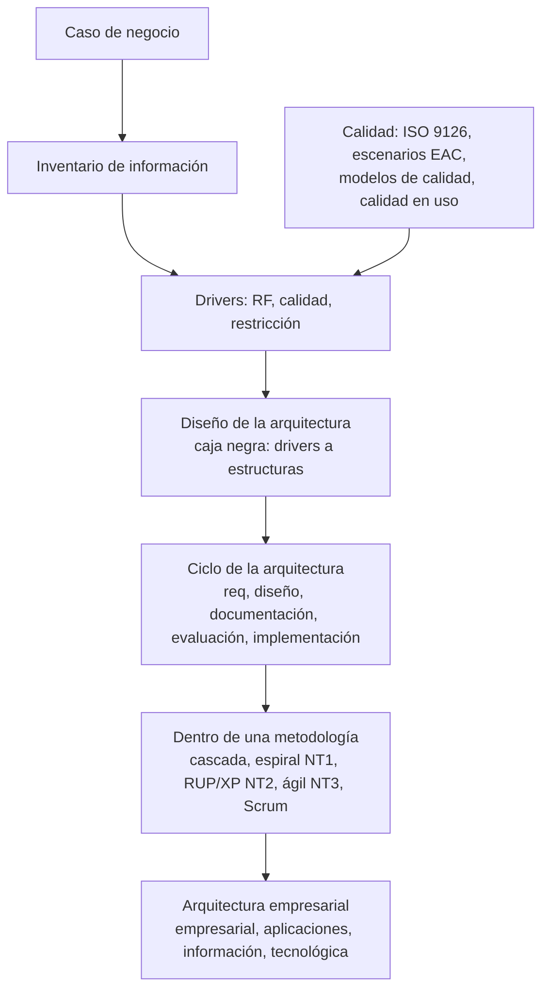

# Repaso — Parcial 3 (17 de octubre de 2026)

> [!important] Qué entra, según lo que sabemos
> El programa pone la **unidad 3** (*Arquitectura en el Ciclo de Vida*). El estudiante confirmó que
> entran también las dos lecturas de **calidad** (la NT de modelos de calidad y Covella). Las láminas de
> calidad de la clase del 16/10 (ISO 9126, escenarios) **probablemente** entran también: están en la
> misma tanda. Qué entra exactamente sigue siendo la duda 47.

**Cómo usar esta guía**: cada bloque tiene las **definiciones para citar**, las **listas que se
preguntan**, las **trampas** y una **autoevaluación** con la respuesta escondida. Primero leé el
bloque, después tapá y respondé.

---

## Mapa: cómo se conecta todo

**La idea de una línea**: *la arquitectura es la transformación de drivers en estructuras, que se
hace temprano y se sostiene durante todo el ciclo, sea cual sea la metodología; y la calidad es lo
que hace medibles a los drivers.*

---

## Bloque 1 — Metodologías: predictivo, ágil y Scrum

Notas: [[Metodologías predictivas y ágiles]] · [[Proceso Scrum en la arquitectura de software]]

| Para citar | |
|---|---|
| Frase de la lámina | *"Los mejores equipos entregan pronto y frecuentemente"* |
| Factores para elegir (7) | requerimientos (certidumbre) · estabilidad del alcance · cadencia de entrega (única, múltiples, periódicas) · riesgos · seguridad · proyecto · organización |
| Cascada | Requisitos → Diseño → Construcción → Pruebas → Entrega. *"Válido en entornos estables y con certidumbre"* |
| Por qué falla (6) | modelo de producción · el cliente *sabe* lo que quiere · los requisitos no cambian · planifica con información incompleta · la ejecución no se ajusta al plan · plan optimista: **planning fallacy** (Kahneman y Tversky, 1979) |
| Ágil | Planteamiento → requerimientos priorizados → iteración; ciclos de **1-4 semanas**, un entregable por ciclo (Mona Lisa: iterativo + incremental) |
| Valor | cascada: **una** flecha VALOR, al final · ágil: **una por iteración** |
| Roles Scrum | **Product Owner**: backlog, valor, historias, criterios de aceptación, visión, prioridades · **Scrum Master**: proceso, impedimentos, facilita, entrena (no es jefe) · **Development Team**: se autogestiona, incrementos *Done* |
| Regla del sprint | *"Sprint end date and team deliverable do not change"* |
| Ceremonias | planning (meta, re-priorizar, tareas, estimar, pila del sprint) · daily (qué hice, qué haré, problemas) · review (qué se terminó / qué no) · retrospective (qué bien, qué mejorar, qué intentar) |
| **Scrum en la arquitectura** | 14 pasos; los de arquitectura: **1** especificación de CDU · **2** priorización de CDU · **4** arquitectura base (**primer sprint**) · **9** refinamiento de la arquitectura (**sprint 1 al n**) |

> [!warning] Trampas
> - Ágil no es "siempre mejor": **depende de los factores**.
> - **Review** = producto; **retrospective** = proceso.
> - Sprint: **1-4** semanas en dos láminas, **2-4** en otra (duda 56).
> - En Scrum **sí hay arquitectura**: base temprana y refinamiento continuo.

> [!question]- Autoevaluación 1 (abrí para ver las respuestas)
> 1. *¿Qué siete factores deciden la metodología?* → requerimientos, estabilidad del alcance, cadencia de entrega, riesgos, seguridad, proyecto, organización.
> 2. *¿Qué es la planning fallacy?* → planificar de modo optimista (Kahneman y Tversky, 1979); una razón por la que falla la cascada.
> 3. *¿Cuándo es válida la cascada?* → en entornos estables y con certidumbre.
> 4. *¿Quién quita los impedimentos y quién prioriza el backlog?* → el Scrum Master; el Product Owner.
> 5. *¿En qué sprint se define la arquitectura base?* → en el primero (paso 4); se refina del 1 al n (paso 9).

---

## Bloque 2 — El diseño y el ciclo de la arquitectura

Notas: [[Proceso general de diseño de la arquitectura]] · [[Ciclo de desarrollo de la arquitectura]]
· [[Proceso de diseño arquitectónico]] · [[Arquitectura en el ciclo de vida del software]]

| Para citar | |
|---|---|
| Caja negra | entradas a la izquierda (**drivers**: RF, calidad, restricción), salidas a la derecha (**estructuras**), responsables arriba (**arquitecto**) |
| Definición | *"La etapa del diseño de la arquitectura puede verse como una **transformación**, que realiza el arquitecto, de los drivers hacia las distintas estructuras que componen a la arquitectura"* |
| Arquitectura (lámina en verde) | *"…la estructura o estructuras del sistema, la cual comprende los componentes de software, las propiedades externas visibles de estos elementos y las relaciones entre ellos"* |
| Niveles de diseño | arquitectura → interfaces → diseño detallado de módulos (con `«precede»` y retorno) |
| Ciclo interno | elegir un **subconjunto** de drivers → tomar decisiones de diseño → producir y evaluar el diseño **parcial** → volver |
| Ciclo de la arquitectura (5) | requerimientos → diseño → documentación → evaluación → implementación *(de la arquitectura)* |
| Desarrollo de sistemas (5) | requerimientos → diseño → construcción → pruebas → implantación (de *problemática u oportunidad* a *solución*) |
| **Mapeo** | req→req · **diseño, documentación y evaluación → Diseño** · implementación → **Construcción** · pruebas e implantación: sin etapa |
| Siete afirmaciones | requisitos funcionales y no funcionales · iterativo a través de requisitos y calidad · muchos stakeholders · primeras decisiones de diseño, estructura organizativa, restricciones, atributos · abstracción del sistema · **equilibrar requisitos funcionales y calidad** · afectada por organización, entorno y experiencia |
| Modelo del CV guiado por arquitecturas | caso de negocio → inventario de información → análisis de requerimientos → análisis global ↔ **diseño de arquitectura** (+ estándares, patrones, tácticas) → evaluación → análisis de riesgos → plan de desarrollo (diseño de detalle, código, testing) → testing de aceptación → implantación. Base: **gestión de configuración** y **aseguramiento de la calidad** |

> [!warning] Trampas
> - **Implementación de la arquitectura ≠ implantación.** La primera cae en Construcción; la segunda es poner en producción.
> - La arquitectura se **evalúa antes de construir**: la evaluación cae en Diseño.
> - El diagrama de clases es del **tercer** nivel (diseño detallado), no de la arquitectura.

> [!question]- Autoevaluación 2
> 1. *Dibujá la caja negra.* → drivers (RF, calidad, restricción) → **Diseño de la arquitectura** → estructuras; el arquitecto arriba.
> 2. *¿Por qué se elige un subconjunto de drivers?* → se diseña por partes: se decide, se produce un diseño parcial, se evalúa y se vuelve por el siguiente grupo.
> 3. *¿Dónde caen documentación y evaluación de la arquitectura?* → en el Diseño del sistema.
> 4. *¿Qué actividades del desarrollo no tienen etapa de arquitectura?* → pruebas e implantación.
> 5. *¿Qué hay en la base del modelo del CV guiado por arquitecturas?* → gestión de configuración y aseguramiento de la calidad.

---

## Bloque 3 — Las tres notas técnicas (NT1, NT2, NT3)

Notas: [[Arquitectura de software en el modelo en espiral]] · [[Arquitectura dirigida por modelos MDA]]
· [[Arquitectura de la información]] · [[Arquitectura ágil]] · [[Requisitos significativos para la arquitectura]]

| NT | Lo esencial |
|---|---|
| **NT1 — espiral** | Boehm **1986**; evolutivo e iterativo; lo nuevo es el **análisis de riesgo**. Avance angular = progreso; desplazamiento radial = costo acumulado. Cuatro actividades (apartado III): **objetivos y alternativas · análisis de riesgo · ingeniería · planificación** (la introducción da otra lista con *evaluación del cliente*, duda 48). La arquitectura analizada **y** usada como prototipo. **Integridad conceptual**: *"un pequeño número de mentes"*. Atributos "más comunes": escalabilidad, seguridad, desempeño, fiabilidad |
| **NT1 — MDA** | OMG; desarrollo como **transformación de modelos UML**. **CIM** (negocio) → **PIM** (sistema sin tecnología) → **PSM** (con tecnología) → **ISM** (código). Cartucho = reglas de transformación. Ventajas: separación de responsabilidades, productividad, portabilidad, mantenimiento y documentación. Estándares: UML, MOF, XMI, CWM. Resuelve la **pérdida de trazabilidad**; **minimiza** (no elimina) el riesgo. Desventajas: el artículo las anuncia y **no las da** |
| **NT2 — arquitectura de la información** | organiza **contenidos** para el usuario (categorías, etiquetas, navegación); **no es la AS**. Wurman, AIfIA. Tres etapas: **investigación → organización → diseño** = Inicio/Elaboración/Construcción (RUP) = Exploración/Planificación/Producción (XP). En RUP la AI y la AS salen en **Elaboración**. Entregables de clase: **inventario, mapa, diagrama funcional** |
| **NT3 — arquitectura ágil** | ágil y AS parecían incompatibles (requisitos que cambian vs decisiones tempranas); la **arquitectura ágil** las une con los **RSA** |
| **RSA** | requisito con **impacto medible** (Chen 2013) / **esencial** (NT1); si falta, la arquitectura sería **totalmente diferente**. Suelen ser no funcionales **pero también funcionales**. Subjetivos, relativos, interactúan (tradeoff). Captura: categorizar decisiones (Chen), entrevistas, objetivos de negocio, **escenarios** (Bass) |

> [!warning] Trampas
> - Plataforma en el **PSM**, no en el PIM.
> - RSA ≠ "no funcional".
> - **Hay dos NT1**: trazabilidad (unidad 1) y AS/CCV (unidad 3). Decí cuál.
> - "Arquitectura de la información": en la NT2 son **contenidos**; en la lámina de dominios, **datos** (duda 57).

> [!question]- Autoevaluación 3
> 1. *¿Qué agrega la espiral respecto de otros modelos?* → el análisis de riesgo en cada vuelta.
> 2. *¿En qué modelo de MDA entra la plataforma?* → en el PSM.
> 3. *¿Qué problema de los ciclos tradicionales resuelve MDA?* → la pérdida de trazabilidad entre artefactos; regenerando desde el PIM la traza queda garantizada.
> 4. *¿Con qué fases de RUP y XP se corresponde la etapa de organización de la AI?* → Elaboración y Planificación.
> 5. *Dá un RSA funcional.* → "el paciente reserva desde el celular": obliga a una capa móvil y a exponer un servicio.

---

## Bloque 4 — Arquitectura empresarial

Nota: [[Arquitectura empresarial]]

| Dominio | Definición de la lámina |
|---|---|
| **Empresarial** | estrategia de la empresa, servicios ofrecidos, organización y capacidades para prestarlos |
| **De aplicaciones** | cartera de aplicaciones, integración y cómo los activos de TI respaldan procesos y servicios |
| **De la información** | requisitos de información y **modelo de datos**; que los datos se gestionen para el negocio |
| **Tecnológica** | tecnologías (software y hardware) que soportan aplicaciones y datos, y **cómo se despliegan** |

El **diagrama de comunicación** (ejemplo PIENSA) muestra zonas, dispositivos y enlaces: producción,
gestión, stock, servidor con redundancia, router cortafuegos, Internet y GSM.

---

## Bloque 5 — Calidad: ISO 9126, 25000, observables y escenarios

Notas: [[Calidad del software]] · [[Norma ISO 9126]] · [[Familia de normas ISO 25000]] ·
[[Atributos observables y no observables vía ejecución]] · [[Escenarios de calidad]]

| Para citar | |
|---|---|
| Calidad (clase) | *"Proceso eficaz de software que se aplica de manera que crea un producto útil que proporciona valor medible a quienes lo producen y a quienes lo utilizan"* |
| ISO 9000:2000 | *"grado en el que un conjunto de características inherentes cumple con los requisitos"* |
| Garvin (5) | trascendental · usuario · fabricante · producto · valor |
| Fuentes de errores | requerimientos **56 %** · diseño **27 %** · programación 7 % · otros 10 % |
| ISO 9126 | *"La totalidad de características de un producto de software que se manifiesta en su habilidad para satisfacer necesidades establecidas o implícitas"*; **6**: funcionalidad, fiabilidad (= confiabilidad), usabilidad, eficiencia, mantenibilidad, portabilidad |
| Tres puntos | requisitos = base de la medición · estándares guían el trabajo · **requisitos implícitos** (ej.: mantenibilidad) |
| Modelos antiguos | **McCall (1977)** y **Boehm (1978)**, jerárquicos hasta primitivas medibles |
| Subcaracterísticas | la **rueda** tiene 27 (cada característica con su *cumplimiento*); la tabla, 21 con otros nombres |
| ISO 25000 | 2500n gestión · 2501n modelo · 2502n medición · 2503n requisitos · 2504n evaluación |
| Bass 1998 | **observables** (en ejecución): disponibilidad, funcionalidad, confidencialidad, desempeño · **no observables** (en el desarrollo): interoperabilidad, portabilidad, escalabilidad, mantenibilidad |
| Escenario (EAC) | fuente (u origen) del estímulo · estímulo · entorno · artefacto · respuesta · **medida** (*"criterio para testear el requerimiento"*) · atributo afectado |

> [!warning] Trampas
> - Seguridad está **dentro de funcionalidad** en ISO 9126.
> - La lámina 17 se titula *NO observables* pero lista **observables** (duda 52).
> - Sus ejemplos de escenario tienen medidas **sin número**: en el examen, poné número con unidad.

> [!question]- Autoevaluación 5
> 1. *Nombrá las seis características de ISO 9126 y dónde cae la seguridad.* → funcionalidad, fiabilidad, usabilidad, eficiencia, mantenibilidad, portabilidad; seguridad dentro de funcionalidad.
> 2. *¿Qué división de ISO 25000 trata la medición?* → la 2502n.
> 3. *¿Qué partes tiene un escenario de calidad?* → fuente, estímulo, entorno, artefacto, respuesta, medida, más el atributo afectado.
> 4. *¿Dónde nace la mayoría de los errores?* → en requerimientos (56 %) y diseño (27 %).

---

## Bloque 6 — Modelos de calidad (NT) y calidad en uso (Covella)

Notas: [[Modelos de calidad del software]] · [[Calidad en uso]]

| Para citar | |
|---|---|
| Pressman | concordancia con requisitos explícitos, estándares documentados y características implícitas |
| IEEE 1990 | *"el grado con el que un sistema, componente o proceso cumple los requerimientos especificados y las necesidades o expectativas del cliente o usuario"* |
| Modelo de calidad (Scalone) | documentos que integran las mejores prácticas y **permiten medir los avances en calidad** |
| Estructura | **factor → criterio → métrica** |
| Enfoques (3) | **proceso** · **producto** (interna, externa, en uso) · **calidad en uso** |
| De proceso | ITIL 1989 · ISO 15504 1993 · Dromey 1995 · PSP 1995 · Bootstrap, TSP, IEEE 12207, Cobit 1996 · ISO 90003 1997 · **CMMI 2000** · ISO 20000 2005 |
| De producto | **McCall 1977** · GQM 1984 · Boehm 1986 (sic) · **FURPS 1987** · Gilb 1988 · **ISO 9126 1991** · SQAE 1997 · WebQEM 1998 · **ISO 25000 2005** |
| CMMI | escalonada: **5** niveles de madurez (inicial, gestionado, definido, gestionado cuantitativamente, en optimización) · continua: **6** de capacidad (0 incompleto a 5) |
| Otros números | ISO 15504: 6 niveles (0-5) · McCall: 11 criterios · Cobit: 7 criterios · Bootstrap: 6 actividades · ISO 9126: 4 partes · ISO 25000: 8 características |
| Calidad en uso | *"…alcanzar metas específicas con **eficacia, productividad, seguridad y satisfacción** en un contexto específico de uso"*; se mide sobre **los resultados de usar** el software |
| Interna/externa/uso | medir en uso valida la externa; la externa valida la interna |
| Usabilidad ≠ calidad en uso | usabilidad es **una característica**; calidad en uso es un **modelo** más amplio. Nielsen: aprendizaje, eficiencia, memorización, pocos errores, satisfacción |
| Medición (INCAMI) | métrica **directa** (método objetivo o subjetivo) / **indirecta** (fórmula). Escalas: categórica o numérica; nominal, ordinal, intervalo, proporción, absoluta. **Indicador** = métrica + modelo elemental + **criterios de decisión** |
| Caso QPlus | 6 usuarios, 4 tareas, umbral 70 %: global **57,45 %**; solo la **satisfacción** (87 %) superó el umbral |

> [!warning] Trampas
> - **Boehm**: la NT lo fecha en 1986 y lo describe con el espiral. Como **modelo de calidad**, la lámina dice 1978 (duda 55).
> - CMMI **escalonado = madurez (5)**, **continuo = capacidad (6)**.
> - "Habilidad" en la NT es **fiabilidad**; "TPS" es **TSP**.
> - Una métrica sola **no** dice si se cumple el requisito: hace falta el **indicador**.

> [!question]- Autoevaluación 6
> 1. *Clasificá CMMI, McCall, ITIL y FURPS.* → proceso, producto, proceso, producto.
> 2. *¿Cuál es la estructura general de un modelo de calidad?* → factor, criterio, métrica.
> 3. *¿Cuáles son las características de la calidad en uso?* → eficacia, productividad, seguridad, satisfacción.
> 4. *¿Por qué hace falta un indicador además de la métrica?* → el valor de la métrica no dice si se cumple; el indicador lo interpreta contra criterios de decisión.
> 5. *¿Qué concluyó el caso QPlus?* → los usuarios estaban satisfechos aunque no fueron eficaces ni productivos.

---

## Si piden desarrollar un tema largo: el molde

1. **Definición citable**, con su fuente (lámina, NT o lectura).
2. **Para qué existe** en una línea.
3. **La lista o el diagrama** (caja negra, mapeo, cuatro dominios, factor-criterio-métrica).
4. **Un ejemplo** del curso (FarmaHosp, Harley-Davidson, READM, QPlus).
5. **La trampa** dicha antes de que la marquen.

## Las dudas abiertas que pueden afectar una respuesta

| # | Duda | Qué contestar mientras tanto |
|---|---|---|
| 48 | las 4 actividades del espiral | las del apartado III, nombrando la otra lista |
| 52 | tabla con título invertido | contestar con el árbol |
| 54 | medidas sin número | poner número |
| 55 | Boehm 1978 o 1986 | calidad: 1978 jerárquico · espiral: 1986 |
| 56 | sprint 1-4 o 2-4 | "de 1 a 4 semanas" y nombrar la otra |
| 57 | AI: contenidos o datos | declarar cuál; para la unidad 3, contenidos (NT2) |

Tarjetas para repasar con repetición espaciada: [[Flashcards - Metodologías, Scrum y ciclo de la arquitectura]],
[[Flashcards - Modelos de calidad y calidad en uso]], [[Flashcards - Calidad del software e ISO 9126]],
[[Flashcards - Arquitectura de la información y ágil]], [[Flashcards - MDA y modelo en espiral]].
